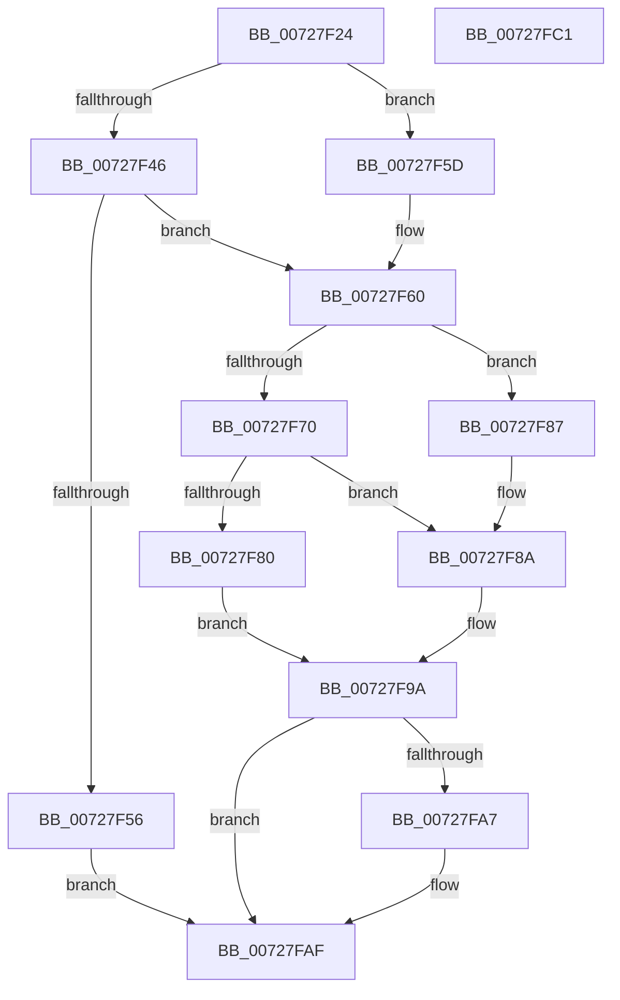

# PipSetDependency

- RVA: `0x00727F24`–`0x00727FC2` (길이 `158` bytes)
- VA: `0x0000000140727F24`
- 실행 섹션: `PAGE`
- PDB 이름 있음: `예`; PDB Function 태그: `아니요`
- unwind 정보 RVA: `0x00060BC4`
- 디코드: `49`개 명령, `158/158` bytes 표시
- 미해석 바이트: `0` (있으면 어셈블리에 `.byte`로 보존)

> 이 문서는 커널 이미지의 기계어와 PDB 기호를 분석해 생성했습니다. 4번과 5번은 함수 원형과 자료형을 바이너리 사용 방식에서 추정한 C 해석이며 원본 소스 복구 결과는 아닙니다.

## 1. Dependencies

- 직접 호출 지점: **7**; 고유 호출 대상: **4**
- 직접 호출자로 확인된 함수: **3**
- RIP 상대 이미지 참조: **0**

### Outgoing calls
- `0x00727F39` → [PipQueryBindingResolution](../A8/PipQueryBindingResolution_function_00A85310.md) (function, `0x00A85310`)
- `0x00727F49` → [PipCreateDependencyNode](PipCreateDependencyNode_function_00727B0C.md) (function, `0x00727B0C`)
- `0x00727F63` → [PipQueryBindingResolution](../A8/PipQueryBindingResolution_function_00A85310.md) (function, `0x00A85310`)
- `0x00727F73` → [PipCreateDependencyNode](PipCreateDependencyNode_function_00727B0C.md) (function, `0x00727B0C`)
- `0x00727F93` → [PipAddDependencyEdgeBetweenNodes](../../text/5A/PipAddDependencyEdgeBetweenNodes_function_005A5520.md) (function, `0x005A5520`)
- `0x00727F9D` → [PipDereferenceDependencyNode](../AC/PipDereferenceDependencyNode_function_00ACD5A0.md) (function, `0x00ACD5A0`)
- `0x00727FAA` → [PipDereferenceDependencyNode](../AC/PipDereferenceDependencyNode_function_00ACD5A0.md) (function, `0x00ACD5A0`)

### Direct callers
- [IoReserveDependency](IoReserveDependency_function_007276B0.md) at `0x00727714`
- [IoSetDependency](IoSetDependency_function_00727740.md) at `0x007277B0`
- [PipConvertResolutionsToReservations](../AD/PipConvertResolutionsToReservations_function_00AD59D4.md) at `0x00AD5A50`

### Static image references
- 디코드된 RIP-relative 메모리 참조가 없습니다.

## 2. Other-region calls and transfers

- 다른 실행 섹션으로 향하는 call: **1**
  - `0x00727F93` → [PipAddDependencyEdgeBetweenNodes](../../text/5A/PipAddDependencyEdgeBetweenNodes_function_005A5520.md) (`PAGE` → `.text`)
- 별도 외부 분기/꼬리 이동을 확인하지 못했습니다.

## 3. Assembly (complete function range)

```asm
00727F24  48 89 5C 24 08                  mov qword ptr [rsp + 8], rbx
00727F29  48 89 74 24 10                  mov qword ptr [rsp + 0x10], rsi
00727F2E  57                              push rdi
00727F2F  48 83 EC 20                     sub rsp, 0x20
00727F33  48 8B FA                        mov rdi, rdx
00727F36  48 8B D9                        mov rbx, rcx
00727F39  E8 D2 D3 35 00                  call 0x140a85310
00727F3E  48 8B F0                        mov rsi, rax
00727F41  48 85 C0                        test rax, rax
00727F44  75 17                           jne 0x140727f5d
00727F46  48 8B CB                        mov rcx, rbx
00727F49  E8 BE FB FF FF                  call 0x140727b0c
00727F4E  48 8B F0                        mov rsi, rax
00727F51  48 85 C0                        test rax, rax
00727F54  75 0A                           jne 0x140727f60
00727F56  BF 9A 00 00 C0                  mov edi, 0xc000009a
00727F5B  EB 52                           jmp 0x140727faf
00727F5D  FF 40 58                        inc dword ptr [rax + 0x58]
00727F60  48 8B CF                        mov rcx, rdi
00727F63  E8 A8 D3 35 00                  call 0x140a85310
00727F68  48 8B D8                        mov rbx, rax
00727F6B  48 85 C0                        test rax, rax
00727F6E  75 17                           jne 0x140727f87
00727F70  48 8B CF                        mov rcx, rdi
00727F73  E8 94 FB FF FF                  call 0x140727b0c
00727F78  48 8B D8                        mov rbx, rax
00727F7B  48 85 C0                        test rax, rax
00727F7E  75 0A                           jne 0x140727f8a
00727F80  BF 9A 00 00 C0                  mov edi, 0xc000009a
00727F85  EB 13                           jmp 0x140727f9a
00727F87  FF 40 58                        inc dword ptr [rax + 0x58]
00727F8A  4C 8B C7                        mov r8, rdi
00727F8D  48 8B D3                        mov rdx, rbx
00727F90  48 8B CE                        mov rcx, rsi
00727F93  E8 88 D5 E7 FF                  call 0x1405a5520
00727F98  8B F8                           mov edi, eax
00727F9A  48 8B CE                        mov rcx, rsi
00727F9D  E8 FE 55 3A 00                  call 0x140acd5a0
00727FA2  48 85 DB                        test rbx, rbx
00727FA5  74 08                           je 0x140727faf
00727FA7  48 8B CB                        mov rcx, rbx
00727FAA  E8 F1 55 3A 00                  call 0x140acd5a0
00727FAF  48 8B 5C 24 30                  mov rbx, qword ptr [rsp + 0x30]
00727FB4  8B C7                           mov eax, edi
00727FB6  48 8B 74 24 38                  mov rsi, qword ptr [rsp + 0x38]
00727FBB  48 83 C4 20                     add rsp, 0x20
00727FBF  5F                              pop rdi
00727FC0  C3                              ret
00727FC1  CC                              int3
```

## 4. C-style interpretation (structured pseudocode)

```c
__int64 __fastcall PipSetDependency(__int64 a1, __int64 a2)
{
    __int64 result;
    __int64 v_rsp;
    unsigned __int64 v_stack_p10;
    unsigned __int64 v_stack_p8;

    v_stack_p8 = v_rbx;
    v_stack_p10 = v_rsi;
    v_rsp = (v_rsp) - (32);
    result = PipQueryBindingResolution(a1, a2, a3, a4);
    if (result != 0) goto loc_00727F5D;
    result = PipCreateDependencyNode(a1, a2, a3, a4);
    if (result != 0) goto loc_00727F60;
    goto loc_00727FAF;
loc_00727F5D:
loc_00727F60:
    result = PipQueryBindingResolution((unsigned int)(0xC000009AULL), a2, a3, a4);
    if (result != 0) goto loc_00727F87;
    result = PipCreateDependencyNode((unsigned int)(0xC000009AULL), a2, a3, a4);
    if (result != 0) goto loc_00727F8A;
    goto loc_00727F9A;
loc_00727F87:
loc_00727F8A:
    result = PipAddDependencyEdgeBetweenNodes(result, result, (unsigned int)(0xC000009AULL), a4);
loc_00727F9A:
    result = PipDereferenceDependencyNode(result, result, (unsigned int)(0xC000009AULL), a4);
    if (result != 0) {
        a1 = result;
        result = PipDereferenceDependencyNode(a1, result, (unsigned int)(0xC000009AULL), a4);
    }
    v_rsp = (v_rsp) + (32);
    return (unsigned int)((unsigned int)((unsigned int)((unsigned int)(result))));
}
```

## 5. (Beta) C Style

```c
int64_t PipSetDependency(int64_t Arg1, int64_t Arg2)
{
    int64_t result;
    int64_t local_rsp;
    uint64_t v_stack_p10;
    uint64_t v_stack_p8;

    v_stack_p8 = local_rbx;
    v_stack_p10 = local_rsi;
    local_rsp = (local_rsp) - (32);
    result = PipQueryBindingResolution(Arg1, Arg2, a3, a4);
    if (result != 0) goto loc_00727F5D;
    result = PipCreateDependencyNode(Arg1, Arg2, a3, a4);
    if (result != 0) goto loc_00727F60;
    goto loc_00727FAF;
loc_00727F5D:
loc_00727F60:
    result = PipQueryBindingResolution((uint32_t)(0xC000009AULL), Arg2, a3, a4);
    if (result != 0) goto loc_00727F87;
    result = PipCreateDependencyNode((uint32_t)(0xC000009AULL), Arg2, a3, a4);
    if (result != 0) goto loc_00727F8A;
    goto loc_00727F9A;
loc_00727F87:
loc_00727F8A:
    result = PipAddDependencyEdgeBetweenNodes(result, result, (uint32_t)(0xC000009AULL), a4);
loc_00727F9A:
    result = PipDereferenceDependencyNode(result, result, (uint32_t)(0xC000009AULL), a4);
    if (result != 0) {
        Arg1 = result;
        result = PipDereferenceDependencyNode(Arg1, result, (uint32_t)(0xC000009AULL), a4);
    }
    local_rsp = (local_rsp) + (32);
    return (uint32_t)((uint32_t)((uint32_t)((uint32_t)(result))));
}
```

## 6. Execution-region graph

[열기: 2D/3D 그래프와 함수 탐색 컨트롤 패널](../../../control-panel.html?section=page&rva=0x00727F24&view=graph)

- 2D 그래프는 위에서 아래로 흐르고, 3D 그래프는 빈 공간을 드래그해 회전합니다. Shift+드래그는 이동, 휠은 확대·축소, 함수 노드 선택은 대상 보고서 이동입니다.

### Static fallback


