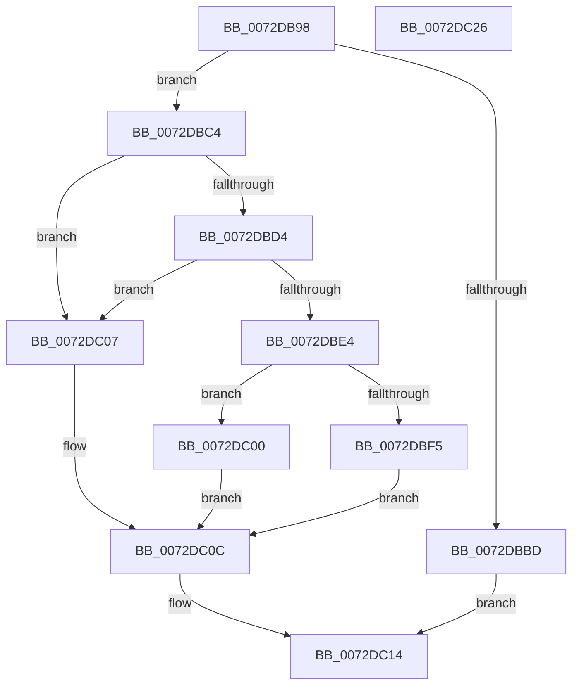

# PipSetDevNodeStateFlags

- RVA: `0x0072DB98`–`0x0072DC27` (길이 `143` bytes)
- VA: `0x000000014072DB98`
- 실행 섹션: `PAGE`
- PDB 이름 있음: `예`; PDB Function 태그: `아니요`
- unwind 정보 RVA: `0x0005CF00`
- 디코드: `40`개 명령, `143/143` bytes 표시
- 미해석 바이트: `0` (있으면 어셈블리에 `.byte`로 보존)

> 이 문서는 커널 이미지의 기계어와 PDB 기호를 분석해 생성했습니다. 4번과 5번은 함수 원형과 자료형을 바이너리 사용 방식에서 추정한 C 해석이며 원본 소스 복구 결과는 아닙니다.

## 1. Dependencies

- 직접 호출 지점: **4**; 고유 호출 대상: **4**
- 직접 호출자로 확인된 함수: **1**
- RIP 상대 이미지 참조: **0**

### Outgoing calls
- `0x0072DBA6` → [PpDevNodeLockTree](../A1/PpDevNodeLockTree_function_00A19310.md) (function, `0x00A19310`)
- `0x0072DBAE` → [IoGetDeviceAttachmentBaseRef](../../text/27/IoGetDeviceAttachmentBaseRef_function_00272710.md) (function, `0x00272710`)
- `0x0072DC0F` → [ObfDereferenceObject](../../text/2F/ObfDereferenceObject_function_002F9350.md) (function, `0x002F9350`)
- `0x0072DC19` → [PpDevNodeUnlockTree](../A2/PpDevNodeUnlockTree_function_00A21290.md) (function, `0x00A21290`)

### Direct callers
- [IopQueueDeviceResetEvent](IopQueueDeviceResetEvent_function_0072AB14.md) at `0x0072AB8E`

### Static image references
- 디코드된 RIP-relative 메모리 참조가 없습니다.

## 2. Other-region calls and transfers

- 다른 실행 섹션으로 향하는 call: **2**
  - `0x0072DBAE` → [IoGetDeviceAttachmentBaseRef](../../text/27/IoGetDeviceAttachmentBaseRef_function_00272710.md) (`PAGE` → `.text`)
  - `0x0072DC0F` → [ObfDereferenceObject](../../text/2F/ObfDereferenceObject_function_002F9350.md) (`PAGE` → `.text`)
- 별도 외부 분기/꼬리 이동을 확인하지 못했습니다.

## 3. Assembly (complete function range)

```asm
0072DB98  40 53                           push rbx
0072DB9A  48 83 EC 20                     sub rsp, 0x20
0072DB9E  48 8B D9                        mov rbx, rcx
0072DBA1  B9 01 00 00 00                  mov ecx, 1
0072DBA6  E8 65 B7 2E 00                  call 0x140a19310
0072DBAB  48 8B CB                        mov rcx, rbx
0072DBAE  E8 5D 4B B4 FF                  call 0x140272710
0072DBB3  33 DB                           xor ebx, ebx
0072DBB5  48 8B D0                        mov rdx, rax
0072DBB8  48 85 C0                        test rax, rax
0072DBBB  75 07                           jne 0x14072dbc4
0072DBBD  BB 10 00 00 C0                  mov ebx, 0xc0000010
0072DBC2  EB 50                           jmp 0x14072dc14
0072DBC4  48 8B 80 38 01 00 00            mov rax, qword ptr [rax + 0x138]
0072DBCB  48 8B 48 28                     mov rcx, qword ptr [rax + 0x28]
0072DBCF  48 85 C9                        test rcx, rcx
0072DBD2  74 33                           je 0x14072dc07
0072DBD4  8B 81 2C 01 00 00               mov eax, dword ptr [rcx + 0x12c]
0072DBDA  2D 15 03 00 00                  sub eax, 0x315
0072DBDF  83 F8 01                        cmp eax, 1
0072DBE2  76 23                           jbe 0x14072dc07
0072DBE4  8B 81 C0 02 00 00               mov eax, dword ptr [rcx + 0x2c0]
0072DBEA  41 B8 00 80 00 00               mov r8d, 0x8000
0072DBF0  41 85 C0                        test r8d, eax
0072DBF3  75 0B                           jne 0x14072dc00
0072DBF5  41 0B C0                        or eax, r8d
0072DBF8  89 81 C0 02 00 00               mov dword ptr [rcx + 0x2c0], eax
0072DBFE  EB 0C                           jmp 0x14072dc0c
0072DC00  BB FF 00 00 00                  mov ebx, 0xff
0072DC05  EB 05                           jmp 0x14072dc0c
0072DC07  BB 56 00 00 C0                  mov ebx, 0xc0000056
0072DC0C  48 8B CA                        mov rcx, rdx
0072DC0F  E8 3C B7 BC FF                  call 0x1402f9350
0072DC14  B9 01 00 00 00                  mov ecx, 1
0072DC19  E8 72 36 2F 00                  call 0x140a21290
0072DC1E  8B C3                           mov eax, ebx
0072DC20  48 83 C4 20                     add rsp, 0x20
0072DC24  5B                              pop rbx
0072DC25  C3                              ret
0072DC26  CC                              int3
```

## 4. C-style interpretation (structured pseudocode)

```c
__int64 __fastcall PipSetDevNodeStateFlags(__int64 a1)
{
    __int64 result;
    __int64 v_rbx;
    __int64 v_rsp;

    v_rsp = (v_rsp) - (32);
    result = PpDevNodeLockTree(1, a2, a3, a4);
    result = IoGetDeviceAttachmentBaseRef(a1, a2, a3, a4);
    v_rbx = 0;
    if (result != 0) goto loc_0072DBC4;
    goto loc_0072DC14;
loc_0072DBC4:
    if (*(unsigned __int64 *)(*(unsigned __int64 *)(result + 312) + 40) == 0) goto loc_0072DC07;
    result = (unsigned int)(((unsigned int)(*(unsigned int *)(*(unsigned __int64 *)(*(unsigned __int64 *)(result + 312) + 40) + 300))) - (789));
    if (((unsigned int)(result)) <= 1) goto loc_0072DC07;
    if ((((unsigned int)((unsigned int)(0x8000ULL))) & ((unsigned int)((unsigned int)(*(unsigned int *)(*(unsigned __int64 *)(*(unsigned __int64 *)(result + 312) + 40) + 704))))) != 0) goto loc_0072DC00;
    result = (unsigned int)(((unsigned int)(*(unsigned int *)(*(unsigned __int64 *)(*(unsigned __int64 *)(result + 312) + 40) + 704))) | ((unsigned int)((unsigned int)(0x8000ULL))));
    *(unsigned int *)(*(unsigned __int64 *)(*(unsigned __int64 *)(result + 312) + 40) + 704) = (unsigned int)(result);
    goto loc_0072DC0C;
loc_0072DC00:
    goto loc_0072DC0C;
loc_0072DC07:
loc_0072DC0C:
    result = ObfDereferenceObject(result, result, (unsigned int)(0x8000ULL), a4);
loc_0072DC14:
    result = PpDevNodeUnlockTree(1, result, (unsigned int)(0x8000ULL), a4);
    v_rsp = (v_rsp) + (32);
    return (unsigned int)((unsigned int)((unsigned int)(0xC0000056ULL)));
}
```

## 5. (Beta) C Style

```c
int64_t PipSetDevNodeStateFlags(int64_t Arg1)
{
    int64_t result;
    int64_t local_rbx;
    int64_t local_rsp;

    local_rsp = (local_rsp) - (32);
    result = PpDevNodeLockTree(1, a2, a3, a4);
    result = IoGetDeviceAttachmentBaseRef(Arg1, a2, a3, a4);
    local_rbx = 0;
    if (result != 0) goto loc_0072DBC4;
    goto loc_0072DC14;
loc_0072DBC4:
    if (*(uint64_t *)(*(uint64_t *)(result + 0x138) + 0x28) == 0) goto loc_0072DC07;
    result = (uint32_t)(((uint32_t)(*(uint32_t *)(*(uint64_t *)(*(uint64_t *)(result + 0x138) + 0x28) + 0x12C))) - (789));
    if (((uint32_t)(result)) <= 1) goto loc_0072DC07;
    if ((((uint32_t)((uint32_t)(0x8000ULL))) & ((uint32_t)((uint32_t)(*(uint32_t *)(*(uint64_t *)(*(uint64_t *)(result + 0x138) + 0x28) + 0x2C0))))) != 0) goto loc_0072DC00;
    result = (uint32_t)(((uint32_t)(*(uint32_t *)(*(uint64_t *)(*(uint64_t *)(result + 0x138) + 0x28) + 0x2C0))) | ((uint32_t)((uint32_t)(0x8000ULL))));
    *(uint32_t *)(*(uint64_t *)(*(uint64_t *)(result + 0x138) + 0x28) + 0x2C0) = (uint32_t)(result);
    goto loc_0072DC0C;
loc_0072DC00:
    goto loc_0072DC0C;
loc_0072DC07:
loc_0072DC0C:
    result = ObfDereferenceObject(result, result, (uint32_t)(0x8000ULL), a4);
loc_0072DC14:
    result = PpDevNodeUnlockTree(1, result, (uint32_t)(0x8000ULL), a4);
    local_rsp = (local_rsp) + (32);
    return (uint32_t)((uint32_t)((uint32_t)(0xC0000056ULL)));
}
```

## 6. Execution-region graph

[열기: 2D/3D 그래프와 함수 탐색 컨트롤 패널](../../../control-panel.html?section=page&rva=0x0072DB98&view=graph)

- 2D 그래프는 위에서 아래로 흐르고, 3D 그래프는 빈 공간을 드래그해 회전합니다. Shift+드래그는 이동, 휠은 확대·축소, 함수 노드 선택은 대상 보고서 이동입니다.

### Static fallback


