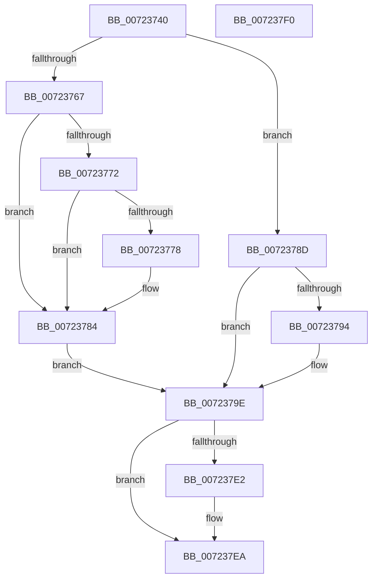

# PipUpdateAsyncOptionsCallback

- RVA: `0x00723740`–`0x007237F1` (길이 `177` bytes)
- VA: `0x0000000140723740`
- 실행 섹션: `PAGE`
- PDB 이름 있음: `예`; PDB Function 태그: `아니요`
- unwind 정보 RVA: `0x00071A74`
- 디코드: `44`개 명령, `177/177` bytes 표시
- 미해석 바이트: `0` (있으면 어셈블리에 `.byte`로 보존)

> 이 문서는 커널 이미지의 기계어와 PDB 기호를 분석해 생성했습니다. 4번과 5번은 함수 원형과 자료형을 바이너리 사용 방식에서 추정한 C 해석이며 원본 소스 복구 결과는 아닙니다.

## 1. Dependencies

- 직접 호출 지점: **4**; 고유 호출 대상: **4**
- 직접 호출자로 확인된 함수: **1**
- RIP 상대 이미지 참조: **4**

### Outgoing calls
- `0x0072375E` → [IopGetRegistryValue](../99/IopGetRegistryValue_function_009990EC.md) (function, `0x009990EC`)
- `0x00723786` → [ExFreePoolWithTag](../../poolcode/B8/ExFreePoolWithTag_function_00B82870.md) (function, `0x00B82870`)
- `0x007237D9` → [ZwNotifyChangeKey](../../text/6A/ZwNotifyChangeKey_function_006AF550.md) (function, `0x006AF550`)
- `0x007237E5` → [ZwClose](../../text/6A/ZwClose_function_006AD2B0.md) (function, `0x006AD2B0`)

### Direct callers
- [IopInitializePlugPlayServices](../../init/C2/IopInitializePlugPlayServices_function_00C2F298.md) at `0x00C2F7A7`

### Static image references
- `0x00723754` → RVA `0x00AFD210` (` ?? ::NNGAKEGL::`string'`; read)
- `0x0072377E` → RVA `0x00E0AA18` (`.data`; write)
- `0x007237A3` → RVA `0x00F8CF60` (`.data`; read)
- `0x007237AF` → RVA `0x00F8CF80` (`.data`; read)

## 2. Other-region calls and transfers

- 다른 실행 섹션으로 향하는 call: **3**
  - `0x00723786` → [ExFreePoolWithTag](../../poolcode/B8/ExFreePoolWithTag_function_00B82870.md) (`PAGE` → `POOLCODE`)
  - `0x007237D9` → [ZwNotifyChangeKey](../../text/6A/ZwNotifyChangeKey_function_006AF550.md) (`PAGE` → `.text`)
  - `0x007237E5` → [ZwClose](../../text/6A/ZwClose_function_006AD2B0.md) (`PAGE` → `.text`)
- 별도 외부 분기/꼬리 이동을 확인하지 못했습니다.

## 3. Assembly (complete function range)

```asm
00723740  40 53                           push rbx
00723742  48 83 EC 50                     sub rsp, 0x50
00723746  48 83 64 24 60 00               and qword ptr [rsp + 0x60], 0
0072374C  4C 8D 4C 24 60                  lea r9, [rsp + 0x60]
00723751  45 33 C0                        xor r8d, r8d
00723754  48 8D 15 B5 9A 3D 00            lea rdx, [rip + 0x3d9ab5]
0072375B  48 8B D9                        mov rbx, rcx
0072375E  E8 89 59 27 00                  call 0x1409990ec
00723763  85 C0                           test eax, eax
00723765  78 26                           js 0x14072378d
00723767  48 8B 4C 24 60                  mov rcx, qword ptr [rsp + 0x60]
0072376C  83 79 04 04                     cmp dword ptr [rcx + 4], 4
00723770  75 12                           jne 0x140723784
00723772  83 79 0C 04                     cmp dword ptr [rcx + 0xc], 4
00723776  75 0C                           jne 0x140723784
00723778  8B 41 08                        mov eax, dword ptr [rcx + 8]
0072377B  8B 14 08                        mov edx, dword ptr [rax + rcx]
0072377E  89 15 94 72 6E 00               mov dword ptr [rip + 0x6e7294], edx
00723784  33 D2                           xor edx, edx
00723786  E8 E5 F0 45 00                  call 0x140b82870
0072378B  EB 11                           jmp 0x14072379e
0072378D  3D 34 00 00 C0                  cmp eax, 0xc0000034
00723792  75 0A                           jne 0x14072379e
00723794  C7 05 7A 72 6E 00 03 00 00 80   mov dword ptr [rip + 0x6e727a], 0x80000003
0072379E  C6 44 24 48 01                  mov byte ptr [rsp + 0x48], 1
007237A3  48 8D 05 B6 97 86 00            lea rax, [rip + 0x8697b6]
007237AA  83 64 24 40 00                  and dword ptr [rsp + 0x40], 0
007237AF  4C 8D 05 CA 97 86 00            lea r8, [rip + 0x8697ca]
007237B6  48 83 64 24 38 00               and qword ptr [rsp + 0x38], 0
007237BC  41 B9 01 00 00 00               mov r9d, 1
007237C2  C6 44 24 30 00                  mov byte ptr [rsp + 0x30], 0
007237C7  33 D2                           xor edx, edx
007237C9  C7 44 24 28 04 00 00 00         mov dword ptr [rsp + 0x28], 4
007237D1  48 8B CB                        mov rcx, rbx
007237D4  48 89 44 24 20                  mov qword ptr [rsp + 0x20], rax
007237D9  E8 72 BD F8 FF                  call 0x1406af550
007237DE  85 C0                           test eax, eax
007237E0  79 08                           jns 0x1407237ea
007237E2  48 8B CB                        mov rcx, rbx
007237E5  E8 C6 9A F8 FF                  call 0x1406ad2b0
007237EA  48 83 C4 50                     add rsp, 0x50
007237EE  5B                              pop rbx
007237EF  C3                              ret
007237F0  CC                              int3
```

## 4. C-style interpretation (structured pseudocode)

```c
__int64 __fastcall PipUpdateAsyncOptionsCallback(__int64 a1, __int64 a2, int a3)
{
    __int64 result;
    __int64 v_rsp;
    unsigned __int8 v_stack_m10;
    unsigned int v_stack_m18;
    unsigned __int64 v_stack_m20;
    unsigned __int8 v_stack_m28;
    unsigned int v_stack_m30;
    unsigned __int64 v_stack_m38;
    unsigned __int64 v_stack_p8;

    v_rsp = (v_rsp) - (80);
    a3 = 0;
    result = IopGetRegistryValue(a1, v_rip + 4037301, a3, v_stack_p8);
    if (sign_flag) goto loc_0072378D;
    if ((*(unsigned int *)(v_stack_p8 + 4)) != 4) goto loc_00723784;
    if ((*(unsigned int *)(v_stack_p8 + 12)) == 4) {
        result = *(unsigned int *)(v_stack_p8 + 8);
        a2 = *(unsigned int *)(result + v_stack_p8 * 1);
        *(unsigned int *)(v_rip + 7238292) = (unsigned int)(a2);
    }
    a2 = 0;
    result = ExFreePoolWithTag(v_stack_p8, a2, a3, v_stack_p8);
    goto loc_0072379E;
loc_0072378D:
    if (((unsigned int)(result)) == 0xC0000034ULL) {
        *(unsigned int *)(v_rip + 7238266) = 0x80000003ULL;
    }
    v_stack_m10 = 1;
    v_stack_m28 = 0;
    a2 = 0;
    v_stack_m30 = 4;
    v_stack_m38 = v_rip + 8820662;
    result = ZwNotifyChangeKey(a1, a2, v_rip + 8820682, 1);
    if (sign_flag) {
        a1 = a1;
        result = ZwClose(a1, a2, v_rip + 8820682, 1);
    }
    v_rsp = (v_rsp) + (80);
    return result;
}
```

## 5. (Beta) C Style

```c
int64_t PipUpdateAsyncOptionsCallback(int64_t Arg1, int64_t Arg2, int32_t Arg3)
{
    int64_t result;
    int64_t local_rsp;
    uint8_t v_stack_m10;
    uint32_t v_stack_m18;
    uint64_t v_stack_m20;
    uint8_t v_stack_m28;
    uint32_t v_stack_m30;
    uint64_t v_stack_m38;
    uint64_t v_stack_p8;

    local_rsp = (local_rsp) - (80);
    Arg3 = 0;
    result = IopGetRegistryValue(Arg1, v_rip + 4037301, Arg3, v_stack_p8);
    if (sign_flag) goto loc_0072378D;
    if ((*(uint32_t *)(v_stack_p8 + 0x4)) != 4) goto loc_00723784;
    if ((*(uint32_t *)(v_stack_p8 + 0xC)) == 4) {
        result = *(uint32_t *)(v_stack_p8 + 0x8);
        Arg2 = *(uint32_t *)(result + v_stack_p8 * 1);
        *(uint32_t *)(v_rip + 0x6E7294) = (uint32_t)(Arg2);
    }
    Arg2 = 0;
    result = ExFreePoolWithTag(v_stack_p8, Arg2, Arg3, v_stack_p8);
    goto loc_0072379E;
loc_0072378D:
    if (((uint32_t)(result)) == 0xC0000034ULL) {
        *(uint32_t *)(v_rip + 0x6E727A) = 0x80000003ULL;
    }
    v_stack_m10 = 1;
    v_stack_m28 = 0;
    Arg2 = 0;
    v_stack_m30 = 4;
    v_stack_m38 = v_rip + 8820662;
    result = ZwNotifyChangeKey(Arg1, Arg2, v_rip + 8820682, 1);
    if (sign_flag) {
        Arg1 = Arg1;
        result = ZwClose(Arg1, Arg2, v_rip + 8820682, 1);
    }
    local_rsp = (local_rsp) + (80);
    return result;
}
```

## 6. Execution-region graph

[열기: 2D/3D 그래프와 함수 탐색 컨트롤 패널](../../../control-panel.html?section=page&rva=0x00723740&view=graph)

- 2D 그래프는 위에서 아래로 흐르고, 3D 그래프는 빈 공간을 드래그해 회전합니다. Shift+드래그는 이동, 휠은 확대·축소, 함수 노드 선택은 대상 보고서 이동입니다.

### Static fallback


