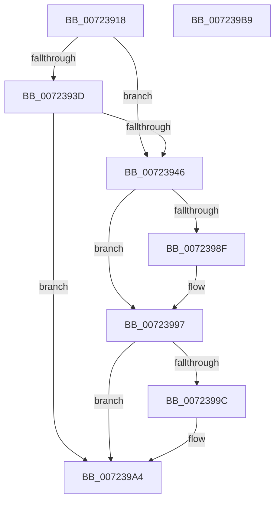

# PipUpdateSetupInProgressNotify

- RVA: `0x00723918`–`0x007239BA` (길이 `162` bytes)
- VA: `0x0000000140723918`
- 실행 섹션: `PAGE`
- PDB 이름 있음: `예`; PDB Function 태그: `아니요`
- unwind 정보 RVA: `0x0006F874`
- 디코드: `41`개 명령, `162/162` bytes 표시
- 미해석 바이트: `0` (있으면 어셈블리에 `.byte`로 보존)

> 이 문서는 커널 이미지의 기계어와 PDB 기호를 분석해 생성했습니다. 4번과 5번은 함수 원형과 자료형을 바이너리 사용 방식에서 추정한 C 해석이며 원본 소스 복구 결과는 아닙니다.

## 1. Dependencies

- 직접 호출 지점: **3**; 고유 호출 대상: **3**
- 직접 호출자로 확인된 함수: **2**
- RIP 상대 이미지 참조: **4**

### Outgoing calls
- `0x0072397C` → [ZwNotifyChangeKey](../../text/6A/ZwNotifyChangeKey_function_006AF550.md) (function, `0x006AF550`)
- `0x00723992` → [PipUpdateSetupInProgress](PipUpdateSetupInProgress_function_007237F8.md) (function, `0x007237F8`)
- `0x0072399F` → [ZwClose](../../text/6A/ZwClose_function_006AD2B0.md) (function, `0x006AD2B0`)

### Direct callers
- [PipUpdateSetupInProgressCallback](PipUpdateSetupInProgressCallback_function_00723900.md) at `0x00723906`
- [IopInitializePlugPlayServices](../../init/C2/IopInitializePlugPlayServices_function_00C2F298.md) at `0x00C2F8B9`

### Static image references
- `0x00723931` → RVA `0x00E66245` (`.data`; read)
- `0x0072393D` → RVA `0x00E66279` (`.data`; read)
- `0x0072394B` → RVA `0x00F8CF20` (`.data`; read)
- `0x00723956` → RVA `0x00F8CF40` (`.data`; read)

## 2. Other-region calls and transfers

- 다른 실행 섹션으로 향하는 call: **2**
  - `0x0072397C` → [ZwNotifyChangeKey](../../text/6A/ZwNotifyChangeKey_function_006AF550.md) (`PAGE` → `.text`)
  - `0x0072399F` → [ZwClose](../../text/6A/ZwClose_function_006AD2B0.md) (`PAGE` → `.text`)
- 별도 외부 분기/꼬리 이동을 확인하지 못했습니다.

## 3. Assembly (complete function range)

```asm
00723918  48 89 5C 24 08                  mov qword ptr [rsp + 8], rbx
0072391D  48 89 6C 24 10                  mov qword ptr [rsp + 0x10], rbp
00723922  48 89 74 24 18                  mov qword ptr [rsp + 0x18], rsi
00723927  57                              push rdi
00723928  48 83 EC 50                     sub rsp, 0x50
0072392C  33 ED                           xor ebp, ebp
0072392E  40 8A F2                        mov sil, dl
00723931  40 38 2D 0D 29 74 00            cmp byte ptr [rip + 0x74290d], bpl
00723938  48 8B F9                        mov rdi, rcx
0072393B  75 09                           jne 0x140723946
0072393D  40 38 2D 35 29 74 00            cmp byte ptr [rip + 0x742935], bpl
00723944  74 5E                           je 0x1407239a4
00723946  C6 44 24 48 01                  mov byte ptr [rsp + 0x48], 1
0072394B  48 8D 05 CE 95 86 00            lea rax, [rip + 0x8695ce]
00723952  89 6C 24 40                     mov dword ptr [rsp + 0x40], ebp
00723956  4C 8D 05 E3 95 86 00            lea r8, [rip + 0x8695e3]
0072395D  48 89 6C 24 38                  mov qword ptr [rsp + 0x38], rbp
00723962  41 B9 01 00 00 00               mov r9d, 1
00723968  40 88 6C 24 30                  mov byte ptr [rsp + 0x30], bpl
0072396D  33 D2                           xor edx, edx
0072396F  C7 44 24 28 04 00 00 00         mov dword ptr [rsp + 0x28], 4
00723977  48 89 44 24 20                  mov qword ptr [rsp + 0x20], rax
0072397C  E8 CF BB F8 FF                  call 0x1406af550
00723981  85 C0                           test eax, eax
00723983  48 8B DF                        mov rbx, rdi
00723986  48 0F 49 DD                     cmovns rbx, rbp
0072398A  40 84 F6                        test sil, sil
0072398D  74 08                           je 0x140723997
0072398F  48 8B CF                        mov rcx, rdi
00723992  E8 61 FE FF FF                  call 0x1407237f8
00723997  48 85 DB                        test rbx, rbx
0072399A  74 08                           je 0x1407239a4
0072399C  48 8B CB                        mov rcx, rbx
0072399F  E8 0C 99 F8 FF                  call 0x1406ad2b0
007239A4  48 8B 5C 24 60                  mov rbx, qword ptr [rsp + 0x60]
007239A9  48 8B 6C 24 68                  mov rbp, qword ptr [rsp + 0x68]
007239AE  48 8B 74 24 70                  mov rsi, qword ptr [rsp + 0x70]
007239B3  48 83 C4 50                     add rsp, 0x50
007239B7  5F                              pop rdi
007239B8  C3                              ret
007239B9  CC                              int3
```

## 4. C-style interpretation (structured pseudocode)

```c
__int64 __fastcall PipUpdateSetupInProgressNotify(__int64 a1, int a2)
{
    __int64 result;
    __int64 v_rbp;
    __int64 v_rsp;
    unsigned __int8 v_stack_m10;
    unsigned int v_stack_m18;
    unsigned __int64 v_stack_m20;
    unsigned __int8 v_stack_m28;
    unsigned int v_stack_m30;
    unsigned __int64 v_stack_m38;
    unsigned __int64 v_stack_p10;
    unsigned __int64 v_stack_p18;
    unsigned __int64 v_stack_p8;

    v_stack_p8 = v_rbx;
    v_stack_p10 = v_rbp;
    v_stack_p18 = v_rsi;
    v_rsp = (v_rsp) - (80);
    v_rbp = 0;
    if ((*(unsigned __int8 *)(v_rip + 7612685)) != 0) goto loc_00723946;
    if ((*(unsigned __int8 *)(v_rip + 7612725)) == 0) goto loc_007239A4;
loc_00723946:
    v_stack_m10 = 1;
    v_stack_m18 = 0;
    v_stack_m20 = 0;
    v_stack_m28 = 0;
    a2 = 0;
    v_stack_m30 = 4;
    v_stack_m38 = v_rip + 8820174;
    result = ZwNotifyChangeKey(a1, a2, v_rip + 8820195, 1);
    if (!sign_flag) { a1 = 0; }
    if ((unsigned __int8)((unsigned __int8)(a2)) != 0) {
        a1 = a1;
        result = PipUpdateSetupInProgress(a1, a2, v_rip + 8820195, 1);
    }
    if (a1 != 0) {
        a1 = a1;
        result = ZwClose(a1, a2, v_rip + 8820195, 1);
    }
    v_rsp = (v_rsp) + (80);
    return result;
}
```

## 5. (Beta) C Style

```c
int64_t PipUpdateSetupInProgressNotify(int64_t Arg1, int32_t Arg2)
{
    int64_t result;
    int64_t local_rbp;
    int64_t local_rsp;
    uint8_t v_stack_m10;
    uint32_t v_stack_m18;
    uint64_t v_stack_m20;
    uint8_t v_stack_m28;
    uint32_t v_stack_m30;
    uint64_t v_stack_m38;
    uint64_t v_stack_p10;
    uint64_t v_stack_p18;
    uint64_t v_stack_p8;

    v_stack_p8 = local_rbx;
    v_stack_p10 = local_rbp;
    v_stack_p18 = local_rsi;
    local_rsp = (local_rsp) - (80);
    local_rbp = 0;
    if ((*(uint8_t *)(v_rip + 0x74290D)) != 0) goto loc_00723946;
    if ((*(uint8_t *)(v_rip + 0x742935)) == 0) goto loc_007239A4;
loc_00723946:
    v_stack_m10 = 1;
    v_stack_m18 = 0;
    v_stack_m20 = 0;
    v_stack_m28 = 0;
    Arg2 = 0;
    v_stack_m30 = 4;
    v_stack_m38 = v_rip + 8820174;
    result = ZwNotifyChangeKey(Arg1, Arg2, v_rip + 8820195, 1);
    if (!sign_flag) { Arg1 = 0; }
    if ((uint8_t)((uint8_t)(Arg2)) != 0) {
        Arg1 = Arg1;
        result = PipUpdateSetupInProgress(Arg1, Arg2, v_rip + 8820195, 1);
    }
    if (Arg1 != 0) {
        Arg1 = Arg1;
        result = ZwClose(Arg1, Arg2, v_rip + 8820195, 1);
    }
    local_rsp = (local_rsp) + (80);
    return result;
}
```

## 6. Execution-region graph

[열기: 2D/3D 그래프와 함수 탐색 컨트롤 패널](../../../control-panel.html?section=page&rva=0x00723918&view=graph)

- 2D 그래프는 위에서 아래로 흐르고, 3D 그래프는 빈 공간을 드래그해 회전합니다. Shift+드래그는 이동, 휠은 확대·축소, 함수 노드 선택은 대상 보고서 이동입니다.

### Static fallback


