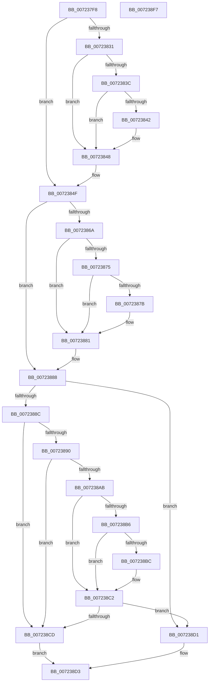

# PipUpdateSetupInProgress

- RVA: `0x007237F8`–`0x007238F8` (길이 `256` bytes)
- VA: `0x00000001407237F8`
- 실행 섹션: `PAGE`
- PDB 이름 있음: `예`; PDB Function 태그: `아니요`
- unwind 정보 RVA: `0x000B6A1C`
- 디코드: `77`개 명령, `256/256` bytes 표시
- 미해석 바이트: `0` (있으면 어셈블리에 `.byte`로 보존)

> 이 문서는 커널 이미지의 기계어와 PDB 기호를 분석해 생성했습니다. 4번과 5번은 함수 원형과 자료형을 바이너리 사용 방식에서 추정한 C 해석이며 원본 소스 복구 결과는 아닙니다.

## 1. Dependencies

- 직접 호출 지점: **6**; 고유 호출 대상: **2**
- 직접 호출자로 확인된 함수: **2**
- RIP 상대 이미지 참조: **5**

### Outgoing calls
- `0x00723828` → [IopGetRegistryValue](../99/IopGetRegistryValue_function_009990EC.md) (function, `0x009990EC`)
- `0x0072384A` → [ExFreePoolWithTag](../../poolcode/B8/ExFreePoolWithTag_function_00B82870.md) (function, `0x00B82870`)
- `0x00723861` → [IopGetRegistryValue](../99/IopGetRegistryValue_function_009990EC.md) (function, `0x009990EC`)
- `0x00723883` → [ExFreePoolWithTag](../../poolcode/B8/ExFreePoolWithTag_function_00B82870.md) (function, `0x00B82870`)
- `0x007238A2` → [IopGetRegistryValue](../99/IopGetRegistryValue_function_009990EC.md) (function, `0x009990EC`)
- `0x007238C4` → [ExFreePoolWithTag](../../poolcode/B8/ExFreePoolWithTag_function_00B82870.md) (function, `0x00B82870`)

### Direct callers
- [PipUpdateSetupInProgressNotify](PipUpdateSetupInProgressNotify_function_00723918.md) at `0x00723992`
- [IopInitializePlugPlayServices](../../init/C2/IopInitializePlugPlayServices_function_00C2F298.md) at `0x00C2F7E9`

### Static image references
- `0x00723818` → RVA `0x00AFD190` (` ?? ::NNGAKEGL::`string'`; read)
- `0x00723857` → RVA `0x00AFD1C0` (` ?? ::NNGAKEGL::`string'`; read)
- `0x00723898` → RVA `0x00AFD1E0` (` ?? ::NNGAKEGL::`string'`; read)
- `0x007238E4` → RVA `0x00E66279` (`.data`; write)
- `0x007238EB` → RVA `0x00E66245` (`.data`; write)

## 2. Other-region calls and transfers

- 다른 실행 섹션으로 향하는 call: **3**
  - `0x0072384A` → [ExFreePoolWithTag](../../poolcode/B8/ExFreePoolWithTag_function_00B82870.md) (`PAGE` → `POOLCODE`)
  - `0x00723883` → [ExFreePoolWithTag](../../poolcode/B8/ExFreePoolWithTag_function_00B82870.md) (`PAGE` → `POOLCODE`)
  - `0x007238C4` → [ExFreePoolWithTag](../../poolcode/B8/ExFreePoolWithTag_function_00B82870.md) (`PAGE` → `POOLCODE`)
- 별도 외부 분기/꼬리 이동을 확인하지 못했습니다.

## 3. Assembly (complete function range)

```asm
007237F8  48 8B C4                        mov rax, rsp
007237FB  48 89 58 08                     mov qword ptr [rax + 8], rbx
007237FF  48 89 68 18                     mov qword ptr [rax + 0x18], rbp
00723803  48 89 70 20                     mov qword ptr [rax + 0x20], rsi
00723807  57                              push rdi
00723808  48 83 EC 20                     sub rsp, 0x20
0072380C  48 83 60 10 00                  and qword ptr [rax + 0x10], 0
00723811  4C 8D 48 10                     lea r9, [rax + 0x10]
00723815  45 33 C0                        xor r8d, r8d
00723818  48 8D 15 71 99 3D 00            lea rdx, [rip + 0x3d9971]
0072381F  48 8B E9                        mov rbp, rcx
00723822  33 FF                           xor edi, edi
00723824  33 DB                           xor ebx, ebx
00723826  33 F6                           xor esi, esi
00723828  E8 BF 58 27 00                  call 0x1409990ec
0072382D  85 C0                           test eax, eax
0072382F  78 1E                           js 0x14072384f
00723831  48 8B 4C 24 38                  mov rcx, qword ptr [rsp + 0x38]
00723836  83 79 04 04                     cmp dword ptr [rcx + 4], 4
0072383A  75 0C                           jne 0x140723848
0072383C  83 79 0C 04                     cmp dword ptr [rcx + 0xc], 4
00723840  75 06                           jne 0x140723848
00723842  8B 41 08                        mov eax, dword ptr [rcx + 8]
00723845  8B 3C 08                        mov edi, dword ptr [rax + rcx]
00723848  33 D2                           xor edx, edx
0072384A  E8 21 F0 45 00                  call 0x140b82870
0072384F  4C 8D 4C 24 38                  lea r9, [rsp + 0x38]
00723854  45 33 C0                        xor r8d, r8d
00723857  48 8D 15 62 99 3D 00            lea rdx, [rip + 0x3d9962]
0072385E  48 8B CD                        mov rcx, rbp
00723861  E8 86 58 27 00                  call 0x1409990ec
00723866  85 C0                           test eax, eax
00723868  78 1E                           js 0x140723888
0072386A  48 8B 4C 24 38                  mov rcx, qword ptr [rsp + 0x38]
0072386F  83 79 04 04                     cmp dword ptr [rcx + 4], 4
00723873  75 0C                           jne 0x140723881
00723875  83 79 0C 04                     cmp dword ptr [rcx + 0xc], 4
00723879  75 06                           jne 0x140723881
0072387B  8B 41 08                        mov eax, dword ptr [rcx + 8]
0072387E  8B 1C 08                        mov ebx, dword ptr [rax + rcx]
00723881  33 D2                           xor edx, edx
00723883  E8 E8 EF 45 00                  call 0x140b82870
00723888  85 FF                           test edi, edi
0072388A  75 45                           jne 0x1407238d1
0072388C  85 DB                           test ebx, ebx
0072388E  74 3D                           je 0x1407238cd
00723890  4C 8D 4C 24 38                  lea r9, [rsp + 0x38]
00723895  45 33 C0                        xor r8d, r8d
00723898  48 8D 15 41 99 3D 00            lea rdx, [rip + 0x3d9941]
0072389F  48 8B CD                        mov rcx, rbp
007238A2  E8 45 58 27 00                  call 0x1409990ec
007238A7  85 C0                           test eax, eax
007238A9  78 22                           js 0x1407238cd
007238AB  48 8B 4C 24 38                  mov rcx, qword ptr [rsp + 0x38]
007238B0  83 79 04 04                     cmp dword ptr [rcx + 4], 4
007238B4  75 0C                           jne 0x1407238c2
007238B6  83 79 0C 04                     cmp dword ptr [rcx + 0xc], 4
007238BA  75 06                           jne 0x1407238c2
007238BC  8B 41 08                        mov eax, dword ptr [rcx + 8]
007238BF  8B 34 08                        mov esi, dword ptr [rax + rcx]
007238C2  33 D2                           xor edx, edx
007238C4  E8 A7 EF 45 00                  call 0x140b82870
007238C9  85 F6                           test esi, esi
007238CB  75 04                           jne 0x1407238d1
007238CD  32 C0                           xor al, al
007238CF  EB 02                           jmp 0x1407238d3
007238D1  B0 01                           mov al, 1
007238D3  48 8B 6C 24 40                  mov rbp, qword ptr [rsp + 0x40]
007238D8  85 DB                           test ebx, ebx
007238DA  48 8B 5C 24 30                  mov rbx, qword ptr [rsp + 0x30]
007238DF  48 8B 74 24 48                  mov rsi, qword ptr [rsp + 0x48]
007238E4  0F 95 05 8E 29 74 00            setne byte ptr [rip + 0x74298e]
007238EB  88 05 54 29 74 00               mov byte ptr [rip + 0x742954], al
007238F1  48 83 C4 20                     add rsp, 0x20
007238F5  5F                              pop rdi
007238F6  C3                              ret
007238F7  CC                              int3
```

## 4. C-style interpretation (structured pseudocode)

```c
__int64 __fastcall PipUpdateSetupInProgress(__int64 a1, __int64 a2, int a3)
{
    __int64 result;
    __int64 v_rbx;
    __int64 v_rdi;
    __int64 v_rsi;
    __int64 v_rsp;
    unsigned __int64 v_stack_p10;
    unsigned __int64 v_stack_p18;
    unsigned __int64 v_stack_p20;
    unsigned __int64 v_stack_p8;

    *(unsigned __int64 *)(v_rsp + 8) = v_rbx;
    *(unsigned __int64 *)(v_rsp + 24) = v_rbp;
    *(unsigned __int64 *)(v_rsp + 32) = v_rsi;
    v_rsp = (v_rsp) - (32);
    a3 = 0;
    v_rdi = 0;
    v_rbx = 0;
    v_rsi = 0;
    result = IopGetRegistryValue(a1, v_rip + 4036977, a3, v_rsp + 16);
    if (sign_flag) goto loc_0072384F;
    if ((*(unsigned int *)(v_stack_p10 + 4)) != 4) goto loc_00723848;
    if ((*(unsigned int *)(v_stack_p10 + 12)) == 4) {
        result = *(unsigned int *)(v_stack_p10 + 8);
        v_rdi = *(unsigned int *)(result + v_stack_p10 * 1);
    }
    a2 = 0;
    result = ExFreePoolWithTag(v_stack_p10, a2, a3, v_rsp + 16);
loc_0072384F:
    a3 = 0;
    result = IopGetRegistryValue(a1, v_rip + 4036962, a3, v_stack_p10);
    if (sign_flag) goto loc_00723888;
    if ((*(unsigned int *)(v_stack_p10 + 4)) != 4) goto loc_00723881;
    if ((*(unsigned int *)(v_stack_p10 + 12)) == 4) {
        result = *(unsigned int *)(v_stack_p10 + 8);
        v_rbx = *(unsigned int *)(result + v_stack_p10 * 1);
    }
    a2 = 0;
    result = ExFreePoolWithTag(v_stack_p10, a2, a3, v_stack_p10);
loc_00723888:
    if ((unsigned int)(v_rdi) != 0) goto loc_007238D1;
    if ((unsigned int)(v_rbx) == 0) goto loc_007238CD;
    a3 = 0;
    result = IopGetRegistryValue(a1, v_rip + 4036929, a3, v_stack_p10);
    if (sign_flag) goto loc_007238CD;
    if ((*(unsigned int *)(v_stack_p10 + 4)) != 4) goto loc_007238C2;
    if ((*(unsigned int *)(v_stack_p10 + 12)) == 4) {
        result = *(unsigned int *)(v_stack_p10 + 8);
        v_rsi = *(unsigned int *)(result + v_stack_p10 * 1);
    }
    a2 = 0;
    result = ExFreePoolWithTag(v_stack_p10, a2, a3, v_stack_p10);
    if ((unsigned int)(v_rsi) != 0) goto loc_007238D1;
loc_007238CD:
    result = 0;
    goto loc_007238D3;
loc_007238D1:
loc_007238D3:
    *(unsigned __int8 *)(v_rip + 7612756) = 1;
    v_rsp = (v_rsp) + (32);
    return 1;
}
```

## 5. (Beta) C Style

```c
int64_t PipUpdateSetupInProgress(int64_t Arg1, int64_t Arg2, int32_t Arg3)
{
    int64_t result;
    int64_t local_rbx;
    int64_t local_rdi;
    int64_t local_rsi;
    int64_t local_rsp;
    uint64_t v_stack_p10;
    uint64_t v_stack_p18;
    uint64_t v_stack_p20;
    uint64_t v_stack_p8;

    *(uint64_t *)(local_rsp + 0x8) = local_rbx;
    *(uint64_t *)(local_rsp + 0x18) = local_rbp;
    *(uint64_t *)(local_rsp + 0x20) = local_rsi;
    local_rsp = (local_rsp) - (32);
    Arg3 = 0;
    local_rdi = 0;
    local_rbx = 0;
    local_rsi = 0;
    result = IopGetRegistryValue(Arg1, v_rip + 4036977, Arg3, local_rsp + 16);
    if (sign_flag) goto loc_0072384F;
    if ((*(uint32_t *)(v_stack_p10 + 0x4)) != 4) goto loc_00723848;
    if ((*(uint32_t *)(v_stack_p10 + 0xC)) == 4) {
        result = *(uint32_t *)(v_stack_p10 + 0x8);
        local_rdi = *(uint32_t *)(result + v_stack_p10 * 1);
    }
    Arg2 = 0;
    result = ExFreePoolWithTag(v_stack_p10, Arg2, Arg3, local_rsp + 16);
loc_0072384F:
    Arg3 = 0;
    result = IopGetRegistryValue(Arg1, v_rip + 4036962, Arg3, v_stack_p10);
    if (sign_flag) goto loc_00723888;
    if ((*(uint32_t *)(v_stack_p10 + 0x4)) != 4) goto loc_00723881;
    if ((*(uint32_t *)(v_stack_p10 + 0xC)) == 4) {
        result = *(uint32_t *)(v_stack_p10 + 0x8);
        local_rbx = *(uint32_t *)(result + v_stack_p10 * 1);
    }
    Arg2 = 0;
    result = ExFreePoolWithTag(v_stack_p10, Arg2, Arg3, v_stack_p10);
loc_00723888:
    if ((uint32_t)(local_rdi) != 0) goto loc_007238D1;
    if ((uint32_t)(local_rbx) == 0) goto loc_007238CD;
    Arg3 = 0;
    result = IopGetRegistryValue(Arg1, v_rip + 4036929, Arg3, v_stack_p10);
    if (sign_flag) goto loc_007238CD;
    if ((*(uint32_t *)(v_stack_p10 + 0x4)) != 4) goto loc_007238C2;
    if ((*(uint32_t *)(v_stack_p10 + 0xC)) == 4) {
        result = *(uint32_t *)(v_stack_p10 + 0x8);
        local_rsi = *(uint32_t *)(result + v_stack_p10 * 1);
    }
    Arg2 = 0;
    result = ExFreePoolWithTag(v_stack_p10, Arg2, Arg3, v_stack_p10);
    if ((uint32_t)(local_rsi) != 0) goto loc_007238D1;
loc_007238CD:
    result = 0;
    goto loc_007238D3;
loc_007238D1:
loc_007238D3:
    *(uint8_t *)(v_rip + 0x742954) = 1;
    local_rsp = (local_rsp) + (32);
    return 1;
}
```

## 6. Execution-region graph

[열기: 2D/3D 그래프와 함수 탐색 컨트롤 패널](../../../control-panel.html?section=page&rva=0x007237F8&view=graph)

- 2D 그래프는 위에서 아래로 흐르고, 3D 그래프는 빈 공간을 드래그해 회전합니다. Shift+드래그는 이동, 휠은 확대·축소, 함수 노드 선택은 대상 보고서 이동입니다.

### Static fallback


