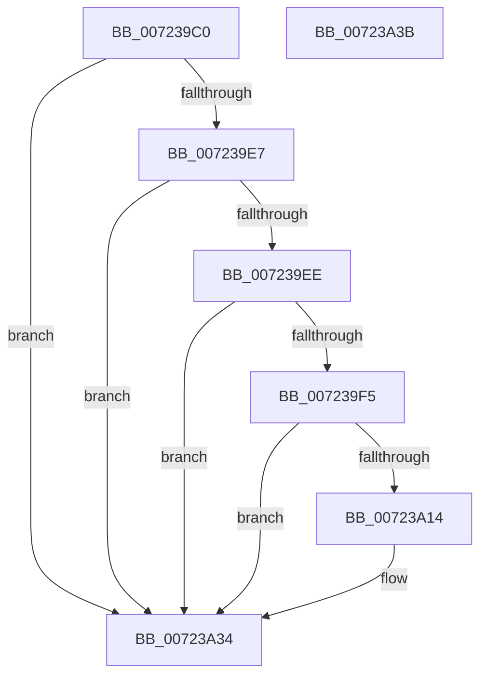

# PipUpdateSetupOobeCompleteWnfCallback

- RVA: `0x007239C0`–`0x00723A3C` (길이 `124` bytes)
- VA: `0x00000001407239C0`
- 실행 섹션: `PAGE`
- PDB 이름 있음: `예`; PDB Function 태그: `아니요`
- unwind 정보 RVA: `0x00097934`
- 디코드: `32`개 명령, `124/124` bytes 표시
- 미해석 바이트: `0` (있으면 어셈블리에 `.byte`로 보존)

> 이 문서는 커널 이미지의 기계어와 PDB 기호를 분석해 생성했습니다. 4번과 5번은 함수 원형과 자료형을 바이너리 사용 방식에서 추정한 C 해석이며 원본 소스 복구 결과는 아닙니다.

## 1. Dependencies

- 직접 호출 지점: **3**; 고유 호출 대상: **3**
- 직접 호출자로 확인된 함수: **0**
- RIP 상대 이미지 참조: **2**

### Outgoing calls
- `0x007239DE` → [ExQueryWnfStateData](../A4/ExQueryWnfStateData_function_00A4A480.md) (function, `0x00A4A480`)
- `0x00723A0A` → [ExAllocatePool2](../../poolcode/B8/ExAllocatePool2_function_00B820F0.md) (function, `0x00B820F0`)
- `0x00723A2F` → [ExQueueWorkItem](../../text/2F/ExQueueWorkItem_function_002F9520.md) (function, `0x002F9520`)

### Direct callers
- 이 함수 시작 RVA로 연결되는 직접 call은 확인되지 않았습니다. 간접 호출은 완전히 역산할 수 없습니다.

### Static image references
- `0x007239FA` → RVA `0x00E66279` (`.data`; write)
- `0x00723A18` → RVA `0x00723710` (`PipOobeCompleteAsyncCallback`; read)

## 2. Other-region calls and transfers

- 다른 실행 섹션으로 향하는 call: **2**
  - `0x00723A0A` → [ExAllocatePool2](../../poolcode/B8/ExAllocatePool2_function_00B820F0.md) (`PAGE` → `POOLCODE`)
  - `0x00723A2F` → [ExQueueWorkItem](../../text/2F/ExQueueWorkItem_function_002F9520.md) (`PAGE` → `.text`)
- 별도 외부 분기/꼬리 이동을 확인하지 못했습니다.

## 3. Assembly (complete function range)

```asm
007239C0  48 8B C4                        mov rax, rsp
007239C3  48 83 EC 38                     sub rsp, 0x38
007239C7  83 60 EC 00                     and dword ptr [rax - 0x14], 0
007239CB  4C 8D 48 E8                     lea r9, [rax - 0x18]
007239CF  4C 8D 40 EC                     lea r8, [rax - 0x14]
007239D3  C7 40 E8 04 00 00 00            mov dword ptr [rax - 0x18], 4
007239DA  48 8D 50 20                     lea rdx, [rax + 0x20]
007239DE  E8 9D 6A 32 00                  call 0x140a4a480
007239E3  85 C0                           test eax, eax
007239E5  78 4D                           js 0x140723a34
007239E7  83 7C 24 20 04                  cmp dword ptr [rsp + 0x20], 4
007239EC  75 46                           jne 0x140723a34
007239EE  83 7C 24 24 00                  cmp dword ptr [rsp + 0x24], 0
007239F3  74 3F                           je 0x140723a34
007239F5  BA 20 00 00 00                  mov edx, 0x20
007239FA  C6 05 78 28 74 00 00            mov byte ptr [rip + 0x742878], 0
00723A01  41 B8 50 70 69 6E               mov r8d, 0x6e697050
00723A07  8D 4A 20                        lea ecx, [rdx + 0x20]
00723A0A  E8 E1 E6 45 00                  call 0x140b820f0
00723A0F  48 85 C0                        test rax, rax
00723A12  74 20                           je 0x140723a34
00723A14  48 83 20 00                     and qword ptr [rax], 0
00723A18  48 8D 0D F1 FC FF FF            lea rcx, [rip - 0x30f]
00723A1F  48 89 48 10                     mov qword ptr [rax + 0x10], rcx
00723A23  BA 03 00 00 00                  mov edx, 3
00723A28  48 8B C8                        mov rcx, rax
00723A2B  48 89 40 18                     mov qword ptr [rax + 0x18], rax
00723A2F  E8 EC 5A BD FF                  call 0x1402f9520
00723A34  33 C0                           xor eax, eax
00723A36  48 83 C4 38                     add rsp, 0x38
00723A3A  C3                              ret
00723A3B  CC                              int3
```

## 4. C-style interpretation (structured pseudocode)

```c
__int64 __fastcall PipUpdateSetupOobeCompleteWnfCallback(void)
{
    __int64 result;
    __int64 v_rsp;
    unsigned int v_stack_m14;
    unsigned int v_stack_m18;

    v_rsp = (v_rsp) - (56);
    *(unsigned int *)(v_rsp - 24) = 4;
    result = ExQueryWnfStateData(a1, v_rsp + 32, v_rsp - 20, v_rsp - 24);
    if (sign_flag) goto loc_00723A34;
    if (v_stack_m18 != 4) goto loc_00723A34;
    if (v_stack_m14 == 0) goto loc_00723A34;
    *(unsigned __int8 *)(v_rip + 7612536) = 0;
    result = ExAllocatePool2(32 + 32, 32, (unsigned int)(0x6E697050ULL), v_rsp - 24);
    if (result != 0) {
        a1 = v_rip - 783;
        *(unsigned __int64 *)(result + 16) = a1;
        a2 = 3;
        a1 = result;
        *(unsigned __int64 *)(result + 24) = result;
        result = ExQueueWorkItem(a1, a2, (unsigned int)(0x6E697050ULL), v_rsp - 24);
    }
    result = 0;
    v_rsp = (v_rsp) + (56);
    return result;
}
```

## 5. (Beta) C Style

```c
void PipUpdateSetupOobeCompleteWnfCallback(void)
{
    int64_t result;
    int64_t local_rsp;
    uint32_t v_stack_m14;
    uint32_t v_stack_m18;

    local_rsp = (local_rsp) - (56);
    *(uint32_t *)(local_rsp - 0x18) = 4;
    result = ExQueryWnfStateData(a1, local_rsp + 32, local_rsp - 20, local_rsp - 24);
    if (sign_flag) goto loc_00723A34;
    if (v_stack_m18 != 4) goto loc_00723A34;
    if (v_stack_m14 == 0) goto loc_00723A34;
    *(uint8_t *)(v_rip + 0x742878) = 0;
    result = ExAllocatePool2(32 + 32, 32, (uint32_t)(0x6E697050ULL), local_rsp - 24);
    if (result != 0) {
        a1 = v_rip - 783;
        *(uint64_t *)(result + 0x10) = a1;
        a2 = 3;
        a1 = result;
        *(uint64_t *)(result + 0x18) = result;
        result = ExQueueWorkItem(a1, a2, (uint32_t)(0x6E697050ULL), local_rsp - 24);
    }
    result = 0;
    local_rsp = (local_rsp) + (56);
    return result;
}
```

## 6. Execution-region graph

[열기: 2D/3D 그래프와 함수 탐색 컨트롤 패널](../../../control-panel.html?section=page&rva=0x007239C0&view=graph)

- 2D 그래프는 위에서 아래로 흐르고, 3D 그래프는 빈 공간을 드래그해 회전합니다. Shift+드래그는 이동, 휠은 확대·축소, 함수 노드 선택은 대상 보고서 이동입니다.

### Static fallback


