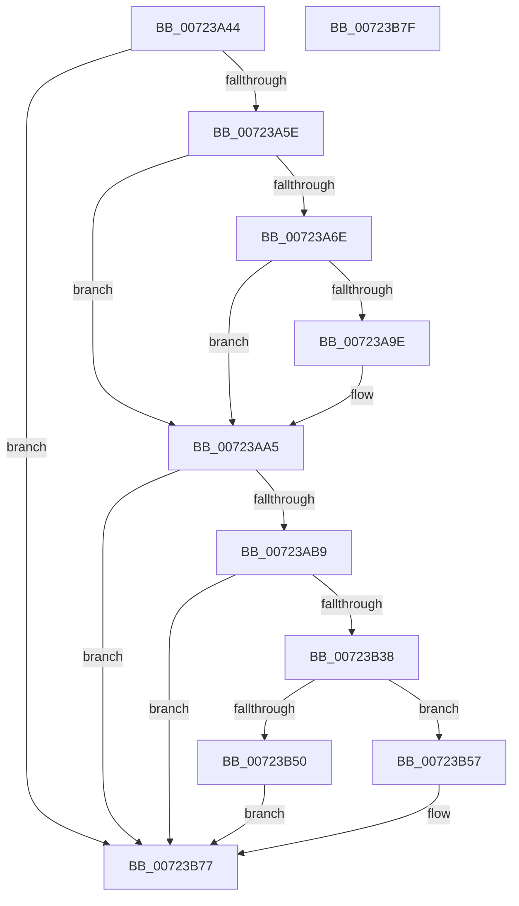

# PnpBootPhaseComplete

- RVA: `0x00723A44`–`0x00723B80` (길이 `316` bytes)
- VA: `0x0000000140723A44`
- 실행 섹션: `PAGE`
- PDB 이름 있음: `예`; PDB Function 태그: `아니요`
- unwind 정보 RVA: `0x0006E5B4`
- 디코드: `71`개 명령, `316/316` bytes 표시
- 미해석 바이트: `0` (있으면 어셈블리에 `.byte`로 보존)

> 이 문서는 커널 이미지의 기계어와 PDB 기호를 분석해 생성했습니다. 4번과 5번은 함수 원형과 자료형을 바이너리 사용 방식에서 추정한 C 해석이며 원본 소스 복구 결과는 아닙니다.

## 1. Dependencies

- 직접 호출 지점: **8**; 고유 호출 대상: **8**
- 직접 호출자로 확인된 함수: **1**
- RIP 상대 이미지 참조: **10**

### Outgoing calls
- `0x00723A4F` → [PiPnpRtlInit](../73/PiPnpRtlInit_function_007300A4.md) (function, `0x007300A4`)
- `0x00723A95` → [ExSubscribeWnfStateChange](../9D/ExSubscribeWnfStateChange_function_009D4BC0.md) (function, `0x009D4BC0`)
- `0x00723AAA` → [PiDmaGuardInitialize](../../text/5A/PiDmaGuardInitialize_function_005A9F0C.md) (function, `0x005A9F0C`)
- `0x00723AEA` → [Pdcv2ActivationClientRegister](../79/Pdcv2ActivationClientRegister_function_0079AF28.md) (function, `0x0079AF28`)
- `0x00723B28` → [PnpRequestDeviceAction](../../text/47/PnpRequestDeviceAction_function_00477FF8.md) (function, `0x00477FF8`)
- `0x00723B2D` → [PpDevCfgProcessDevices](../73/PpDevCfgProcessDevices_function_007373C0.md) (function, `0x007373C0`)
- `0x00723B46` → [ExAllocatePool2](../../poolcode/B8/ExAllocatePool2_function_00B820F0.md) (function, `0x00B820F0`)
- `0x00723B72` → [ExQueueWorkItem](../../text/2F/ExQueueWorkItem_function_002F9520.md) (function, `0x002F9520`)

### Direct callers
- [CmCompleteRegistryInitialization](../7D/CmCompleteRegistryInitialization_function_007DF1EC.md) at `0x007DF337`

### Static image references
- `0x00723A5E` → RVA `0x00E66279` (`.data`; read)
- `0x00723A65` → RVA `0x00E0A9E0` (`.data`; write)
- `0x00723A74` → RVA `0x007239C0` (`PipUpdateSetupOobeCompleteWnfCallback`; read)
- `0x00723A83` → RVA `0x00020B40` (`.rdata`; read)
- `0x00723A8A` → RVA `0x00E66270` (`.data`; read)
- `0x00723A9E` → RVA `0x00E66279` (`.data`; write)
- `0x00723ABF` → RVA `0x00A64D60` (`AlpcConnectionCleanupProcedure`; read)
- `0x00723ACF` → RVA `0x00F8A8F8` (`.data`; read)
- `0x00723AEF` → RVA `0x00F8C438` (`.data`; read)
- `0x00723B5B` → RVA `0x005A46C0` (`PipUpdateDeviceProducts`; read)

## 2. Other-region calls and transfers

- 다른 실행 섹션으로 향하는 call: **4**
  - `0x00723AAA` → [PiDmaGuardInitialize](../../text/5A/PiDmaGuardInitialize_function_005A9F0C.md) (`PAGE` → `.text`)
  - `0x00723B28` → [PnpRequestDeviceAction](../../text/47/PnpRequestDeviceAction_function_00477FF8.md) (`PAGE` → `.text`)
  - `0x00723B46` → [ExAllocatePool2](../../poolcode/B8/ExAllocatePool2_function_00B820F0.md) (`PAGE` → `POOLCODE`)
  - `0x00723B72` → [ExQueueWorkItem](../../text/2F/ExQueueWorkItem_function_002F9520.md) (`PAGE` → `.text`)
- 별도 외부 분기/꼬리 이동을 확인하지 못했습니다.

## 3. Assembly (complete function range)

```asm
00723A44  40 53                           push rbx
00723A46  48 83 EC 60                     sub rsp, 0x60
00723A4A  B9 02 00 00 00                  mov ecx, 2
00723A4F  E8 50 C6 00 00                  call 0x1407300a4
00723A54  8B D8                           mov ebx, eax
00723A56  85 C0                           test eax, eax
00723A58  0F 88 19 01 00 00               js 0x140723b77
00723A5E  80 3D 14 28 74 00 00            cmp byte ptr [rip + 0x742814], 0
00723A65  C6 05 74 6F 6E 00 00            mov byte ptr [rip + 0x6e6f74], 0
00723A6C  74 37                           je 0x140723aa5
00723A6E  48 83 64 24 28 00               and qword ptr [rsp + 0x28], 0
00723A74  48 8D 05 45 FF FF FF            lea rax, [rip - 0xbb]
00723A7B  45 33 C9                        xor r9d, r9d
00723A7E  48 89 44 24 20                  mov qword ptr [rsp + 0x20], rax
00723A83  48 8D 15 B6 D0 8F FF            lea rdx, [rip - 0x702f4a]
00723A8A  48 8D 0D DF 27 74 00            lea rcx, [rip + 0x7427df]
00723A91  45 8D 41 01                     lea r8d, [r9 + 1]
00723A95  E8 26 11 2B 00                  call 0x1409d4bc0
00723A9A  85 C0                           test eax, eax
00723A9C  79 07                           jns 0x140723aa5
00723A9E  C6 05 D4 27 74 00 00            mov byte ptr [rip + 0x7427d4], 0
00723AA5  B9 02 00 00 00                  mov ecx, 2
00723AAA  E8 5D 64 E8 FF                  call 0x1405a9f0c
00723AAF  8B D8                           mov ebx, eax
00723AB1  85 C0                           test eax, eax
00723AB3  0F 88 BE 00 00 00               js 0x140723b77
00723AB9  48 83 64 24 50 00               and qword ptr [rsp + 0x50], 0
00723ABF  48 8D 05 9A 12 34 00            lea rax, [rip + 0x34129a]
00723AC6  48 C7 44 24 40 01 00 00 00      mov qword ptr [rsp + 0x40], 1
00723ACF  4C 8D 05 22 6E 86 00            lea r8, [rip + 0x866e22]
00723AD6  83 64 24 44 00                  and dword ptr [rsp + 0x44], 0
00723ADB  48 8D 54 24 40                  lea rdx, [rsp + 0x40]
00723AE0  B9 79 00 00 00                  mov ecx, 0x79
00723AE5  48 89 44 24 48                  mov qword ptr [rsp + 0x48], rax
00723AEA  E8 39 74 07 00                  call 0x14079af28
00723AEF  48 8B 0D 42 89 86 00            mov rcx, qword ptr [rip + 0x868942]
00723AF6  4C 8D 4C 24 40                  lea r9, [rsp + 0x40]
00723AFB  48 83 64 24 30 00               and qword ptr [rsp + 0x30], 0
00723B01  45 33 C0                        xor r8d, r8d
00723B04  48 83 64 24 28 00               and qword ptr [rsp + 0x28], 0
00723B0A  0F 57 C0                        xorps xmm0, xmm0
00723B0D  48 83 64 24 20 00               and qword ptr [rsp + 0x20], 0
00723B13  48 8B 49 20                     mov rcx, qword ptr [rcx + 0x20]
00723B17  0F 11 44 24 40                  movups xmmword ptr [rsp + 0x40], xmm0
00723B1C  41 8D 50 02                     lea edx, [r8 + 2]
00723B20  C7 44 24 48 27 00 00 00         mov dword ptr [rsp + 0x48], 0x27
00723B28  E8 CB 44 D5 FF                  call 0x140477ff8
00723B2D  E8 8E 38 01 00                  call 0x1407373c0
00723B32  8B D8                           mov ebx, eax
00723B34  85 C0                           test eax, eax
00723B36  78 3F                           js 0x140723b77
00723B38  BA 20 00 00 00                  mov edx, 0x20
00723B3D  41 B8 50 70 69 6E               mov r8d, 0x6e697050
00723B43  8D 4A 20                        lea ecx, [rdx + 0x20]
00723B46  E8 A5 E5 45 00                  call 0x140b820f0
00723B4B  48 85 C0                        test rax, rax
00723B4E  75 07                           jne 0x140723b57
00723B50  BB 9A 00 00 C0                  mov ebx, 0xc000009a
00723B55  EB 20                           jmp 0x140723b77
00723B57  48 83 20 00                     and qword ptr [rax], 0
00723B5B  48 8D 0D 5E 0B E8 FF            lea rcx, [rip - 0x17f4a2]
00723B62  48 89 48 10                     mov qword ptr [rax + 0x10], rcx
00723B66  BA 03 00 00 00                  mov edx, 3
00723B6B  48 8B C8                        mov rcx, rax
00723B6E  48 89 40 18                     mov qword ptr [rax + 0x18], rax
00723B72  E8 A9 59 BD FF                  call 0x1402f9520
00723B77  8B C3                           mov eax, ebx
00723B79  48 83 C4 60                     add rsp, 0x60
00723B7D  5B                              pop rbx
00723B7E  C3                              ret
00723B7F  CC                              int3
```

## 4. C-style interpretation (structured pseudocode)

```c
__int64 __fastcall PnpBootPhaseComplete(__int64 a1, __int64 a2, __int64 a3, int a4)
{
    __int64 result;
    __int64 v_rsp;
    unsigned __int64 v_stack_m18;
    unsigned __int64 v_stack_m20;
    unsigned int v_stack_m24;
    unsigned __int64 v_stack_m28;
    unsigned __int64 v_stack_m38;
    unsigned __int64 v_stack_m40;
    unsigned __int64 v_stack_m48;

    v_rsp = (v_rsp) - (96);
    result = PiPnpRtlInit(2, a2, a3, a4);
    if (sign_flag) goto loc_00723B77;
    *(unsigned __int8 *)(v_rip + 7237492) = 0;
    if ((*(unsigned __int8 *)(v_rip + 7612436)) == 0) goto loc_00723AA5;
    a4 = 0;
    v_stack_m48 = v_rip - 187;
    result = ExSubscribeWnfStateChange(v_rip + 7612383, v_rip - 7352138, a4 + 1, a4);
    if (sign_flag) {
        *(unsigned __int8 *)(v_rip + 7612372) = 0;
    }
    result = PiDmaGuardInitialize(2, v_rip - 7352138, a4 + 1, a4);
    if (sign_flag) goto loc_00723B77;
    v_stack_m28 = 1;
    v_stack_m20 = v_rip + 3412634;
    result = Pdcv2ActivationClientRegister(121, v_stack_m28, v_rip + 8810018, a4);
    a3 = 0;
    v_stack_m28 = v_xmm0;
    v_stack_m20 = 39;
    result = PnpRequestDeviceAction(*(unsigned __int64 *)(*(unsigned __int64 *)(v_rip + 8816962) + 32), a3 + 2, a3, v_stack_m28);
    result = PpDevCfgProcessDevices(*(unsigned __int64 *)(*(unsigned __int64 *)(v_rip + 8816962) + 32), a3 + 2, a3, v_stack_m28);
    if (sign_flag) goto loc_00723B77;
    result = ExAllocatePool2(32 + 32, 32, (unsigned int)(0x6E697050ULL), v_stack_m28);
    if (result != 0) goto loc_00723B57;
    goto loc_00723B77;
loc_00723B57:
    *(unsigned __int64 *)(result + 16) = v_rip - 1569954;
    *(unsigned __int64 *)(result + 24) = result;
    result = ExQueueWorkItem(result, 3, (unsigned int)(0x6E697050ULL), v_stack_m28);
loc_00723B77:
    v_rsp = (v_rsp) + (96);
    return (unsigned int)((unsigned int)((unsigned int)(0xC000009AULL)));
}
```

## 5. (Beta) C Style

```c
int64_t PnpBootPhaseComplete(int64_t Arg1, int64_t Arg2, int64_t Arg3, int32_t Arg4)
{
    int64_t result;
    int64_t local_rsp;
    uint64_t v_stack_m18;
    uint64_t v_stack_m20;
    uint32_t v_stack_m24;
    uint64_t v_stack_m28;
    uint64_t v_stack_m38;
    uint64_t v_stack_m40;
    uint64_t v_stack_m48;

    local_rsp = (local_rsp) - (96);
    result = PiPnpRtlInit(2, Arg2, Arg3, Arg4);
    if (sign_flag) goto loc_00723B77;
    *(uint8_t *)(v_rip + 0x6E6F74) = 0;
    if ((*(uint8_t *)(v_rip + 0x742814)) == 0) goto loc_00723AA5;
    Arg4 = 0;
    v_stack_m48 = v_rip - 187;
    result = ExSubscribeWnfStateChange(v_rip + 7612383, v_rip - 7352138, Arg4 + 1, Arg4);
    if (sign_flag) {
        *(uint8_t *)(v_rip + 0x7427D4) = 0;
    }
    result = PiDmaGuardInitialize(2, v_rip - 7352138, Arg4 + 1, Arg4);
    if (sign_flag) goto loc_00723B77;
    v_stack_m28 = 1;
    v_stack_m20 = v_rip + 3412634;
    result = Pdcv2ActivationClientRegister(121, v_stack_m28, v_rip + 8810018, Arg4);
    Arg3 = 0;
    v_stack_m28 = v_xmm0;
    v_stack_m20 = 39;
    result = PnpRequestDeviceAction(*(uint64_t *)(*(uint64_t *)(v_rip + 0x868942) + 0x20), Arg3 + 2, Arg3, v_stack_m28);
    result = PpDevCfgProcessDevices(*(uint64_t *)(*(uint64_t *)(v_rip + 0x868942) + 0x20), Arg3 + 2, Arg3, v_stack_m28);
    if (sign_flag) goto loc_00723B77;
    result = ExAllocatePool2(32 + 32, 32, (uint32_t)(0x6E697050ULL), v_stack_m28);
    if (result != 0) goto loc_00723B57;
    goto loc_00723B77;
loc_00723B57:
    *(uint64_t *)(result + 0x10) = v_rip - 1569954;
    *(uint64_t *)(result + 0x18) = result;
    result = ExQueueWorkItem(result, 3, (uint32_t)(0x6E697050ULL), v_stack_m28);
loc_00723B77:
    local_rsp = (local_rsp) + (96);
    return (uint32_t)((uint32_t)((uint32_t)(0xC000009AULL)));
}
```

## 6. Execution-region graph

[열기: 2D/3D 그래프와 함수 탐색 컨트롤 패널](../../../control-panel.html?section=page&rva=0x00723A44&view=graph)

- 2D 그래프는 위에서 아래로 흐르고, 3D 그래프는 빈 공간을 드래그해 회전합니다. Shift+드래그는 이동, 휠은 확대·축소, 함수 노드 선택은 대상 보고서 이동입니다.

### Static fallback


