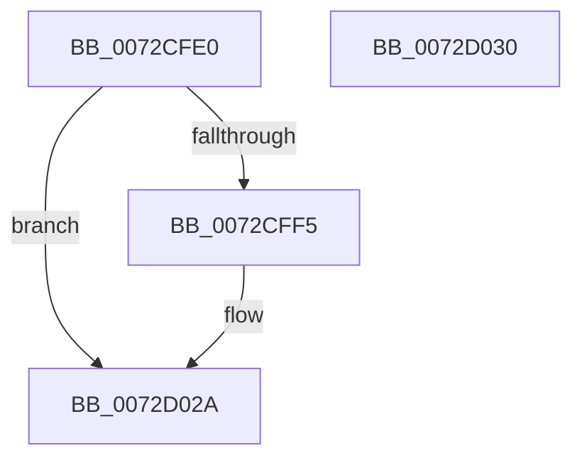

# PnpCancelRemoveLockedDeviceNode

- RVA: `0x0072CFE0`–`0x0072D031` (길이 `81` bytes)
- VA: `0x000000014072CFE0`
- 실행 섹션: `PAGE`
- PDB 이름 있음: `예`; PDB Function 태그: `아니요`
- unwind 정보 RVA: `0x0005CF00`
- 디코드: `21`개 명령, `81/81` bytes 표시
- 미해석 바이트: `0` (있으면 어셈블리에 `.byte`로 보존)

> 이 문서는 커널 이미지의 기계어와 PDB 기호를 분석해 생성했습니다. 4번과 5번은 함수 원형과 자료형을 바이너리 사용 방식에서 추정한 C 해석이며 원본 소스 복구 결과는 아닙니다.

## 1. Dependencies

- 직접 호출 지점: **5**; 고유 호출 대상: **5**
- 직접 호출자로 확인된 함수: **1**
- RIP 상대 이미지 참조: **0**

### Outgoing calls
- `0x0072CFFA` → [PipSetDevNodeUserFlags](../8F/PipSetDevNodeUserFlags_function_008FB8FC.md) (function, `0x008FB8FC`)
- `0x0072D008` → [IopRemoveDevice](../8F/IopRemoveDevice_function_008FC7FC.md) (function, `0x008FC7FC`)
- `0x0072D015` → [PipClearDevNodeUserFlags](../A2/PipClearDevNodeUserFlags_function_00A2ABC4.md) (function, `0x00A2ABC4`)
- `0x0072D01D` → [PipRestoreDevNodeState](../../text/5A/PipRestoreDevNodeState_function_005A7100.md) (function, `0x005A7100`)
- `0x0072D025` → [PnpStartedDeviceNodeDependencyCheck](../8F/PnpStartedDeviceNodeDependencyCheck_function_008FCF58.md) (function, `0x008FCF58`)

### Direct callers
- [sub_00B34BF4](../B3/Unknown_function_00B34BF4.md) at `0x00B34C07`

### Static image references
- 디코드된 RIP-relative 메모리 참조가 없습니다.

## 2. Other-region calls and transfers

- 다른 실행 섹션으로 향하는 call: **1**
  - `0x0072D01D` → [PipRestoreDevNodeState](../../text/5A/PipRestoreDevNodeState_function_005A7100.md) (`PAGE` → `.text`)
- 별도 외부 분기/꼬리 이동을 확인하지 못했습니다.

## 3. Assembly (complete function range)

```asm
0072CFE0  40 53                           push rbx
0072CFE2  48 83 EC 20                     sub rsp, 0x20
0072CFE6  81 B9 2C 01 00 00 12 03 00 00   cmp dword ptr [rcx + 0x12c], 0x312
0072CFF0  48 8B D9                        mov rbx, rcx
0072CFF3  75 35                           jne 0x14072d02a
0072CFF5  BA 00 02 00 00                  mov edx, 0x200
0072CFFA  E8 FD E8 1C 00                  call 0x1408fb8fc
0072CFFF  48 8B 4B 20                     mov rcx, qword ptr [rbx + 0x20]
0072D003  BA 03 00 00 00                  mov edx, 3
0072D008  E8 EF F7 1C 00                  call 0x1408fc7fc
0072D00D  BA 00 02 00 00                  mov edx, 0x200
0072D012  48 8B CB                        mov rcx, rbx
0072D015  E8 AA DB 2F 00                  call 0x140a2abc4
0072D01A  48 8B CB                        mov rcx, rbx
0072D01D  E8 DE A0 E7 FF                  call 0x1405a7100
0072D022  48 8B CB                        mov rcx, rbx
0072D025  E8 2E FF 1C 00                  call 0x1408fcf58
0072D02A  48 83 C4 20                     add rsp, 0x20
0072D02E  5B                              pop rbx
0072D02F  C3                              ret
0072D030  CC                              int3
```

## 4. C-style interpretation (structured pseudocode)

```c
__int64 __fastcall PnpCancelRemoveLockedDeviceNode(__int64 a1)
{
    __int64 result;
    __int64 v_rsp;

    v_rsp = (v_rsp) - (32);
    if ((*(unsigned int *)(a1 + 300)) == 786) {
        a2 = 512;
        result = PipSetDevNodeUserFlags(a1, a2, a3, a4);
        a1 = *(unsigned __int64 *)(a1 + 32);
        a2 = 3;
        result = IopRemoveDevice(a1, a2, a3, a4);
        a2 = 512;
        a1 = a1;
        result = PipClearDevNodeUserFlags(a1, a2, a3, a4);
        a1 = a1;
        result = PipRestoreDevNodeState(a1, a2, a3, a4);
        a1 = a1;
        result = PnpStartedDeviceNodeDependencyCheck(a1, a2, a3, a4);
    }
    v_rsp = (v_rsp) + (32);
    return result;
}
```

## 5. (Beta) C Style

```c
int64_t PnpCancelRemoveLockedDeviceNode(void *Arg1)
{
    uint8_t *arg1 = (uint8_t *)Arg1;

    int64_t result;
    int64_t local_rsp;

    local_rsp = (local_rsp) - (32);
    if ((*(uint32_t *)(arg1 + 0x12C)) == 786) {
        a2 = 512;
        result = PipSetDevNodeUserFlags(Arg1, a2, a3, a4);
        Arg1 = *(uint64_t *)(arg1 + 0x20);
        a2 = 3;
        result = IopRemoveDevice(Arg1, a2, a3, a4);
        a2 = 512;
        Arg1 = Arg1;
        result = PipClearDevNodeUserFlags(Arg1, a2, a3, a4);
        Arg1 = Arg1;
        result = PipRestoreDevNodeState(Arg1, a2, a3, a4);
        Arg1 = Arg1;
        result = PnpStartedDeviceNodeDependencyCheck(Arg1, a2, a3, a4);
    }
    local_rsp = (local_rsp) + (32);
    return result;
}
```

### 관측된 메모리 오프셋

구조체 형식이 확인되지 않은 접근은 인자 기준의 오프셋으로만 기록했습니다.

| 기준 인자 | 오프셋 표현 | 폭 (bit) | 접근 |
|---|---:|---:|---|
| `Arg1` | `+ 0x20` | `64` | `R` |
| `Arg1` | `+ 0x12C` | `32` | `R` |

## 6. Execution-region graph

[열기: 2D/3D 그래프와 함수 탐색 컨트롤 패널](../../../control-panel.html?section=page&rva=0x0072CFE0&view=graph)

- 2D 그래프는 위에서 아래로 흐르고, 3D 그래프는 빈 공간을 드래그해 회전합니다. Shift+드래그는 이동, 휠은 확대·축소, 함수 노드 선택은 대상 보고서 이동입니다.

### Static fallback


