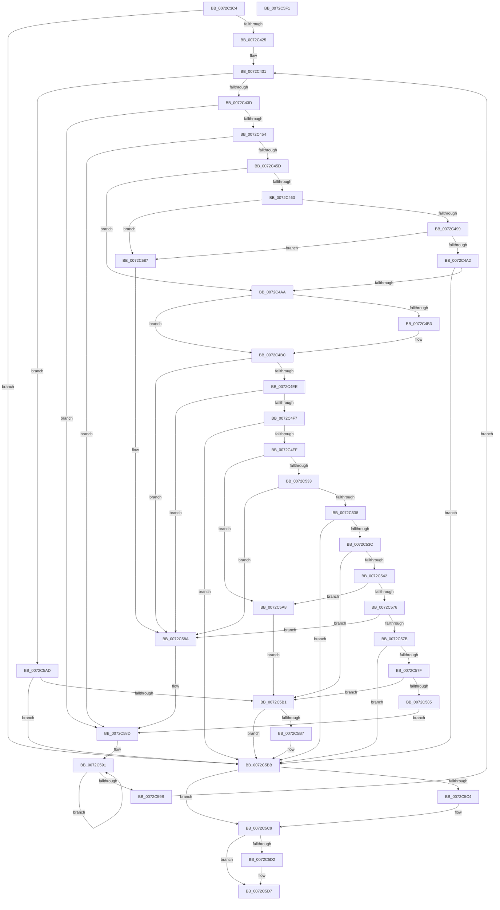

# PnpCheckDriverDependencies

- RVA: `0x0072C3C4`–`0x0072C5F2` (길이 `558` bytes)
- VA: `0x000000014072C3C4`
- 실행 섹션: `PAGE`
- PDB 이름 있음: `예`; PDB Function 태그: `아니요`
- unwind 정보 RVA: `0x000C5C40`
- 디코드: `151`개 명령, `558/558` bytes 표시
- 미해석 바이트: `0` (있으면 어셈블리에 `.byte`로 보존)

> 이 문서는 커널 이미지의 기계어와 PDB 기호를 분석해 생성했습니다. 4번과 5번은 함수 원형과 자료형을 바이너리 사용 방식에서 추정한 C 해석이며 원본 소스 복구 결과는 아닙니다.

## 1. Dependencies

- 직접 호출 지점: **9**; 고유 호출 대상: **5**
- 직접 호출자로 확인된 함수: **1**
- RIP 상대 이미지 참조: **5**

### Outgoing calls
- `0x0072C416` → [_PnpCtxGetCachedContextBaseKey](../8E/_PnpCtxGetCachedContextBaseKey_function_008EFB2C.md) (function, `0x008EFB2C`)
- `0x0072C447` → [wcsicmp](../../text/50/wcsicmp_function_00500080.md) (function, `0x00500080`)
- `0x0072C489` → [PnpCtxRegOpenKey](../8E/PnpCtxRegOpenKey_function_008EF7B8.md) (function, `0x008EF7B8`)
- `0x0072C4B3` → [ZwClose](../../text/6A/ZwClose_function_006AD2B0.md) (function, `0x006AD2B0`)
- `0x0072C4DE` → [PnpCtxRegOpenKey](../8E/PnpCtxRegOpenKey_function_008EF7B8.md) (function, `0x008EF7B8`)
- `0x0072C527` → [PnpCtxRegQueryValue](../99/PnpCtxRegQueryValue_function_009940FC.md) (function, `0x009940FC`)
- `0x0072C56A` → [PnpCtxRegQueryValue](../99/PnpCtxRegQueryValue_function_009940FC.md) (function, `0x009940FC`)
- `0x0072C5C4` → [ZwClose](../../text/6A/ZwClose_function_006AD2B0.md) (function, `0x006AD2B0`)
- `0x0072C5D2` → [ZwClose](../../text/6A/ZwClose_function_006AD2B0.md) (function, `0x006AD2B0`)

### Direct callers
- [PipProcessPendingObjects](../../init/C3/PipProcessPendingObjects_function_00C35F00.md) at `0x00C360D2`

### Static image references
- `0x0072C3F4` → RVA `0x00E66398` (`.data`; read)
- `0x0072C43D` → RVA `0x00AFD260` (` ?? ::NNGAKEGL::`string'`; read)
- `0x0072C472` → RVA `0x00AFDC50` (` ?? ::NNGAKEGL::`string'`; read)
- `0x0072C51B` → RVA `0x00AFDC90` (` ?? ::NNGAKEGL::`string'`; read)
- `0x0072C55E` → RVA `0x00AFDDB0` (` ?? ::NNGAKEGL::`string'`; read)

## 2. Other-region calls and transfers

- 다른 실행 섹션으로 향하는 call: **4**
  - `0x0072C447` → [wcsicmp](../../text/50/wcsicmp_function_00500080.md) (`PAGE` → `.text`)
  - `0x0072C4B3` → [ZwClose](../../text/6A/ZwClose_function_006AD2B0.md) (`PAGE` → `.text`)
  - `0x0072C5C4` → [ZwClose](../../text/6A/ZwClose_function_006AD2B0.md) (`PAGE` → `.text`)
  - `0x0072C5D2` → [ZwClose](../../text/6A/ZwClose_function_006AD2B0.md) (`PAGE` → `.text`)
- 별도 외부 분기/꼬리 이동을 확인하지 못했습니다.

## 3. Assembly (complete function range)

```asm
0072C3C4  48 89 5C 24 08                  mov qword ptr [rsp + 8], rbx
0072C3C9  4C 89 44 24 18                  mov qword ptr [rsp + 0x18], r8
0072C3CE  55                              push rbp
0072C3CF  56                              push rsi
0072C3D0  57                              push rdi
0072C3D1  41 54                           push r12
0072C3D3  41 55                           push r13
0072C3D5  41 56                           push r14
0072C3D7  41 57                           push r15
0072C3D9  48 8B EC                        mov rbp, rsp
0072C3DC  48 83 EC 50                     sub rsp, 0x50
0072C3E0  45 33 FF                        xor r15d, r15d
0072C3E3  4C 8D 45 F8                     lea r8, [rbp - 8]
0072C3E7  4C 8B F2                        mov r14, rdx
0072C3EA  44 88 3A                        mov byte ptr [rdx], r15b
0072C3ED  48 8B F9                        mov rdi, rcx
0072C3F0  4C 89 7D F8                     mov qword ptr [rbp - 8], r15
0072C3F4  48 8B 0D 9D 9F 73 00            mov rcx, qword ptr [rip + 0x739f9d]
0072C3FB  41 8A F7                        mov sil, r15b
0072C3FE  41 8D 57 04                     lea edx, [r15 + 4]
0072C402  4C 89 7D F0                     mov qword ptr [rbp - 0x10], r15
0072C406  4C 89 7D E8                     mov qword ptr [rbp - 0x18], r15
0072C40A  44 89 7D E0                     mov dword ptr [rbp - 0x20], r15d
0072C40E  44 89 7D 48                     mov dword ptr [rbp + 0x48], r15d
0072C412  44 89 7D 58                     mov dword ptr [rbp + 0x58], r15d
0072C416  E8 11 37 1C 00                  call 0x1408efb2c
0072C41B  8B D8                           mov ebx, eax
0072C41D  85 C0                           test eax, eax
0072C41F  0F 88 96 01 00 00               js 0x14072c5bb
0072C425  41 BD 34 00 00 C0               mov r13d, 0xc0000034
0072C42B  41 BC 7C 01 00 C0               mov r12d, 0xc000017c
0072C431  8B C3                           mov eax, ebx
0072C433  66 44 39 3F                     cmp word ptr [rdi], r15w
0072C437  0F 84 70 01 00 00               je 0x14072c5ad
0072C43D  48 8D 15 1C 0E 3D 00            lea rdx, [rip + 0x3d0e1c]
0072C444  48 8B CF                        mov rcx, rdi
0072C447  E8 34 3C DD FF                  call 0x140500080
0072C44C  85 C0                           test eax, eax
0072C44E  0F 84 39 01 00 00               je 0x14072c58d
0072C454  40 84 F6                        test sil, sil
0072C457  0F 85 30 01 00 00               jne 0x14072c58d
0072C45D  4C 39 7D F0                     cmp qword ptr [rbp - 0x10], r15
0072C461  75 47                           jne 0x14072c4aa
0072C463  48 8B 55 F8                     mov rdx, qword ptr [rbp - 8]
0072C467  48 8D 45 F0                     lea rax, [rbp - 0x10]
0072C46B  48 8B 0D 26 9F 73 00            mov rcx, qword ptr [rip + 0x739f26]
0072C472  4C 8D 05 D7 17 3D 00            lea r8, [rip + 0x3d17d7]
0072C479  48 89 44 24 28                  mov qword ptr [rsp + 0x28], rax
0072C47E  45 33 C9                        xor r9d, r9d
0072C481  C7 44 24 20 19 00 02 00         mov dword ptr [rsp + 0x20], 0x20019
0072C489  E8 2A 33 1C 00                  call 0x1408ef7b8
0072C48E  8B D8                           mov ebx, eax
0072C490  41 3B C5                        cmp eax, r13d
0072C493  0F 84 EE 00 00 00               je 0x14072c587
0072C499  41 3B C4                        cmp eax, r12d
0072C49C  0F 84 E5 00 00 00               je 0x14072c587
0072C4A2  85 C0                           test eax, eax
0072C4A4  0F 88 11 01 00 00               js 0x14072c5bb
0072C4AA  48 8B 4D E8                     mov rcx, qword ptr [rbp - 0x18]
0072C4AE  48 85 C9                        test rcx, rcx
0072C4B1  74 09                           je 0x14072c4bc
0072C4B3  E8 F8 0D F8 FF                  call 0x1406ad2b0
0072C4B8  4C 89 7D E8                     mov qword ptr [rbp - 0x18], r15
0072C4BC  48 8B 55 F0                     mov rdx, qword ptr [rbp - 0x10]
0072C4C0  48 8D 45 E8                     lea rax, [rbp - 0x18]
0072C4C4  48 8B 0D CD 9E 73 00            mov rcx, qword ptr [rip + 0x739ecd]
0072C4CB  45 33 C9                        xor r9d, r9d
0072C4CE  48 89 44 24 28                  mov qword ptr [rsp + 0x28], rax
0072C4D3  4C 8B C7                        mov r8, rdi
0072C4D6  C7 44 24 20 01 00 00 00         mov dword ptr [rsp + 0x20], 1
0072C4DE  E8 D5 32 1C 00                  call 0x1408ef7b8
0072C4E3  8B D8                           mov ebx, eax
0072C4E5  41 3B C5                        cmp eax, r13d
0072C4E8  0F 84 9C 00 00 00               je 0x14072c58a
0072C4EE  41 3B C4                        cmp eax, r12d
0072C4F1  0F 84 93 00 00 00               je 0x14072c58a
0072C4F7  85 C0                           test eax, eax
0072C4F9  0F 88 BC 00 00 00               js 0x14072c5bb
0072C4FF  48 8B 55 E8                     mov rdx, qword ptr [rbp - 0x18]
0072C503  48 8D 45 50                     lea rax, [rbp + 0x50]
0072C507  48 89 44 24 28                  mov qword ptr [rsp + 0x28], rax
0072C50C  4C 8D 4D 58                     lea r9, [rbp + 0x58]
0072C510  48 8D 45 48                     lea rax, [rbp + 0x48]
0072C514  C7 45 50 04 00 00 00            mov dword ptr [rbp + 0x50], 4
0072C51B  4C 8D 05 6E 17 3D 00            lea r8, [rip + 0x3d176e]
0072C522  48 89 44 24 20                  mov qword ptr [rsp + 0x20], rax
0072C527  E8 D0 7B 26 00                  call 0x1409940fc
0072C52C  8B D8                           mov ebx, eax
0072C52E  41 3B C5                        cmp eax, r13d
0072C531  74 75                           je 0x14072c5a8
0072C533  41 3B C4                        cmp eax, r12d
0072C536  74 52                           je 0x14072c58a
0072C538  85 C0                           test eax, eax
0072C53A  78 7F                           js 0x14072c5bb
0072C53C  83 7D 48 02                     cmp dword ptr [rbp + 0x48], 2
0072C540  75 6F                           jne 0x14072c5b1
0072C542  48 8B 55 E8                     mov rdx, qword ptr [rbp - 0x18]
0072C546  48 8D 45 50                     lea rax, [rbp + 0x50]
0072C54A  48 89 44 24 28                  mov qword ptr [rsp + 0x28], rax
0072C54F  4C 8D 4D 58                     lea r9, [rbp + 0x58]
0072C553  48 8D 45 E0                     lea rax, [rbp - 0x20]
0072C557  C7 45 50 04 00 00 00            mov dword ptr [rbp + 0x50], 4
0072C55E  4C 8D 05 4B 18 3D 00            lea r8, [rip + 0x3d184b]
0072C565  48 89 44 24 20                  mov qword ptr [rsp + 0x20], rax
0072C56A  E8 8D 7B 26 00                  call 0x1409940fc
0072C56F  8B D8                           mov ebx, eax
0072C571  41 3B C5                        cmp eax, r13d
0072C574  74 32                           je 0x14072c5a8
0072C576  41 3B C4                        cmp eax, r12d
0072C579  74 0F                           je 0x14072c58a
0072C57B  85 C0                           test eax, eax
0072C57D  78 3C                           js 0x14072c5bb
0072C57F  44 39 7D E0                     cmp dword ptr [rbp - 0x20], r15d
0072C583  75 2C                           jne 0x14072c5b1
0072C585  EB 06                           jmp 0x14072c58d
0072C587  40 B6 01                        mov sil, 1
0072C58A  41 8B DF                        mov ebx, r15d
0072C58D  48 83 C8 FF                     or rax, 0xffffffffffffffff
0072C591  48 FF C0                        inc rax
0072C594  66 44 39 3C 47                  cmp word ptr [rdi + rax*2], r15w
0072C599  75 F6                           jne 0x14072c591
0072C59B  48 8D 3C 47                     lea rdi, [rdi + rax*2]
0072C59F  48 83 C7 02                     add rdi, 2
0072C5A3  E9 89 FE FF FF                  jmp 0x14072c431
0072C5A8  41 8B DF                        mov ebx, r15d
0072C5AB  EB 04                           jmp 0x14072c5b1
0072C5AD  85 C0                           test eax, eax
0072C5AF  78 0A                           js 0x14072c5bb
0072C5B1  66 44 39 3F                     cmp word ptr [rdi], r15w
0072C5B5  75 04                           jne 0x14072c5bb
0072C5B7  41 C6 06 01                     mov byte ptr [r14], 1
0072C5BB  48 8B 4D F0                     mov rcx, qword ptr [rbp - 0x10]
0072C5BF  48 85 C9                        test rcx, rcx
0072C5C2  74 05                           je 0x14072c5c9
0072C5C4  E8 E7 0C F8 FF                  call 0x1406ad2b0
0072C5C9  48 8B 4D E8                     mov rcx, qword ptr [rbp - 0x18]
0072C5CD  48 85 C9                        test rcx, rcx
0072C5D0  74 05                           je 0x14072c5d7
0072C5D2  E8 D9 0C F8 FF                  call 0x1406ad2b0
0072C5D7  8B C3                           mov eax, ebx
0072C5D9  48 8B 9C 24 90 00 00 00         mov rbx, qword ptr [rsp + 0x90]
0072C5E1  48 83 C4 50                     add rsp, 0x50
0072C5E5  41 5F                           pop r15
0072C5E7  41 5E                           pop r14
0072C5E9  41 5D                           pop r13
0072C5EB  41 5C                           pop r12
0072C5ED  5F                              pop rdi
0072C5EE  5E                              pop rsi
0072C5EF  5D                              pop rbp
0072C5F0  C3                              ret
0072C5F1  CC                              int3
```

## 4. C-style interpretation (structured pseudocode)

```c
__int64 __fastcall PnpCheckDriverDependencies(__int64 a1, __int64 a2, __int64 a3, int a4)
{
    __int64 result;
    __int64 v_r15;
    __int64 v_rdi;
    __int64 v_rsp;
    unsigned __int64 v_stack_m40;
    unsigned __int64 v_stack_m48;
    unsigned __int64 v_stack_m50;
    unsigned int v_stack_m58;
    unsigned __int64 v_stack_m60;
    unsigned int v_stack_m68;
    unsigned int v_stack_p10;
    unsigned __int64 v_stack_p18;
    unsigned int v_stack_p20;
    unsigned __int64 v_stack_p8;

    v_stack_p8 = v_rbx;
    v_stack_p18 = a3;
    v_rsp = (v_rsp) - (80);
    v_r15 = 0;
    *(unsigned __int8 *)(a2) = 0;
    v_stack_m40 = 0;
    v_stack_m48 = 0;
    v_stack_m50 = 0;
    v_stack_m58 = 0;
    v_stack_p10 = 0;
    v_stack_p20 = 0;
    result = _PnpCtxGetCachedContextBaseKey(*(unsigned __int64 *)(v_rip + 7577501), v_r15 + 4, v_stack_m40, a4);
    if (sign_flag) goto loc_0072C5BB;
loc_0072C431:
    if ((*(unsigned __int16 *)(a1)) == 0) goto loc_0072C5AD;
    result = wcsicmp(a1, v_rip + 4001308, v_stack_m40, a4);
    if ((unsigned int)(result) == 0) goto loc_0072C58D;
    if (0 != 0) goto loc_0072C58D;
    if (v_stack_m48 != 0) goto loc_0072C4AA;
    v_stack_m60 = v_stack_m48;
    a4 = 0;
    v_stack_m68 = 0x20019ULL;
    result = PnpCtxRegOpenKey(*(unsigned __int64 *)(v_rip + 7577382), v_stack_m40, v_rip + 4003799, a4);
    if (((unsigned int)(result)) == ((unsigned int)((unsigned int)(0xC0000034ULL)))) goto loc_0072C587;
    if (((unsigned int)(result)) == ((unsigned int)((unsigned int)(0xC000017CULL)))) goto loc_0072C587;
    if (sign_flag) goto loc_0072C5BB;
loc_0072C4AA:
    if (v_stack_m50 != 0) {
        result = ZwClose(v_stack_m50, v_stack_m40, v_rip + 4003799, a4);
        v_stack_m50 = 0;
    }
    a4 = 0;
    v_stack_m60 = v_stack_m50;
    v_stack_m68 = 1;
    result = PnpCtxRegOpenKey(*(unsigned __int64 *)(v_rip + 7577293), v_stack_m48, a1, a4);
    if (((unsigned int)(result)) == ((unsigned int)((unsigned int)(0xC0000034ULL)))) goto loc_0072C58A;
    if (((unsigned int)(result)) == ((unsigned int)((unsigned int)(0xC000017CULL)))) goto loc_0072C58A;
    if (sign_flag) goto loc_0072C5BB;
    v_stack_m60 = v_stack_p18;
    v_stack_p18 = 4;
    v_stack_m68 = v_stack_p10;
    result = PnpCtxRegQueryValue(*(unsigned __int64 *)(v_rip + 7577293), v_stack_m50, v_rip + 4003694, v_stack_p20);
    if (((unsigned int)(result)) == ((unsigned int)((unsigned int)(0xC0000034ULL)))) goto loc_0072C5A8;
    if (((unsigned int)(result)) == ((unsigned int)((unsigned int)(0xC000017CULL)))) goto loc_0072C58A;
    if (sign_flag) goto loc_0072C5BB;
    if (v_stack_p10 != 2) goto loc_0072C5B1;
    v_stack_m60 = v_stack_p18;
    v_stack_p18 = 4;
    v_stack_m68 = v_stack_m58;
    result = PnpCtxRegQueryValue(*(unsigned __int64 *)(v_rip + 7577293), v_stack_m50, v_rip + 4003915, v_stack_p20);
    if (((unsigned int)(result)) == ((unsigned int)((unsigned int)(0xC0000034ULL)))) goto loc_0072C5A8;
    if (((unsigned int)(result)) == ((unsigned int)((unsigned int)(0xC000017CULL)))) goto loc_0072C58A;
    if (sign_flag) goto loc_0072C5BB;
    if (v_stack_m58 != 0) goto loc_0072C5B1;
    goto loc_0072C58D;
loc_0072C587:
loc_0072C58A:
loc_0072C58D:
    result = (result) | (-1);
loc_0072C591:
    result = (result) + 1;
    if ((*(unsigned __int16 *)(a1 + result * 2)) != 0) goto loc_0072C591;
    v_rdi = (a1 + result * 2) + (2);
    goto loc_0072C431;
loc_0072C5A8:
    goto loc_0072C5B1;
loc_0072C5AD:
    if (sign_flag) goto loc_0072C5BB;
loc_0072C5B1:
    if ((*(unsigned __int16 *)(v_rdi)) == 0) {
        *(unsigned __int8 *)(a2) = 1;
    }
    if (v_stack_m48 != 0) {
        result = ZwClose(v_stack_m48, v_stack_m50, v_rip + 4003915, v_stack_p20);
    }
    if (v_stack_m50 != 0) {
        result = ZwClose(v_stack_m50, v_stack_m50, v_rip + 4003915, v_stack_p20);
    }
    v_rsp = (v_rsp) + (80);
    return 0;
}
```

## 5. (Beta) C Style

```c
int64_t PnpCheckDriverDependencies(void *Arg1, void *Arg2, int64_t Arg3, int32_t Arg4)
{
    uint8_t *arg1 = (uint8_t *)Arg1;
    uint8_t *arg2 = (uint8_t *)Arg2;

    int64_t result;
    int64_t local_r15;
    int64_t local_rdi;
    int64_t local_rsp;
    uint64_t v_stack_m40;
    uint64_t v_stack_m48;
    uint64_t v_stack_m50;
    uint32_t v_stack_m58;
    uint64_t v_stack_m60;
    uint32_t v_stack_m68;
    uint32_t v_stack_p10;
    uint64_t v_stack_p18;
    uint32_t v_stack_p20;
    uint64_t v_stack_p8;

    v_stack_p8 = local_rbx;
    v_stack_p18 = Arg3;
    local_rsp = (local_rsp) - (80);
    local_r15 = 0;
    *(uint8_t *)(arg2) = 0;
    v_stack_m40 = 0;
    v_stack_m48 = 0;
    v_stack_m50 = 0;
    v_stack_m58 = 0;
    v_stack_p10 = 0;
    v_stack_p20 = 0;
    result = _PnpCtxGetCachedContextBaseKey(*(uint64_t *)(v_rip + 0x739F9D), local_r15 + 4, v_stack_m40, Arg4);
    if (sign_flag) goto loc_0072C5BB;
loc_0072C431:
    if ((*(uint16_t *)(arg1)) == 0) goto loc_0072C5AD;
    result = wcsicmp(Arg1, v_rip + 4001308, v_stack_m40, Arg4);
    if ((uint32_t)(result) == 0) goto loc_0072C58D;
    if (0 != 0) goto loc_0072C58D;
    if (v_stack_m48 != 0) goto loc_0072C4AA;
    v_stack_m60 = v_stack_m48;
    Arg4 = 0;
    v_stack_m68 = 0x20019ULL;
    result = PnpCtxRegOpenKey(*(uint64_t *)(v_rip + 0x739F26), v_stack_m40, v_rip + 4003799, Arg4);
    if (((uint32_t)(result)) == ((uint32_t)((uint32_t)(0xC0000034ULL)))) goto loc_0072C587;
    if (((uint32_t)(result)) == ((uint32_t)((uint32_t)(0xC000017CULL)))) goto loc_0072C587;
    if (sign_flag) goto loc_0072C5BB;
loc_0072C4AA:
    if (v_stack_m50 != 0) {
        result = ZwClose(v_stack_m50, v_stack_m40, v_rip + 4003799, Arg4);
        v_stack_m50 = 0;
    }
    Arg4 = 0;
    v_stack_m60 = v_stack_m50;
    v_stack_m68 = 1;
    result = PnpCtxRegOpenKey(*(uint64_t *)(v_rip + 0x739ECD), v_stack_m48, Arg1, Arg4);
    if (((uint32_t)(result)) == ((uint32_t)((uint32_t)(0xC0000034ULL)))) goto loc_0072C58A;
    if (((uint32_t)(result)) == ((uint32_t)((uint32_t)(0xC000017CULL)))) goto loc_0072C58A;
    if (sign_flag) goto loc_0072C5BB;
    v_stack_m60 = v_stack_p18;
    v_stack_p18 = 4;
    v_stack_m68 = v_stack_p10;
    result = PnpCtxRegQueryValue(*(uint64_t *)(v_rip + 0x739ECD), v_stack_m50, v_rip + 4003694, v_stack_p20);
    if (((uint32_t)(result)) == ((uint32_t)((uint32_t)(0xC0000034ULL)))) goto loc_0072C5A8;
    if (((uint32_t)(result)) == ((uint32_t)((uint32_t)(0xC000017CULL)))) goto loc_0072C58A;
    if (sign_flag) goto loc_0072C5BB;
    if (v_stack_p10 != 2) goto loc_0072C5B1;
    v_stack_m60 = v_stack_p18;
    v_stack_p18 = 4;
    v_stack_m68 = v_stack_m58;
    result = PnpCtxRegQueryValue(*(uint64_t *)(v_rip + 0x739ECD), v_stack_m50, v_rip + 4003915, v_stack_p20);
    if (((uint32_t)(result)) == ((uint32_t)((uint32_t)(0xC0000034ULL)))) goto loc_0072C5A8;
    if (((uint32_t)(result)) == ((uint32_t)((uint32_t)(0xC000017CULL)))) goto loc_0072C58A;
    if (sign_flag) goto loc_0072C5BB;
    if (v_stack_m58 != 0) goto loc_0072C5B1;
    goto loc_0072C58D;
loc_0072C587:
loc_0072C58A:
loc_0072C58D:
    result = (result) | (-1);
loc_0072C591:
    result = (result) + 1;
    if ((*(uint16_t *)(arg1 + result * 2)) != 0) goto loc_0072C591;
    local_rdi = (Arg1 + result * 2) + (2);
    goto loc_0072C431;
loc_0072C5A8:
    goto loc_0072C5B1;
loc_0072C5AD:
    if (sign_flag) goto loc_0072C5BB;
loc_0072C5B1:
    if ((*(uint16_t *)(local_rdi)) == 0) {
        *(uint8_t *)(arg2) = 1;
    }
    if (v_stack_m48 != 0) {
        result = ZwClose(v_stack_m48, v_stack_m50, v_rip + 4003915, v_stack_p20);
    }
    if (v_stack_m50 != 0) {
        result = ZwClose(v_stack_m50, v_stack_m50, v_rip + 4003915, v_stack_p20);
    }
    local_rsp = (local_rsp) + (80);
    return 0;
}
```

### 관측된 메모리 오프셋

구조체 형식이 확인되지 않은 접근은 인자 기준의 오프셋으로만 기록했습니다.

| 기준 인자 | 오프셋 표현 | 폭 (bit) | 접근 |
|---|---:|---:|---|
| `Arg1` | `+ 0x0` | `16` | `R` |
| `Arg1` | `+ 0x0 + rax*2` | `16` | `R` |
| `Arg1` | `+ 0x0 + rax*2` | `64` | `R` |
| `Arg2` | `+ 0x0` | `8` | `W` |

## 6. Execution-region graph

[열기: 2D/3D 그래프와 함수 탐색 컨트롤 패널](../../../control-panel.html?section=page&rva=0x0072C3C4&view=graph)

- 2D 그래프는 위에서 아래로 흐르고, 3D 그래프는 빈 공간을 드래그해 회전합니다. Shift+드래그는 이동, 휠은 확대·축소, 함수 노드 선택은 대상 보고서 이동입니다.

### Static fallback


