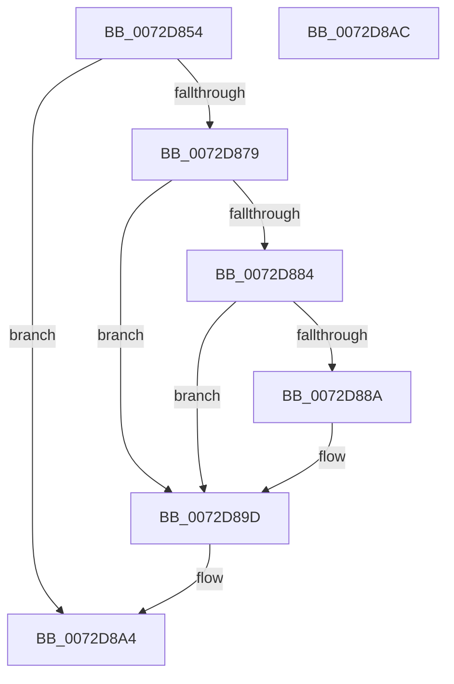

# PnpCheckPossibleBootStartDriver

- RVA: `0x0072D854`–`0x0072D8AD` (길이 `89` bytes)
- VA: `0x000000014072D854`
- 실행 섹션: `PAGE`
- PDB 이름 있음: `예`; PDB Function 태그: `아니요`
- unwind 정보 RVA: `0x0005CF00`
- 디코드: `28`개 명령, `89/89` bytes 표시
- 미해석 바이트: `0` (있으면 어셈블리에 `.byte`로 보존)

> 이 문서는 커널 이미지의 기계어와 PDB 기호를 분석해 생성했습니다. 4번과 5번은 함수 원형과 자료형을 바이너리 사용 방식에서 추정한 C 해석이며 원본 소스 복구 결과는 아닙니다.

## 1. Dependencies

- 직접 호출 지점: **2**; 고유 호출 대상: **2**
- 직접 호출자로 확인된 함수: **1**
- RIP 상대 이미지 참조: **1**

### Outgoing calls
- `0x0072D870` → [IopGetRegistryValue](../99/IopGetRegistryValue_function_009990EC.md) (function, `0x009990EC`)
- `0x0072D89F` → [ExFreePoolWithTag](../../poolcode/B8/ExFreePoolWithTag_function_00B82870.md) (function, `0x00B82870`)

### Direct callers
- [PipCallDriverAddDeviceQueryRoutine](../99/PipCallDriverAddDeviceQueryRoutine_function_00996604.md) at `0x009969FD`
- [PipCallDriverAddDeviceQueryRoutine](../99/PipCallDriverAddDeviceQueryRoutine_function_00996604.md) at `0x00996A52`

### Static image references
- `0x0072D869` → RVA `0x00AFDF70` (` ?? ::NNGAKEGL::`string'`; read)

## 2. Other-region calls and transfers

- 다른 실행 섹션으로 향하는 call: **1**
  - `0x0072D89F` → [ExFreePoolWithTag](../../poolcode/B8/ExFreePoolWithTag_function_00B82870.md) (`PAGE` → `POOLCODE`)
- 별도 외부 분기/꼬리 이동을 확인하지 못했습니다.

## 3. Assembly (complete function range)

```asm
0072D854  40 53                           push rbx
0072D856  48 83 EC 20                     sub rsp, 0x20
0072D85A  33 DB                           xor ebx, ebx
0072D85C  4C 8D 4C 24 38                  lea r9, [rsp + 0x38]
0072D861  45 33 C0                        xor r8d, r8d
0072D864  48 89 5C 24 38                  mov qword ptr [rsp + 0x38], rbx
0072D869  48 8D 15 00 07 3D 00            lea rdx, [rip + 0x3d0700]
0072D870  E8 77 B8 26 00                  call 0x1409990ec
0072D875  85 C0                           test eax, eax
0072D877  78 2B                           js 0x14072d8a4
0072D879  48 8B 4C 24 38                  mov rcx, qword ptr [rsp + 0x38]
0072D87E  83 79 04 04                     cmp dword ptr [rcx + 4], 4
0072D882  75 19                           jne 0x14072d89d
0072D884  83 79 0C 04                     cmp dword ptr [rcx + 0xc], 4
0072D888  75 13                           jne 0x14072d89d
0072D88A  8B 41 08                        mov eax, dword ptr [rcx + 8]
0072D88D  44 8D 43 01                     lea r8d, [rbx + 1]
0072D891  0F B6 D3                        movzx edx, bl
0072D894  39 1C 08                        cmp dword ptr [rax + rcx], ebx
0072D897  41 0F 45 D0                     cmovne edx, r8d
0072D89B  8A DA                           mov bl, dl
0072D89D  33 D2                           xor edx, edx
0072D89F  E8 CC 4F 45 00                  call 0x140b82870
0072D8A4  8A C3                           mov al, bl
0072D8A6  48 83 C4 20                     add rsp, 0x20
0072D8AA  5B                              pop rbx
0072D8AB  C3                              ret
0072D8AC  CC                              int3
```

## 4. C-style interpretation (structured pseudocode)

```c
__int64 __fastcall PnpCheckPossibleBootStartDriver(__int64 a1, __int64 a2, int a3)
{
    __int64 result;
    __int64 v_rbx;
    __int64 v_rsp;
    unsigned __int64 v_stack_p10;

    v_rsp = (v_rsp) - (32);
    v_rbx = 0;
    a3 = 0;
    v_stack_p10 = 0;
    result = IopGetRegistryValue(a1, v_rip + 3999488, a3, v_stack_p10);
    if (sign_flag) goto loc_0072D8A4;
    if ((*(unsigned int *)(v_stack_p10 + 4)) != 4) goto loc_0072D89D;
    if ((*(unsigned int *)(v_stack_p10 + 12)) == 4) {
        result = *(unsigned int *)(v_stack_p10 + 8);
        a3 = v_rbx + 1;
        a2 = 0;
        if ((*(unsigned int *)(result + v_stack_p10 * 1)) != 0) { a2 = a3; }
        v_rbx = (unsigned __int8)(a2);
    }
    a2 = 0;
    result = ExFreePoolWithTag(v_stack_p10, a2, a3, v_stack_p10);
loc_0072D8A4:
    v_rsp = (v_rsp) + (32);
    return (unsigned __int8)(v_rbx);
}
```

## 5. (Beta) C Style

```c
int64_t PnpCheckPossibleBootStartDriver(int64_t Arg1, int64_t Arg2, int32_t Arg3)
{
    int64_t result;
    int64_t local_rbx;
    int64_t local_rsp;
    uint64_t v_stack_p10;

    local_rsp = (local_rsp) - (32);
    local_rbx = 0;
    Arg3 = 0;
    v_stack_p10 = 0;
    result = IopGetRegistryValue(Arg1, v_rip + 3999488, Arg3, v_stack_p10);
    if (sign_flag) goto loc_0072D8A4;
    if ((*(uint32_t *)(v_stack_p10 + 0x4)) != 4) goto loc_0072D89D;
    if ((*(uint32_t *)(v_stack_p10 + 0xC)) == 4) {
        result = *(uint32_t *)(v_stack_p10 + 0x8);
        Arg3 = local_rbx + 1;
        Arg2 = 0;
        if ((*(uint32_t *)(result + v_stack_p10 * 1)) != 0) { Arg2 = Arg3; }
        local_rbx = (uint8_t)(Arg2);
    }
    Arg2 = 0;
    result = ExFreePoolWithTag(v_stack_p10, Arg2, Arg3, v_stack_p10);
loc_0072D8A4:
    local_rsp = (local_rsp) + (32);
    return (uint8_t)(local_rbx);
}
```

## 6. Execution-region graph

[열기: 2D/3D 그래프와 함수 탐색 컨트롤 패널](../../../control-panel.html?section=page&rva=0x0072D854&view=graph)

- 2D 그래프는 위에서 아래로 흐르고, 3D 그래프는 빈 공간을 드래그해 회전합니다. Shift+드래그는 이동, 휠은 확대·축소, 함수 노드 선택은 대상 보고서 이동입니다.

### Static fallback


