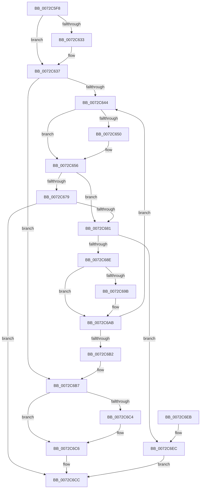

# PnpConvertDevpropcompkeyArrayToString

- RVA: `0x0072C5F8`–`0x0072C6F3` (길이 `251` bytes)
- VA: `0x000000014072C5F8`
- 실행 섹션: `PAGE`
- PDB 이름 있음: `예`; PDB Function 태그: `아니요`
- unwind 정보 RVA: `0x000C8734`
- 디코드: `84`개 명령, `251/251` bytes 표시
- 미해석 바이트: `0` (있으면 어셈블리에 `.byte`로 보존)

> 이 문서는 커널 이미지의 기계어와 PDB 기호를 분석해 생성했습니다. 4번과 5번은 함수 원형과 자료형을 바이너리 사용 방식에서 추정한 C 해석이며 원본 소스 복구 결과는 아닙니다.

## 1. Dependencies

- 직접 호출 지점: **2**; 고유 호출 대상: **2**
- 직접 호출자로 확인된 함수: **1**
- RIP 상대 이미지 참조: **0**

### Outgoing calls
- `0x0072C644` → [Feature_KernelPnP_ConvertDevpropcompkeyArrayToString__private_IsEnabledDeviceUsageNoInline](../../text/5A/Feature_KernelPnP_ConvertDevpropcompkeyArrayToString__private_IsEnabledDeviceUsageNoInline_function_005A68A4.md) (function, `0x005A68A4`)
- `0x0072C667` → [ConvertDevpropcompkeyToString](../AF/ConvertDevpropcompkeyToString_function_00AFA604.md) (function, `0x00AFA604`)

### Direct callers
- [sub_00B1C93A](../B1/Unknown_function_00B1C93A.md) at `0x00B1CB6E`
- [sub_00B1C93A](../B1/Unknown_function_00B1C93A.md) at `0x00B1CBBE`

### Static image references
- 디코드된 RIP-relative 메모리 참조가 없습니다.

## 2. Other-region calls and transfers

- 다른 실행 섹션으로 향하는 call: **1**
  - `0x0072C644` → [Feature_KernelPnP_ConvertDevpropcompkeyArrayToString__private_IsEnabledDeviceUsageNoInline](../../text/5A/Feature_KernelPnP_ConvertDevpropcompkeyArrayToString__private_IsEnabledDeviceUsageNoInline_function_005A68A4.md) (`PAGE` → `.text`)
- 별도 외부 분기/꼬리 이동을 확인하지 못했습니다.

## 3. Assembly (complete function range)

```asm
0072C5F8  48 8B C4                        mov rax, rsp
0072C5FB  48 89 58 08                     mov qword ptr [rax + 8], rbx
0072C5FF  48 89 68 18                     mov qword ptr [rax + 0x18], rbp
0072C603  48 89 70 20                     mov qword ptr [rax + 0x20], rsi
0072C607  57                              push rdi
0072C608  41 54                           push r12
0072C60A  41 55                           push r13
0072C60C  41 56                           push r14
0072C60E  41 57                           push r15
0072C610  48 83 EC 20                     sub rsp, 0x20
0072C614  45 33 ED                        xor r13d, r13d
0072C617  41 8B F9                        mov edi, r9d
0072C61A  49 8B F0                        mov rsi, r8
0072C61D  44 89 68 10                     mov dword ptr [rax + 0x10], r13d
0072C621  44 8B F2                        mov r14d, edx
0072C624  4C 8B E1                        mov r12, rcx
0072C627  45 8B F9                        mov r15d, r9d
0072C62A  41 8D 5D 02                     lea ebx, [r13 + 2]
0072C62E  44 3B CB                        cmp r9d, ebx
0072C631  72 04                           jb 0x14072c637
0072C633  66 45 89 28                     mov word ptr [r8], r13w
0072C637  41 8B ED                        mov ebp, r13d
0072C63A  BA 23 00 00 C0                  mov edx, 0xc0000023
0072C63F  45 85 F6                        test r14d, r14d
0072C642  74 73                           je 0x14072c6b7
0072C644  E8 5B A2 E7 FF                  call 0x1405a68a4
0072C649  48 8B D6                        mov rdx, rsi
0072C64C  85 C0                           test eax, eax
0072C64E  74 06                           je 0x14072c656
0072C650  85 FF                           test edi, edi
0072C652  49 0F 44 D5                     cmove rdx, r13
0072C656  8B CD                           mov ecx, ebp
0072C658  4C 8D 4C 24 58                  lea r9, [rsp + 0x58]
0072C65D  48 C1 E1 05                     shl rcx, 5
0072C661  44 8B C7                        mov r8d, edi
0072C664  49 03 CC                        add rcx, r12
0072C667  E8 98 DF 3C 00                  call 0x140afa604
0072C66C  BA 00 00 00 80                  mov edx, 0x80000000
0072C671  8B C8                           mov ecx, eax
0072C673  03 C2                           add eax, edx
0072C675  85 C2                           test edx, eax
0072C677  75 08                           jne 0x14072c681
0072C679  81 F9 23 00 00 C0               cmp ecx, 0xc0000023
0072C67F  75 4B                           jne 0x14072c6cc
0072C681  8B 54 24 58                     mov edx, dword ptr [rsp + 0x58]
0072C685  8D 42 FE                        lea eax, [rdx - 2]
0072C688  03 C3                           add eax, ebx
0072C68A  3B C3                           cmp eax, ebx
0072C68C  72 5E                           jb 0x14072c6ec
0072C68E  8B D8                           mov ebx, eax
0072C690  48 8D 4A FE                     lea rcx, [rdx - 2]
0072C694  8B C7                           mov eax, edi
0072C696  48 3B C1                        cmp rax, rcx
0072C699  72 10                           jb 0x14072c6ab
0072C69B  B8 02 00 00 00                  mov eax, 2
0072C6A0  2B C2                           sub eax, edx
0072C6A2  03 F8                           add edi, eax
0072C6A4  48 D1 E9                        shr rcx, 1
0072C6A7  48 8D 34 4E                     lea rsi, [rsi + rcx*2]
0072C6AB  FF C5                           inc ebp
0072C6AD  41 3B EE                        cmp ebp, r14d
0072C6B0  72 92                           jb 0x14072c644
0072C6B2  BA 23 00 00 C0                  mov edx, 0xc0000023
0072C6B7  48 8B 44 24 70                  mov rax, qword ptr [rsp + 0x70]
0072C6BC  41 8B CD                        mov ecx, r13d
0072C6BF  48 85 C0                        test rax, rax
0072C6C2  74 02                           je 0x14072c6c6
0072C6C4  89 18                           mov dword ptr [rax], ebx
0072C6C6  41 3B DF                        cmp ebx, r15d
0072C6C9  0F 47 CA                        cmova ecx, edx
0072C6CC  48 8B 5C 24 50                  mov rbx, qword ptr [rsp + 0x50]
0072C6D1  8B C1                           mov eax, ecx
0072C6D3  48 8B 6C 24 60                  mov rbp, qword ptr [rsp + 0x60]
0072C6D8  48 8B 74 24 68                  mov rsi, qword ptr [rsp + 0x68]
0072C6DD  48 83 C4 20                     add rsp, 0x20
0072C6E1  41 5F                           pop r15
0072C6E3  41 5E                           pop r14
0072C6E5  41 5D                           pop r13
0072C6E7  41 5C                           pop r12
0072C6E9  5F                              pop rdi
0072C6EA  C3                              ret
0072C6EB  CC                              int3
0072C6EC  B9 95 00 00 C0                  mov ecx, 0xc0000095
0072C6F1  EB D9                           jmp 0x14072c6cc
```

## 4. C-style interpretation (structured pseudocode)

```c
__int64 __fastcall PnpConvertDevpropcompkeyArrayToString(__int64 a1, int a2, __int64 a3, int a4, __int64 a5)
{
    __int64 result;
    __int64 v_r13;
    __int64 v_rbp;
    __int64 v_rdi;
    __int64 v_rsi;
    __int64 v_rsp;
    unsigned __int64 v_stack_p10;
    unsigned __int64 v_stack_p18;
    unsigned __int64 v_stack_p20;
    unsigned __int64 v_stack_p8;

    *(unsigned __int64 *)(v_rsp + 8) = v_rbx;
    *(unsigned __int64 *)(v_rsp + 24) = v_rbp;
    *(unsigned __int64 *)(v_rsp + 32) = v_rsi;
    v_rsp = (v_rsp) - (32);
    v_r13 = 0;
    *(unsigned int *)(v_rsp + 16) = 0;
    if (a4 >= ((unsigned int)(v_r13 + 2))) {
        *(unsigned __int16 *)(a3) = 0;
    }
    if ((unsigned int)((unsigned int)(a2)) == 0) goto loc_0072C6B7;
loc_0072C644:
    result = Feature_KernelPnP_ConvertDevpropcompkeyArrayToString__private_IsEnabledDeviceUsageNoInline(a1, (unsigned int)(0xC0000023ULL), a3, a4);
    if ((unsigned int)(result) != 0) {
        if ((unsigned int)((unsigned int)(a4)) == 0) { a3 = 0; }
    }
    a1 = (0) << (5);
    a1 = (a1) + (a1);
    result = ConvertDevpropcompkeyToString(a1, a3, (unsigned int)((unsigned int)((unsigned int)(a4))), v_stack_p10);
    result = (unsigned int)((result) + ((unsigned int)((unsigned int)(0x80000000ULL))));
    if ((((unsigned int)((unsigned int)(0x80000000ULL))) & ((unsigned int)(result))) != 0) goto loc_0072C681;
    if (((unsigned int)((unsigned int)((unsigned int)(result)))) != 0xC0000023ULL) goto loc_0072C6CC;
loc_0072C681:
    result = (unsigned int)(((unsigned int)(v_stack_p10) - 2) + ((unsigned int)(v_r13 + 2)));
    if (((unsigned int)(result)) < ((unsigned int)(v_r13 + 2))) goto loc_0072C6EC;
    result = (unsigned int)((unsigned int)((unsigned int)(a4)));
    v_rsi = a3;
    v_rdi = (unsigned int)(a4);
    if (((unsigned int)((unsigned int)((unsigned int)(a4)))) >= ((unsigned int)(v_stack_p10) - 2)) {
        result = 2;
        result = (unsigned int)((result) - ((unsigned int)((unsigned int)(v_stack_p10))));
        v_rdi = (unsigned int)(((unsigned int)(a4)) + ((unsigned int)(result)));
        a1 = ((unsigned int)(v_stack_p10) - 2) >> (1);
        v_rsi = a3 + a1 * 2;
    }
    v_rbp = (unsigned int)((0) + 1);
    if (((unsigned int)(v_rbp)) < ((unsigned int)((unsigned int)(a2)))) goto loc_0072C644;
loc_0072C6B7:
    if (a5 != 0) {
        *(unsigned int *)(a5) = (unsigned int)((unsigned int)((unsigned int)(result)));
    }
    a1 = 0;
    if (((unsigned int)((unsigned int)((unsigned int)(result)))) > ((unsigned int)((unsigned int)(a4)))) { a1 = (unsigned int)((unsigned int)(0xC0000023ULL)); }
loc_0072C6CC:
    v_rsp = (v_rsp) + (32);
    return (unsigned int)((unsigned int)(a1));
loc_0072C6EC:
    goto loc_0072C6CC;
}
```

## 5. (Beta) C Style

```c
int64_t PnpConvertDevpropcompkeyArrayToString(int64_t Arg1, int32_t Arg2, void *Arg3, int32_t Arg4, int64_t Arg5)
{
    uint8_t *arg3 = (uint8_t *)Arg3;

    int64_t result;
    int64_t local_r13;
    int64_t local_rbp;
    int64_t local_rdi;
    int64_t local_rsi;
    int64_t local_rsp;
    uint64_t v_stack_p10;
    uint64_t v_stack_p18;
    uint64_t v_stack_p20;
    uint64_t v_stack_p8;

    *(uint64_t *)(local_rsp + 0x8) = local_rbx;
    *(uint64_t *)(local_rsp + 0x18) = local_rbp;
    *(uint64_t *)(local_rsp + 0x20) = local_rsi;
    local_rsp = (local_rsp) - (32);
    local_r13 = 0;
    *(uint32_t *)(local_rsp + 0x10) = 0;
    if (Arg4 >= ((uint32_t)(local_r13 + 2))) {
        *(uint16_t *)(arg3) = 0;
    }
    if ((uint32_t)((uint32_t)(Arg2)) == 0) goto loc_0072C6B7;
loc_0072C644:
    result = Feature_KernelPnP_ConvertDevpropcompkeyArrayToString__private_IsEnabledDeviceUsageNoInline(Arg1, (uint32_t)(0xC0000023ULL), Arg3, Arg4);
    if ((uint32_t)(result) != 0) {
        if ((uint32_t)((uint32_t)(Arg4)) == 0) { Arg3 = 0; }
    }
    Arg1 = (0) << (5);
    Arg1 = (Arg1) + (Arg1);
    result = ConvertDevpropcompkeyToString(Arg1, Arg3, (uint32_t)((uint32_t)((uint32_t)(Arg4))), v_stack_p10);
    result = (uint32_t)((result) + ((uint32_t)((uint32_t)(0x80000000ULL))));
    if ((((uint32_t)((uint32_t)(0x80000000ULL))) & ((uint32_t)(result))) != 0) goto loc_0072C681;
    if (((uint32_t)((uint32_t)((uint32_t)(result)))) != 0xC0000023ULL) goto loc_0072C6CC;
loc_0072C681:
    result = (uint32_t)(((uint32_t)(v_stack_p10) - 2) + ((uint32_t)(local_r13 + 2)));
    if (((uint32_t)(result)) < ((uint32_t)(local_r13 + 2))) goto loc_0072C6EC;
    result = (uint32_t)((uint32_t)((uint32_t)(Arg4)));
    local_rsi = Arg3;
    local_rdi = (uint32_t)(Arg4);
    if (((uint32_t)((uint32_t)((uint32_t)(Arg4)))) >= ((uint32_t)(v_stack_p10) - 2)) {
        result = 2;
        result = (uint32_t)((result) - ((uint32_t)((uint32_t)(v_stack_p10))));
        local_rdi = (uint32_t)(((uint32_t)(Arg4)) + ((uint32_t)(result)));
        Arg1 = ((uint32_t)(v_stack_p10) - 2) >> (1);
        local_rsi = Arg3 + Arg1 * 2;
    }
    local_rbp = (uint32_t)((0) + 1);
    if (((uint32_t)(local_rbp)) < ((uint32_t)((uint32_t)(Arg2)))) goto loc_0072C644;
loc_0072C6B7:
    if (Arg5 != 0) {
        *(uint32_t *)(Arg5) = (uint32_t)((uint32_t)((uint32_t)(result)));
    }
    Arg1 = 0;
    if (((uint32_t)((uint32_t)((uint32_t)(result)))) > ((uint32_t)((uint32_t)(Arg4)))) { Arg1 = (uint32_t)((uint32_t)(0xC0000023ULL)); }
loc_0072C6CC:
    local_rsp = (local_rsp) + (32);
    return (uint32_t)((uint32_t)(Arg1));
loc_0072C6EC:
    goto loc_0072C6CC;
}
```

### 관측된 메모리 오프셋

구조체 형식이 확인되지 않은 접근은 인자 기준의 오프셋으로만 기록했습니다.

| 기준 인자 | 오프셋 표현 | 폭 (bit) | 접근 |
|---|---:|---:|---|
| `Arg3` | `+ 0x0` | `16` | `W` |
| `Arg3` | `+ 0x0 + rcx*2` | `64` | `R` |

## 6. Execution-region graph

[열기: 2D/3D 그래프와 함수 탐색 컨트롤 패널](../../../control-panel.html?section=page&rva=0x0072C5F8&view=graph)

- 2D 그래프는 위에서 아래로 흐르고, 3D 그래프는 빈 공간을 드래그해 회전합니다. Shift+드래그는 이동, 휠은 확대·축소, 함수 노드 선택은 대상 보고서 이동입니다.

### Static fallback


