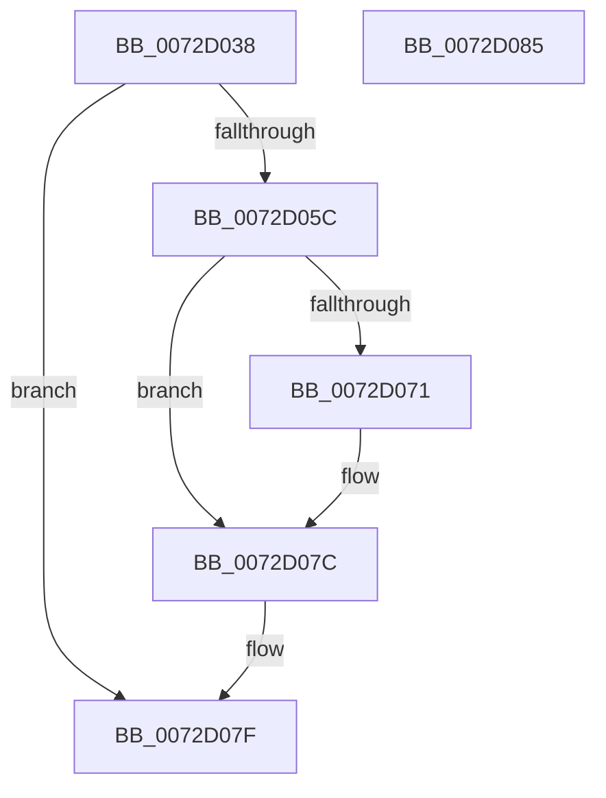

# PnpDelayedRemoveWorkerContextCreate

- RVA: `0x0072D038`–`0x0072D086` (길이 `78` bytes)
- VA: `0x000000014072D038`
- 실행 섹션: `PAGE`
- PDB 이름 있음: `예`; PDB Function 태그: `아니요`
- unwind 정보 RVA: `0x0005CF00`
- 디코드: `23`개 명령, `78/78` bytes 표시
- 미해석 바이트: `0` (있으면 어셈블리에 `.byte`로 보존)

> 이 문서는 커널 이미지의 기계어와 PDB 기호를 분석해 생성했습니다. 4번과 5번은 함수 원형과 자료형을 바이너리 사용 방식에서 추정한 C 해석이며 원본 소스 복구 결과는 아닙니다.

## 1. Dependencies

- 직접 호출 지점: **1**; 고유 호출 대상: **1**
- 직접 호출자로 확인된 함수: **1**
- RIP 상대 이미지 참조: **0**

### Outgoing calls
- `0x0072D04F` → [ExAllocatePool2](../../poolcode/B8/ExAllocatePool2_function_00B820F0.md) (function, `0x00B820F0`)

### Direct callers
- [sub_00B33662](../B3/Unknown_function_00B33662.md) at `0x00B33665`

### Static image references
- 디코드된 RIP-relative 메모리 참조가 없습니다.

## 2. Other-region calls and transfers

- 다른 실행 섹션으로 향하는 call: **1**
  - `0x0072D04F` → [ExAllocatePool2](../../poolcode/B8/ExAllocatePool2_function_00B820F0.md) (`PAGE` → `POOLCODE`)
- 별도 외부 분기/꼬리 이동을 확인하지 못했습니다.

## 3. Assembly (complete function range)

```asm
0072D038  40 53                           push rbx
0072D03A  48 83 EC 20                     sub rsp, 0x20
0072D03E  BA 20 00 00 00                  mov edx, 0x20
0072D043  48 8B D9                        mov rbx, rcx
0072D046  41 B8 50 6E 70 54               mov r8d, 0x54706e50
0072D04C  8D 4A 20                        lea ecx, [rdx + 0x20]
0072D04F  E8 9C 50 45 00                  call 0x140b820f0
0072D054  45 33 C0                        xor r8d, r8d
0072D057  48 85 C0                        test rax, rax
0072D05A  74 23                           je 0x14072d07f
0072D05C  48 89 58 10                     mov qword ptr [rax + 0x10], rbx
0072D060  48 8B 53 38                     mov rdx, qword ptr [rbx + 0x38]
0072D064  48 89 50 08                     mov qword ptr [rax + 8], rdx
0072D068  48 8B 4B 38                     mov rcx, qword ptr [rbx + 0x38]
0072D06C  48 85 C9                        test rcx, rcx
0072D06F  74 0B                           je 0x14072d07c
0072D071  48 8B 89 38 01 00 00            mov rcx, qword ptr [rcx + 0x138]
0072D078  4C 8B 41 28                     mov r8, qword ptr [rcx + 0x28]
0072D07C  4C 89 00                        mov qword ptr [rax], r8
0072D07F  48 83 C4 20                     add rsp, 0x20
0072D083  5B                              pop rbx
0072D084  C3                              ret
0072D085  CC                              int3
```

## 4. C-style interpretation (structured pseudocode)

```c
__int64 __fastcall PnpDelayedRemoveWorkerContextCreate(__int64 a1)
{
    __int64 result;
    __int64 v_rsp;

    v_rsp = (v_rsp) - (32);
    result = ExAllocatePool2(32 + 32, 32, (unsigned int)(0x54706E50ULL), a4);
    a3 = 0;
    if (result == 0) goto loc_0072D07F;
    *(unsigned __int64 *)(result + 16) = a1;
    *(unsigned __int64 *)(result + 8) = *(unsigned __int64 *)(a1 + 56);
    if (*(unsigned __int64 *)(a1 + 56) != 0) {
        a1 = *(unsigned __int64 *)(*(unsigned __int64 *)(a1 + 56) + 312);
        a3 = *(unsigned __int64 *)(a1 + 40);
    }
    *(unsigned __int64 *)(result) = a3;
loc_0072D07F:
    v_rsp = (v_rsp) + (32);
    return result;
}
```

## 5. (Beta) C Style

```c
int64_t PnpDelayedRemoveWorkerContextCreate(void *Arg1)
{
    uint8_t *arg1 = (uint8_t *)Arg1;

    int64_t result;
    int64_t local_rsp;

    local_rsp = (local_rsp) - (32);
    result = ExAllocatePool2(32 + 32, 32, (uint32_t)(0x54706E50ULL), a4);
    a3 = 0;
    if (result == 0) goto loc_0072D07F;
    *(void **)(result + 0x10) = Arg1;
    *(uint64_t *)(result + 0x8) = *(uint64_t *)(arg1 + 0x38);
    if (*(uint64_t *)(arg1 + 0x38) != 0) {
        Arg1 = *(uint64_t *)(*(uint64_t *)(arg1 + 0x38) + 0x138);
        a3 = *(uint64_t *)(arg1 + 0x28);
    }
    *(uint64_t *)(result) = a3;
loc_0072D07F:
    local_rsp = (local_rsp) + (32);
    return result;
}
```

### 관측된 메모리 오프셋

구조체 형식이 확인되지 않은 접근은 인자 기준의 오프셋으로만 기록했습니다.

| 기준 인자 | 오프셋 표현 | 폭 (bit) | 접근 |
|---|---:|---:|---|
| `Arg1` | `+ 0x38` | `64` | `R` |

## 6. Execution-region graph

[열기: 2D/3D 그래프와 함수 탐색 컨트롤 패널](../../../control-panel.html?section=page&rva=0x0072D038&view=graph)

- 2D 그래프는 위에서 아래로 흐르고, 3D 그래프는 빈 공간을 드래그해 회전합니다. Shift+드래그는 이동, 휠은 확대·축소, 함수 노드 선택은 대상 보고서 이동입니다.

### Static fallback


