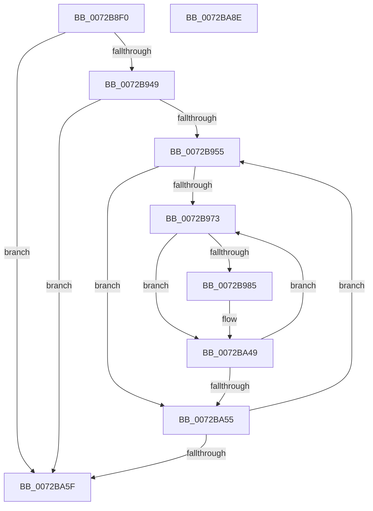

# PnpDiagRundownInterruptResourceForEachDevice

- RVA: `0x0072B8F0`–`0x0072BA8F` (길이 `415` bytes)
- VA: `0x000000014072B8F0`
- 실행 섹션: `PAGE`
- PDB 이름 있음: `예`; PDB Function 태그: `아니요`
- unwind 정보 RVA: `0x000C85F0`
- 디코드: `97`개 명령, `415/415` bytes 표시
- 미해석 바이트: `0` (있으면 어셈블리에 `.byte`로 보존)

> 이 문서는 커널 이미지의 기계어와 PDB 기호를 분석해 생성했습니다. 4번과 5번은 함수 원형과 자료형을 바이너리 사용 방식에서 추정한 C 해석이며 원본 소스 복구 결과는 아닙니다.

## 1. Dependencies

- 직접 호출 지점: **2**; 고유 호출 대상: **2**
- 직접 호출자로 확인된 함수: **0**
- RIP 상대 이미지 참조: **3**

### Outgoing calls
- `0x0072BA44` → [EtwWrite](../../text/41/EtwWrite_function_0041C720.md) (function, `0x0041C720`)
- `0x0072BA68` → [_security_check_cookie](../../text/6A/_security_check_cookie_function_006AC640.md) (function, `0x006AC640`)

### Direct callers
- 이 함수 시작 RVA로 연결되는 직접 call은 확인되지 않았습니다. 간접 호출은 완전히 역산할 수 없습니다.

### Static image references
- `0x0072B913` → RVA `0x00E0A740` (`.data`; read)
- `0x0072B98B` → RVA `0x0001A688` (`.rdata`; read)
- `0x0072BA04` → RVA `0x00E662D0` (`.data`; read)

## 2. Other-region calls and transfers

- 다른 실행 섹션으로 향하는 call: **2**
  - `0x0072BA44` → [EtwWrite](../../text/41/EtwWrite_function_0041C720.md) (`PAGE` → `.text`)
  - `0x0072BA68` → [_security_check_cookie](../../text/6A/_security_check_cookie_function_006AC640.md) (`PAGE` → `.text`)
- 별도 외부 분기/꼬리 이동을 확인하지 못했습니다.

## 3. Assembly (complete function range)

```asm
0072B8F0  48 8B C4                        mov rax, rsp
0072B8F3  48 89 58 08                     mov qword ptr [rax + 8], rbx
0072B8F7  48 89 70 10                     mov qword ptr [rax + 0x10], rsi
0072B8FB  48 89 78 18                     mov qword ptr [rax + 0x18], rdi
0072B8FF  4C 89 60 20                     mov qword ptr [rax + 0x20], r12
0072B903  55                              push rbp
0072B904  41 56                           push r14
0072B906  41 57                           push r15
0072B908  48 8D 68 A1                     lea rbp, [rax - 0x5f]
0072B90C  48 81 EC D0 00 00 00            sub rsp, 0xd0
0072B913  48 8B 05 26 EE 6D 00            mov rax, qword ptr [rip + 0x6dee26]
0072B91A  48 33 C4                        xor rax, rsp
0072B91D  48 89 45 37                     mov qword ptr [rbp + 0x37], rax
0072B921  48 8B 99 A8 01 00 00            mov rbx, qword ptr [rcx + 0x1a8]
0072B928  45 33 E4                        xor r12d, r12d
0072B92B  4C 89 65 B7                     mov qword ptr [rbp - 0x49], r12
0072B92F  4C 8B F9                        mov r15, rcx
0072B932  66 44 89 65 A7                  mov word ptr [rbp - 0x59], r12w
0072B937  44 89 65 AF                     mov dword ptr [rbp - 0x51], r12d
0072B93B  66 44 89 65 AB                  mov word ptr [rbp - 0x55], r12w
0072B940  48 85 DB                        test rbx, rbx
0072B943  0F 84 16 01 00 00               je 0x14072ba5f
0072B949  41 8B FC                        mov edi, r12d
0072B94C  44 39 23                        cmp dword ptr [rbx], r12d
0072B94F  0F 86 0A 01 00 00               jbe 0x14072ba5f
0072B955  8B C7                           mov eax, edi
0072B957  41 8B F4                        mov esi, r12d
0072B95A  4C 8D 34 C5 01 00 00 00         lea r14, [rax*8 + 1]
0072B962  4C 03 F0                        add r14, rax
0072B965  4E 8D 34 B3                     lea r14, [rbx + r14*4]
0072B969  45 39 66 0C                     cmp dword ptr [r14 + 0xc], r12d
0072B96D  0F 86 E2 00 00 00               jbe 0x14072ba55
0072B973  8B C6                           mov eax, esi
0072B975  48 8D 0C 80                     lea rcx, [rax + rax*4]
0072B979  41 80 7C 8E 10 02               cmp byte ptr [r14 + rcx*4 + 0x10], 2
0072B97F  0F 85 C4 00 00 00               jne 0x14072ba49
0072B985  41 0F B7 44 8E 16               movzx eax, word ptr [r14 + rcx*4 + 0x16]
0072B98B  48 8D 15 F6 EC 8E FF            lea rdx, [rip - 0x71130a]
0072B992  66 89 45 A7                     mov word ptr [rbp - 0x59], ax
0072B996  41 B9 07 00 00 00               mov r9d, 7
0072B99C  41 0F B7 44 8E 18               movzx eax, word ptr [r14 + rcx*4 + 0x18]
0072B9A2  45 33 C0                        xor r8d, r8d
0072B9A5  66 89 45 AB                     mov word ptr [rbp - 0x55], ax
0072B9A9  49 8B 44 8E 1C                  mov rax, qword ptr [r14 + rcx*4 + 0x1c]
0072B9AE  48 89 45 B7                     mov qword ptr [rbp - 0x49], rax
0072B9B2  49 8D 47 20                     lea rax, [r15 + 0x20]
0072B9B6  48 89 45 C7                     mov qword ptr [rbp - 0x39], rax
0072B9BA  48 8D 04 8D 12 00 00 00         lea rax, [rcx*4 + 0x12]
0072B9C2  41 0F B7 4F 28                  movzx ecx, word ptr [r15 + 0x28]
0072B9C7  49 03 C6                        add rax, r14
0072B9CA  48 89 45 D7                     mov qword ptr [rbp - 0x29], rax
0072B9CE  48 8D 45 A7                     lea rax, [rbp - 0x59]
0072B9D2  48 89 45 E7                     mov qword ptr [rbp - 0x19], rax
0072B9D6  48 8D 45 AB                     lea rax, [rbp - 0x55]
0072B9DA  48 89 45 F7                     mov qword ptr [rbp - 9], rax
0072B9DE  48 8D 45 B7                     lea rax, [rbp - 0x49]
0072B9E2  48 89 45 07                     mov qword ptr [rbp + 7], rax
0072B9E6  8B C1                           mov eax, ecx
0072B9E8  D1 E8                           shr eax, 1
0072B9EA  89 45 AF                        mov dword ptr [rbp - 0x51], eax
0072B9ED  48 8D 45 AF                     lea rax, [rbp - 0x51]
0072B9F1  48 89 45 17                     mov qword ptr [rbp + 0x17], rax
0072B9F5  49 8B 47 30                     mov rax, qword ptr [r15 + 0x30]
0072B9F9  48 89 45 27                     mov qword ptr [rbp + 0x27], rax
0072B9FD  48 8D 45 C7                     lea rax, [rbp - 0x39]
0072BA01  89 4D 2F                        mov dword ptr [rbp + 0x2f], ecx
0072BA04  48 8B 0D C5 A8 73 00            mov rcx, qword ptr [rip + 0x73a8c5]
0072BA0B  48 89 44 24 20                  mov qword ptr [rsp + 0x20], rax
0072BA10  48 C7 45 CF 08 00 00 00         mov qword ptr [rbp - 0x31], 8
0072BA18  48 C7 45 DF 02 00 00 00         mov qword ptr [rbp - 0x21], 2
0072BA20  48 C7 45 EF 02 00 00 00         mov qword ptr [rbp - 0x11], 2
0072BA28  48 C7 45 FF 02 00 00 00         mov qword ptr [rbp - 1], 2
0072BA30  48 C7 45 0F 08 00 00 00         mov qword ptr [rbp + 0xf], 8
0072BA38  48 C7 45 1F 04 00 00 00         mov qword ptr [rbp + 0x1f], 4
0072BA40  44 89 65 33                     mov dword ptr [rbp + 0x33], r12d
0072BA44  E8 D7 0C CF FF                  call 0x14041c720
0072BA49  FF C6                           inc esi
0072BA4B  41 3B 76 0C                     cmp esi, dword ptr [r14 + 0xc]
0072BA4F  0F 82 1E FF FF FF               jb 0x14072b973
0072BA55  FF C7                           inc edi
0072BA57  3B 3B                           cmp edi, dword ptr [rbx]
0072BA59  0F 82 F6 FE FF FF               jb 0x14072b955
0072BA5F  33 C0                           xor eax, eax
0072BA61  48 8B 4D 37                     mov rcx, qword ptr [rbp + 0x37]
0072BA65  48 33 CC                        xor rcx, rsp
0072BA68  E8 D3 0B F8 FF                  call 0x1406ac640
0072BA6D  4C 8D 9C 24 D0 00 00 00         lea r11, [rsp + 0xd0]
0072BA75  49 8B 5B 20                     mov rbx, qword ptr [r11 + 0x20]
0072BA79  49 8B 73 28                     mov rsi, qword ptr [r11 + 0x28]
0072BA7D  49 8B 7B 30                     mov rdi, qword ptr [r11 + 0x30]
0072BA81  4D 8B 63 38                     mov r12, qword ptr [r11 + 0x38]
0072BA85  49 8B E3                        mov rsp, r11
0072BA88  41 5F                           pop r15
0072BA8A  41 5E                           pop r14
0072BA8C  5D                              pop rbp
0072BA8D  C3                              ret
0072BA8E  CC                              int3
```

## 4. C-style interpretation (structured pseudocode)

```c
__int64 __fastcall PnpDiagRundownInterruptResourceForEachDevice(__int64 a1, __int64 a2, int a3)
{
    __int64 result;
    __int64 v_r12;
    __int64 v_r14;
    __int64 v_rdi;
    __int64 v_rsi;
    __int64 v_rsp;
    unsigned __int64 v_stack_m18;
    unsigned __int64 v_stack_mC8;

    *(unsigned __int64 *)(v_rsp + 8) = v_rbx;
    *(unsigned __int64 *)(v_rsp + 16) = v_rsi;
    *(unsigned __int64 *)(v_rsp + 24) = v_rdi;
    *(unsigned __int64 *)(v_rsp + 32) = v_r12;
    v_rsp = (v_rsp) - (208);
    result = (*(unsigned __int64 *)(v_rip + 7204390)) ^ (v_rsp);
    *(unsigned __int64 *)(v_rsp - 95 + 55) = result;
    v_r12 = 0;
    *(unsigned __int64 *)(v_rsp - 95 - 73) = 0;
    *(unsigned __int16 *)(v_rsp - 95 - 89) = 0;
    *(unsigned int *)(v_rsp - 95 - 81) = 0;
    *(unsigned __int16 *)(v_rsp - 95 - 85) = 0;
    if (*(unsigned __int64 *)(a1 + 424) == 0) goto loc_0072BA5F;
    if ((*(unsigned int *)(*(unsigned __int64 *)(a1 + 424))) <= 0) goto loc_0072BA5F;
loc_0072B955:
    v_r14 = (0 * 8 + 1) + (0);
    if ((*(unsigned int *)(*(unsigned __int64 *)(a1 + 424) + v_r14 * 4 + 12)) <= 0) goto loc_0072BA55;
loc_0072B973:
    result = 0;
    if ((*(unsigned __int8 *)(*(unsigned __int64 *)(a1 + 424) + v_r14 * 4 + 0 + 0 * 4 * 4 + 16)) == 2) {
        result = *(unsigned __int16 *)(*(unsigned __int64 *)(a1 + 424) + v_r14 * 4 + 0 + 0 * 4 * 4 + 22);
        a2 = v_rip - 7410442;
        *(unsigned __int16 *)(v_rsp - 95 - 89) = (unsigned __int16)(result);
        a4 = 7;
        result = *(unsigned __int16 *)(*(unsigned __int64 *)(a1 + 424) + v_r14 * 4 + 0 + 0 * 4 * 4 + 24);
        a3 = 0;
        *(unsigned __int16 *)(v_rsp - 95 - 85) = (unsigned __int16)(result);
        result = *(unsigned __int64 *)(*(unsigned __int64 *)(a1 + 424) + v_r14 * 4 + 0 + 0 * 4 * 4 + 28);
        *(unsigned __int64 *)(v_rsp - 95 - 73) = result;
        result = a1 + 32;
        *(unsigned __int64 *)(v_rsp - 95 - 57) = result;
        result = 0 + 0 * 4 * 4 + 18;
        a1 = *(unsigned __int16 *)(a1 + 40);
        result = (result) + (*(unsigned __int64 *)(a1 + 424) + v_r14 * 4);
        *(unsigned __int64 *)(v_rsp - 95 - 41) = result;
        result = v_rsp - 95 - 89;
        *(unsigned __int64 *)(v_rsp - 95 - 25) = result;
        result = v_rsp - 95 - 85;
        *(unsigned __int64 *)(v_rsp - 95 - 9) = result;
        result = v_rsp - 95 - 73;
        *(unsigned __int64 *)(v_rsp - 95 + 7) = result;
        result = (unsigned int)(a1);
        result = (unsigned int)((result) >> (1));
        *(unsigned int *)(v_rsp - 95 - 81) = (unsigned int)(result);
        result = v_rsp - 95 - 81;
        *(unsigned __int64 *)(v_rsp - 95 + 23) = result;
        result = *(unsigned __int64 *)(a1 + 48);
        *(unsigned __int64 *)(v_rsp - 95 + 39) = result;
        result = v_rsp - 95 - 57;
        *(unsigned int *)(v_rsp - 95 + 47) = (unsigned int)(a1);
        a1 = *(unsigned __int64 *)(v_rip + 7579845);
        v_stack_mC8 = result;
        *(unsigned __int64 *)(v_rsp - 95 - 49) = 8;
        *(unsigned __int64 *)(v_rsp - 95 - 33) = 2;
        *(unsigned __int64 *)(v_rsp - 95 - 17) = 2;
        *(unsigned __int64 *)(v_rsp - 95 - 1) = 2;
        *(unsigned __int64 *)(v_rsp - 95 + 15) = 8;
        *(unsigned __int64 *)(v_rsp - 95 + 31) = 4;
        *(unsigned int *)(v_rsp - 95 + 51) = 0;
        result = EtwWrite(a1, a2, a3, a4);
    }
    v_rsi = (unsigned int)((0) + 1);
    if (((unsigned int)(v_rsi)) < (*(unsigned int *)(*(unsigned __int64 *)(a1 + 424) + v_r14 * 4 + 12))) goto loc_0072B973;
loc_0072BA55:
    v_rdi = (unsigned int)((0) + 1);
    if (((unsigned int)(v_rdi)) < (*(unsigned int *)(*(unsigned __int64 *)(a1 + 424)))) goto loc_0072B955;
loc_0072BA5F:
    result = 0;
    a1 = (*(unsigned __int64 *)(v_rsp - 95 + 55)) ^ (v_rsp);
    result = _security_check_cookie(a1, a2, a3, a4);
    return result;
}
```

## 5. (Beta) C Style

```c
int64_t PnpDiagRundownInterruptResourceForEachDevice(void *Arg1, int64_t Arg2, int32_t Arg3)
{
    uint8_t *arg1 = (uint8_t *)Arg1;

    int64_t result;
    int64_t local_r12;
    int64_t local_r14;
    int64_t local_rdi;
    int64_t local_rsi;
    int64_t local_rsp;
    uint64_t v_stack_m18;
    uint64_t v_stack_mC8;

    *(uint64_t *)(local_rsp + 0x8) = local_rbx;
    *(uint64_t *)(local_rsp + 0x10) = local_rsi;
    *(uint64_t *)(local_rsp + 0x18) = local_rdi;
    *(uint64_t *)(local_rsp + 0x20) = local_r12;
    local_rsp = (local_rsp) - (208);
    result = (*(uint64_t *)(v_rip + 0x6DEE26)) ^ (local_rsp);
    *(uint64_t *)(local_rsp - 0x5F + 0x37) = result;
    local_r12 = 0;
    *(uint64_t *)(local_rsp - 0x5F - 0x49) = 0;
    *(uint16_t *)(local_rsp - 0x5F - 0x59) = 0;
    *(uint32_t *)(local_rsp - 0x5F - 0x51) = 0;
    *(uint16_t *)(local_rsp - 0x5F - 0x55) = 0;
    if (*(uint64_t *)(arg1 + 0x1A8) == 0) goto loc_0072BA5F;
    if ((*(uint32_t *)(*(uint64_t *)(arg1 + 0x1A8))) <= 0) goto loc_0072BA5F;
loc_0072B955:
    local_r14 = (0 * 8 + 1) + (0);
    if ((*(uint32_t *)(*(uint64_t *)(arg1 + 0x1A8) + local_r14 * 4 + 0xC)) <= 0) goto loc_0072BA55;
loc_0072B973:
    result = 0;
    if ((*(uint8_t *)(*(uint64_t *)(arg1 + 0x1A8) + local_r14 * 4 + 0x0 + 0x0 * 4 * 4 + 0x10)) == 2) {
        result = *(uint16_t *)(*(uint64_t *)(arg1 + 0x1A8) + local_r14 * 4 + 0x0 + 0x0 * 4 * 4 + 0x16);
        Arg2 = v_rip - 7410442;
        *(uint16_t *)(local_rsp - 0x5F - 0x59) = (uint16_t)(result);
        a4 = 7;
        result = *(uint16_t *)(*(uint64_t *)(arg1 + 0x1A8) + local_r14 * 4 + 0x0 + 0x0 * 4 * 4 + 0x18);
        Arg3 = 0;
        *(uint16_t *)(local_rsp - 0x5F - 0x55) = (uint16_t)(result);
        result = *(uint64_t *)(*(uint64_t *)(arg1 + 0x1A8) + local_r14 * 4 + 0x0 + 0x0 * 4 * 4 + 0x1C);
        *(uint64_t *)(local_rsp - 0x5F - 0x49) = result;
        result = Arg1 + 32;
        *(uint64_t *)(local_rsp - 0x5F - 0x39) = result;
        result = 0 + 0 * 4 * 4 + 18;
        Arg1 = *(uint16_t *)(arg1 + 0x28);
        result = (result) + (*(uint64_t *)(arg1 + 0x1A8) + local_r14 * 4);
        *(uint64_t *)(local_rsp - 0x5F - 0x29) = result;
        result = local_rsp - 95 - 89;
        *(uint64_t *)(local_rsp - 0x5F - 0x19) = result;
        result = local_rsp - 95 - 85;
        *(uint64_t *)(local_rsp - 0x5F - 0x9) = result;
        result = local_rsp - 95 - 73;
        *(uint64_t *)(local_rsp - 0x5F + 0x7) = result;
        result = (uint32_t)(Arg1);
        result = (uint32_t)((result) >> (1));
        *(uint32_t *)(local_rsp - 0x5F - 0x51) = (uint32_t)(result);
        result = local_rsp - 95 - 81;
        *(uint64_t *)(local_rsp - 0x5F + 0x17) = result;
        result = *(uint64_t *)(arg1 + 0x30);
        *(uint64_t *)(local_rsp - 0x5F + 0x27) = result;
        result = local_rsp - 95 - 57;
        *(uint32_t *)(local_rsp - 0x5F + 0x2F) = (uint32_t)(Arg1);
        Arg1 = *(uint64_t *)(v_rip + 0x73A8C5);
        v_stack_mC8 = result;
        *(uint64_t *)(local_rsp - 0x5F - 0x31) = 8;
        *(uint64_t *)(local_rsp - 0x5F - 0x21) = 2;
        *(uint64_t *)(local_rsp - 0x5F - 0x11) = 2;
        *(uint64_t *)(local_rsp - 0x5F - 0x1) = 2;
        *(uint64_t *)(local_rsp - 0x5F + 0xF) = 8;
        *(uint64_t *)(local_rsp - 0x5F + 0x1F) = 4;
        *(uint32_t *)(local_rsp - 0x5F + 0x33) = 0;
        result = EtwWrite(Arg1, Arg2, Arg3, a4);
    }
    local_rsi = (uint32_t)((0) + 1);
    if (((uint32_t)(local_rsi)) < (*(uint32_t *)(*(uint64_t *)(arg1 + 0x1A8) + local_r14 * 4 + 0xC))) goto loc_0072B973;
loc_0072BA55:
    local_rdi = (uint32_t)((0) + 1);
    if (((uint32_t)(local_rdi)) < (*(uint32_t *)(*(uint64_t *)(arg1 + 0x1A8)))) goto loc_0072B955;
loc_0072BA5F:
    result = 0;
    Arg1 = (*(uint64_t *)(local_rsp - 0x5F + 0x37)) ^ (local_rsp);
    result = _security_check_cookie(Arg1, Arg2, Arg3, a4);
    return result;
}
```

### 관측된 메모리 오프셋

구조체 형식이 확인되지 않은 접근은 인자 기준의 오프셋으로만 기록했습니다.

| 기준 인자 | 오프셋 표현 | 폭 (bit) | 접근 |
|---|---:|---:|---|
| `Arg1` | `+ 0x20` | `64` | `R` |
| `Arg1` | `+ 0x28` | `16` | `R` |
| `Arg1` | `+ 0x30` | `64` | `R` |
| `Arg1` | `+ 0x1A8` | `64` | `R` |

## 6. Execution-region graph

[열기: 2D/3D 그래프와 함수 탐색 컨트롤 패널](../../../control-panel.html?section=page&rva=0x0072B8F0&view=graph)

- 2D 그래프는 위에서 아래로 흐르고, 3D 그래프는 빈 공간을 드래그해 회전합니다. Shift+드래그는 이동, 휠은 확대·축소, 함수 노드 선택은 대상 보고서 이동입니다.

### Static fallback


