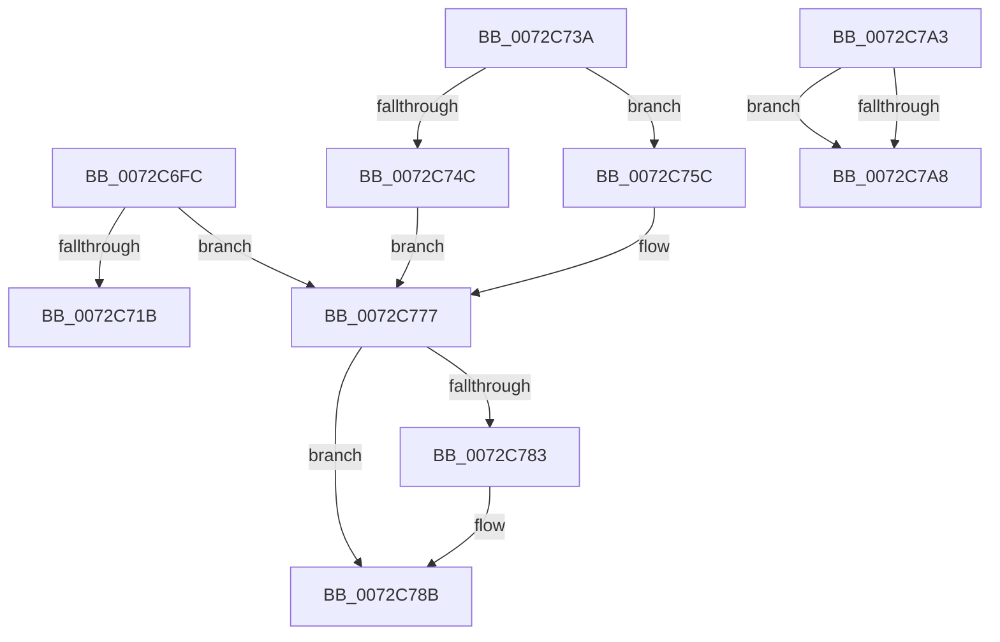

# PnpDisableDevice

- RVA: `0x0072C6FC`–`0x0072C7BB` (길이 `191` bytes)
- VA: `0x000000014072C6FC`
- 실행 섹션: `PAGE`
- PDB 이름 있음: `예`; PDB Function 태그: `아니요`
- unwind 정보 RVA: `0x0007918C`
- 디코드: `57`개 명령, `191/191` bytes 표시
- 미해석 바이트: `1` (있으면 어셈블리에 `.byte`로 보존)

> 이 문서는 커널 이미지의 기계어와 PDB 기호를 분석해 생성했습니다. 4번과 5번은 함수 원형과 자료형을 바이너리 사용 방식에서 추정한 C 해석이며 원본 소스 복구 결과는 아닙니다.

## 1. Dependencies

- 직접 호출 지점: **6**; 고유 호출 대상: **5**
- 직접 호출자로 확인된 함수: **2**
- RIP 상대 이미지 참조: **1**

### Outgoing calls
- `0x0072C743` → [PiIrpQueryRemoveDevice](../73/PiIrpQueryRemoveDevice_function_0073E088.md) (function, `0x0073E088`)
- `0x0072C755` → [IopRemoveDevice](../8F/IopRemoveDevice_function_008FC7FC.md) (function, `0x008FC7FC`)
- `0x0072C765` → [IopRemoveDevice](../8F/IopRemoveDevice_function_008FC7FC.md) (function, `0x008FC7FC`)
- `0x0072C772` → [IopReleaseDeviceResources](../A0/IopReleaseDeviceResources_function_00A0867C.md) (function, `0x00A0867C`)
- `0x0072C786` → [PipClearDevNodeProblem](../A2/PipClearDevNodeProblem_function_00A27C8C.md) (function, `0x00A27C8C`)
- `0x0072C793` → [PipSetDevNodeProblem](../8F/PipSetDevNodeProblem_function_008FDE0C.md) (function, `0x008FDE0C`)

### Direct callers
- [PiProcessNewDeviceNode](../A2/PiProcessNewDeviceNode_function_00A28F20.md) at `0x00A298F5`
- [PnpIsDeviceInstanceEnabled](../A7/PnpIsDeviceInstanceEnabled_function_00A75A3C.md) at `0x00A75C02`

### Static image references
- `0x0072C71B` → RVA `0x00000000` (`image boundary/outside`; read)

## 2. Other-region calls and transfers

- 다른 실행 섹션으로 향하는 call: **0**
- 별도 외부 분기/꼬리 이동을 확인하지 못했습니다.

## 3. Assembly (complete function range)

```asm
0072C6FC  48 89 5C 24 08                  mov qword ptr [rsp + 8], rbx
0072C701  57                              push rdi
0072C702  48 83 EC 20                     sub rsp, 0x20
0072C706  8B 81 2C 01 00 00               mov eax, dword ptr [rcx + 0x12c]
0072C70C  8B FA                           mov edi, edx
0072C70E  05 FF FC FF FF                  add eax, 0xfffffcff
0072C713  48 8B D9                        mov rbx, rcx
0072C716  83 F8 0E                        cmp eax, 0xe
0072C719  77 5C                           ja 0x14072c777
0072C71B  48 8D 0D DE 38 8D FF            lea rcx, [rip - 0x72c722]
0072C722  48 98                           cdqe
0072C724  0F B6 84 01 AC C7 72 00         movzx eax, byte ptr [rcx + rax + 0x72c7ac]
0072C72C  44 8B 84 81 A4 C7 72 00         mov r8d, dword ptr [rcx + rax*4 + 0x72c7a4]
0072C734  4C 03 C1                        add r8, rcx
0072C737  41 FF E0                        jmp r8
0072C73A  CC                              int3
0072C73B  CC                              int3
0072C73C  CC                              int3
0072C73D  48 8B 4B 20                     mov rcx, qword ptr [rbx + 0x20]
0072C741  33 D2                           xor edx, edx
0072C743  E8 40 19 01 00                  call 0x14073e088
0072C748  85 C0                           test eax, eax
0072C74A  79 10                           jns 0x14072c75c
0072C74C  48 8B 4B 20                     mov rcx, qword ptr [rbx + 0x20]
0072C750  BA 03 00 00 00                  mov edx, 3
0072C755  E8 A2 00 1D 00                  call 0x1408fc7fc
0072C75A  EB 1B                           jmp 0x14072c777
0072C75C  48 8B 4B 20                     mov rcx, qword ptr [rbx + 0x20]
0072C760  BA 02 00 00 00                  mov edx, 2
0072C765  E8 92 00 1D 00                  call 0x1408fc7fc
0072C76A  BA 01 00 00 00                  mov edx, 1
0072C76F  48 8B CB                        mov rcx, rbx
0072C772  E8 05 BF 2D 00                  call 0x140a0867c
0072C777  F7 83 8C 01 00 00 00 60 00 00   test dword ptr [rbx + 0x18c], 0x6000
0072C781  74 08                           je 0x14072c78b
0072C783  48 8B CB                        mov rcx, rbx
0072C786  E8 01 B5 2F 00                  call 0x140a27c8c
0072C78B  45 33 C0                        xor r8d, r8d
0072C78E  8B D7                           mov edx, edi
0072C790  48 8B CB                        mov rcx, rbx
0072C793  E8 74 16 1D 00                  call 0x1408fde0c
0072C798  48 8B 5C 24 30                  mov rbx, qword ptr [rsp + 0x30]
0072C79D  48 83 C4 20                     add rsp, 0x20
0072C7A1  5F                              pop rdi
0072C7A2  C3                              ret
0072C7A3  CC                              int3
0072C7A4  5C                              pop rsp
0072C7A5  C7                              .byte 0xc7
0072C7A6  72 00                           jb 0x14072c7a8
0072C7A8  3D C7 72 00 00                  cmp eax, 0x72c7
0072C7AD  00 00                           add byte ptr [rax], al
0072C7AF  00 01                           add byte ptr [rcx], al
0072C7B1  01 01                           add dword ptr [rcx], eax
0072C7B3  01 01                           add dword ptr [rcx], eax
0072C7B5  01 01                           add dword ptr [rcx], eax
0072C7B7  01 01                           add dword ptr [rcx], eax
0072C7B9  01 01                           add dword ptr [rcx], eax
```

## 4. C-style interpretation (structured pseudocode)

```c
__int64 __fastcall PnpDisableDevice(__int64 a1, int a2)
{
    __int64 result;
    __int64 v_rsp;
    unsigned __int64 v_stack_p8;

    v_stack_p8 = v_rbx;
    v_rsp = (v_rsp) - (32);
    result = (unsigned int)(((unsigned int)(*(unsigned int *)(a1 + 300))) + (0xFFFFFCFFULL));
    if (((unsigned int)(result)) > 14) goto loc_0072C777;
    a3 = ((unsigned int)(*(unsigned int *)(v_rip - 7522082 + *(unsigned __int8 *)(v_rip - 7522082 + result * 1 + 7522220) * 4 + 7522212))) + (v_rip - 7522082);
loc_0072C777:
    result = *(unsigned __int8 *)(v_rip - 7522082 + result * 1 + 7522220);
    if (((*(unsigned int *)(a1 + 396)) & (0x6000ULL)) != 0) {
        a1 = a1;
        result = PipClearDevNodeProblem(a1, a2, a3, a4);
    }
    a3 = 0;
    result = PipSetDevNodeProblem(a1, (unsigned int)((unsigned int)((unsigned int)(a2))), a3, a4);
    v_rsp = (v_rsp) + (32);
    return result;
}
```

## 5. (Beta) C Style

```c
int64_t PnpDisableDevice(void *Arg1, int32_t Arg2)
{
    uint8_t *arg1 = (uint8_t *)Arg1;

    int64_t result;
    int64_t local_rsp;
    uint64_t v_stack_p8;

    v_stack_p8 = local_rbx;
    local_rsp = (local_rsp) - (32);
    result = (uint32_t)(((uint32_t)(*(uint32_t *)(arg1 + 0x12C))) + (0xFFFFFCFFULL));
    if (((uint32_t)(result)) > 14) goto loc_0072C777;
    a3 = ((uint32_t)(*(uint32_t *)(v_rip - 0x72C722 + *(uint8_t *)(v_rip - 0x72C722 + result * 1 + 0x72C7AC) * 4 + 0x72C7A4))) + (v_rip - 7522082);
loc_0072C777:
    result = *(uint8_t *)(v_rip - 0x72C722 + result * 1 + 0x72C7AC);
    if (((*(uint32_t *)(arg1 + 0x18C)) & (0x6000ULL)) != 0) {
        Arg1 = Arg1;
        result = PipClearDevNodeProblem(Arg1, Arg2, a3, a4);
    }
    a3 = 0;
    result = PipSetDevNodeProblem(Arg1, (uint32_t)((uint32_t)((uint32_t)(Arg2))), a3, a4);
    local_rsp = (local_rsp) + (32);
    return result;
}
```

### 관측된 메모리 오프셋

구조체 형식이 확인되지 않은 접근은 인자 기준의 오프셋으로만 기록했습니다.

| 기준 인자 | 오프셋 표현 | 폭 (bit) | 접근 |
|---|---:|---:|---|
| `Arg1` | `+ 0x12C` | `32` | `R` |
| `Arg1` | `+ 0x18C` | `32` | `R` |

## 6. Execution-region graph

[열기: 2D/3D 그래프와 함수 탐색 컨트롤 패널](../../../control-panel.html?section=page&rva=0x0072C6FC&view=graph)

- 2D 그래프는 위에서 아래로 흐르고, 3D 그래프는 빈 공간을 드래그해 회전합니다. Shift+드래그는 이동, 휠은 확대·축소, 함수 노드 선택은 대상 보고서 이동입니다.

### Static fallback


