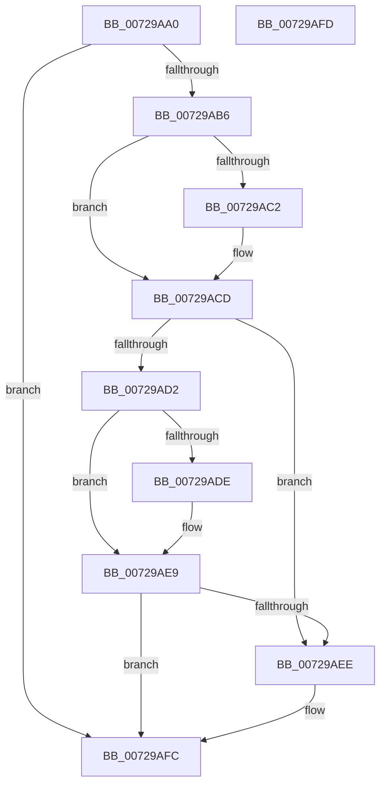

# PnpExtractNotificationSpecificData

- RVA: `0x00729AA0`–`0x00729AFE` (길이 `94` bytes)
- VA: `0x0000000140729AA0`
- 실행 섹션: `PAGE`
- PDB 이름 있음: `예`; PDB Function 태그: `아니요`
- unwind 정보 RVA: `0x000DB714`
- 디코드: `26`개 명령, `94/94` bytes 표시
- 미해석 바이트: `0` (있으면 어셈블리에 `.byte`로 보존)

> 이 문서는 커널 이미지의 기계어와 PDB 기호를 분석해 생성했습니다. 4번과 5번은 함수 원형과 자료형을 바이너리 사용 방식에서 추정한 C 해석이며 원본 소스 복구 결과는 아닙니다.

## 1. Dependencies

- 직접 호출 지점: **0**; 고유 호출 대상: **0**
- 직접 호출자로 확인된 함수: **1**
- RIP 상대 이미지 참조: **4**

### Outgoing calls
- 직접 디코드된 call 명령이 없습니다.

### Direct callers
- [PnpNotifyDriverCallback](../95/PnpNotifyDriverCallback_function_00954AA0.md) at `0x00954BA8`

### Static image references
- `0x00729AB9` → RVA `0x00013E30` (`.rdata`; read)
- `0x00729AC6` → RVA `0x00013E38` (`.rdata`; read)
- `0x00729AD5` → RVA `0x000122D8` (`.rdata`; read)
- `0x00729AE2` → RVA `0x000122E0` (`.rdata`; read)

## 2. Other-region calls and transfers

- 다른 실행 섹션으로 향하는 call: **0**
- 별도 외부 분기/꼬리 이동을 확인하지 못했습니다.

## 3. Assembly (complete function range)

```asm
00729AA0  49 83 20 00                     and qword ptr [r8], 0
00729AA4  4C 8D 51 04                     lea r10, [rcx + 4]
00729AA8  49 83 21 00                     and qword ptr [r9], 0
00729AAC  66 83 79 02 30                  cmp word ptr [rcx + 2], 0x30
00729AB1  4C 89 12                        mov qword ptr [rdx], r10
00729AB4  72 46                           jb 0x140729afc
00729AB6  49 8B 02                        mov rax, qword ptr [r10]
00729AB9  48 2B 05 70 A3 8E FF            sub rax, qword ptr [rip - 0x715c90]
00729AC0  75 0B                           jne 0x140729acd
00729AC2  49 8B 42 08                     mov rax, qword ptr [r10 + 8]
00729AC6  48 2B 05 6B A3 8E FF            sub rax, qword ptr [rip - 0x715c95]
00729ACD  48 85 C0                        test rax, rax
00729AD0  74 1C                           je 0x140729aee
00729AD2  49 8B 02                        mov rax, qword ptr [r10]
00729AD5  48 2B 05 FC 87 8E FF            sub rax, qword ptr [rip - 0x717804]
00729ADC  75 0B                           jne 0x140729ae9
00729ADE  49 8B 42 08                     mov rax, qword ptr [r10 + 8]
00729AE2  48 2B 05 F7 87 8E FF            sub rax, qword ptr [rip - 0x717809]
00729AE9  48 85 C0                        test rax, rax
00729AEC  75 0E                           jne 0x140729afc
00729AEE  48 8D 41 14                     lea rax, [rcx + 0x14]
00729AF2  49 89 00                        mov qword ptr [r8], rax
00729AF5  48 8B 41 28                     mov rax, qword ptr [rcx + 0x28]
00729AF9  49 89 01                        mov qword ptr [r9], rax
00729AFC  C3                              ret
00729AFD  CC                              int3
```

## 4. C-style interpretation (structured pseudocode)

```c
__int64 __fastcall PnpExtractNotificationSpecificData(__int64 a1, __int64 a2, __int64 a3, __int64 a4)
{
    __int64 result;

    *(unsigned __int64 *)(a2) = a1 + 4;
    if ((*(unsigned __int16 *)(a1 + 2)) < 48) goto loc_00729AFC;
    result = (*(unsigned __int64 *)(a1 + 4)) - (*(unsigned __int64 *)(v_rip - 7429264));
    if (!(condition_is_not_equal)) {
        result = *(unsigned __int64 *)(a1 + 4 + 8);
        result = (result) - (*(unsigned __int64 *)(v_rip - 7429269));
    }
    if (result == 0) goto loc_00729AEE;
    result = (*(unsigned __int64 *)(a1 + 4)) - (*(unsigned __int64 *)(v_rip - 7436292));
    if (!(condition_is_not_equal)) {
        result = *(unsigned __int64 *)(a1 + 4 + 8);
        result = (result) - (*(unsigned __int64 *)(v_rip - 7436297));
    }
    if (result == 0) {
        result = a1 + 20;
        *(unsigned __int64 *)(a3) = result;
        result = *(unsigned __int64 *)(a1 + 40);
        *(unsigned __int64 *)(a4) = result;
    }
    return result;
}
```

## 5. (Beta) C Style

```c
int64_t PnpExtractNotificationSpecificData(void *Arg1, void *Arg2, void *Arg3, void *Arg4)
{
    uint8_t *arg1 = (uint8_t *)Arg1;
    uint8_t *arg2 = (uint8_t *)Arg2;
    uint8_t *arg3 = (uint8_t *)Arg3;
    uint8_t *arg4 = (uint8_t *)Arg4;

    int64_t result;

    *(void **)(arg2) = Arg1 + 4;
    if ((*(uint16_t *)(arg1 + 0x2)) < 48) goto loc_00729AFC;
    result = (*(uint64_t *)(arg1 + 0x4)) - (*(uint64_t *)(v_rip - 0x715C90));
    if (!(condition_is_not_equal)) {
        result = *(uint64_t *)(arg1 + 0x4 + 0x8);
        result = (result) - (*(uint64_t *)(v_rip - 0x715C95));
    }
    if (result == 0) goto loc_00729AEE;
    result = (*(uint64_t *)(arg1 + 0x4)) - (*(uint64_t *)(v_rip - 0x717804));
    if (!(condition_is_not_equal)) {
        result = *(uint64_t *)(arg1 + 0x4 + 0x8);
        result = (result) - (*(uint64_t *)(v_rip - 0x717809));
    }
    if (result == 0) {
        result = Arg1 + 20;
        *(uint64_t *)(arg3) = result;
        result = *(uint64_t *)(arg1 + 0x28);
        *(uint64_t *)(arg4) = result;
    }
    return result;
}
```

### 관측된 메모리 오프셋

구조체 형식이 확인되지 않은 접근은 인자 기준의 오프셋으로만 기록했습니다.

| 기준 인자 | 오프셋 표현 | 폭 (bit) | 접근 |
|---|---:|---:|---|
| `Arg1` | `+ 0x0` | `64` | `R` |
| `Arg1` | `+ 0x2` | `16` | `R` |
| `Arg1` | `+ 0x4` | `64` | `R` |
| `Arg1` | `+ 0x8` | `64` | `R` |
| `Arg1` | `+ 0x14` | `64` | `R` |
| `Arg1` | `+ 0x28` | `64` | `R` |
| `Arg2` | `+ 0x0` | `64` | `W` |
| `Arg3` | `+ 0x0` | `64` | `R/W` |
| `Arg3` | `+ 0x0` | `64` | `W` |
| `Arg4` | `+ 0x0` | `64` | `R/W` |
| `Arg4` | `+ 0x0` | `64` | `W` |

## 6. Execution-region graph

[열기: 2D/3D 그래프와 함수 탐색 컨트롤 패널](../../../control-panel.html?section=page&rva=0x00729AA0&view=graph)

- 2D 그래프는 위에서 아래로 흐르고, 3D 그래프는 빈 공간을 드래그해 회전합니다. Shift+드래그는 이동, 휠은 확대·축소, 함수 노드 선택은 대상 보고서 이동입니다.

### Static fallback


