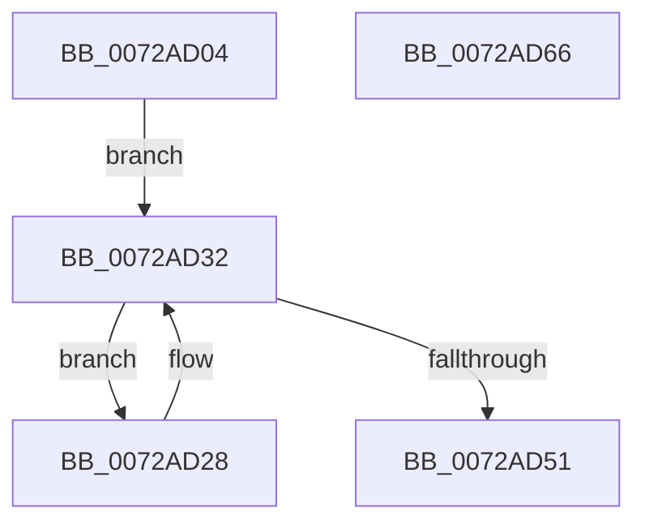

# PnpFinalizeDeviceRemovalForReset

- RVA: `0x0072AD04`–`0x0072AD67` (길이 `99` bytes)
- VA: `0x000000014072AD04`
- 실행 섹션: `PAGE`
- PDB 이름 있음: `예`; PDB Function 태그: `아니요`
- unwind 정보 RVA: `0x00084AC0`
- 디코드: `28`개 명령, `99/99` bytes 표시
- 미해석 바이트: `0` (있으면 어셈블리에 `.byte`로 보존)

> 이 문서는 커널 이미지의 기계어와 PDB 기호를 분석해 생성했습니다. 4번과 5번은 함수 원형과 자료형을 바이너리 사용 방식에서 추정한 C 해석이며 원본 소스 복구 결과는 아닙니다.

## 1. Dependencies

- 직접 호출 지점: **3**; 고유 호출 대상: **3**
- 직접 호출자로 확인된 함수: **1**
- RIP 상대 이미지 참조: **0**

### Outgoing calls
- `0x0072AD2D` → [IopMarkDeviceToBeReset](IopMarkDeviceToBeReset_function_0072A9A0.md) (function, `0x0072A9A0`)
- `0x0072AD48` → [IopEnumerateRelations](../A6/IopEnumerateRelations_function_00A6E3B4.md) (function, `0x00A6E3B4`)
- `0x0072AD56` → [IopLogDeviceResetComplete](IopLogDeviceResetComplete_function_0072A914.md) (function, `0x0072A914`)

### Direct callers
- [PnpProcessQueryRemoveAndEject](../A0/PnpProcessQueryRemoveAndEject_function_00A05170.md) at `0x00A05697`

### Static image references
- 디코드된 RIP-relative 메모리 참조가 없습니다.

## 2. Other-region calls and transfers

- 다른 실행 섹션으로 향하는 call: **0**
- 별도 외부 분기/꼬리 이동을 확인하지 못했습니다.

## 3. Assembly (complete function range)

```asm
0072AD04  48 8B C4                        mov rax, rsp
0072AD07  48 89 58 08                     mov qword ptr [rax + 8], rbx
0072AD0B  57                              push rdi
0072AD0C  48 83 EC 30                     sub rsp, 0x30
0072AD10  48 83 60 18 00                  and qword ptr [rax + 0x18], 0
0072AD15  48 8B FA                        mov rdi, rdx
0072AD18  83 60 24 00                     and dword ptr [rax + 0x24], 0
0072AD1C  48 8B D9                        mov rbx, rcx
0072AD1F  C7 40 20 01 00 00 00            mov dword ptr [rax + 0x20], 1
0072AD26  EB 0A                           jmp 0x14072ad32
0072AD28  48 8B 4C 24 50                  mov rcx, qword ptr [rsp + 0x50]
0072AD2D  E8 6E FC FF FF                  call 0x14072a9a0
0072AD32  48 83 64 24 20 00               and qword ptr [rsp + 0x20], 0
0072AD38  4C 8D 44 24 50                  lea r8, [rsp + 0x50]
0072AD3D  45 33 C9                        xor r9d, r9d
0072AD40  48 8D 54 24 58                  lea rdx, [rsp + 0x58]
0072AD45  48 8B CF                        mov rcx, rdi
0072AD48  E8 67 36 34 00                  call 0x140a6e3b4
0072AD4D  84 C0                           test al, al
0072AD4F  75 D7                           jne 0x14072ad28
0072AD51  33 D2                           xor edx, edx
0072AD53  48 8B CB                        mov rcx, rbx
0072AD56  E8 B9 FB FF FF                  call 0x14072a914
0072AD5B  48 8B 5C 24 40                  mov rbx, qword ptr [rsp + 0x40]
0072AD60  48 83 C4 30                     add rsp, 0x30
0072AD64  5F                              pop rdi
0072AD65  C3                              ret
0072AD66  CC                              int3
```

## 4. C-style interpretation (structured pseudocode)

```c
__int64 __fastcall PnpFinalizeDeviceRemovalForReset(__int64 a1, __int64 a2, __int64 a3, int a4)
{
    __int64 result;
    __int64 v_rsp;
    unsigned __int64 v_stack_m18;
    unsigned __int64 v_stack_p18;
    unsigned __int64 v_stack_p20;
    unsigned __int64 v_stack_p8;

    *(unsigned __int64 *)(v_rsp + 8) = v_rbx;
    v_rsp = (v_rsp) - (48);
    *(unsigned int *)(v_rsp + 32) = 1;
    goto loc_0072AD32;
loc_0072AD28:
    result = IopMarkDeviceToBeReset(v_stack_p18, a2, a3, a4);
loc_0072AD32:
    a4 = 0;
    result = IopEnumerateRelations(a2, v_stack_p20, v_stack_p18, a4);
    if ((unsigned __int8)(result) != 0) goto loc_0072AD28;
    a2 = 0;
    result = IopLogDeviceResetComplete(a1, a2, v_stack_p18, a4);
    v_rsp = (v_rsp) + (48);
    return result;
}
```

## 5. (Beta) C Style

```c
int64_t PnpFinalizeDeviceRemovalForReset(int64_t Arg1, int64_t Arg2, int64_t Arg3, int32_t Arg4)
{
    int64_t result;
    int64_t local_rsp;
    uint64_t v_stack_m18;
    uint64_t v_stack_p18;
    uint64_t v_stack_p20;
    uint64_t v_stack_p8;

    *(uint64_t *)(local_rsp + 0x8) = local_rbx;
    local_rsp = (local_rsp) - (48);
    *(uint32_t *)(local_rsp + 0x20) = 1;
    goto loc_0072AD32;
loc_0072AD28:
    result = IopMarkDeviceToBeReset(v_stack_p18, Arg2, Arg3, Arg4);
loc_0072AD32:
    Arg4 = 0;
    result = IopEnumerateRelations(Arg2, v_stack_p20, v_stack_p18, Arg4);
    if ((uint8_t)(result) != 0) goto loc_0072AD28;
    Arg2 = 0;
    result = IopLogDeviceResetComplete(Arg1, Arg2, v_stack_p18, Arg4);
    local_rsp = (local_rsp) + (48);
    return result;
}
```

## 6. Execution-region graph

[열기: 2D/3D 그래프와 함수 탐색 컨트롤 패널](../../../control-panel.html?section=page&rva=0x0072AD04&view=graph)

- 2D 그래프는 위에서 아래로 흐르고, 3D 그래프는 빈 공간을 드래그해 회전합니다. Shift+드래그는 이동, 휠은 확대·축소, 함수 노드 선택은 대상 보고서 이동입니다.

### Static fallback


