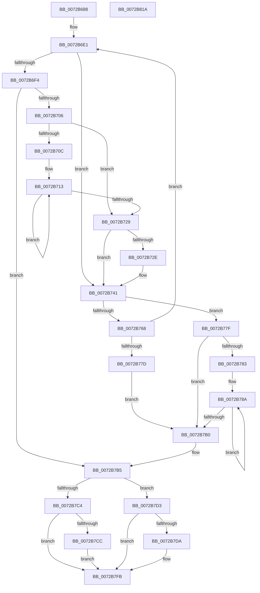

# PnpFindBestConfigurationWorker

- RVA: `0x0072B688`–`0x0072B81B` (길이 `403` bytes)
- VA: `0x000000014072B688`
- 실행 섹션: `PAGE`
- PDB 이름 있음: `예`; PDB Function 태그: `아니요`
- unwind 정보 RVA: `0x0008C20C`
- 디코드: `121`개 명령, `403/403` bytes 표시
- 미해석 바이트: `0` (있으면 어셈블리에 `.byte`로 보존)

> 이 문서는 커널 이미지의 기계어와 PDB 기호를 분석해 생성했습니다. 4번과 5번은 함수 원형과 자료형을 바이너리 사용 방식에서 추정한 C 해석이며 원본 소스 복구 결과는 아닙니다.

## 1. Dependencies

- 직접 호출 지점: **7**; 고유 호출 대상: **6**
- 직접 호출자로 확인된 함수: **1**
- RIP 상대 이미지 참조: **1**

### Outgoing calls
- `0x0072B6C3` → [PnpSelectFirstConfiguration](PnpSelectFirstConfiguration_function_0072B824.md) (function, `0x0072B824`)
- `0x0072B6E9` → [IopTestConfiguration](IopTestConfiguration_function_0072B1AC.md) (function, `0x0072B1AC`)
- `0x0072B73C` → [IopSaveRestoreConfiguration](IopSaveRestoreConfiguration_function_0072AF4C.md) (function, `0x0072AF4C`)
- `0x0072B770` → [IopSelectNextConfiguration](IopSelectNextConfiguration_function_0072B0D4.md) (function, `0x0072B0D4`)
- `0x0072B7A1` → [IopAddRemoveReqDescs](../AB/IopAddRemoveReqDescs_function_00AB3FD0.md) (function, `0x00AB3FD0`)
- `0x0072B7EA` → [IopSaveRestoreConfiguration](IopSaveRestoreConfiguration_function_0072AF4C.md) (function, `0x0072AF4C`)
- `0x0072B7F4` → [IopRetestConfiguration](IopRetestConfiguration_function_0072AE8C.md) (function, `0x0072AE8C`)

### Direct callers
- [PnpFindBestConfiguration](PnpFindBestConfiguration_function_0072B630.md) at `0x0072B659`

### Static image references
- `0x0072B6DA` → RVA `0x00E0A9E4` (`.data`; read)

## 2. Other-region calls and transfers

- 다른 실행 섹션으로 향하는 call: **0**
- 별도 외부 분기/꼬리 이동을 확인하지 못했습니다.

## 3. Assembly (complete function range)

```asm
0072B688  4C 8B DC                        mov r11, rsp
0072B68B  49 89 5B 08                     mov qword ptr [r11 + 8], rbx
0072B68F  49 89 6B 10                     mov qword ptr [r11 + 0x10], rbp
0072B693  49 89 73 18                     mov qword ptr [r11 + 0x18], rsi
0072B697  57                              push rdi
0072B698  41 54                           push r12
0072B69A  41 55                           push r13
0072B69C  41 56                           push r14
0072B69E  41 57                           push r15
0072B6A0  48 83 EC 30                     sub rsp, 0x30
0072B6A4  49 8D 43 C8                     lea rax, [r11 - 0x38]
0072B6A8  8B FA                           mov edi, edx
0072B6AA  49 89 43 D0                     mov qword ptr [r11 - 0x30], rax
0072B6AE  4D 8B F0                        mov r14, r8
0072B6B1  49 8D 43 C8                     lea rax, [r11 - 0x38]
0072B6B5  4D 89 40 08                     mov qword ptr [r8 + 8], r8
0072B6B9  49 89 43 C8                     mov qword ptr [r11 - 0x38], rax
0072B6BD  48 8B E9                        mov rbp, rcx
0072B6C0  4D 89 00                        mov qword ptr [r8], r8
0072B6C3  E8 5C 01 00 00                  call 0x14072b824
0072B6C8  49 BD 14 00 00 00 80 F7 FF FF   movabs r13, 0xfffff78000000014
0072B6D2  41 83 CF FF                     or r15d, 0xffffffff
0072B6D6  49 8B 5D 00                     mov rbx, qword ptr [r13]
0072B6DA  44 8B 25 03 F3 6D 00            mov r12d, dword ptr [rip + 0x6df303]
0072B6E1  4D 8B C6                        mov r8, r14
0072B6E4  8B D7                           mov edx, edi
0072B6E6  48 8B CD                        mov rcx, rbp
0072B6E9  E8 BE FA FF FF                  call 0x14072b1ac
0072B6EE  8B F0                           mov esi, eax
0072B6F0  85 C0                           test eax, eax
0072B6F2  78 4D                           js 0x14072b741
0072B6F4  41 0F 10 06                     movups xmm0, xmmword ptr [r14]
0072B6F8  0F 11 44 24 20                  movups xmmword ptr [rsp + 0x20], xmm0
0072B6FD  83 FF 01                        cmp edi, 1
0072B700  0F 84 AF 00 00 00               je 0x14072b7b5
0072B706  33 D2                           xor edx, edx
0072B708  85 FF                           test edi, edi
0072B70A  74 1D                           je 0x14072b729
0072B70C  4C 8D 45 20                     lea r8, [rbp + 0x20]
0072B710  4C 8B CF                        mov r9, rdi
0072B713  49 8B 00                        mov rax, qword ptr [r8]
0072B716  4D 8D 40 40                     lea r8, [r8 + 0x40]
0072B71A  48 8B 48 10                     mov rcx, qword ptr [rax + 0x10]
0072B71E  48 8B 01                        mov rax, qword ptr [rcx]
0072B721  03 10                           add edx, dword ptr [rax]
0072B723  49 83 E9 01                     sub r9, 1
0072B727  75 EA                           jne 0x14072b713
0072B729  41 3B D7                        cmp edx, r15d
0072B72C  73 13                           jae 0x14072b741
0072B72E  44 8B FA                        mov r15d, edx
0072B731  41 B1 01                        mov r9b, 1
0072B734  8B D7                           mov edx, edi
0072B736  4D 8B C6                        mov r8, r14
0072B739  48 8B CD                        mov rcx, rbp
0072B73C  E8 0B F8 FF FF                  call 0x14072af4c
0072B741  49 8B 4D 00                     mov rcx, qword ptr [r13]
0072B745  48 B8 4B 59 86 38 D6 C5 6D 34   movabs rax, 0x346dc5d63886594b
0072B74F  48 2B CB                        sub rcx, rbx
0072B752  48 F7 E9                        imul rcx
0072B755  48 C1 FA 0B                     sar rdx, 0xb
0072B759  48 8B C2                        mov rax, rdx
0072B75C  48 C1 E8 3F                     shr rax, 0x3f
0072B760  48 03 D0                        add rdx, rax
0072B763  41 3B D4                        cmp edx, r12d
0072B766  73 17                           jae 0x14072b77f
0072B768  4D 8B C6                        mov r8, r14
0072B76B  8B D7                           mov edx, edi
0072B76D  48 8B CD                        mov rcx, rbp
0072B770  E8 5F F9 FF FF                  call 0x14072b0d4
0072B775  84 C0                           test al, al
0072B777  0F 85 64 FF FF FF               jne 0x14072b6e1
0072B77D  EB 31                           jmp 0x14072b7b0
0072B77F  85 FF                           test edi, edi
0072B781  74 2D                           je 0x14072b7b0
0072B783  48 8D 5D 20                     lea rbx, [rbp + 0x20]
0072B787  4C 8B FF                        mov r15, rdi
0072B78A  48 8B 03                        mov rax, qword ptr [rbx]
0072B78D  45 33 C9                        xor r9d, r9d
0072B790  45 33 C0                        xor r8d, r8d
0072B793  48 8B 48 10                     mov rcx, qword ptr [rax + 0x10]
0072B797  48 8B 11                        mov rdx, qword ptr [rcx]
0072B79A  48 8D 4A 18                     lea rcx, [rdx + 0x18]
0072B79E  8B 52 14                        mov edx, dword ptr [rdx + 0x14]
0072B7A1  E8 2A 88 38 00                  call 0x140ab3fd0
0072B7A6  48 8D 5B 40                     lea rbx, [rbx + 0x40]
0072B7AA  49 83 EF 01                     sub r15, 1
0072B7AE  75 DA                           jne 0x14072b78a
0072B7B0  0F 10 44 24 20                  movups xmm0, xmmword ptr [rsp + 0x20]
0072B7B5  48 8D 4C 24 20                  lea rcx, [rsp + 0x20]
0072B7BA  66 48 0F 7E C0                  movq rax, xmm0
0072B7BF  48 3B C1                        cmp rax, rcx
0072B7C2  75 0F                           jne 0x14072b7d3
0072B7C4  81 FE 08 09 00 C0               cmp esi, 0xc0000908
0072B7CA  74 2F                           je 0x14072b7fb
0072B7CC  BE 01 00 00 C0                  mov esi, 0xc0000001
0072B7D1  EB 28                           jmp 0x14072b7fb
0072B7D3  33 F6                           xor esi, esi
0072B7D5  83 FF 01                        cmp edi, 1
0072B7D8  74 21                           je 0x14072b7fb
0072B7DA  45 33 C9                        xor r9d, r9d
0072B7DD  4D 8B C6                        mov r8, r14
0072B7E0  8B D7                           mov edx, edi
0072B7E2  48 8B CD                        mov rcx, rbp
0072B7E5  F3 41 0F 7F 06                  movdqu xmmword ptr [r14], xmm0
0072B7EA  E8 5D F7 FF FF                  call 0x14072af4c
0072B7EF  8B D7                           mov edx, edi
0072B7F1  48 8B CD                        mov rcx, rbp
0072B7F4  E8 93 F6 FF FF                  call 0x14072ae8c
0072B7F9  8B F0                           mov esi, eax
0072B7FB  48 8B 5C 24 60                  mov rbx, qword ptr [rsp + 0x60]
0072B800  8B C6                           mov eax, esi
0072B802  48 8B 74 24 70                  mov rsi, qword ptr [rsp + 0x70]
0072B807  48 8B 6C 24 68                  mov rbp, qword ptr [rsp + 0x68]
0072B80C  48 83 C4 30                     add rsp, 0x30
0072B810  41 5F                           pop r15
0072B812  41 5E                           pop r14
0072B814  41 5D                           pop r13
0072B816  41 5C                           pop r12
0072B818  5F                              pop rdi
0072B819  C3                              ret
0072B81A  CC                              int3
```

## 4. C-style interpretation (structured pseudocode)

```c
__int64 __fastcall PnpFindBestConfigurationWorker(__int64 a1, int a2, __int64 a3)
{
    __int64 result;
    __int64 v_r15;
    __int64 v_rsi;
    __int64 v_rsp;
    unsigned __int64 v_stack_m38;
    unsigned __int64 v_stack_p10;
    unsigned __int64 v_stack_p18;
    unsigned __int64 v_stack_p8;

    *(unsigned __int64 *)(v_rsp + 8) = v_rbx;
    *(unsigned __int64 *)(v_rsp + 16) = v_rbp;
    *(unsigned __int64 *)(v_rsp + 24) = v_rsi;
    v_rsp = (v_rsp) - (48);
    *(unsigned __int64 *)(v_rsp - 48) = v_rsp - 56;
    *(unsigned __int64 *)(a3 + 8) = a3;
    *(unsigned __int64 *)(v_rsp - 56) = v_rsp - 56;
    *(unsigned __int64 *)(a3) = a3;
    result = PnpSelectFirstConfiguration(a1, a2, a3, a4);
    v_r15 = (unsigned int)((v_r15) | (0xFFFFFFFFULL));
loc_0072B6E1:
    result = IopTestConfiguration(a1, (unsigned int)((unsigned int)((unsigned int)(a2))), a3, a4);
    if (sign_flag) goto loc_0072B741;
    v_stack_m38 = v_xmm0;
    if (((unsigned int)((unsigned int)(a2))) == 1) goto loc_0072B7B5;
    a2 = 0;
    if ((unsigned int)((unsigned int)(a2)) == 0) goto loc_0072B729;
loc_0072B713:
    a2 = (unsigned int)((a2) + (*(unsigned int *)(*(unsigned __int64 *)(*(unsigned __int64 *)(*(unsigned __int64 *)(a1 + 32) + 16)))));
    a4 = ((unsigned int)(a2)) - (1);
    if (condition_is_not_equal) goto loc_0072B713;
loc_0072B729:
    result = *(unsigned __int64 *)(*(unsigned __int64 *)(*(unsigned __int64 *)(a1 + 32) + 16));
    if (a2 < ((unsigned int)(v_r15))) {
        v_r15 = a2;
        a4 = 1;
        a2 = (unsigned int)((unsigned int)(a2));
        a3 = a3;
        a1 = a1;
        result = IopSaveRestoreConfiguration(a1, a2, a3, a4);
    }
    a1 = (*(unsigned __int64 *)(v_r13)) - (*(unsigned __int64 *)(v_r13));
    a2 = (a2) >> (11);
    result = (a2) >> (63);
    a2 = (a2) + (result);
    if (a2 >= ((unsigned int)((unsigned int)(*(unsigned int *)(v_rip + 7205635))))) goto loc_0072B77F;
    result = IopSelectNextConfiguration(a1, (unsigned int)((unsigned int)((unsigned int)(a2))), a3, a4);
    if ((unsigned __int8)(result) != 0) goto loc_0072B6E1;
    goto loc_0072B7B0;
loc_0072B77F:
    if ((unsigned int)((unsigned int)(a2)) == 0) goto loc_0072B7B0;
loc_0072B78A:
    a4 = 0;
    a3 = 0;
    result = IopAddRemoveReqDescs(*(unsigned __int64 *)(*(unsigned __int64 *)(*(unsigned __int64 *)(a1 + 32) + 16)) + 24, (unsigned int)(*(unsigned int *)(*(unsigned __int64 *)(*(unsigned __int64 *)(*(unsigned __int64 *)(a1 + 32) + 16)) + 20)), a3, a4);
    v_r15 = ((unsigned int)(a2)) - (1);
    if (condition_is_not_equal) goto loc_0072B78A;
loc_0072B7B0:
loc_0072B7B5:
    if (result != v_stack_m38) goto loc_0072B7D3;
    if (((unsigned int)((unsigned int)((unsigned int)(result)))) == 0xC0000908ULL) goto loc_0072B7FB;
    goto loc_0072B7FB;
loc_0072B7D3:
    v_rsi = 0;
    if (((unsigned int)((unsigned int)(a2))) != 1) {
        a4 = 0;
        a3 = 0;
        a2 = (unsigned int)((unsigned int)(a2));
        a1 = a1;
        *(unsigned __int64 *)(a3) = v_xmm0;
        result = IopSaveRestoreConfiguration(a1, a2, a3, a4);
        a2 = (unsigned int)((unsigned int)(a2));
        a1 = a1;
        result = IopRetestConfiguration(a1, a2, a3, a4);
        v_rsi = (unsigned int)(result);
    }
    v_rsp = (v_rsp) + (48);
    return (unsigned int)((unsigned int)(v_rsi));
}
```

## 5. (Beta) C Style

```c
int64_t PnpFindBestConfigurationWorker(void *Arg1, int32_t Arg2, void *Arg3)
{
    uint8_t *arg1 = (uint8_t *)Arg1;
    uint8_t *arg3 = (uint8_t *)Arg3;

    int64_t result;
    int64_t local_r15;
    int64_t local_rsi;
    int64_t local_rsp;
    uint64_t v_stack_m38;
    uint64_t v_stack_p10;
    uint64_t v_stack_p18;
    uint64_t v_stack_p8;

    *(uint64_t *)(local_rsp + 0x8) = local_rbx;
    *(uint64_t *)(local_rsp + 0x10) = local_rbp;
    *(uint64_t *)(local_rsp + 0x18) = local_rsi;
    local_rsp = (local_rsp) - (48);
    *(uint64_t *)(local_rsp - 0x30) = local_rsp - 56;
    *(void **)(arg3 + 0x8) = Arg3;
    *(uint64_t *)(local_rsp - 0x38) = local_rsp - 56;
    *(void **)(arg3) = Arg3;
    result = PnpSelectFirstConfiguration(Arg1, Arg2, Arg3, a4);
    local_r15 = (uint32_t)((local_r15) | (0xFFFFFFFFULL));
loc_0072B6E1:
    result = IopTestConfiguration(Arg1, (uint32_t)((uint32_t)((uint32_t)(Arg2))), Arg3, a4);
    if (sign_flag) goto loc_0072B741;
    v_stack_m38 = v_xmm0;
    if (((uint32_t)((uint32_t)(Arg2))) == 1) goto loc_0072B7B5;
    Arg2 = 0;
    if ((uint32_t)((uint32_t)(Arg2)) == 0) goto loc_0072B729;
loc_0072B713:
    Arg2 = (uint32_t)((Arg2) + (*(uint32_t *)(*(uint64_t *)(*(uint64_t *)(*(uint64_t *)(arg1 + 0x20) + 0x10)))));
    a4 = ((uint32_t)(Arg2)) - (1);
    if (condition_is_not_equal) goto loc_0072B713;
loc_0072B729:
    result = *(uint64_t *)(*(uint64_t *)(*(uint64_t *)(arg1 + 0x20) + 0x10));
    if (Arg2 < ((uint32_t)(local_r15))) {
        local_r15 = Arg2;
        a4 = 1;
        Arg2 = (uint32_t)((uint32_t)(Arg2));
        Arg3 = Arg3;
        Arg1 = Arg1;
        result = IopSaveRestoreConfiguration(Arg1, Arg2, Arg3, a4);
    }
    Arg1 = (*(uint64_t *)(local_r13)) - (*(uint64_t *)(local_r13));
    Arg2 = (Arg2) >> (11);
    result = (Arg2) >> (63);
    Arg2 = (Arg2) + (result);
    if (Arg2 >= ((uint32_t)((uint32_t)(*(uint32_t *)(v_rip + 0x6DF303))))) goto loc_0072B77F;
    result = IopSelectNextConfiguration(Arg1, (uint32_t)((uint32_t)((uint32_t)(Arg2))), Arg3, a4);
    if ((uint8_t)(result) != 0) goto loc_0072B6E1;
    goto loc_0072B7B0;
loc_0072B77F:
    if ((uint32_t)((uint32_t)(Arg2)) == 0) goto loc_0072B7B0;
loc_0072B78A:
    a4 = 0;
    Arg3 = 0;
    result = IopAddRemoveReqDescs(*(uint64_t *)(*(uint64_t *)(*(uint64_t *)(arg1 + 0x20) + 0x10)) + 24, (uint32_t)(*(uint32_t *)(*(uint64_t *)(*(uint64_t *)(*(uint64_t *)(arg1 + 0x20) + 0x10)) + 0x14)), Arg3, a4);
    local_r15 = ((uint32_t)(Arg2)) - (1);
    if (condition_is_not_equal) goto loc_0072B78A;
loc_0072B7B0:
loc_0072B7B5:
    if (result != v_stack_m38) goto loc_0072B7D3;
    if (((uint32_t)((uint32_t)((uint32_t)(result)))) == 0xC0000908ULL) goto loc_0072B7FB;
    goto loc_0072B7FB;
loc_0072B7D3:
    local_rsi = 0;
    if (((uint32_t)((uint32_t)(Arg2))) != 1) {
        a4 = 0;
        Arg3 = 0;
        Arg2 = (uint32_t)((uint32_t)(Arg2));
        Arg1 = Arg1;
        *(uint64_t *)(arg3) = v_xmm0;
        result = IopSaveRestoreConfiguration(Arg1, Arg2, Arg3, a4);
        Arg2 = (uint32_t)((uint32_t)(Arg2));
        Arg1 = Arg1;
        result = IopRetestConfiguration(Arg1, Arg2, Arg3, a4);
        local_rsi = (uint32_t)(result);
    }
    local_rsp = (local_rsp) + (48);
    return (uint32_t)((uint32_t)(local_rsi));
}
```

### 관측된 메모리 오프셋

구조체 형식이 확인되지 않은 접근은 인자 기준의 오프셋으로만 기록했습니다.

| 기준 인자 | 오프셋 표현 | 폭 (bit) | 접근 |
|---|---:|---:|---|
| `Arg1` | `+ 0x0` | `64` | `R` |
| `Arg1` | `+ 0x20` | `64` | `R` |
| `Arg1` | `+ 0x40` | `64` | `R` |
| `Arg3` | `+ 0x0` | `64` | `W` |
| `Arg3` | `+ 0x0` | `128` | `R` |
| `Arg3` | `+ 0x0` | `128` | `W` |
| `Arg3` | `+ 0x8` | `64` | `W` |

## 6. Execution-region graph

[열기: 2D/3D 그래프와 함수 탐색 컨트롤 패널](../../../control-panel.html?section=page&rva=0x0072B688&view=graph)

- 2D 그래프는 위에서 아래로 흐르고, 3D 그래프는 빈 공간을 드래그해 회전합니다. Shift+드래그는 이동, 휠은 확대·축소, 함수 노드 선택은 대상 보고서 이동입니다.

### Static fallback


