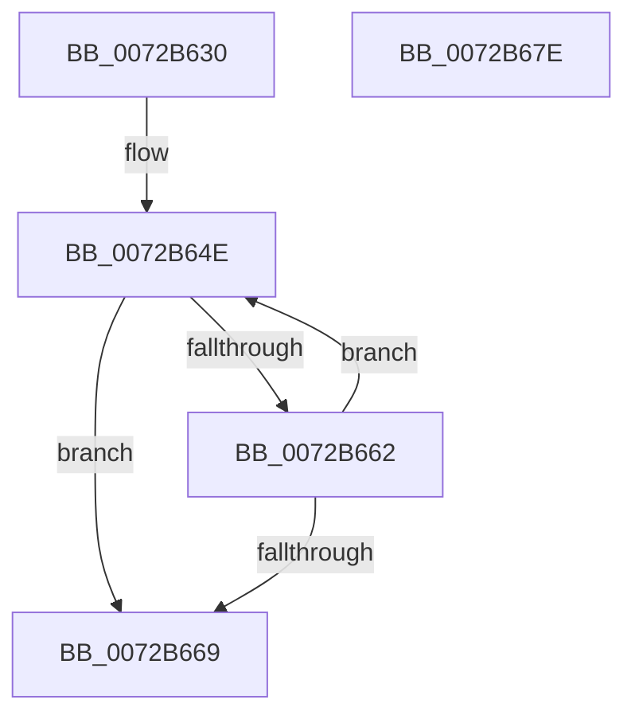

# PnpFindBestConfiguration

- RVA: `0x0072B630`–`0x0072B67F` (길이 `79` bytes)
- VA: `0x000000014072B630`
- 실행 섹션: `PAGE`
- PDB 이름 있음: `예`; PDB Function 태그: `아니요`
- unwind 정보 RVA: `0x0005C954`
- 디코드: `26`개 명령, `79/79` bytes 표시
- 미해석 바이트: `0` (있으면 어셈블리에 `.byte`로 보존)

> 이 문서는 커널 이미지의 기계어와 PDB 기호를 분석해 생성했습니다. 4번과 5번은 함수 원형과 자료형을 바이너리 사용 방식에서 추정한 C 해석이며 원본 소스 복구 결과는 아닙니다.

## 1. Dependencies

- 직접 호출 지점: **1**; 고유 호출 대상: **1**
- 직접 호출자로 확인된 함수: **4**
- RIP 상대 이미지 참조: **0**

### Outgoing calls
- `0x0072B659` → [PnpFindBestConfigurationWorker](PnpFindBestConfigurationWorker_function_0072B688.md) (function, `0x0072B688`)

### Direct callers
- [PnpReallocateResources](../73/PnpReallocateResources_function_0073E924.md) at `0x0073EA0F`
- [PnpRestoreResourcesInternal](../73/PnpRestoreResourcesInternal_function_0073EB10.md) at `0x0073EBD0`
- [PnpRebalance](../73/PnpRebalance_function_0073F508.md) at `0x0073F682`
- [sub_00B38CDE](../B3/Unknown_function_00B38CDE.md) at `0x00B38E86`
- [sub_00B38CDE](../B3/Unknown_function_00B38CDE.md) at `0x00B38F0F`

### Static image references
- 디코드된 RIP-relative 메모리 참조가 없습니다.

## 2. Other-region calls and transfers

- 다른 실행 섹션으로 향하는 call: **0**
- 별도 외부 분기/꼬리 이동을 확인하지 못했습니다.

## 3. Assembly (complete function range)

```asm
0072B630  48 89 5C 24 08                  mov qword ptr [rsp + 8], rbx
0072B635  48 89 6C 24 10                  mov qword ptr [rsp + 0x10], rbp
0072B63A  48 89 74 24 18                  mov qword ptr [rsp + 0x18], rsi
0072B63F  57                              push rdi
0072B640  48 83 EC 20                     sub rsp, 0x20
0072B644  49 8B F8                        mov rdi, r8
0072B647  8B F2                           mov esi, edx
0072B649  48 8B E9                        mov rbp, rcx
0072B64C  33 DB                           xor ebx, ebx
0072B64E  44 8B CB                        mov r9d, ebx
0072B651  4C 8B C7                        mov r8, rdi
0072B654  8B D6                           mov edx, esi
0072B656  48 8B CD                        mov rcx, rbp
0072B659  E8 2A 00 00 00                  call 0x14072b688
0072B65E  85 C0                           test eax, eax
0072B660  79 07                           jns 0x14072b669
0072B662  FF C3                           inc ebx
0072B664  83 FB 02                        cmp ebx, 2
0072B667  72 E5                           jb 0x14072b64e
0072B669  48 8B 5C 24 30                  mov rbx, qword ptr [rsp + 0x30]
0072B66E  48 8B 6C 24 38                  mov rbp, qword ptr [rsp + 0x38]
0072B673  48 8B 74 24 40                  mov rsi, qword ptr [rsp + 0x40]
0072B678  48 83 C4 20                     add rsp, 0x20
0072B67C  5F                              pop rdi
0072B67D  C3                              ret
0072B67E  CC                              int3
```

## 4. C-style interpretation (structured pseudocode)

```c
__int64 __fastcall PnpFindBestConfiguration(__int64 a1, int a2, __int64 a3)
{
    __int64 result;
    __int64 v_rbx;
    __int64 v_rsp;
    unsigned __int64 v_stack_p10;
    unsigned __int64 v_stack_p18;
    unsigned __int64 v_stack_p8;

    v_stack_p8 = v_rbx;
    v_stack_p10 = v_rbp;
    v_stack_p18 = v_rsi;
    v_rsp = (v_rsp) - (32);
    v_rbx = 0;
loc_0072B64E:
    result = PnpFindBestConfigurationWorker(a1, (unsigned int)((unsigned int)((unsigned int)(a2))), a3, 0);
    if (!sign_flag) goto loc_0072B669;
    v_rbx = (unsigned int)((v_rbx) + 1);
    if (((unsigned int)(v_rbx)) < 2) goto loc_0072B64E;
loc_0072B669:
    v_rsp = (v_rsp) + (32);
    return result;
}
```

## 5. (Beta) C Style

```c
int64_t PnpFindBestConfiguration(int64_t Arg1, int32_t Arg2, int64_t Arg3)
{
    int64_t result;
    int64_t local_rbx;
    int64_t local_rsp;
    uint64_t v_stack_p10;
    uint64_t v_stack_p18;
    uint64_t v_stack_p8;

    v_stack_p8 = local_rbx;
    v_stack_p10 = local_rbp;
    v_stack_p18 = local_rsi;
    local_rsp = (local_rsp) - (32);
    local_rbx = 0;
loc_0072B64E:
    result = PnpFindBestConfigurationWorker(Arg1, (uint32_t)((uint32_t)((uint32_t)(Arg2))), Arg3, 0);
    if (!sign_flag) goto loc_0072B669;
    local_rbx = (uint32_t)((local_rbx) + 1);
    if (((uint32_t)(local_rbx)) < 2) goto loc_0072B64E;
loc_0072B669:
    local_rsp = (local_rsp) + (32);
    return result;
}
```

## 6. Execution-region graph

[열기: 2D/3D 그래프와 함수 탐색 컨트롤 패널](../../../control-panel.html?section=page&rva=0x0072B630&view=graph)

- 2D 그래프는 위에서 아래로 흐르고, 3D 그래프는 빈 공간을 드래그해 회전합니다. Shift+드래그는 이동, 휠은 확대·축소, 함수 노드 선택은 대상 보고서 이동입니다.

### Static fallback


