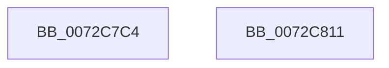

# PnpGetCallerSessionId

- RVA: `0x0072C7C4`–`0x0072C812` (길이 `78` bytes)
- VA: `0x000000014072C7C4`
- 실행 섹션: `PAGE`
- PDB 이름 있음: `예`; PDB Function 태그: `아니요`
- unwind 정보 RVA: `0x000697A4`
- 디코드: `22`개 명령, `78/78` bytes 표시
- 미해석 바이트: `0` (있으면 어셈블리에 `.byte`로 보존)

> 이 문서는 커널 이미지의 기계어와 PDB 기호를 분석해 생성했습니다. 4번과 5번은 함수 원형과 자료형을 바이너리 사용 방식에서 추정한 C 해석이며 원본 소스 복구 결과는 아닙니다.

## 1. Dependencies

- 직접 호출 지점: **3**; 고유 호출 대상: **3**
- 직접 호출자로 확인된 함수: **1**
- RIP 상대 이미지 참조: **0**

### Outgoing calls
- `0x0072C7DF` → [SeCaptureSubjectContext](../86/SeCaptureSubjectContext_function_0086B820.md) (function, `0x0086B820`)
- `0x0072C7F8` → [SeQuerySessionIdToken](../A0/SeQuerySessionIdToken_function_00A04490.md) (function, `0x00A04490`)
- `0x0072C804` → [SeReleaseSubjectContext](../86/SeReleaseSubjectContext_function_0086B710.md) (function, `0x0086B710`)

### Direct callers
- [PiCMQueryRemove](../AD/PiCMQueryRemove_function_00AD43F4.md) at `0x00AD4646`

### Static image references
- 디코드된 RIP-relative 메모리 참조가 없습니다.

## 2. Other-region calls and transfers

- 다른 실행 섹션으로 향하는 call: **0**
- 별도 외부 분기/꼬리 이동을 확인하지 못했습니다.

## 3. Assembly (complete function range)

```asm
0072C7C4  40 53                           push rbx
0072C7C6  48 83 EC 40                     sub rsp, 0x40
0072C7CA  0F 57 C0                        xorps xmm0, xmm0
0072C7CD  48 8B D9                        mov rbx, rcx
0072C7D0  48 8D 4C 24 20                  lea rcx, [rsp + 0x20]
0072C7D5  0F 11 44 24 20                  movups xmmword ptr [rsp + 0x20], xmm0
0072C7DA  0F 11 44 24 30                  movups xmmword ptr [rsp + 0x30], xmm0
0072C7DF  E8 3C F0 13 00                  call 0x14086b820
0072C7E4  48 8B 44 24 20                  mov rax, qword ptr [rsp + 0x20]
0072C7E9  48 8B D3                        mov rdx, rbx
0072C7EC  48 8B 4C 24 30                  mov rcx, qword ptr [rsp + 0x30]
0072C7F1  48 85 C0                        test rax, rax
0072C7F4  48 0F 45 C8                     cmovne rcx, rax
0072C7F8  E8 93 7C 2D 00                  call 0x140a04490
0072C7FD  48 8D 4C 24 20                  lea rcx, [rsp + 0x20]
0072C802  8B D8                           mov ebx, eax
0072C804  E8 07 EF 13 00                  call 0x14086b710
0072C809  8B C3                           mov eax, ebx
0072C80B  48 83 C4 40                     add rsp, 0x40
0072C80F  5B                              pop rbx
0072C810  C3                              ret
0072C811  CC                              int3
```

## 4. C-style interpretation (structured pseudocode)

```c
__int64 __fastcall PnpGetCallerSessionId(__int64 a1)
{
    __int64 result;
    __int64 v_rsp;
    unsigned __int64 v_stack_m18;
    unsigned __int64 v_stack_m28;

    v_rsp = (v_rsp) - (64);
    v_stack_m28 = v_xmm0;
    v_stack_m18 = v_xmm0;
    result = SeCaptureSubjectContext(v_stack_m28, a2, a3, a4);
    a1 = v_stack_m18;
    if (v_stack_m28 != 0) { a1 = v_stack_m28; }
    result = SeQuerySessionIdToken(a1, a1, a3, a4);
    result = SeReleaseSubjectContext(v_stack_m28, a1, a3, a4);
    v_rsp = (v_rsp) + (64);
    return (unsigned int)((unsigned int)((unsigned int)((unsigned int)(result))));
}
```

## 5. (Beta) C Style

```c
int64_t PnpGetCallerSessionId(int64_t Arg1)
{
    int64_t result;
    int64_t local_rsp;
    uint64_t v_stack_m18;
    uint64_t v_stack_m28;

    local_rsp = (local_rsp) - (64);
    v_stack_m28 = v_xmm0;
    v_stack_m18 = v_xmm0;
    result = SeCaptureSubjectContext(v_stack_m28, a2, a3, a4);
    Arg1 = v_stack_m18;
    if (v_stack_m28 != 0) { Arg1 = v_stack_m28; }
    result = SeQuerySessionIdToken(Arg1, Arg1, a3, a4);
    result = SeReleaseSubjectContext(v_stack_m28, Arg1, a3, a4);
    local_rsp = (local_rsp) + (64);
    return (uint32_t)((uint32_t)((uint32_t)((uint32_t)(result))));
}
```

## 6. Execution-region graph

[열기: 2D/3D 그래프와 함수 탐색 컨트롤 패널](../../../control-panel.html?section=page&rva=0x0072C7C4&view=graph)

- 2D 그래프는 위에서 아래로 흐르고, 3D 그래프는 빈 공간을 드래그해 회전합니다. Shift+드래그는 이동, 휠은 확대·축소, 함수 노드 선택은 대상 보고서 이동입니다.

### Static fallback


