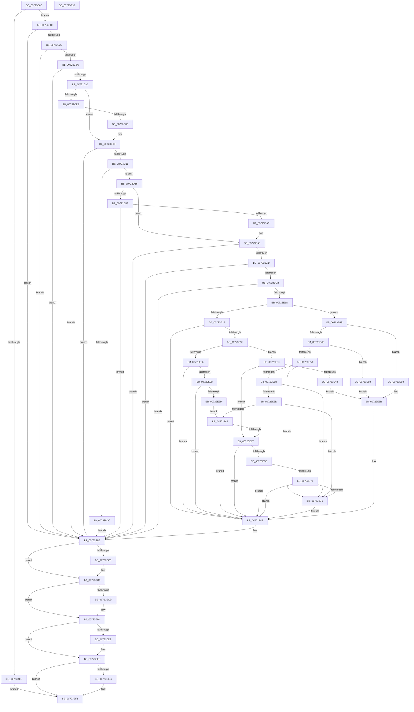

# PnpHardwareConfigCreateBootDriverFlags

- RVA: `0x00723B88`–`0x00723F19` (길이 `913` bytes)
- VA: `0x0000000140723B88`
- 실행 섹션: `PAGE`
- PDB 이름 있음: `예`; PDB Function 태그: `아니요`
- unwind 정보 RVA: `0x000C81E0`
- 디코드: `239`개 명령, `913/913` bytes 표시
- 미해석 바이트: `0` (있으면 어셈블리에 `.byte`로 보존)

> 이 문서는 커널 이미지의 기계어와 PDB 기호를 분석해 생성했습니다. 4번과 5번은 함수 원형과 자료형을 바이너리 사용 방식에서 추정한 C 해석이며 원본 소스 복구 결과는 아닙니다.

## 1. Dependencies

- 직접 호출 지점: **17**; 고유 호출 대상: **12**
- 직접 호출자로 확인된 함수: **1**
- RIP 상대 이미지 참조: **4**

### Outgoing calls
- `0x00723C11` → [PipHardwareConfigOpenKey](../AD/PipHardwareConfigOpenKey_function_00AD8848.md) (function, `0x00AD8848`)
- `0x00723C48` → [PnpCtxRegQueryValue](../99/PnpCtxRegQueryValue_function_009940FC.md) (function, `0x009940FC`)
- `0x00723C91` → [ZwCreateEvent](../../text/6A/ZwCreateEvent_function_006AD9D0.md) (function, `0x006AD9D0`)
- `0x00723CE0` → [ZwDeviceIoControlFile](../../text/6A/ZwDeviceIoControlFile_function_006AD1B0.md) (function, `0x006AD1B0`)
- `0x00723CF7` → [ZwWaitForSingleObject](../../text/6A/ZwWaitForSingleObject_function_006AD150.md) (function, `0x006AD150`)
- `0x00723D1F` → [ExAllocatePool2](../../poolcode/B8/ExAllocatePool2_function_00B820F0.md) (function, `0x00B820F0`)
- `0x00723D3C` → [ZwResetEvent](../../text/6B/ZwResetEvent_function_006B01D0.md) (function, `0x006B01D0`)
- `0x00723D7C` → [ZwDeviceIoControlFile](../../text/6A/ZwDeviceIoControlFile_function_006AD1B0.md) (function, `0x006AD1B0`)
- `0x00723D93` → [ZwWaitForSingleObject](../../text/6A/ZwWaitForSingleObject_function_006AD150.md) (function, `0x006AD150`)
- `0x00723DD4` → [PnpCtxRegOpenKey](../8E/PnpCtxRegOpenKey_function_008EF7B8.md) (function, `0x008EF7B8`)
- `0x00723E0B` → [PnpCtxRegQueryValue](../99/PnpCtxRegQueryValue_function_009940FC.md) (function, `0x009940FC`)
- `0x00723EB0` → [PnpCtxRegSetValue](../99/PnpCtxRegSetValue_function_00991B8C.md) (function, `0x00991B8C`)
- `0x00723EC0` → [ZwClose](../../text/6A/ZwClose_function_006AD2B0.md) (function, `0x006AD2B0`)
- `0x00723ECF` → [ZwClose](../../text/6A/ZwClose_function_006AD2B0.md) (function, `0x006AD2B0`)
- `0x00723EDE` → [ExFreePoolWithTag](../../poolcode/B8/ExFreePoolWithTag_function_00B82870.md) (function, `0x00B82870`)
- `0x00723EEC` → [ZwClose](../../text/6A/ZwClose_function_006AD2B0.md) (function, `0x006AD2B0`)
- `0x00723EFA` → [_security_check_cookie](../../text/6A/_security_check_cookie_function_006AC640.md) (function, `0x006AC640`)

### Direct callers
- [IopMarkBootPartition](../../init/C2/IopMarkBootPartition_function_00C2CFA0.md) at `0x00C2D12A`

### Static image references
- `0x00723BA3` → RVA `0x00E0A740` (`.data`; read)
- `0x00723C3C` → RVA `0x00AFD3A0` (` ?? ::NNGAKEGL::`string'`; read)
- `0x00723DAD` → RVA `0x00E66398` (`.data`; read)
- `0x00723DBD` → RVA `0x00AFD3C0` (` ?? ::NNGAKEGL::`string'`; read)

## 2. Other-region calls and transfers

- 다른 실행 섹션으로 향하는 call: **12**
  - `0x00723C91` → [ZwCreateEvent](../../text/6A/ZwCreateEvent_function_006AD9D0.md) (`PAGE` → `.text`)
  - `0x00723CE0` → [ZwDeviceIoControlFile](../../text/6A/ZwDeviceIoControlFile_function_006AD1B0.md) (`PAGE` → `.text`)
  - `0x00723CF7` → [ZwWaitForSingleObject](../../text/6A/ZwWaitForSingleObject_function_006AD150.md) (`PAGE` → `.text`)
  - `0x00723D1F` → [ExAllocatePool2](../../poolcode/B8/ExAllocatePool2_function_00B820F0.md) (`PAGE` → `POOLCODE`)
  - `0x00723D3C` → [ZwResetEvent](../../text/6B/ZwResetEvent_function_006B01D0.md) (`PAGE` → `.text`)
  - `0x00723D7C` → [ZwDeviceIoControlFile](../../text/6A/ZwDeviceIoControlFile_function_006AD1B0.md) (`PAGE` → `.text`)
  - `0x00723D93` → [ZwWaitForSingleObject](../../text/6A/ZwWaitForSingleObject_function_006AD150.md) (`PAGE` → `.text`)
  - `0x00723EC0` → [ZwClose](../../text/6A/ZwClose_function_006AD2B0.md) (`PAGE` → `.text`)
  - `0x00723ECF` → [ZwClose](../../text/6A/ZwClose_function_006AD2B0.md) (`PAGE` → `.text`)
  - `0x00723EDE` → [ExFreePoolWithTag](../../poolcode/B8/ExFreePoolWithTag_function_00B82870.md) (`PAGE` → `POOLCODE`)
  - `0x00723EEC` → [ZwClose](../../text/6A/ZwClose_function_006AD2B0.md) (`PAGE` → `.text`)
  - `0x00723EFA` → [_security_check_cookie](../../text/6A/_security_check_cookie_function_006AC640.md) (`PAGE` → `.text`)
- 별도 외부 분기/꼬리 이동을 확인하지 못했습니다.

## 3. Assembly (complete function range)

```asm
00723B88  48 89 5C 24 08                  mov qword ptr [rsp + 8], rbx
00723B8D  48 89 7C 24 18                  mov qword ptr [rsp + 0x18], rdi
00723B92  55                              push rbp
00723B93  41 56                           push r14
00723B95  41 57                           push r15
00723B97  48 8D 6C 24 B9                  lea rbp, [rsp - 0x47]
00723B9C  48 81 EC E0 00 00 00            sub rsp, 0xe0
00723BA3  48 8B 05 96 6B 6E 00            mov rax, qword ptr [rip + 0x6e6b96]
00723BAA  48 33 C4                        xor rax, rsp
00723BAD  48 89 45 3F                     mov qword ptr [rbp + 0x3f], rax
00723BB1  45 33 FF                        xor r15d, r15d
00723BB4  33 C0                           xor eax, eax
00723BB6  4C 89 7D DF                     mov qword ptr [rbp - 0x21], r15
00723BBA  0F 57 C0                        xorps xmm0, xmm0
00723BBD  44 89 7D B7                     mov dword ptr [rbp - 0x49], r15d
00723BC1  4C 8B F2                        mov r14, rdx
00723BC4  48 89 45 1F                     mov qword ptr [rbp + 0x1f], rax
00723BC8  41 8B FF                        mov edi, r15d
00723BCB  89 45 27                        mov dword ptr [rbp + 0x27], eax
00723BCE  48 89 45 2F                     mov qword ptr [rbp + 0x2f], rax
00723BD2  89 45 37                        mov dword ptr [rbp + 0x37], eax
00723BD5  44 89 7D C7                     mov dword ptr [rbp - 0x39], r15d
00723BD9  44 89 7D D7                     mov dword ptr [rbp - 0x29], r15d
00723BDD  4C 89 7D BF                     mov qword ptr [rbp - 0x41], r15
00723BE1  44 89 7D CB                     mov dword ptr [rbp - 0x35], r15d
00723BE5  4C 89 7D E7                     mov qword ptr [rbp - 0x19], r15
00723BE9  4C 89 7D CF                     mov qword ptr [rbp - 0x31], r15
00723BED  0F 11 45 EF                     movups xmmword ptr [rbp - 0x11], xmm0
00723BF1  0F 11 45 FF                     movups xmmword ptr [rbp - 1], xmm0
00723BF5  0F 11 45 0F                     movups xmmword ptr [rbp + 0xf], xmm0
00723BF9  48 85 D2                        test rdx, rdx
00723BFC  75 0A                           jne 0x140723c08
00723BFE  BB 0D 00 00 C0                  mov ebx, 0xc000000d
00723C03  E9 E9 02 00 00                  jmp 0x140723ef1
00723C08  4C 8D 45 CF                     lea r8, [rbp - 0x31]
00723C0C  BA 19 00 02 00                  mov edx, 0x20019
00723C11  E8 32 4C 3B 00                  call 0x140ad8848
00723C16  8B D8                           mov ebx, eax
00723C18  85 C0                           test eax, eax
00723C1A  0F 88 97 02 00 00               js 0x140723eb7
00723C20  48 8B 55 CF                     mov rdx, qword ptr [rbp - 0x31]
00723C24  48 8D 45 BB                     lea rax, [rbp - 0x45]
00723C28  48 89 44 24 28                  mov qword ptr [rsp + 0x28], rax
00723C2D  4C 8D 4D C7                     lea r9, [rbp - 0x39]
00723C31  48 8D 45 D7                     lea rax, [rbp - 0x29]
00723C35  C7 45 BB 04 00 00 00            mov dword ptr [rbp - 0x45], 4
00723C3C  4C 8D 05 5D 97 3D 00            lea r8, [rip + 0x3d975d]
00723C43  48 89 44 24 20                  mov qword ptr [rsp + 0x20], rax
00723C48  E8 AF 04 27 00                  call 0x1409940fc
00723C4D  8B D8                           mov ebx, eax
00723C4F  3D 34 00 00 C0                  cmp eax, 0xc0000034
00723C54  0F 85 5D 02 00 00               jne 0x140723eb7
00723C5A  0F 57 C0                        xorps xmm0, xmm0
00723C5D  44 89 7D 37                     mov dword ptr [rbp + 0x37], r15d
00723C61  45 33 C9                        xor r9d, r9d
00723C64  C7 45 FF 30 00 00 00            mov dword ptr [rbp - 1], 0x30
00723C6B  4C 8D 45 FF                     lea r8, [rbp - 1]
00723C6F  4C 89 7D 07                     mov qword ptr [rbp + 7], r15
00723C73  BA 03 00 1F 00                  mov edx, 0x1f0003
00723C78  C7 45 17 00 02 00 00            mov dword ptr [rbp + 0x17], 0x200
00723C7F  48 8D 4D BF                     lea rcx, [rbp - 0x41]
00723C83  4C 89 7D 0F                     mov qword ptr [rbp + 0xf], r15
00723C87  F3 0F 7F 45 1F                  movdqu xmmword ptr [rbp + 0x1f], xmm0
00723C8C  44 88 7C 24 20                  mov byte ptr [rsp + 0x20], r15b
00723C91  E8 3A 9D F8 FF                  call 0x1406ad9d0
00723C96  8B D8                           mov ebx, eax
00723C98  85 C0                           test eax, eax
00723C9A  0F 88 17 02 00 00               js 0x140723eb7
00723CA0  48 8B 55 BF                     mov rdx, qword ptr [rbp - 0x41]
00723CA4  48 8D 45 DF                     lea rax, [rbp - 0x21]
00723CA8  C7 44 24 48 08 00 00 00         mov dword ptr [rsp + 0x48], 8
00723CB0  45 33 C9                        xor r9d, r9d
00723CB3  48 89 44 24 40                  mov qword ptr [rsp + 0x40], rax
00723CB8  45 33 C0                        xor r8d, r8d
00723CBB  C7 44 24 38 0C 00 00 00         mov dword ptr [rsp + 0x38], 0xc
00723CC3  48 8D 45 2F                     lea rax, [rbp + 0x2f]
00723CC7  48 89 44 24 30                  mov qword ptr [rsp + 0x30], rax
00723CCC  49 8B CE                        mov rcx, r14
00723CCF  48 8D 45 EF                     lea rax, [rbp - 0x11]
00723CD3  C7 44 24 28 00 14 2D 00         mov dword ptr [rsp + 0x28], 0x2d1400
00723CDB  48 89 44 24 20                  mov qword ptr [rsp + 0x20], rax
00723CE0  E8 CB 94 F8 FF                  call 0x1406ad1b0
00723CE5  8B D8                           mov ebx, eax
00723CE7  3D 03 01 00 00                  cmp eax, 0x103
00723CEC  75 1B                           jne 0x140723d09
00723CEE  48 8B 4D BF                     mov rcx, qword ptr [rbp - 0x41]
00723CF2  45 33 C0                        xor r8d, r8d
00723CF5  33 D2                           xor edx, edx
00723CF7  E8 54 94 F8 FF                  call 0x1406ad150
00723CFC  8B D8                           mov ebx, eax
00723CFE  85 C0                           test eax, eax
00723D00  0F 88 B1 01 00 00               js 0x140723eb7
00723D06  8B 5D EF                        mov ebx, dword ptr [rbp - 0x11]
00723D09  85 DB                           test ebx, ebx
00723D0B  0F 88 A6 01 00 00               js 0x140723eb7
00723D11  8B 55 E3                        mov edx, dword ptr [rbp - 0x1d]
00723D14  B9 00 01 00 00                  mov ecx, 0x100
00723D19  41 B8 50 70 69 6E               mov r8d, 0x6e697050
00723D1F  E8 CC E3 45 00                  call 0x140b820f0
00723D24  48 8B F8                        mov rdi, rax
00723D27  48 85 C0                        test rax, rax
00723D2A  75 0A                           jne 0x140723d36
00723D2C  BB 9A 00 00 C0                  mov ebx, 0xc000009a
00723D31  E9 81 01 00 00                  jmp 0x140723eb7
00723D36  48 8B 4D BF                     mov rcx, qword ptr [rbp - 0x41]
00723D3A  33 D2                           xor edx, edx
00723D3C  E8 8F C4 F8 FF                  call 0x1406b01d0
00723D41  8B 45 E3                        mov eax, dword ptr [rbp - 0x1d]
00723D44  45 33 C9                        xor r9d, r9d
00723D47  48 8B 55 BF                     mov rdx, qword ptr [rbp - 0x41]
00723D4B  45 33 C0                        xor r8d, r8d
00723D4E  89 44 24 48                     mov dword ptr [rsp + 0x48], eax
00723D52  49 8B CE                        mov rcx, r14
00723D55  48 89 7C 24 40                  mov qword ptr [rsp + 0x40], rdi
00723D5A  48 8D 45 2F                     lea rax, [rbp + 0x2f]
00723D5E  C7 44 24 38 0C 00 00 00         mov dword ptr [rsp + 0x38], 0xc
00723D66  48 89 44 24 30                  mov qword ptr [rsp + 0x30], rax
00723D6B  48 8D 45 EF                     lea rax, [rbp - 0x11]
00723D6F  C7 44 24 28 00 14 2D 00         mov dword ptr [rsp + 0x28], 0x2d1400
00723D77  48 89 44 24 20                  mov qword ptr [rsp + 0x20], rax
00723D7C  E8 2F 94 F8 FF                  call 0x1406ad1b0
00723D81  8B D8                           mov ebx, eax
00723D83  3D 03 01 00 00                  cmp eax, 0x103
00723D88  75 1B                           jne 0x140723da5
00723D8A  48 8B 4D BF                     mov rcx, qword ptr [rbp - 0x41]
00723D8E  45 33 C0                        xor r8d, r8d
00723D91  33 D2                           xor edx, edx
00723D93  E8 B8 93 F8 FF                  call 0x1406ad150
00723D98  8B D8                           mov ebx, eax
00723D9A  85 C0                           test eax, eax
00723D9C  0F 88 15 01 00 00               js 0x140723eb7
00723DA2  8B 5D EF                        mov ebx, dword ptr [rbp - 0x11]
00723DA5  85 DB                           test ebx, ebx
00723DA7  0F 88 0A 01 00 00               js 0x140723eb7
00723DAD  48 8B 0D E4 25 74 00            mov rcx, qword ptr [rip + 0x7425e4]
00723DB4  48 8D 45 E7                     lea rax, [rbp - 0x19]
00723DB8  48 89 44 24 28                  mov qword ptr [rsp + 0x28], rax
00723DBD  4C 8D 05 FC 95 3D 00            lea r8, [rip + 0x3d95fc]
00723DC4  45 33 C9                        xor r9d, r9d
00723DC7  C7 44 24 20 01 00 00 00         mov dword ptr [rsp + 0x20], 1
00723DCF  BA 02 00 00 80                  mov edx, 0x80000002
00723DD4  E8 DF B9 1C 00                  call 0x1408ef7b8
00723DD9  8B D8                           mov ebx, eax
00723DDB  85 C0                           test eax, eax
00723DDD  0F 88 D4 00 00 00               js 0x140723eb7
00723DE3  48 8B 55 E7                     mov rdx, qword ptr [rbp - 0x19]
00723DE7  48 8D 45 BB                     lea rax, [rbp - 0x45]
00723DEB  48 89 44 24 28                  mov qword ptr [rsp + 0x28], rax
00723DF0  4C 8D 4D C7                     lea r9, [rbp - 0x39]
00723DF4  48 8D 45 CB                     lea rax, [rbp - 0x35]
00723DF8  C7 45 BB 04 00 00 00            mov dword ptr [rbp - 0x45], 4
00723DFF  4C 8D 05 9A 95 3D 00            lea r8, [rip + 0x3d959a]
00723E06  48 89 44 24 20                  mov qword ptr [rsp + 0x20], rax
00723E0B  E8 EC 02 27 00                  call 0x1409940fc
00723E10  8B D8                           mov ebx, eax
00723E12  85 C0                           test eax, eax
00723E14  0F 88 9D 00 00 00               js 0x140723eb7
00723E1A  44 8B 45 CB                     mov r8d, dword ptr [rbp - 0x35]
00723E1E  41 8B D0                        mov edx, r8d
00723E21  83 E2 E3                        and edx, 0xffffffe3
00723E24  89 55 B7                        mov dword ptr [rbp - 0x49], edx
00723E27  8B 4F 1C                        mov ecx, dword ptr [rdi + 0x1c]
00723E2A  83 F9 0B                        cmp ecx, 0xb
00723E2D  7F 1A                           jg 0x140723e49
00723E2F  74 5D                           je 0x140723e8e
00723E31  83 F9 06                        cmp ecx, 6
00723E34  7F 09                           jg 0x140723e3f
00723E36  74 56                           je 0x140723e8e
00723E38  83 E9 01                        sub ecx, 1
00723E3B  74 51                           je 0x140723e8e
00723E3D  EB 23                           jmp 0x140723e62
00723E3F  83 E9 07                        sub ecx, 7
00723E42  75 23                           jne 0x140723e67
00723E44  83 CA 14                        or edx, 0x14
00723E47  EB 42                           jmp 0x140723e8b
00723E49  83 E9 0C                        sub ecx, 0xc
00723E4C  74 3A                           je 0x140723e88
00723E4E  83 E9 01                        sub ecx, 1
00723E51  74 30                           je 0x140723e83
00723E53  83 E9 01                        sub ecx, 1
00723E56  74 1E                           je 0x140723e76
00723E58  83 E9 01                        sub ecx, 1
00723E5B  74 19                           je 0x140723e76
00723E5D  83 E9 01                        sub ecx, 1
00723E60  74 14                           je 0x140723e76
00723E62  83 E9 01                        sub ecx, 1
00723E65  74 27                           je 0x140723e8e
00723E67  83 E9 01                        sub ecx, 1
00723E6A  74 22                           je 0x140723e8e
00723E6C  83 E9 01                        sub ecx, 1
00723E6F  74 1D                           je 0x140723e8e
00723E71  83 F9 01                        cmp ecx, 1
00723E74  74 18                           je 0x140723e8e
00723E76  41 83 E0 1C                     and r8d, 0x1c
00723E7A  44 0B C2                        or r8d, edx
00723E7D  44 89 45 B7                     mov dword ptr [rbp - 0x49], r8d
00723E81  EB 0B                           jmp 0x140723e8e
00723E83  83 CA 1C                        or edx, 0x1c
00723E86  EB 03                           jmp 0x140723e8b
00723E88  83 CA 08                        or edx, 8
00723E8B  89 55 B7                        mov dword ptr [rbp - 0x49], edx
00723E8E  48 8B 55 CF                     mov rdx, qword ptr [rbp - 0x31]
00723E92  48 8D 45 B7                     lea rax, [rbp - 0x49]
00723E96  C7 44 24 28 04 00 00 00         mov dword ptr [rsp + 0x28], 4
00723E9E  4C 8D 05 FB 94 3D 00            lea r8, [rip + 0x3d94fb]
00723EA5  41 B9 04 00 00 00               mov r9d, 4
00723EAB  48 89 44 24 20                  mov qword ptr [rsp + 0x20], rax
00723EB0  E8 D7 DC 26 00                  call 0x140991b8c
00723EB5  8B D8                           mov ebx, eax
00723EB7  48 8B 4D E7                     mov rcx, qword ptr [rbp - 0x19]
00723EBB  48 85 C9                        test rcx, rcx
00723EBE  74 05                           je 0x140723ec5
00723EC0  E8 EB 93 F8 FF                  call 0x1406ad2b0
00723EC5  4C 39 7D CF                     cmp qword ptr [rbp - 0x31], r15
00723EC9  74 09                           je 0x140723ed4
00723ECB  48 8B 4D CF                     mov rcx, qword ptr [rbp - 0x31]
00723ECF  E8 DC 93 F8 FF                  call 0x1406ad2b0
00723ED4  48 85 FF                        test rdi, rdi
00723ED7  74 0A                           je 0x140723ee3
00723ED9  33 D2                           xor edx, edx
00723EDB  48 8B CF                        mov rcx, rdi
00723EDE  E8 8D E9 45 00                  call 0x140b82870
00723EE3  48 8B 4D BF                     mov rcx, qword ptr [rbp - 0x41]
00723EE7  48 85 C9                        test rcx, rcx
00723EEA  74 05                           je 0x140723ef1
00723EEC  E8 BF 93 F8 FF                  call 0x1406ad2b0
00723EF1  8B C3                           mov eax, ebx
00723EF3  48 8B 4D 3F                     mov rcx, qword ptr [rbp + 0x3f]
00723EF7  48 33 CC                        xor rcx, rsp
00723EFA  E8 41 87 F8 FF                  call 0x1406ac640
00723EFF  4C 8D 9C 24 E0 00 00 00         lea r11, [rsp + 0xe0]
00723F07  49 8B 5B 20                     mov rbx, qword ptr [r11 + 0x20]
00723F0B  49 8B 7B 30                     mov rdi, qword ptr [r11 + 0x30]
00723F0F  49 8B E3                        mov rsp, r11
00723F12  41 5F                           pop r15
00723F14  41 5E                           pop r14
00723F16  5D                              pop rbp
00723F17  C3                              ret
00723F18  CC                              int3
```

## 4. C-style interpretation (structured pseudocode)

```c
__int64 __fastcall PnpHardwareConfigCreateBootDriverFlags(__int64 a1, __int64 a2)
{
    __int64 result;
    __int64 v_r15;
    __int64 v_rsp;
    unsigned __int64 v_stack_m18;
    unsigned __int64 v_stack_m20;
    unsigned int v_stack_m28;
    unsigned __int64 v_stack_m30;
    unsigned int v_stack_m38;
    unsigned __int64 v_stack_m40;
    unsigned int v_stack_m48;
    unsigned __int64 v_stack_m50;
    unsigned __int64 v_stack_m58;
    unsigned __int64 v_stack_m5F;
    unsigned __int64 v_stack_m60;
    unsigned __int64 v_stack_m70;
    unsigned __int64 v_stack_m78;
    unsigned int v_stack_m7C;
    unsigned __int64 v_stack_m80;
    unsigned int v_stack_m88;
    unsigned __int64 v_stack_m90;
    unsigned int v_stack_m94;
    unsigned int v_stack_m98;
    unsigned __int64 v_stack_mA0;
    unsigned __int64 v_stack_mA4;
    unsigned int v_stack_mA8;
    unsigned int v_stack_mB0;
    unsigned __int64 v_stack_mB8;
    unsigned int v_stack_mC0;
    unsigned __int64 v_stack_mC8;
    unsigned __int64 v_stack_mD0;
    unsigned __int64 v_stack_mD8;
    unsigned __int64 v_stack_p18;
    unsigned __int64 v_stack_p8;

    v_stack_p8 = v_rbx;
    v_stack_p18 = v_rdi;
    v_rsp = (v_rsp) - (224);
    result = (*(unsigned __int64 *)(v_rip + 7236502)) ^ (v_rsp);
    v_stack_m20 = result;
    v_r15 = 0;
    result = 0;
    v_stack_m80 = 0;
    v_stack_mA8 = 0;
    v_stack_m40 = 0;
    v_stack_m38 = 0;
    v_stack_m30 = 0;
    v_stack_m28 = 0;
    v_stack_m98 = 0;
    v_stack_m88 = 0;
    v_stack_mA0 = 0;
    v_stack_m94 = 0;
    v_stack_m78 = 0;
    v_stack_m90 = 0;
    v_stack_m70 = v_xmm0;
    v_stack_m60 = v_xmm0;
    v_stack_m50 = v_xmm0;
    if (a2 != 0) goto loc_00723C08;
    goto loc_00723EF1;
loc_00723C08:
    result = PipHardwareConfigOpenKey(a1, (unsigned int)(0x20019ULL), v_stack_m90, a4);
    if (sign_flag) goto loc_00723EB7;
    v_stack_mD0 = v_stack_mA4;
    v_stack_mA4 = 4;
    v_stack_mD8 = v_stack_m88;
    result = PnpCtxRegQueryValue(a1, v_stack_m90, v_rip + 4036445, v_stack_m98);
    if (((unsigned int)(result)) != 0xC0000034ULL) goto loc_00723EB7;
    v_stack_m28 = 0;
    a4 = 0;
    v_stack_m60 = 48;
    v_stack_m58 = 0;
    v_stack_m48 = 512;
    v_stack_m50 = 0;
    v_stack_m40 = v_xmm0;
    v_stack_mD8 = 0;
    result = ZwCreateEvent(v_stack_mA0, (unsigned int)(0x1F0003ULL), v_stack_m60, a4);
    if (sign_flag) goto loc_00723EB7;
    v_stack_mB0 = 8;
    a4 = 0;
    v_stack_mB8 = v_stack_m80;
    a3 = 0;
    v_stack_mC0 = 12;
    v_stack_mC8 = v_stack_m30;
    v_stack_mD0 = 0x2D1400ULL;
    v_stack_mD8 = v_stack_m70;
    result = ZwDeviceIoControlFile(a2, v_stack_mA0, a3, a4);
    if (((unsigned int)(result)) != 259) goto loc_00723D09;
    a3 = 0;
    a2 = 0;
    result = ZwWaitForSingleObject(v_stack_mA0, a2, a3, a4);
    if (sign_flag) goto loc_00723EB7;
loc_00723D09:
    if (sign_flag) goto loc_00723EB7;
    result = ExAllocatePool2(256, (unsigned int)(v_stack_m7C), (unsigned int)(0x6E697050ULL), a4);
    if (result != 0) goto loc_00723D36;
    goto loc_00723EB7;
loc_00723D36:
    a2 = 0;
    result = ZwResetEvent(v_stack_mA0, a2, (unsigned int)(0x6E697050ULL), a4);
    a4 = 0;
    a3 = 0;
    v_stack_mB0 = (unsigned int)((unsigned int)(v_stack_m7C));
    v_stack_mB8 = result;
    v_stack_mC0 = 12;
    v_stack_mC8 = v_stack_m30;
    v_stack_mD0 = 0x2D1400ULL;
    v_stack_mD8 = v_stack_m70;
    result = ZwDeviceIoControlFile(0, v_stack_mA0, a3, a4);
    if (((unsigned int)(result)) != 259) goto loc_00723DA5;
    a3 = 0;
    a2 = 0;
    result = ZwWaitForSingleObject(v_stack_mA0, a2, a3, a4);
    if (sign_flag) goto loc_00723EB7;
loc_00723DA5:
    if (sign_flag) goto loc_00723EB7;
    v_stack_mD0 = v_stack_m78;
    a4 = 0;
    v_stack_mD8 = 1;
    result = PnpCtxRegOpenKey(*(unsigned __int64 *)(v_rip + 7611876), (unsigned int)(0x80000002ULL), v_rip + 4036092, a4);
    if (sign_flag) goto loc_00723EB7;
    v_stack_mD0 = v_stack_mA4;
    v_stack_mA4 = 4;
    v_stack_mD8 = v_stack_m94;
    result = PnpCtxRegQueryValue(*(unsigned __int64 *)(v_rip + 7611876), v_stack_m78, v_rip + 4035994, v_stack_m98);
    if (sign_flag) goto loc_00723EB7;
    a2 = (unsigned int)(((unsigned int)((unsigned int)((unsigned int)(v_stack_m94)))) & (0xFFFFFFE3ULL));
    v_stack_mA8 = (unsigned int)(a2);
    if (((unsigned int)((unsigned int)(*(unsigned int *)(result + 28)))) > 11) goto loc_00723E49;
    if (((unsigned int)((unsigned int)(*(unsigned int *)(result + 28)))) == 11) goto loc_00723E8E;
    if (((unsigned int)((unsigned int)(*(unsigned int *)(result + 28)))) > 6) goto loc_00723E3F;
    if (((unsigned int)((unsigned int)(*(unsigned int *)(result + 28)))) == 6) goto loc_00723E8E;
    a1 = (unsigned int)(((unsigned int)(*(unsigned int *)(result + 28))) - (1));
    if (condition_is_equal) goto loc_00723E8E;
    goto loc_00723E62;
loc_00723E3F:
    a1 = (unsigned int)((a1) - (7));
    if (condition_is_not_equal) goto loc_00723E67;
    a2 = (unsigned int)((a2) | (20));
    goto loc_00723E8B;
loc_00723E49:
    a1 = (unsigned int)((a1) - (12));
    if (condition_is_equal) goto loc_00723E88;
    a1 = (unsigned int)((a1) - (1));
    if (condition_is_equal) goto loc_00723E83;
    a1 = (unsigned int)((a1) - (1));
    if (condition_is_equal) goto loc_00723E76;
    a1 = (unsigned int)((a1) - (1));
    if (condition_is_equal) goto loc_00723E76;
    a1 = (unsigned int)((a1) - (1));
    if (condition_is_equal) goto loc_00723E76;
loc_00723E62:
    a1 = (unsigned int)((a1) - (1));
    if (condition_is_equal) goto loc_00723E8E;
loc_00723E67:
    a1 = (unsigned int)((a1) - (1));
    if (condition_is_equal) goto loc_00723E8E;
    a1 = (unsigned int)((a1) - (1));
    if (condition_is_equal) goto loc_00723E8E;
    if (((unsigned int)(a1)) == 1) goto loc_00723E8E;
loc_00723E76:
    a3 = (unsigned int)(((unsigned int)(v_stack_m94)) & (28));
    a3 = (unsigned int)((a3) | ((unsigned int)(a2)));
    v_stack_mA8 = (unsigned int)(a3);
    goto loc_00723E8E;
loc_00723E83:
    a2 = (unsigned int)((a2) | (28));
    goto loc_00723E8B;
loc_00723E88:
    a2 = (unsigned int)((a2) | (8));
loc_00723E8B:
    v_stack_mA8 = (unsigned int)(a2);
loc_00723E8E:
    v_stack_mD0 = 4;
    v_stack_mD8 = v_stack_mA8;
    result = PnpCtxRegSetValue(a1, v_stack_m90, v_rip + 4035835, 4);
loc_00723EB7:
    if (v_stack_m78 != 0) {
        result = ZwClose(v_stack_m78, v_stack_m90, v_rip + 4035835, 4);
    }
    if (v_stack_m90 != 0) {
        a1 = v_stack_m90;
        result = ZwClose(a1, v_stack_m90, v_rip + 4035835, 4);
    }
    if (result != 0) {
        a2 = 0;
        a1 = result;
        result = ExFreePoolWithTag(a1, a2, v_rip + 4035835, 4);
    }
    if (v_stack_mA0 != 0) {
        result = ZwClose(v_stack_mA0, a2, v_rip + 4035835, 4);
    }
    a1 = (v_stack_m20) ^ (v_rsp);
    result = _security_check_cookie(a1, a2, v_rip + 4035835, 4);
    return result;
}
```

## 5. (Beta) C Style

```c
int64_t PnpHardwareConfigCreateBootDriverFlags(int64_t Arg1, int64_t Arg2)
{
    int64_t result;
    int64_t local_r15;
    int64_t local_rsp;
    uint64_t v_stack_m18;
    uint64_t v_stack_m20;
    uint32_t v_stack_m28;
    uint64_t v_stack_m30;
    uint32_t v_stack_m38;
    uint64_t v_stack_m40;
    uint32_t v_stack_m48;
    uint64_t v_stack_m50;
    uint64_t v_stack_m58;
    uint64_t v_stack_m5F;
    uint64_t v_stack_m60;
    uint64_t v_stack_m70;
    uint64_t v_stack_m78;
    uint32_t v_stack_m7C;
    uint64_t v_stack_m80;
    uint32_t v_stack_m88;
    uint64_t v_stack_m90;
    uint32_t v_stack_m94;
    uint32_t v_stack_m98;
    uint64_t v_stack_mA0;
    uint64_t v_stack_mA4;
    uint32_t v_stack_mA8;
    uint32_t v_stack_mB0;
    uint64_t v_stack_mB8;
    uint32_t v_stack_mC0;
    uint64_t v_stack_mC8;
    uint64_t v_stack_mD0;
    uint64_t v_stack_mD8;
    uint64_t v_stack_p18;
    uint64_t v_stack_p8;

    v_stack_p8 = local_rbx;
    v_stack_p18 = local_rdi;
    local_rsp = (local_rsp) - (224);
    result = (*(uint64_t *)(v_rip + 0x6E6B96)) ^ (local_rsp);
    v_stack_m20 = result;
    local_r15 = 0;
    result = 0;
    v_stack_m80 = 0;
    v_stack_mA8 = 0;
    v_stack_m40 = 0;
    v_stack_m38 = 0;
    v_stack_m30 = 0;
    v_stack_m28 = 0;
    v_stack_m98 = 0;
    v_stack_m88 = 0;
    v_stack_mA0 = 0;
    v_stack_m94 = 0;
    v_stack_m78 = 0;
    v_stack_m90 = 0;
    v_stack_m70 = v_xmm0;
    v_stack_m60 = v_xmm0;
    v_stack_m50 = v_xmm0;
    if (Arg2 != 0) goto loc_00723C08;
    goto loc_00723EF1;
loc_00723C08:
    result = PipHardwareConfigOpenKey(Arg1, (uint32_t)(0x20019ULL), v_stack_m90, a4);
    if (sign_flag) goto loc_00723EB7;
    v_stack_mD0 = v_stack_mA4;
    v_stack_mA4 = 4;
    v_stack_mD8 = v_stack_m88;
    result = PnpCtxRegQueryValue(Arg1, v_stack_m90, v_rip + 4036445, v_stack_m98);
    if (((uint32_t)(result)) != 0xC0000034ULL) goto loc_00723EB7;
    v_stack_m28 = 0;
    a4 = 0;
    v_stack_m60 = 48;
    v_stack_m58 = 0;
    v_stack_m48 = 512;
    v_stack_m50 = 0;
    v_stack_m40 = v_xmm0;
    v_stack_mD8 = 0;
    result = ZwCreateEvent(v_stack_mA0, (uint32_t)(0x1F0003ULL), v_stack_m60, a4);
    if (sign_flag) goto loc_00723EB7;
    v_stack_mB0 = 8;
    a4 = 0;
    v_stack_mB8 = v_stack_m80;
    a3 = 0;
    v_stack_mC0 = 12;
    v_stack_mC8 = v_stack_m30;
    v_stack_mD0 = 0x2D1400ULL;
    v_stack_mD8 = v_stack_m70;
    result = ZwDeviceIoControlFile(Arg2, v_stack_mA0, a3, a4);
    if (((uint32_t)(result)) != 259) goto loc_00723D09;
    a3 = 0;
    Arg2 = 0;
    result = ZwWaitForSingleObject(v_stack_mA0, Arg2, a3, a4);
    if (sign_flag) goto loc_00723EB7;
loc_00723D09:
    if (sign_flag) goto loc_00723EB7;
    result = ExAllocatePool2(256, (uint32_t)(v_stack_m7C), (uint32_t)(0x6E697050ULL), a4);
    if (result != 0) goto loc_00723D36;
    goto loc_00723EB7;
loc_00723D36:
    Arg2 = 0;
    result = ZwResetEvent(v_stack_mA0, Arg2, (uint32_t)(0x6E697050ULL), a4);
    a4 = 0;
    a3 = 0;
    v_stack_mB0 = (uint32_t)((uint32_t)(v_stack_m7C));
    v_stack_mB8 = result;
    v_stack_mC0 = 12;
    v_stack_mC8 = v_stack_m30;
    v_stack_mD0 = 0x2D1400ULL;
    v_stack_mD8 = v_stack_m70;
    result = ZwDeviceIoControlFile(0, v_stack_mA0, a3, a4);
    if (((uint32_t)(result)) != 259) goto loc_00723DA5;
    a3 = 0;
    Arg2 = 0;
    result = ZwWaitForSingleObject(v_stack_mA0, Arg2, a3, a4);
    if (sign_flag) goto loc_00723EB7;
loc_00723DA5:
    if (sign_flag) goto loc_00723EB7;
    v_stack_mD0 = v_stack_m78;
    a4 = 0;
    v_stack_mD8 = 1;
    result = PnpCtxRegOpenKey(*(uint64_t *)(v_rip + 0x7425E4), (uint32_t)(0x80000002ULL), v_rip + 4036092, a4);
    if (sign_flag) goto loc_00723EB7;
    v_stack_mD0 = v_stack_mA4;
    v_stack_mA4 = 4;
    v_stack_mD8 = v_stack_m94;
    result = PnpCtxRegQueryValue(*(uint64_t *)(v_rip + 0x7425E4), v_stack_m78, v_rip + 4035994, v_stack_m98);
    if (sign_flag) goto loc_00723EB7;
    Arg2 = (uint32_t)(((uint32_t)((uint32_t)((uint32_t)(v_stack_m94)))) & (0xFFFFFFE3ULL));
    v_stack_mA8 = (uint32_t)(Arg2);
    if (((uint32_t)((uint32_t)(*(uint32_t *)(result + 0x1C)))) > 11) goto loc_00723E49;
    if (((uint32_t)((uint32_t)(*(uint32_t *)(result + 0x1C)))) == 11) goto loc_00723E8E;
    if (((uint32_t)((uint32_t)(*(uint32_t *)(result + 0x1C)))) > 6) goto loc_00723E3F;
    if (((uint32_t)((uint32_t)(*(uint32_t *)(result + 0x1C)))) == 6) goto loc_00723E8E;
    Arg1 = (uint32_t)(((uint32_t)(*(uint32_t *)(result + 0x1C))) - (1));
    if (condition_is_equal) goto loc_00723E8E;
    goto loc_00723E62;
loc_00723E3F:
    Arg1 = (uint32_t)((Arg1) - (7));
    if (condition_is_not_equal) goto loc_00723E67;
    Arg2 = (uint32_t)((Arg2) | (20));
    goto loc_00723E8B;
loc_00723E49:
    Arg1 = (uint32_t)((Arg1) - (12));
    if (condition_is_equal) goto loc_00723E88;
    Arg1 = (uint32_t)((Arg1) - (1));
    if (condition_is_equal) goto loc_00723E83;
    Arg1 = (uint32_t)((Arg1) - (1));
    if (condition_is_equal) goto loc_00723E76;
    Arg1 = (uint32_t)((Arg1) - (1));
    if (condition_is_equal) goto loc_00723E76;
    Arg1 = (uint32_t)((Arg1) - (1));
    if (condition_is_equal) goto loc_00723E76;
loc_00723E62:
    Arg1 = (uint32_t)((Arg1) - (1));
    if (condition_is_equal) goto loc_00723E8E;
loc_00723E67:
    Arg1 = (uint32_t)((Arg1) - (1));
    if (condition_is_equal) goto loc_00723E8E;
    Arg1 = (uint32_t)((Arg1) - (1));
    if (condition_is_equal) goto loc_00723E8E;
    if (((uint32_t)(Arg1)) == 1) goto loc_00723E8E;
loc_00723E76:
    a3 = (uint32_t)(((uint32_t)(v_stack_m94)) & (28));
    a3 = (uint32_t)((a3) | ((uint32_t)(Arg2)));
    v_stack_mA8 = (uint32_t)(a3);
    goto loc_00723E8E;
loc_00723E83:
    Arg2 = (uint32_t)((Arg2) | (28));
    goto loc_00723E8B;
loc_00723E88:
    Arg2 = (uint32_t)((Arg2) | (8));
loc_00723E8B:
    v_stack_mA8 = (uint32_t)(Arg2);
loc_00723E8E:
    v_stack_mD0 = 4;
    v_stack_mD8 = v_stack_mA8;
    result = PnpCtxRegSetValue(Arg1, v_stack_m90, v_rip + 4035835, 4);
loc_00723EB7:
    if (v_stack_m78 != 0) {
        result = ZwClose(v_stack_m78, v_stack_m90, v_rip + 4035835, 4);
    }
    if (v_stack_m90 != 0) {
        Arg1 = v_stack_m90;
        result = ZwClose(Arg1, v_stack_m90, v_rip + 4035835, 4);
    }
    if (result != 0) {
        Arg2 = 0;
        Arg1 = result;
        result = ExFreePoolWithTag(Arg1, Arg2, v_rip + 4035835, 4);
    }
    if (v_stack_mA0 != 0) {
        result = ZwClose(v_stack_mA0, Arg2, v_rip + 4035835, 4);
    }
    Arg1 = (v_stack_m20) ^ (local_rsp);
    result = _security_check_cookie(Arg1, Arg2, v_rip + 4035835, 4);
    return result;
}
```

## 6. Execution-region graph

[열기: 2D/3D 그래프와 함수 탐색 컨트롤 패널](../../../control-panel.html?section=page&rva=0x00723B88&view=graph)

- 2D 그래프는 위에서 아래로 흐르고, 3D 그래프는 빈 공간을 드래그해 회전합니다. Shift+드래그는 이동, 휠은 확대·축소, 함수 노드 선택은 대상 보고서 이동입니다.

### Static fallback


