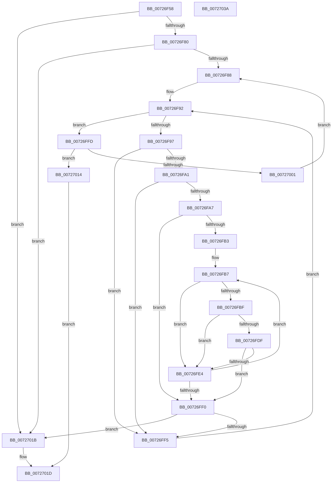

# PnpIsDuplicateDevice

- RVA: `0x00726F58`–`0x0072703B` (길이 `227` bytes)
- VA: `0x0000000140726F58`
- 실행 섹션: `PAGE`
- PDB 이름 있음: `예`; PDB Function 태그: `아니요`
- unwind 정보 RVA: `0x000C3E7C`
- 디코드: `74`개 명령, `227/227` bytes 표시
- 미해석 바이트: `0` (있으면 어셈블리에 `.byte`로 보존)

> 이 문서는 커널 이미지의 기계어와 PDB 기호를 분석해 생성했습니다. 4번과 5번은 함수 원형과 자료형을 바이너리 사용 방식에서 추정한 C 해석이며 원본 소스 복구 결과는 아닙니다.

## 1. Dependencies

- 직접 호출 지점: **0**; 고유 호출 대상: **0**
- 직접 호출자로 확인된 함수: **1**
- RIP 상대 이미지 참조: **0**

### Outgoing calls
- 직접 디코드된 call 명령이 없습니다.

### Direct callers
- [IopIsReportedAlready](IopIsReportedAlready_function_00726C6C.md) at `0x00726DEF`

### Static image references
- 디코드된 RIP-relative 메모리 참조가 없습니다.

## 2. Other-region calls and transfers

- 다른 실행 섹션으로 향하는 call: **0**
- 별도 외부 분기/꼬리 이동을 확인하지 못했습니다.

## 3. Assembly (complete function range)

```asm
00726F58  48 8B C4                        mov rax, rsp
00726F5B  48 89 58 08                     mov qword ptr [rax + 8], rbx
00726F5F  48 89 68 10                     mov qword ptr [rax + 0x10], rbp
00726F63  48 89 70 18                     mov qword ptr [rax + 0x18], rsi
00726F67  48 89 78 20                     mov qword ptr [rax + 0x20], rdi
00726F6B  41 54                           push r12
00726F6D  41 55                           push r13
00726F6F  41 56                           push r14
00726F71  41 57                           push r15
00726F73  33 F6                           xor esi, esi
00726F75  4C 8B C1                        mov r8, rcx
00726F78  39 31                           cmp dword ptr [rcx], esi
00726F7A  0F 84 9B 00 00 00               je 0x14072701b
00726F80  39 32                           cmp dword ptr [rdx], esi
00726F82  0F 84 93 00 00 00               je 0x14072701b
00726F88  45 8B 68 10                     mov r13d, dword ptr [r8 + 0x10]
00726F8C  4D 8D 50 14                     lea r10, [r8 + 0x14]
00726F90  33 DB                           xor ebx, ebx
00726F92  41 3B DD                        cmp ebx, r13d
00726F95  73 66                           jae 0x140726ffd
00726F97  41 8A 3A                        mov dil, byte ptr [r10]
00726F9A  8D 47 FF                        lea eax, [rdi - 1]
00726F9D  A8 F9                           test al, 0xf9
00726F9F  75 54                           jne 0x140726ff5
00726FA1  40 80 FF 05                     cmp dil, 5
00726FA5  74 4E                           je 0x140726ff5
00726FA7  44 8B 72 10                     mov r14d, dword ptr [rdx + 0x10]
00726FAB  45 33 C9                        xor r9d, r9d
00726FAE  45 85 F6                        test r14d, r14d
00726FB1  74 3D                           je 0x140726ff0
00726FB3  4C 8D 5A 14                     lea r11, [rdx + 0x14]
00726FB7  41 8A 2B                        mov bpl, byte ptr [r11]
00726FBA  40 3A FD                        cmp dil, bpl
00726FBD  75 25                           jne 0x140726fe4
00726FBF  49 8B 4A 04                     mov rcx, qword ptr [r10 + 4]
00726FC3  45 33 FF                        xor r15d, r15d
00726FC6  40 80 FF 01                     cmp dil, 1
00726FCA  41 0F 94 C7                     sete r15b
00726FCE  45 33 E4                        xor r12d, r12d
00726FD1  40 80 FD 01                     cmp bpl, 1
00726FD5  41 0F 94 C4                     sete r12b
00726FD9  49 3B 4B 04                     cmp rcx, qword ptr [r11 + 4]
00726FDD  75 05                           jne 0x140726fe4
00726FDF  45 3B FC                        cmp r15d, r12d
00726FE2  74 0C                           je 0x140726ff0
00726FE4  41 FF C1                        inc r9d
00726FE7  49 83 C3 14                     add r11, 0x14
00726FEB  45 3B CE                        cmp r9d, r14d
00726FEE  72 C7                           jb 0x140726fb7
00726FF0  45 3B CE                        cmp r9d, r14d
00726FF3  74 26                           je 0x14072701b
00726FF5  FF C3                           inc ebx
00726FF7  49 83 C2 14                     add r10, 0x14
00726FFB  EB 95                           jmp 0x140726f92
00726FFD  85 F6                           test esi, esi
00726FFF  75 13                           jne 0x140727014
00727001  48 8B C2                        mov rax, rdx
00727004  BE 01 00 00 00                  mov esi, 1
00727009  49 8B D0                        mov rdx, r8
0072700C  4C 8B C0                        mov r8, rax
0072700F  E9 74 FF FF FF                  jmp 0x140726f88
00727014  B8 01 00 00 00                  mov eax, 1
00727019  EB 02                           jmp 0x14072701d
0072701B  33 C0                           xor eax, eax
0072701D  48 8B 5C 24 28                  mov rbx, qword ptr [rsp + 0x28]
00727022  48 8B 6C 24 30                  mov rbp, qword ptr [rsp + 0x30]
00727027  48 8B 74 24 38                  mov rsi, qword ptr [rsp + 0x38]
0072702C  48 8B 7C 24 40                  mov rdi, qword ptr [rsp + 0x40]
00727031  41 5F                           pop r15
00727033  41 5E                           pop r14
00727035  41 5D                           pop r13
00727037  41 5C                           pop r12
00727039  C3                              ret
0072703A  CC                              int3
```

## 4. C-style interpretation (structured pseudocode)

```c
__int64 __fastcall PnpIsDuplicateDevice(__int64 a1, __int64 a2, __int64 a3, int a4)
{
    __int64 result;
    __int64 v_r10;
    __int64 v_r11;
    __int64 v_r12;
    __int64 v_r15;
    __int64 v_rbx;
    __int64 v_rsi;
    unsigned __int64 v_stack_p10;
    unsigned __int64 v_stack_p18;
    unsigned __int64 v_stack_p20;
    unsigned __int64 v_stack_p8;

    *(unsigned __int64 *)(v_rsp + 8) = v_rbx;
    *(unsigned __int64 *)(v_rsp + 16) = v_rbp;
    *(unsigned __int64 *)(v_rsp + 24) = v_rsi;
    *(unsigned __int64 *)(v_rsp + 32) = v_rdi;
    v_rsi = 0;
    if ((*(unsigned int *)(a1)) == 0) goto loc_0072701B;
    if ((*(unsigned int *)(a2)) == 0) goto loc_0072701B;
loc_00726F88:
    v_rbx = 0;
loc_00726F92:
    if (0 >= ((unsigned int)((unsigned int)(*(unsigned int *)(a1 + 16))))) goto loc_00726FFD;
    if ((((unsigned __int8)(*(unsigned __int8 *)(a1 + 20) - 1)) & (249)) != 0) goto loc_00726FF5;
    if (((unsigned __int8)(*(unsigned __int8 *)(a1 + 20))) == 5) goto loc_00726FF5;
    a4 = 0;
    if ((unsigned int)((unsigned int)(*(unsigned int *)(a2 + 16))) == 0) goto loc_00726FF0;
loc_00726FB7:
    if (((unsigned __int8)(*(unsigned __int8 *)(a1 + 20))) != ((unsigned __int8)(*(unsigned __int8 *)(a2 + 20)))) goto loc_00726FE4;
    v_r15 = 0;
    v_r15 = (((unsigned __int8)(*(unsigned __int8 *)(a1 + 20))) == 1) ? 1 : 0;
    v_r12 = 0;
    v_r12 = (((unsigned __int8)(*(unsigned __int8 *)(a2 + 20))) == 1) ? 1 : 0;
    if ((*(unsigned __int64 *)(a1 + 20 + 4)) != (*(unsigned __int64 *)(a2 + 20 + 4))) goto loc_00726FE4;
    if (((unsigned int)(v_r15)) == ((unsigned int)(v_r12))) goto loc_00726FF0;
loc_00726FE4:
    a4 = (unsigned int)((a4) + 1);
    v_r11 = (a2 + 20) + (20);
    if (a4 < ((unsigned int)((unsigned int)(*(unsigned int *)(a2 + 16))))) goto loc_00726FB7;
loc_00726FF0:
    if (a4 == ((unsigned int)((unsigned int)(*(unsigned int *)(a2 + 16))))) goto loc_0072701B;
loc_00726FF5:
    v_rbx = (unsigned int)((v_rbx) + 1);
    v_r10 = (a1 + 20) + (20);
    goto loc_00726F92;
loc_00726FFD:
    if (0 != 0) goto loc_00727014;
    goto loc_00726F88;
loc_00727014:
    goto loc_0072701D;
loc_0072701B:
    result = 0;
loc_0072701D:
    return result;
}
```

## 5. (Beta) C Style

```c
int64_t PnpIsDuplicateDevice(void *Arg1, void *Arg2, int64_t Arg3, int32_t Arg4)
{
    uint8_t *arg1 = (uint8_t *)Arg1;
    uint8_t *arg2 = (uint8_t *)Arg2;

    int64_t result;
    int64_t local_r10;
    int64_t local_r11;
    int64_t local_r12;
    int64_t local_r15;
    int64_t local_rbx;
    int64_t local_rsi;
    uint64_t v_stack_p10;
    uint64_t v_stack_p18;
    uint64_t v_stack_p20;
    uint64_t v_stack_p8;

    *(uint64_t *)(local_rsp + 0x8) = local_rbx;
    *(uint64_t *)(local_rsp + 0x10) = local_rbp;
    *(uint64_t *)(local_rsp + 0x18) = local_rsi;
    *(uint64_t *)(local_rsp + 0x20) = local_rdi;
    local_rsi = 0;
    if ((*(uint32_t *)(arg1)) == 0) goto loc_0072701B;
    if ((*(uint32_t *)(arg2)) == 0) goto loc_0072701B;
loc_00726F88:
    local_rbx = 0;
loc_00726F92:
    if (0 >= ((uint32_t)((uint32_t)(*(uint32_t *)(arg1 + 0x10))))) goto loc_00726FFD;
    if ((((uint8_t)(*(uint8_t *)(arg1 + 0x14) - 1)) & (249)) != 0) goto loc_00726FF5;
    if (((uint8_t)(*(uint8_t *)(arg1 + 0x14))) == 5) goto loc_00726FF5;
    Arg4 = 0;
    if ((uint32_t)((uint32_t)(*(uint32_t *)(arg2 + 0x10))) == 0) goto loc_00726FF0;
loc_00726FB7:
    if (((uint8_t)(*(uint8_t *)(arg1 + 0x14))) != ((uint8_t)(*(uint8_t *)(arg2 + 0x14)))) goto loc_00726FE4;
    local_r15 = 0;
    local_r15 = (((uint8_t)(*(uint8_t *)(arg1 + 0x14))) == 1) ? 1 : 0;
    local_r12 = 0;
    local_r12 = (((uint8_t)(*(uint8_t *)(arg2 + 0x14))) == 1) ? 1 : 0;
    if ((*(uint64_t *)(arg1 + 0x14 + 0x4)) != (*(uint64_t *)(arg2 + 0x14 + 0x4))) goto loc_00726FE4;
    if (((uint32_t)(local_r15)) == ((uint32_t)(local_r12))) goto loc_00726FF0;
loc_00726FE4:
    Arg4 = (uint32_t)((Arg4) + 1);
    local_r11 = (Arg2 + 20) + (20);
    if (Arg4 < ((uint32_t)((uint32_t)(*(uint32_t *)(arg2 + 0x10))))) goto loc_00726FB7;
loc_00726FF0:
    if (Arg4 == ((uint32_t)((uint32_t)(*(uint32_t *)(arg2 + 0x10))))) goto loc_0072701B;
loc_00726FF5:
    local_rbx = (uint32_t)((local_rbx) + 1);
    local_r10 = (Arg1 + 20) + (20);
    goto loc_00726F92;
loc_00726FFD:
    if (0 != 0) goto loc_00727014;
    goto loc_00726F88;
loc_00727014:
    goto loc_0072701D;
loc_0072701B:
    result = 0;
loc_0072701D:
    return result;
}
```

### 관측된 메모리 오프셋

구조체 형식이 확인되지 않은 접근은 인자 기준의 오프셋으로만 기록했습니다.

| 기준 인자 | 오프셋 표현 | 폭 (bit) | 접근 |
|---|---:|---:|---|
| `Arg1` | `+ 0x0` | `32` | `R` |
| `Arg2` | `+ 0x0` | `32` | `R` |

## 6. Execution-region graph

[열기: 2D/3D 그래프와 함수 탐색 컨트롤 패널](../../../control-panel.html?section=page&rva=0x00726F58&view=graph)

- 2D 그래프는 위에서 아래로 흐르고, 3D 그래프는 빈 공간을 드래그해 회전합니다. Shift+드래그는 이동, 휠은 확대·축소, 함수 노드 선택은 대상 보고서 이동입니다.

### Static fallback


