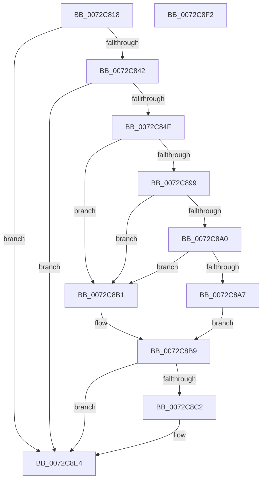

# PnpLogDeviceRequiresReboot

- RVA: `0x0072C818`–`0x0072C8F3` (길이 `219` bytes)
- VA: `0x000000014072C818`
- 실행 섹션: `PAGE`
- PDB 이름 있음: `예`; PDB Function 태그: `아니요`
- unwind 정보 RVA: `0x000C86E8`
- 디코드: `52`개 명령, `219/219` bytes 표시
- 미해석 바이트: `0` (있으면 어셈블리에 `.byte`로 보존)

> 이 문서는 커널 이미지의 기계어와 PDB 기호를 분석해 생성했습니다. 4번과 5번은 함수 원형과 자료형을 바이너리 사용 방식에서 추정한 C 해석이며 원본 소스 복구 결과는 아닙니다.

## 1. Dependencies

- 직접 호출 지점: **2**; 고유 호출 대상: **2**
- 직접 호출자로 확인된 함수: **2**
- RIP 상대 이미지 참조: **3**

### Outgoing calls
- `0x0072C890` → [PnpGetObjectProperty](../8E/PnpGetObjectProperty_function_008E2180.md) (function, `0x008E2180`)
- `0x0072C8DF` → [McTemplateK0zqdi_EtwWriteTransfer](../../text/5A/McTemplateK0zqdi_EtwWriteTransfer_function_005A6944.md) (function, `0x005A6944`)

### Direct callers
- [PiProcessSetDeviceProblem](PiProcessSetDeviceProblem_function_0072D668.md) at `0x0072D712`
- [PipSetDevNodeProblem](../8F/PipSetDevNodeProblem_function_008FDE0C.md) at `0x008FE041`

### Static image references
- `0x0072C842` → RVA `0x00EF012C` (`.data`; read)
- `0x0072C84F` → RVA `0x00E66398` (`.data`; read)
- `0x0072C881` → RVA `0x00012F10` (`.rdata`; read)

## 2. Other-region calls and transfers

- 다른 실행 섹션으로 향하는 call: **1**
  - `0x0072C8DF` → [McTemplateK0zqdi_EtwWriteTransfer](../../text/5A/McTemplateK0zqdi_EtwWriteTransfer_function_005A6944.md) (`PAGE` → `.text`)
- 별도 외부 분기/꼬리 이동을 확인하지 못했습니다.

## 3. Assembly (complete function range)

```asm
0072C818  4C 8B DC                        mov r11, rsp
0072C81B  49 89 5B 20                     mov qword ptr [r11 + 0x20], rbx
0072C81F  57                              push rdi
0072C820  48 83 EC 60                     sub rsp, 0x60
0072C824  48 8B 51 30                     mov rdx, qword ptr [rcx + 0x30]
0072C828  33 DB                           xor ebx, ebx
0072C82A  89 5C 24 78                     mov dword ptr [rsp + 0x78], ebx
0072C82E  48 8B F9                        mov rdi, rcx
0072C831  89 5C 24 70                     mov dword ptr [rsp + 0x70], ebx
0072C835  49 89 5B 18                     mov qword ptr [r11 + 0x18], rbx
0072C839  48 85 D2                        test rdx, rdx
0072C83C  0F 84 A2 00 00 00               je 0x14072c8e4
0072C842  F6 05 E3 38 7C 00 08            test byte ptr [rip + 0x7c38e3], 8
0072C849  0F 84 95 00 00 00               je 0x14072c8e4
0072C84F  48 8B 0D 42 9B 73 00            mov rcx, qword ptr [rip + 0x739b42]
0072C856  49 8D 43 10                     lea rax, [r11 + 0x10]
0072C85A  89 5C 24 50                     mov dword ptr [rsp + 0x50], ebx
0072C85E  44 8D 43 01                     lea r8d, [rbx + 1]
0072C862  49 89 43 E0                     mov qword ptr [r11 - 0x20], rax
0072C866  45 33 C9                        xor r9d, r9d
0072C869  C7 44 24 40 08 00 00 00         mov dword ptr [rsp + 0x40], 8
0072C871  49 8D 43 18                     lea rax, [r11 + 0x18]
0072C875  49 89 43 D0                     mov qword ptr [r11 - 0x30], rax
0072C879  49 8D 43 08                     lea rax, [r11 + 8]
0072C87D  49 89 43 C8                     mov qword ptr [r11 - 0x38], rax
0072C881  48 8D 05 88 66 8E FF            lea rax, [rip - 0x719978]
0072C888  49 89 43 C0                     mov qword ptr [r11 - 0x40], rax
0072C88C  49 89 5B B8                     mov qword ptr [r11 - 0x48], rbx
0072C890  E8 EB 58 1B 00                  call 0x1408e2180
0072C895  85 C0                           test eax, eax
0072C897  78 18                           js 0x14072c8b1
0072C899  83 7C 24 70 09                  cmp dword ptr [rsp + 0x70], 9
0072C89E  75 11                           jne 0x14072c8b1
0072C8A0  83 7C 24 78 08                  cmp dword ptr [rsp + 0x78], 8
0072C8A5  75 0A                           jne 0x14072c8b1
0072C8A7  48 8B 9C 24 80 00 00 00         mov rbx, qword ptr [rsp + 0x80]
0072C8AF  EB 08                           jmp 0x14072c8b9
0072C8B1  48 89 9C 24 80 00 00 00         mov qword ptr [rsp + 0x80], rbx
0072C8B9  F6 05 6C 38 7C 00 08            test byte ptr [rip + 0x7c386c], 8
0072C8C0  74 22                           je 0x14072c8e4
0072C8C2  8B 87 98 01 00 00               mov eax, dword ptr [rdi + 0x198]
0072C8C8  4C 8B 4F 30                     mov r9, qword ptr [rdi + 0x30]
0072C8CC  48 89 5C 24 30                  mov qword ptr [rsp + 0x30], rbx
0072C8D1  89 44 24 28                     mov dword ptr [rsp + 0x28], eax
0072C8D5  8B 87 94 01 00 00               mov eax, dword ptr [rdi + 0x194]
0072C8DB  89 44 24 20                     mov dword ptr [rsp + 0x20], eax
0072C8DF  E8 60 A0 E7 FF                  call 0x1405a6944
0072C8E4  48 8B 9C 24 88 00 00 00         mov rbx, qword ptr [rsp + 0x88]
0072C8EC  48 83 C4 60                     add rsp, 0x60
0072C8F0  5F                              pop rdi
0072C8F1  C3                              ret
0072C8F2  CC                              int3
```

## 4. C-style interpretation (structured pseudocode)

```c
__int64 __fastcall PnpLogDeviceRequiresReboot(__int64 a1, __int64 a2, __int64 a3, int a4)
{
    __int64 result;
    __int64 v_rbx;
    __int64 v_rsp;
    unsigned int v_stack_m18;
    unsigned int v_stack_m28;
    unsigned __int64 v_stack_m38;
    unsigned int v_stack_m40;
    unsigned int v_stack_m48;
    unsigned int v_stack_p10;
    unsigned __int64 v_stack_p18;
    unsigned __int64 v_stack_p20;
    unsigned int v_stack_p8;

    *(unsigned __int64 *)(v_rsp + 32) = v_rbx;
    v_rsp = (v_rsp) - (96);
    v_rbx = 0;
    v_stack_p10 = 0;
    v_stack_p8 = 0;
    *(unsigned __int64 *)(v_rsp + 24) = 0;
    if (*(unsigned __int64 *)(a1 + 48) == 0) goto loc_0072C8E4;
    if (((*(unsigned __int8 *)(v_rip + 8141027)) & (8)) == 0) goto loc_0072C8E4;
    v_stack_m18 = 0;
    *(unsigned __int64 *)(v_rsp - 32) = v_rsp + 16;
    a4 = 0;
    v_stack_m28 = 8;
    *(unsigned __int64 *)(v_rsp - 48) = v_rsp + 24;
    *(unsigned __int64 *)(v_rsp - 56) = v_rsp + 8;
    *(unsigned __int64 *)(v_rsp - 64) = v_rip - 7444856;
    *(unsigned __int64 *)(v_rsp - 72) = 0;
    result = PnpGetObjectProperty(*(unsigned __int64 *)(v_rip + 7576386), *(unsigned __int64 *)(a1 + 48), v_rbx + 1, a4);
    if (sign_flag) goto loc_0072C8B1;
    if (v_stack_p8 != 9) goto loc_0072C8B1;
    if (v_stack_p10 != 8) goto loc_0072C8B1;
    goto loc_0072C8B9;
loc_0072C8B1:
    v_stack_p18 = v_stack_p18;
loc_0072C8B9:
    if (((*(unsigned __int8 *)(v_rip + 8140908)) & (8)) != 0) {
        result = *(unsigned int *)(a1 + 408);
        a4 = *(unsigned __int64 *)(a1 + 48);
        v_stack_m38 = v_stack_p18;
        v_stack_m40 = (unsigned int)(result);
        result = *(unsigned int *)(a1 + 404);
        v_stack_m48 = (unsigned int)(result);
        result = McTemplateK0zqdi_EtwWriteTransfer(*(unsigned __int64 *)(v_rip + 7576386), *(unsigned __int64 *)(a1 + 48), v_rbx + 1, a4);
    }
    v_rsp = (v_rsp) + (96);
    return result;
}
```

## 5. (Beta) C Style

```c
int64_t PnpLogDeviceRequiresReboot(void *Arg1, int64_t Arg2, int64_t Arg3, int32_t Arg4)
{
    uint8_t *arg1 = (uint8_t *)Arg1;

    int64_t result;
    int64_t local_rbx;
    int64_t local_rsp;
    uint32_t v_stack_m18;
    uint32_t v_stack_m28;
    uint64_t v_stack_m38;
    uint32_t v_stack_m40;
    uint32_t v_stack_m48;
    uint32_t v_stack_p10;
    uint64_t v_stack_p18;
    uint64_t v_stack_p20;
    uint32_t v_stack_p8;

    *(uint64_t *)(local_rsp + 0x20) = local_rbx;
    local_rsp = (local_rsp) - (96);
    local_rbx = 0;
    v_stack_p10 = 0;
    v_stack_p8 = 0;
    *(uint64_t *)(local_rsp + 0x18) = 0;
    if (*(uint64_t *)(arg1 + 0x30) == 0) goto loc_0072C8E4;
    if (((*(uint8_t *)(v_rip + 0x7C38E3)) & (8)) == 0) goto loc_0072C8E4;
    v_stack_m18 = 0;
    *(uint64_t *)(local_rsp - 0x20) = local_rsp + 16;
    Arg4 = 0;
    v_stack_m28 = 8;
    *(uint64_t *)(local_rsp - 0x30) = local_rsp + 24;
    *(uint64_t *)(local_rsp - 0x38) = local_rsp + 8;
    *(uint64_t *)(local_rsp - 0x40) = v_rip - 7444856;
    *(uint64_t *)(local_rsp - 0x48) = 0;
    result = PnpGetObjectProperty(*(uint64_t *)(v_rip + 0x739B42), *(uint64_t *)(arg1 + 0x30), local_rbx + 1, Arg4);
    if (sign_flag) goto loc_0072C8B1;
    if (v_stack_p8 != 9) goto loc_0072C8B1;
    if (v_stack_p10 != 8) goto loc_0072C8B1;
    goto loc_0072C8B9;
loc_0072C8B1:
    v_stack_p18 = v_stack_p18;
loc_0072C8B9:
    if (((*(uint8_t *)(v_rip + 0x7C386C)) & (8)) != 0) {
        result = *(uint32_t *)(arg1 + 0x198);
        Arg4 = *(uint64_t *)(arg1 + 0x30);
        v_stack_m38 = v_stack_p18;
        v_stack_m40 = (uint32_t)(result);
        result = *(uint32_t *)(arg1 + 0x194);
        v_stack_m48 = (uint32_t)(result);
        result = McTemplateK0zqdi_EtwWriteTransfer(*(uint64_t *)(v_rip + 0x739B42), *(uint64_t *)(arg1 + 0x30), local_rbx + 1, Arg4);
    }
    local_rsp = (local_rsp) + (96);
    return result;
}
```

### 관측된 메모리 오프셋

구조체 형식이 확인되지 않은 접근은 인자 기준의 오프셋으로만 기록했습니다.

| 기준 인자 | 오프셋 표현 | 폭 (bit) | 접근 |
|---|---:|---:|---|
| `Arg1` | `+ 0x30` | `64` | `R` |
| `Arg1` | `+ 0x194` | `32` | `R` |
| `Arg1` | `+ 0x198` | `32` | `R` |

## 6. Execution-region graph

[열기: 2D/3D 그래프와 함수 탐색 컨트롤 패널](../../../control-panel.html?section=page&rva=0x0072C818&view=graph)

- 2D 그래프는 위에서 아래로 흐르고, 3D 그래프는 빈 공간을 드래그해 회전합니다. Shift+드래그는 이동, 휠은 확대·축소, 함수 노드 선택은 대상 보고서 이동입니다.

### Static fallback


