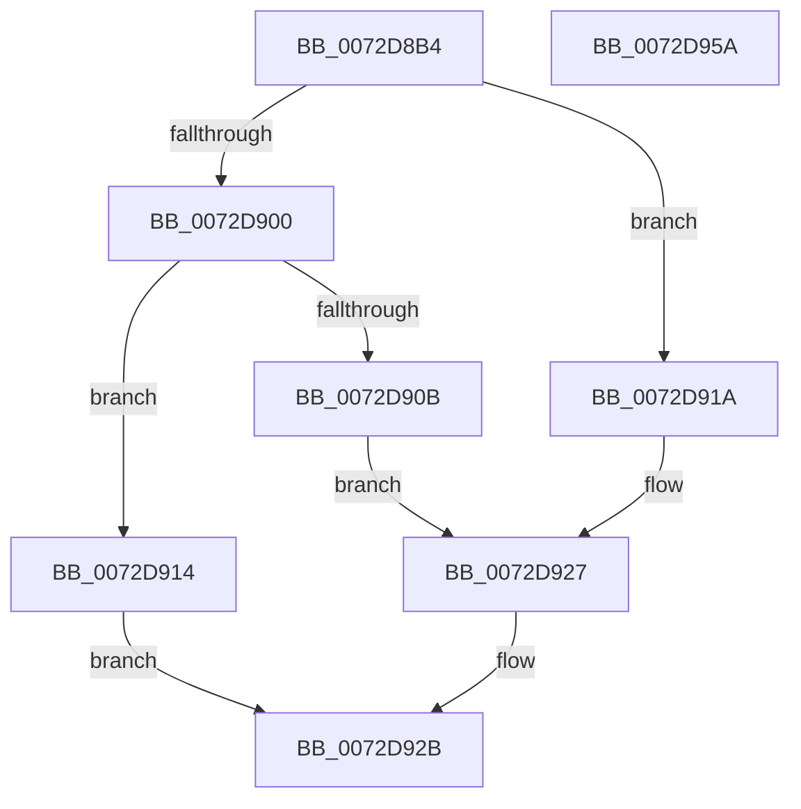

# PnpLogDuplicateDevice

- RVA: `0x0072D8B4`–`0x0072D95B` (길이 `167` bytes)
- VA: `0x000000014072D8B4`
- 실행 섹션: `PAGE`
- PDB 이름 있음: `예`; PDB Function 태그: `아니요`
- unwind 정보 RVA: `0x000ACCDC`
- 디코드: `48`개 명령, `167/167` bytes 표시
- 미해석 바이트: `0` (있으면 어셈블리에 `.byte`로 보존)

> 이 문서는 커널 이미지의 기계어와 PDB 기호를 분석해 생성했습니다. 4번과 5번은 함수 원형과 자료형을 바이너리 사용 방식에서 추정한 C 해석이며 원본 소스 복구 결과는 아닙니다.

## 1. Dependencies

- 직접 호출 지점: **3**; 고유 호출 대상: **2**
- 직접 호출자로 확인된 함수: **1**
- RIP 상대 이미지 참조: **0**

### Outgoing calls
- `0x0072D8D9` → [RtlInitUnicodeString](../../text/42/RtlInitUnicodeString_function_0042A780.md) (function, `0x0042A780`)
- `0x0072D8E5` → [RtlInitUnicodeString](../../text/42/RtlInitUnicodeString_function_0042A780.md) (function, `0x0042A780`)
- `0x0072D94A` → [PnpLogEvent](PnpLogEvent_function_0072C8FC.md) (function, `0x0072C8FC`)

### Direct callers
- [PiProcessNewDeviceNode](../A2/PiProcessNewDeviceNode_function_00A28F20.md) at `0x00A293E1`

### Static image references
- 디코드된 RIP-relative 메모리 참조가 없습니다.

## 2. Other-region calls and transfers

- 다른 실행 섹션으로 향하는 call: **2**
  - `0x0072D8D9` → [RtlInitUnicodeString](../../text/42/RtlInitUnicodeString_function_0042A780.md) (`PAGE` → `.text`)
  - `0x0072D8E5` → [RtlInitUnicodeString](../../text/42/RtlInitUnicodeString_function_0042A780.md) (`PAGE` → `.text`)
- 별도 외부 분기/꼬리 이동을 확인하지 못했습니다.

## 3. Assembly (complete function range)

```asm
0072D8B4  48 89 5C 24 08                  mov qword ptr [rsp + 8], rbx
0072D8B9  55                              push rbp
0072D8BA  48 8B EC                        mov rbp, rsp
0072D8BD  48 83 EC 50                     sub rsp, 0x50
0072D8C1  48 8B DA                        mov rbx, rdx
0072D8C4  0F 57 C0                        xorps xmm0, xmm0
0072D8C7  48 8B D1                        mov rdx, rcx
0072D8CA  0F 57 C9                        xorps xmm1, xmm1
0072D8CD  48 8D 4D E0                     lea rcx, [rbp - 0x20]
0072D8D1  0F 11 45 E0                     movups xmmword ptr [rbp - 0x20], xmm0
0072D8D5  0F 11 4D F0                     movups xmmword ptr [rbp - 0x10], xmm1
0072D8D9  E8 A2 CE CF FF                  call 0x14042a780
0072D8DE  48 8B D3                        mov rdx, rbx
0072D8E1  48 8D 4D F0                     lea rcx, [rbp - 0x10]
0072D8E5  E8 96 CE CF FF                  call 0x14042a780
0072D8EA  0F B7 55 F2                     movzx edx, word ptr [rbp - 0xe]
0072D8EE  45 33 C0                        xor r8d, r8d
0072D8F1  41 B9 F0 00 00 00               mov r9d, 0xf0
0072D8F7  48 8D 42 02                     lea rax, [rdx + 2]
0072D8FB  49 3B C1                        cmp rax, r9
0072D8FE  77 1A                           ja 0x14072d91a
0072D900  0F B7 4D E2                     movzx ecx, word ptr [rbp - 0x1e]
0072D904  03 CA                           add ecx, edx
0072D906  41 3B C9                        cmp ecx, r9d
0072D909  76 09                           jbe 0x14072d914
0072D90B  41 8D 41 FE                     lea eax, [r9 - 2]
0072D90F  66 2B C2                        sub ax, dx
0072D912  EB 13                           jmp 0x14072d927
0072D914  0F B7 45 E0                     movzx eax, word ptr [rbp - 0x20]
0072D918  EB 11                           jmp 0x14072d92b
0072D91A  B8 EE 00 00 00                  mov eax, 0xee
0072D91F  66 89 45 F0                     mov word ptr [rbp - 0x10], ax
0072D923  41 0F B7 C0                     movzx eax, r8w
0072D927  66 89 45 E0                     mov word ptr [rbp - 0x20], ax
0072D92B  66 F7 D8                        neg ax
0072D92E  44 89 44 24 20                  mov dword ptr [rsp + 0x20], r8d
0072D933  48 8D 45 E0                     lea rax, [rbp - 0x20]
0072D937  41 B8 38 00 04 C0               mov r8d, 0xc0040038
0072D93D  48 1B C9                        sbb rcx, rcx
0072D940  48 8D 55 F0                     lea rdx, [rbp - 0x10]
0072D944  48 23 C8                        and rcx, rax
0072D947  45 33 C9                        xor r9d, r9d
0072D94A  E8 AD EF FF FF                  call 0x14072c8fc
0072D94F  48 8B 5C 24 60                  mov rbx, qword ptr [rsp + 0x60]
0072D954  48 83 C4 50                     add rsp, 0x50
0072D958  5D                              pop rbp
0072D959  C3                              ret
0072D95A  CC                              int3
```

## 4. C-style interpretation (structured pseudocode)

```c
__int64 __fastcall PnpLogDuplicateDevice(__int64 a1, __int64 a2, int a3)
{
    __int64 result;
    __int64 v_rsp;
    unsigned __int16 v_stack_m16;
    unsigned __int64 v_stack_m18;
    unsigned __int16 v_stack_m26;
    unsigned __int64 v_stack_m28;
    unsigned int v_stack_m38;
    unsigned __int64 v_stack_p8;

    v_stack_p8 = v_rbx;
    v_rsp = (v_rsp) - (80);
    v_stack_m28 = v_xmm0;
    v_stack_m18 = v_xmm1;
    result = RtlInitUnicodeString(v_stack_m28, a1, a3, a4);
    result = RtlInitUnicodeString(v_stack_m18, a2, a3, a4);
    a3 = 0;
    if ((v_stack_m16 + 2) > 240) goto loc_0072D91A;
    a1 = (unsigned int)((v_stack_m26) + ((unsigned int)(v_stack_m16)));
    if (((unsigned int)(a1)) <= 240) goto loc_0072D914;
    result = (unsigned __int16)((240 - 2) - ((unsigned __int16)(v_stack_m16)));
    goto loc_0072D927;
loc_0072D914:
    goto loc_0072D92B;
loc_0072D91A:
    v_stack_m18 = 238;
loc_0072D927:
    v_stack_m28 = 0;
loc_0072D92B:
    result = (unsigned __int16)(-(0));
    v_stack_m38 = 0;
    a1 = (a1) & (v_stack_m28);
    a4 = 0;
    result = PnpLogEvent(a1, v_stack_m18, (unsigned int)(0xC0040038ULL), a4);
    v_rsp = (v_rsp) + (80);
    return result;
}
```

## 5. (Beta) C Style

```c
int64_t PnpLogDuplicateDevice(int64_t Arg1, int64_t Arg2, int32_t Arg3)
{
    int64_t result;
    int64_t local_rsp;
    uint16_t v_stack_m16;
    uint64_t v_stack_m18;
    uint16_t v_stack_m26;
    uint64_t v_stack_m28;
    uint32_t v_stack_m38;
    uint64_t v_stack_p8;

    v_stack_p8 = local_rbx;
    local_rsp = (local_rsp) - (80);
    v_stack_m28 = v_xmm0;
    v_stack_m18 = v_xmm1;
    result = RtlInitUnicodeString(v_stack_m28, Arg1, Arg3, a4);
    result = RtlInitUnicodeString(v_stack_m18, Arg2, Arg3, a4);
    Arg3 = 0;
    if ((v_stack_m16 + 2) > 240) goto loc_0072D91A;
    Arg1 = (uint32_t)((v_stack_m26) + ((uint32_t)(v_stack_m16)));
    if (((uint32_t)(Arg1)) <= 240) goto loc_0072D914;
    result = (uint16_t)((240 - 2) - ((uint16_t)(v_stack_m16)));
    goto loc_0072D927;
loc_0072D914:
    goto loc_0072D92B;
loc_0072D91A:
    v_stack_m18 = 238;
loc_0072D927:
    v_stack_m28 = 0;
loc_0072D92B:
    result = (uint16_t)(-(0));
    v_stack_m38 = 0;
    Arg1 = (Arg1) & (v_stack_m28);
    a4 = 0;
    result = PnpLogEvent(Arg1, v_stack_m18, (uint32_t)(0xC0040038ULL), a4);
    local_rsp = (local_rsp) + (80);
    return result;
}
```

## 6. Execution-region graph

[열기: 2D/3D 그래프와 함수 탐색 컨트롤 패널](../../../control-panel.html?section=page&rva=0x0072D8B4&view=graph)

- 2D 그래프는 위에서 아래로 흐르고, 3D 그래프는 빈 공간을 드래그해 회전합니다. Shift+드래그는 이동, 휠은 확대·축소, 함수 노드 선택은 대상 보고서 이동입니다.

### Static fallback


