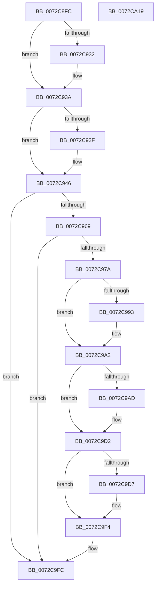

# PnpLogEvent

- RVA: `0x0072C8FC`–`0x0072CA1A` (길이 `286` bytes)
- VA: `0x000000014072C8FC`
- 실행 섹션: `PAGE`
- PDB 이름 있음: `예`; PDB Function 태그: `아니요`
- unwind 정보 RVA: `0x00075C18`
- 디코드: `81`개 명령, `286/286` bytes 표시
- 미해석 바이트: `0` (있으면 어셈블리에 `.byte`로 보존)

> 이 문서는 커널 이미지의 기계어와 PDB 기호를 분석해 생성했습니다. 4번과 5번은 함수 원형과 자료형을 바이너리 사용 방식에서 추정한 C 해석이며 원본 소스 복구 결과는 아닙니다.

## 1. Dependencies

- 직접 호출 지점: **5**; 고유 호출 대상: **3**
- 직접 호출자로 확인된 함수: **9**
- RIP 상대 이미지 참조: **0**

### Outgoing calls
- `0x0072C969` → [IoAllocateGenericErrorLogEntry](../../text/59/IoAllocateGenericErrorLogEntry_function_00597908.md) (function, `0x00597908`)
- `0x0072C99D` → [memcpy](../../text/6C/memcpy_function_006C6840.md) (function, `0x006C6840`)
- `0x0072C9BE` → [memcpy](../../text/6C/memcpy_function_006C6840.md) (function, `0x006C6840`)
- `0x0072C9E7` → [memcpy](../../text/6C/memcpy_function_006C6840.md) (function, `0x006C6840`)
- `0x0072C9F7` → [IoWriteErrorLogEntry](../../text/4B/IoWriteErrorLogEntry_function_004B5B30.md) (function, `0x004B5B30`)

### Direct callers
- [PnpLogDuplicateDevice](PnpLogDuplicateDevice_function_0072D8B4.md) at `0x0072D94A`
- [PpBootDDBHelper](PpBootDDBHelper_function_0072E1CC.md) at `0x0072E262`
- [PpBootDDBHelper](PpBootDDBHelper_function_0072E1CC.md) at `0x0072E2D9`
- [PnpQueryID](../8F/PnpQueryID_function_008FB984.md) at `0x008FBAE6`
- [PpCheckInDriverDatabase](../99/PpCheckInDriverDatabase_function_0099A9E4.md) at `0x0099AB3B`
- [PiIsDriverBlocked](../99/PiIsDriverBlocked_function_0099C254.md) at `0x0099C3FC`
- [PiIsDriverBlocked](../99/PiIsDriverBlocked_function_0099C254.md) at `0x0099C45A`
- [PnpQueryDeviceID](../A2/PnpQueryDeviceID_function_00A2B21C.md) at `0x00A2B34F`
- [sub_00B2CFB8](../B2/Unknown_function_00B2CFB8.md) at `0x00B2CFED`
- [sub_00B3913E](../B3/Unknown_function_00B3913E.md) at `0x00B3914C`
- [IopInitializePlugPlayServices](../../init/C2/IopInitializePlugPlayServices_function_00C2F298.md) at `0x00C2F439`

### Static image references
- 디코드된 RIP-relative 메모리 참조가 없습니다.

## 2. Other-region calls and transfers

- 다른 실행 섹션으로 향하는 call: **5**
  - `0x0072C969` → [IoAllocateGenericErrorLogEntry](../../text/59/IoAllocateGenericErrorLogEntry_function_00597908.md) (`PAGE` → `.text`)
  - `0x0072C99D` → [memcpy](../../text/6C/memcpy_function_006C6840.md) (`PAGE` → `.text`)
  - `0x0072C9BE` → [memcpy](../../text/6C/memcpy_function_006C6840.md) (`PAGE` → `.text`)
  - `0x0072C9E7` → [memcpy](../../text/6C/memcpy_function_006C6840.md) (`PAGE` → `.text`)
  - `0x0072C9F7` → [IoWriteErrorLogEntry](../../text/4B/IoWriteErrorLogEntry_function_004B5B30.md) (`PAGE` → `.text`)
- 별도 외부 분기/꼬리 이동을 확인하지 못했습니다.

## 3. Assembly (complete function range)

```asm
0072C8FC  48 89 5C 24 08                  mov qword ptr [rsp + 8], rbx
0072C901  48 89 6C 24 10                  mov qword ptr [rsp + 0x10], rbp
0072C906  48 89 74 24 18                  mov qword ptr [rsp + 0x18], rsi
0072C90B  57                              push rdi
0072C90C  41 54                           push r12
0072C90E  41 55                           push r13
0072C910  41 56                           push r14
0072C912  41 57                           push r15
0072C914  48 83 EC 20                     sub rsp, 0x20
0072C918  45 33 ED                        xor r13d, r13d
0072C91B  48 8B E9                        mov rbp, rcx
0072C91E  48 8B F2                        mov rsi, rdx
0072C921  4D 8B E1                        mov r12, r9
0072C924  45 8B F8                        mov r15d, r8d
0072C927  41 8B CD                        mov ecx, r13d
0072C92A  41 8B D5                        mov edx, r13d
0072C92D  48 85 ED                        test rbp, rbp
0072C930  74 08                           je 0x14072c93a
0072C932  0F B7 55 00                     movzx edx, word ptr [rbp]
0072C936  48 83 C2 02                     add rdx, 2
0072C93A  48 85 F6                        test rsi, rsi
0072C93D  74 07                           je 0x14072c946
0072C93F  0F B7 0E                        movzx ecx, word ptr [rsi]
0072C942  48 83 C1 02                     add rcx, 2
0072C946  44 8B 74 24 70                  mov r14d, dword ptr [rsp + 0x70]
0072C94B  41 8D 7E 28                     lea edi, [r14 + 0x28]
0072C94F  48 FF C7                        inc rdi
0072C952  48 83 E7 FE                     and rdi, 0xfffffffffffffffe
0072C956  48 03 CF                        add rcx, rdi
0072C959  48 03 CA                        add rcx, rdx
0072C95C  48 81 F9 F0 00 00 00            cmp rcx, 0xf0
0072C963  0F 87 93 00 00 00               ja 0x14072c9fc
0072C969  E8 9A AF E6 FF                  call 0x140597908
0072C96E  48 8B D8                        mov rbx, rax
0072C971  48 85 C0                        test rax, rax
0072C974  0F 84 82 00 00 00               je 0x14072c9fc
0072C97A  66 89 78 06                     mov word ptr [rax + 6], di
0072C97E  48 03 F8                        add rdi, rax
0072C981  44 89 78 0C                     mov dword ptr [rax + 0xc], r15d
0072C985  44 89 78 14                     mov dword ptr [rax + 0x14], r15d
0072C989  66 44 89 70 02                  mov word ptr [rax + 2], r14w
0072C98E  45 85 F6                        test r14d, r14d
0072C991  74 0F                           je 0x14072c9a2
0072C993  45 8B C6                        mov r8d, r14d
0072C996  48 8D 48 28                     lea rcx, [rax + 0x28]
0072C99A  49 8B D4                        mov rdx, r12
0072C99D  E8 9E 9E F9 FF                  call 0x1406c6840
0072C9A2  41 BE 01 00 00 00               mov r14d, 1
0072C9A8  48 85 ED                        test rbp, rbp
0072C9AB  74 25                           je 0x14072c9d2
0072C9AD  66 44 89 73 04                  mov word ptr [rbx + 4], r14w
0072C9B2  48 8B CF                        mov rcx, rdi
0072C9B5  44 0F B7 45 00                  movzx r8d, word ptr [rbp]
0072C9BA  48 8B 55 08                     mov rdx, qword ptr [rbp + 8]
0072C9BE  E8 7D 9E F9 FF                  call 0x1406c6840
0072C9C3  0F B7 45 00                     movzx eax, word ptr [rbp]
0072C9C7  48 03 F8                        add rdi, rax
0072C9CA  66 44 89 2F                     mov word ptr [rdi], r13w
0072C9CE  48 83 C7 02                     add rdi, 2
0072C9D2  48 85 F6                        test rsi, rsi
0072C9D5  74 1D                           je 0x14072c9f4
0072C9D7  66 44 01 73 04                  add word ptr [rbx + 4], r14w
0072C9DC  48 8B CF                        mov rcx, rdi
0072C9DF  44 0F B7 06                     movzx r8d, word ptr [rsi]
0072C9E3  48 8B 56 08                     mov rdx, qword ptr [rsi + 8]
0072C9E7  E8 54 9E F9 FF                  call 0x1406c6840
0072C9EC  0F B7 06                        movzx eax, word ptr [rsi]
0072C9EF  66 44 89 2C 38                  mov word ptr [rax + rdi], r13w
0072C9F4  48 8B CB                        mov rcx, rbx
0072C9F7  E8 34 91 D8 FF                  call 0x1404b5b30
0072C9FC  48 8B 5C 24 50                  mov rbx, qword ptr [rsp + 0x50]
0072CA01  48 8B 6C 24 58                  mov rbp, qword ptr [rsp + 0x58]
0072CA06  48 8B 74 24 60                  mov rsi, qword ptr [rsp + 0x60]
0072CA0B  48 83 C4 20                     add rsp, 0x20
0072CA0F  41 5F                           pop r15
0072CA11  41 5E                           pop r14
0072CA13  41 5D                           pop r13
0072CA15  41 5C                           pop r12
0072CA17  5F                              pop rdi
0072CA18  C3                              ret
0072CA19  CC                              int3
```

## 4. C-style interpretation (structured pseudocode)

```c
__int64 __fastcall PnpLogEvent(__int64 a1, __int64 a2, int a3, __int64 a4, unsigned int a5)
{
    __int64 result;
    __int64 v_r13;
    __int64 v_rdi;
    __int64 v_rsp;
    unsigned __int64 v_stack_p10;
    unsigned __int64 v_stack_p18;
    unsigned __int64 v_stack_p8;

    v_stack_p8 = v_rbx;
    v_stack_p10 = v_rbp;
    v_stack_p18 = v_rsi;
    v_rsp = (v_rsp) - (32);
    v_r13 = 0;
    if (a1 != 0) {
        a2 = *(unsigned __int16 *)(a1);
        a2 = (a2) + (2);
    }
    if (a2 != 0) {
        a1 = *(unsigned __int16 *)(a2);
        a1 = (a1) + (2);
    }
    v_rdi = ((unsigned int)(a5) + 40) + 1;
    v_rdi = (v_rdi) & (-2);
    a1 = (a1) + (v_rdi);
    a1 = (a1) + (a2);
    if (a1 > 240) goto loc_0072C9FC;
    result = IoAllocateGenericErrorLogEntry(a1, a2, a3, a4);
    if (result == 0) goto loc_0072C9FC;
    *(unsigned __int16 *)(result + 6) = (unsigned __int16)(v_rdi);
    v_rdi = (v_rdi) + (result);
    *(unsigned int *)(result + 12) = (unsigned int)((unsigned int)(a3));
    *(unsigned int *)(result + 20) = (unsigned int)((unsigned int)(a3));
    *(unsigned __int16 *)(result + 2) = (unsigned __int16)((unsigned int)(a5));
    if ((unsigned int)((unsigned int)(a5)) != 0) {
        a3 = (unsigned int)((unsigned int)(a5));
        a1 = result + 40;
        a2 = a4;
        result = memcpy(a1, a2, a3, a4);
    }
    if (a1 != 0) {
        *(unsigned __int16 *)(result + 4) = 1;
        a1 = v_rdi;
        a3 = *(unsigned __int16 *)(a1);
        a2 = *(unsigned __int64 *)(a1 + 8);
        result = memcpy(a1, a2, a3, a4);
        result = *(unsigned __int16 *)(a1);
        v_rdi = (v_rdi) + (result);
        *(unsigned __int16 *)(v_rdi) = 0;
        v_rdi = (v_rdi) + (2);
    }
    if (a2 != 0) {
        a1 = v_rdi;
        a3 = *(unsigned __int16 *)(a2);
        a2 = *(unsigned __int64 *)(a2 + 8);
        result = memcpy(a1, a2, a3, a4);
        result = *(unsigned __int16 *)(a2);
        *(unsigned __int16 *)(result + v_rdi * 1) = 0;
    }
    result = IoWriteErrorLogEntry(result, a2, a3, a4);
loc_0072C9FC:
    v_rsp = (v_rsp) + (32);
    return result;
}
```

## 5. (Beta) C Style

```c
int64_t PnpLogEvent(int64_t Arg1, int64_t Arg2, int32_t Arg3, int64_t Arg4, void *Arg5)
{
    uint8_t *arg5 = (uint8_t *)Arg5;

    int64_t result;
    int64_t local_r13;
    int64_t local_rdi;
    int64_t local_rsp;
    uint64_t v_stack_p10;
    uint64_t v_stack_p18;
    uint64_t v_stack_p8;

    v_stack_p8 = local_rbx;
    v_stack_p10 = local_rbp;
    v_stack_p18 = local_rsi;
    local_rsp = (local_rsp) - (32);
    local_r13 = 0;
    if (Arg1 != 0) {
        Arg2 = *(uint16_t *)(Arg1);
        Arg2 = (Arg2) + (2);
    }
    if (Arg2 != 0) {
        Arg1 = *(uint16_t *)(Arg2);
        Arg1 = (Arg1) + (2);
    }
    local_rdi = ((uint32_t)(Arg5) + 40) + 1;
    local_rdi = (local_rdi) & (-2);
    Arg1 = (Arg1) + (local_rdi);
    Arg1 = (Arg1) + (Arg2);
    if (Arg1 > 240) goto loc_0072C9FC;
    result = IoAllocateGenericErrorLogEntry(Arg1, Arg2, Arg3, Arg4);
    if (result == 0) goto loc_0072C9FC;
    *(uint16_t *)(result + 0x6) = (uint16_t)(local_rdi);
    local_rdi = (local_rdi) + (result);
    *(uint32_t *)(result + 0xC) = (uint32_t)((uint32_t)(Arg3));
    *(uint32_t *)(result + 0x14) = (uint32_t)((uint32_t)(Arg3));
    *(uint16_t *)(result + 0x2) = (uint16_t)((uint32_t)(Arg5));
    if ((uint32_t)((uint32_t)(Arg5)) != 0) {
        Arg3 = (uint32_t)((uint32_t)(Arg5));
        Arg1 = result + 40;
        Arg2 = Arg4;
        result = memcpy(Arg1, Arg2, Arg3, Arg4);
    }
    if (Arg1 != 0) {
        *(uint16_t *)(result + 0x4) = 1;
        Arg1 = local_rdi;
        Arg3 = *(uint16_t *)(Arg1);
        Arg2 = *(uint64_t *)(Arg1 + 0x8);
        result = memcpy(Arg1, Arg2, Arg3, Arg4);
        result = *(uint16_t *)(Arg1);
        local_rdi = (local_rdi) + (result);
        *(uint16_t *)(local_rdi) = 0;
        local_rdi = (local_rdi) + (2);
    }
    if (Arg2 != 0) {
        Arg1 = local_rdi;
        Arg3 = *(uint16_t *)(Arg2);
        Arg2 = *(uint64_t *)(Arg2 + 0x8);
        result = memcpy(Arg1, Arg2, Arg3, Arg4);
        result = *(uint16_t *)(Arg2);
        *(uint16_t *)(result + local_rdi * 1) = 0;
    }
    result = IoWriteErrorLogEntry(result, Arg2, Arg3, Arg4);
loc_0072C9FC:
    local_rsp = (local_rsp) + (32);
    return result;
}
```

### 관측된 메모리 오프셋

구조체 형식이 확인되지 않은 접근은 인자 기준의 오프셋으로만 기록했습니다.

| 기준 인자 | 오프셋 표현 | 폭 (bit) | 접근 |
|---|---:|---:|---|
| `Arg5` | `+ 0x28` | `32` | `R` |

## 6. Execution-region graph

[열기: 2D/3D 그래프와 함수 탐색 컨트롤 패널](../../../control-panel.html?section=page&rva=0x0072C8FC&view=graph)

- 2D 그래프는 위에서 아래로 흐르고, 3D 그래프는 빈 공간을 드래그해 회전합니다. Shift+드래그는 이동, 휠은 확대·축소, 함수 노드 선택은 대상 보고서 이동입니다.

### Static fallback


