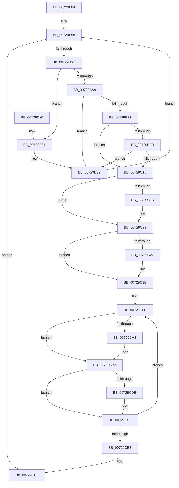

# PnpNotifyHwProfileChange

- RVA: `0x00729B04`–`0x00729D4E` (길이 `586` bytes)
- VA: `0x0000000140729B04`
- 실행 섹션: `PAGE`
- PDB 이름 있음: `예`; PDB Function 태그: `아니요`
- unwind 정보 RVA: `0x000C8470`
- 디코드: `147`개 명령, `586/586` bytes 표시
- 미해석 바이트: `0` (있으면 어셈블리에 `.byte`로 보존)

> 이 문서는 커널 이미지의 기계어와 PDB 기호를 분석해 생성했습니다. 4번과 5번은 함수 원형과 자료형을 바이너리 사용 방식에서 추정한 C 해석이며 원본 소스 복구 결과는 아닙니다.

## 1. Dependencies

- 직접 호출 지점: **23**; 고유 호출 대상: **10**
- 직접 호출자로 확인된 함수: **2**
- RIP 상대 이미지 참조: **5**

### Outgoing calls
- `0x00729B4C` → [ExAcquireFastMutex](../../text/20/ExAcquireFastMutex_function_0020E5A0.md) (function, `0x0020E5A0`)
- `0x00729B7B` → [ExReleaseFastMutex](../../text/25/ExReleaseFastMutex_function_002519C0.md) (function, `0x002519C0`)
- `0x00729B9A` → [ExAcquireResourceExclusiveLite](../../text/21/ExAcquireResourceExclusiveLite_function_00214E20.md) (function, `0x00214E20`)
- `0x00729BC4` → [PnpNotifyDriverCallback](../95/PnpNotifyDriverCallback_function_00954AA0.md) (function, `0x00954AA0`)
- `0x00729BCF` → [ExReleaseResourceLite](../../text/25/ExReleaseResourceLite_function_0025FA10.md) (function, `0x0025FA10`)
- `0x00729BD4` → [KeLeaveCriticalRegion](../../text/25/KeLeaveCriticalRegion_function_0025D8B0.md) (function, `0x0025D8B0`)
- `0x00729C07` → [RtlCompareMemory](../../text/6B/RtlCompareMemory_function_006BA670.md) (function, `0x006BA670`)
- `0x00729C36` → [RtlCopyUnicodeString](../../text/3F/RtlCopyUnicodeString_function_003FEF30.md) (function, `0x003FEF30`)
- `0x00729C5A` → [ExAcquireFastMutex](../../text/20/ExAcquireFastMutex_function_0020E5A0.md) (function, `0x0020E5A0`)
- `0x00729C7B` → [ExReleaseFastMutex](../../text/25/ExReleaseFastMutex_function_002519C0.md) (function, `0x002519C0`)
- `0x00729C98` → [ExAcquireResourceExclusiveLite](../../text/21/ExAcquireResourceExclusiveLite_function_00214E20.md) (function, `0x00214E20`)
- `0x00729CAE` → [PnpNotifyDriverCallback](../95/PnpNotifyDriverCallback_function_00954AA0.md) (function, `0x00954AA0`)
- `0x00729CB7` → [ExReleaseResourceLite](../../text/25/ExReleaseResourceLite_function_0025FA10.md) (function, `0x0025FA10`)
- `0x00729CBC` → [KeLeaveCriticalRegion](../../text/25/KeLeaveCriticalRegion_function_0025D8B0.md) (function, `0x0025D8B0`)
- `0x00729CC8` → [ExAcquireFastMutex](../../text/20/ExAcquireFastMutex_function_0020E5A0.md) (function, `0x0020E5A0`)
- `0x00729CD4` → [PnpDereferenceNotify](../95/PnpDereferenceNotify_function_00954A04.md) (function, `0x00954A04`)
- `0x00729CE1` → [PnpDereferenceNotify](../95/PnpDereferenceNotify_function_00954A04.md) (function, `0x00954A04`)
- `0x00729CF5` → [ExReleaseFastMutex](../../text/25/ExReleaseFastMutex_function_002519C0.md) (function, `0x002519C0`)
- `0x00729D03` → [_security_check_cookie](../../text/6A/_security_check_cookie_function_006AC640.md) (function, `0x006AC640`)
- `0x00729D25` → [ExReleaseResourceLite](../../text/25/ExReleaseResourceLite_function_0025FA10.md) (function, `0x0025FA10`)
- `0x00729D2A` → [KeLeaveCriticalRegion](../../text/25/KeLeaveCriticalRegion_function_0025D8B0.md) (function, `0x0025D8B0`)
- `0x00729D39` → [ExAcquireFastMutex](../../text/20/ExAcquireFastMutex_function_0020E5A0.md) (function, `0x0020E5A0`)
- `0x00729D44` → [PnpDereferenceNotify](../95/PnpDereferenceNotify_function_00954A04.md) (function, `0x00954A04`)

### Direct callers
- [PnpRequestHwProfileChangeNotification](PnpRequestHwProfileChangeNotification_function_00729E78.md) at `0x00729F98`
- [PnpDeviceEventWorker](../95/PnpDeviceEventWorker_function_009556B0.md) at `0x009559D9`

### Static image references
- `0x00729B1B` → RVA `0x00E0A740` (`.data`; read)
- `0x00729B36` → RVA `0x00F8CCE0` (`.data`; read)
- `0x00729B51` → RVA `0x00FD9FD8` (`PAGEDATA`; read)
- `0x00729BF1` → RVA `0x00024028` (`.rdata`; read)
- `0x00729C3B` → RVA `0x000240B8` (`.rdata`; read)

## 2. Other-region calls and transfers

- 다른 실행 섹션으로 향하는 call: **18**
  - `0x00729B4C` → [ExAcquireFastMutex](../../text/20/ExAcquireFastMutex_function_0020E5A0.md) (`PAGE` → `.text`)
  - `0x00729B7B` → [ExReleaseFastMutex](../../text/25/ExReleaseFastMutex_function_002519C0.md) (`PAGE` → `.text`)
  - `0x00729B9A` → [ExAcquireResourceExclusiveLite](../../text/21/ExAcquireResourceExclusiveLite_function_00214E20.md) (`PAGE` → `.text`)
  - `0x00729BCF` → [ExReleaseResourceLite](../../text/25/ExReleaseResourceLite_function_0025FA10.md) (`PAGE` → `.text`)
  - `0x00729BD4` → [KeLeaveCriticalRegion](../../text/25/KeLeaveCriticalRegion_function_0025D8B0.md) (`PAGE` → `.text`)
  - `0x00729C07` → [RtlCompareMemory](../../text/6B/RtlCompareMemory_function_006BA670.md) (`PAGE` → `.text`)
  - `0x00729C36` → [RtlCopyUnicodeString](../../text/3F/RtlCopyUnicodeString_function_003FEF30.md) (`PAGE` → `.text`)
  - `0x00729C5A` → [ExAcquireFastMutex](../../text/20/ExAcquireFastMutex_function_0020E5A0.md) (`PAGE` → `.text`)
  - `0x00729C7B` → [ExReleaseFastMutex](../../text/25/ExReleaseFastMutex_function_002519C0.md) (`PAGE` → `.text`)
  - `0x00729C98` → [ExAcquireResourceExclusiveLite](../../text/21/ExAcquireResourceExclusiveLite_function_00214E20.md) (`PAGE` → `.text`)
  - `0x00729CB7` → [ExReleaseResourceLite](../../text/25/ExReleaseResourceLite_function_0025FA10.md) (`PAGE` → `.text`)
  - `0x00729CBC` → [KeLeaveCriticalRegion](../../text/25/KeLeaveCriticalRegion_function_0025D8B0.md) (`PAGE` → `.text`)
  - `0x00729CC8` → [ExAcquireFastMutex](../../text/20/ExAcquireFastMutex_function_0020E5A0.md) (`PAGE` → `.text`)
  - `0x00729CF5` → [ExReleaseFastMutex](../../text/25/ExReleaseFastMutex_function_002519C0.md) (`PAGE` → `.text`)
  - `0x00729D03` → [_security_check_cookie](../../text/6A/_security_check_cookie_function_006AC640.md) (`PAGE` → `.text`)
  - `0x00729D25` → [ExReleaseResourceLite](../../text/25/ExReleaseResourceLite_function_0025FA10.md) (`PAGE` → `.text`)
  - `0x00729D2A` → [KeLeaveCriticalRegion](../../text/25/KeLeaveCriticalRegion_function_0025D8B0.md) (`PAGE` → `.text`)
  - `0x00729D39` → [ExAcquireFastMutex](../../text/20/ExAcquireFastMutex_function_0020E5A0.md) (`PAGE` → `.text`)
- 별도 외부 분기/꼬리 이동을 확인하지 못했습니다.

## 3. Assembly (complete function range)

```asm
00729B04  48 89 5C 24 20                  mov qword ptr [rsp + 0x20], rbx
00729B09  55                              push rbp
00729B0A  56                              push rsi
00729B0B  57                              push rdi
00729B0C  41 54                           push r12
00729B0E  41 55                           push r13
00729B10  41 56                           push r14
00729B12  41 57                           push r15
00729B14  48 8B EC                        mov rbp, rsp
00729B17  48 83 EC 50                     sub rsp, 0x50
00729B1B  48 8B 05 1E 0C 6E 00            mov rax, qword ptr [rip + 0x6e0c1e]
00729B22  48 33 C4                        xor rax, rsp
00729B25  48 89 45 F0                     mov qword ptr [rbp - 0x10], rax
00729B29  33 DB                           xor ebx, ebx
00729B2B  4C 8B E1                        mov r12, rcx
00729B2E  0F 57 C0                        xorps xmm0, xmm0
00729B31  89 5D D0                        mov dword ptr [rbp - 0x30], ebx
00729B34  33 C0                           xor eax, eax
00729B36  48 8D 0D A3 31 86 00            lea rcx, [rip + 0x8631a3]
00729B3D  0F 11 45 D8                     movups xmmword ptr [rbp - 0x28], xmm0
00729B41  89 45 E8                        mov dword ptr [rbp - 0x18], eax
00729B44  8B F3                           mov esi, ebx
00729B46  4D 8B F0                        mov r14, r8
00729B49  4C 8B FA                        mov r15, rdx
00729B4C  E8 4F 4A AE FF                  call 0x14020e5a0
00729B51  48 8B 3D 80 04 8B 00            mov rdi, qword ptr [rip + 0x8b0480]
00729B58  48 8D 15 79 04 8B 00            lea rdx, [rip + 0x8b0479]
00729B5F  B8 01 00 00 00                  mov eax, 1
00729B64  48 3B FA                        cmp rdi, rdx
00729B67  0F 84 81 01 00 00               je 0x140729cee
00729B6D  66 01 47 38                     add word ptr [rdi + 0x38], ax
00729B71  48 8D 0D 68 31 86 00            lea rcx, [rip + 0x863168]
00729B78  4C 8B EF                        mov r13, rdi
00729B7B  E8 40 7E B2 FF                  call 0x1402519c0
00729B80  65 48 8B 04 25 88 01 00 00      mov rax, qword ptr gs:[0x188]
00729B89  BA 01 00 00 00                  mov edx, 1
00729B8E  66 FF 88 E4 01 00 00            dec word ptr [rax + 0x1e4]
00729B95  90                              nop
00729B96  48 8B 4F 48                     mov rcx, qword ptr [rdi + 0x48]
00729B9A  E8 81 B2 AE FF                  call 0x140214e20
00729B9F  38 5F 3A                        cmp byte ptr [rdi + 0x3a], bl
00729BA2  0F 85 79 01 00 00               jne 0x140729d21
00729BA8  41 0F 10 04 24                  movups xmm0, xmmword ptr [r12]
00729BAD  4C 8D 45 D0                     lea r8, [rbp - 0x30]
00729BB1  C7 45 D8 01 00 14 00            mov dword ptr [rbp - 0x28], 0x140001
00729BB8  48 8D 55 D8                     lea rdx, [rbp - 0x28]
00729BBC  48 8B CF                        mov rcx, rdi
00729BBF  F3 0F 7F 45 DC                  movdqu xmmword ptr [rbp - 0x24], xmm0
00729BC4  E8 D7 AE 22 00                  call 0x140954aa0
00729BC9  48 8B 4F 48                     mov rcx, qword ptr [rdi + 0x48]
00729BCD  8B D8                           mov ebx, eax
00729BCF  E8 3C 5E B3 FF                  call 0x14025fa10
00729BD4  E8 D7 3C B3 FF                  call 0x14025d8b0
00729BD9  8B 75 D0                        mov esi, dword ptr [rbp - 0x30]
00729BDC  85 DB                           test ebx, ebx
00729BDE  BB 00 00 00 00                  mov ebx, 0
00729BE3  0F 48 F3                        cmovs esi, ebx
00729BE6  89 75 D0                        mov dword ptr [rbp - 0x30], esi
00729BE9  85 F6                           test esi, esi
00729BEB  0F 89 41 01 00 00               jns 0x140729d32
00729BF1  48 8D 05 30 A4 8F FF            lea rax, [rip - 0x705bd0]
00729BF8  4C 3B E0                        cmp r12, rax
00729BFB  74 19                           je 0x140729c16
00729BFD  44 8D 43 10                     lea r8d, [rbx + 0x10]
00729C01  48 8B D0                        mov rdx, rax
00729C04  49 8B CC                        mov rcx, r12
00729C07  E8 64 0A F9 FF                  call 0x1406ba670
00729C0C  48 83 F8 10                     cmp rax, 0x10
00729C10  0F 85 1C 01 00 00               jne 0x140729d32
00729C16  4D 85 FF                        test r15, r15
00729C19  74 07                           je 0x140729c22
00729C1B  41 C7 07 07 00 00 00            mov dword ptr [r15], 7
00729C22  4D 85 F6                        test r14, r14
00729C25  74 14                           je 0x140729c3b
00729C27  66 41 89 1E                     mov word ptr [r14], bx
00729C2B  49 8B CE                        mov rcx, r14
00729C2E  48 8B 57 30                     mov rdx, qword ptr [rdi + 0x30]
00729C32  48 83 C2 38                     add rdx, 0x38
00729C36  E8 F5 52 CD FF                  call 0x1403fef30
00729C3B  0F 10 05 76 A4 8F FF            movups xmm0, xmmword ptr [rip - 0x705b8a]
00729C42  B8 10 00 00 00                  mov eax, 0x10
00729C47  48 8D 0D 92 30 86 00            lea rcx, [rip + 0x863092]
00729C4E  66 89 45 DA                     mov word ptr [rbp - 0x26], ax
00729C52  48 8B F7                        mov rsi, rdi
00729C55  F3 0F 7F 45 DC                  movdqu xmmword ptr [rbp - 0x24], xmm0
00729C5A  E8 41 49 AE FF                  call 0x14020e5a0
00729C5F  41 BE 01 00 00 00               mov r14d, 1
00729C65  4C 8D 3D 6C 03 8B 00            lea r15, [rip + 0x8b036c]
00729C6C  66 44 01 77 38                  add word ptr [rdi + 0x38], r14w
00729C71  48 8D 0D 68 30 86 00            lea rcx, [rip + 0x863068]
00729C78  48 8B DF                        mov rbx, rdi
00729C7B  E8 40 7D B2 FF                  call 0x1402519c0
00729C80  65 48 8B 04 25 88 01 00 00      mov rax, qword ptr gs:[0x188]
00729C89  41 8A D6                        mov dl, r14b
00729C8C  66 FF 88 E4 01 00 00            dec word ptr [rax + 0x1e4]
00729C93  90                              nop
00729C94  48 8B 4F 48                     mov rcx, qword ptr [rdi + 0x48]
00729C98  E8 83 B1 AE FF                  call 0x140214e20
00729C9D  33 C0                           xor eax, eax
00729C9F  38 47 3A                        cmp byte ptr [rdi + 0x3a], al
00729CA2  75 0F                           jne 0x140729cb3
00729CA4  45 33 C0                        xor r8d, r8d
00729CA7  48 8D 55 D8                     lea rdx, [rbp - 0x28]
00729CAB  48 8B CF                        mov rcx, rdi
00729CAE  E8 ED AD 22 00                  call 0x140954aa0
00729CB3  48 8B 4F 48                     mov rcx, qword ptr [rdi + 0x48]
00729CB7  E8 54 5D B3 FF                  call 0x14025fa10
00729CBC  E8 EF 3B B3 FF                  call 0x14025d8b0
00729CC1  48 8D 0D 18 30 86 00            lea rcx, [rip + 0x863018]
00729CC8  E8 D3 48 AE FF                  call 0x14020e5a0
00729CCD  48 8B 7F 08                     mov rdi, qword ptr [rdi + 8]
00729CD1  48 8B CB                        mov rcx, rbx
00729CD4  E8 2B AD 22 00                  call 0x140954a04
00729CD9  48 3B DE                        cmp rbx, rsi
00729CDC  75 08                           jne 0x140729ce6
00729CDE  48 8B CB                        mov rcx, rbx
00729CE1  E8 1E AD 22 00                  call 0x140954a04
00729CE6  49 3B FF                        cmp rdi, r15
00729CE9  75 81                           jne 0x140729c6c
00729CEB  8B 75 D0                        mov esi, dword ptr [rbp - 0x30]
00729CEE  48 8D 0D EB 2F 86 00            lea rcx, [rip + 0x862feb]
00729CF5  E8 C6 7C B2 FF                  call 0x1402519c0
00729CFA  8B C6                           mov eax, esi
00729CFC  48 8B 4D F0                     mov rcx, qword ptr [rbp - 0x10]
00729D00  48 33 CC                        xor rcx, rsp
00729D03  E8 38 29 F8 FF                  call 0x1406ac640
00729D08  48 8B 9C 24 A8 00 00 00         mov rbx, qword ptr [rsp + 0xa8]
00729D10  48 83 C4 50                     add rsp, 0x50
00729D14  41 5F                           pop r15
00729D16  41 5E                           pop r14
00729D18  41 5D                           pop r13
00729D1A  41 5C                           pop r12
00729D1C  5F                              pop rdi
00729D1D  5E                              pop rsi
00729D1E  5D                              pop rbp
00729D1F  C3                              ret
00729D20  CC                              int3
00729D21  48 8B 4F 48                     mov rcx, qword ptr [rdi + 0x48]
00729D25  E8 E6 5C B3 FF                  call 0x14025fa10
00729D2A  E8 81 3B B3 FF                  call 0x14025d8b0
00729D2F  8B 75 D0                        mov esi, dword ptr [rbp - 0x30]
00729D32  48 8D 0D A7 2F 86 00            lea rcx, [rip + 0x862fa7]
00729D39  E8 62 48 AE FF                  call 0x14020e5a0
00729D3E  48 8B 3F                        mov rdi, qword ptr [rdi]
00729D41  49 8B CD                        mov rcx, r13
00729D44  E8 BB AC 22 00                  call 0x140954a04
00729D49  E9 0A FE FF FF                  jmp 0x140729b58
```

## 4. C-style interpretation (structured pseudocode)

```c
__int64 __fastcall PnpNotifyHwProfileChange(__int64 a1, __int64 a2, __int64 a3)
{
    __int64 result;
    __int64 v_rbx;
    __int64 v_rsi;
    __int64 v_rsp;
    unsigned __int64 v_stack_m48;
    unsigned int v_stack_m50;
    unsigned __int64 v_stack_m5C;
    unsigned __int16 v_stack_m5E;
    unsigned __int64 v_stack_m60;
    unsigned int v_stack_m68;
    unsigned __int64 v_stack_p20;

    v_stack_p20 = v_rbx;
    v_rsp = (v_rsp) - (80);
    result = (*(unsigned __int64 *)(v_rip + 7212062)) ^ (v_rsp);
    v_stack_m48 = result;
    v_rbx = 0;
    v_stack_m68 = 0;
    result = 0;
    v_stack_m60 = v_xmm0;
    v_stack_m50 = 0;
    result = ExAcquireFastMutex(v_rip + 8794531, a2, a3, a4);
loc_00729B58:
    if ((*(unsigned __int64 *)(v_rip + 9110656)) == (v_rip + 9110649)) goto loc_00729CEE;
    result = ExReleaseFastMutex(v_rip + 8794472, v_rip + 9110649, a3, a4);
    result = ExAcquireResourceExclusiveLite(*(unsigned __int64 *)(*(unsigned __int64 *)(v_rip + 9110656) + 72), 1, a3, a4);
    if ((*(unsigned __int8 *)(*(unsigned __int64 *)(v_rip + 9110656) + 58)) != 0) goto loc_00729D21;
    v_stack_m60 = 0x140001ULL;
    v_stack_m5C = v_xmm0;
    result = PnpNotifyDriverCallback(*(unsigned __int64 *)(v_rip + 9110656), v_stack_m60, v_stack_m68, a4);
    result = ExReleaseResourceLite(*(unsigned __int64 *)(*(unsigned __int64 *)(v_rip + 9110656) + 72), v_stack_m60, v_stack_m68, a4);
    result = KeLeaveCriticalRegion(*(unsigned __int64 *)(*(unsigned __int64 *)(v_rip + 9110656) + 72), v_stack_m60, v_stack_m68, a4);
    v_rsi = (unsigned int)(v_stack_m68);
    if (sign_flag) { v_rsi = 0; }
    v_stack_m68 = (unsigned int)(v_rsi);
    if (!sign_flag) goto loc_00729D32;
    if (a1 == (v_rip - 7363536)) goto loc_00729C16;
    result = RtlCompareMemory(a1, v_rip - 7363536, 0 + 16, a4);
    if (result != 16) goto loc_00729D32;
loc_00729C16:
    if (a2 != 0) {
        *(unsigned int *)(a2) = 7;
    }
    if (a3 != 0) {
        *(unsigned __int16 *)(a3) = 0;
        a1 = a3;
        a2 = *(unsigned __int64 *)(*(unsigned __int64 *)(v_rip + 9110656) + 48);
        a2 = (a2) + (56);
        result = RtlCopyUnicodeString(a1, a2, 0 + 16, a4);
    }
    v_stack_m5E = 16;
    v_stack_m5C = v_xmm0;
    result = ExAcquireFastMutex(v_rip + 8794258, a2, 0 + 16, a4);
loc_00729C6C:
    result = ExReleaseFastMutex(v_rip + 8794216, a2, 0 + 16, a4);
    result = ExAcquireResourceExclusiveLite(*(unsigned __int64 *)(*(unsigned __int64 *)(v_rip + 9110656) + 72), 1, 0 + 16, a4);
    result = 0;
    if ((*(unsigned __int8 *)(*(unsigned __int64 *)(v_rip + 9110656) + 58)) == 0) {
        a3 = 0;
        a2 = v_stack_m60;
        a1 = *(unsigned __int64 *)(v_rip + 9110656);
        result = PnpNotifyDriverCallback(a1, a2, a3, a4);
    }
    result = ExReleaseResourceLite(*(unsigned __int64 *)(*(unsigned __int64 *)(v_rip + 9110656) + 72), a2, a3, a4);
    result = KeLeaveCriticalRegion(*(unsigned __int64 *)(*(unsigned __int64 *)(v_rip + 9110656) + 72), a2, a3, a4);
    result = ExAcquireFastMutex(v_rip + 8794136, a2, a3, a4);
    result = PnpDereferenceNotify(*(unsigned __int64 *)(v_rip + 9110656), a2, a3, a4);
    if ((*(unsigned __int64 *)(v_rip + 9110656)) == (*(unsigned __int64 *)(v_rip + 9110656))) {
        a1 = *(unsigned __int64 *)(v_rip + 9110656);
        result = PnpDereferenceNotify(a1, a2, a3, a4);
    }
    if ((*(unsigned __int64 *)(*(unsigned __int64 *)(v_rip + 9110656) + 8)) != (v_rip + 9110380)) goto loc_00729C6C;
loc_00729CEE:
    result = ExReleaseFastMutex(v_rip + 8794091, a2, a3, a4);
    a1 = (v_stack_m48) ^ (v_rsp);
    result = _security_check_cookie(a1, a2, a3, a4);
    v_rsp = (v_rsp) + (80);
    return result;
loc_00729D21:
    result = ExReleaseResourceLite(*(unsigned __int64 *)(*(unsigned __int64 *)(*(unsigned __int64 *)(v_rip + 9110656) + 8) + 72), a2, a3, a4);
    result = KeLeaveCriticalRegion(*(unsigned __int64 *)(*(unsigned __int64 *)(*(unsigned __int64 *)(v_rip + 9110656) + 8) + 72), a2, a3, a4);
loc_00729D32:
    result = ExAcquireFastMutex(v_rip + 8794023, a2, a3, a4);
    result = PnpDereferenceNotify(*(unsigned __int64 *)(v_rip + 9110656), a2, a3, a4);
    goto loc_00729B58;
}
```

## 5. (Beta) C Style

```c
int64_t PnpNotifyHwProfileChange(int64_t Arg1, int64_t Arg2, int64_t Arg3)
{
    int64_t result;
    int64_t local_rbx;
    int64_t local_rsi;
    int64_t local_rsp;
    uint64_t v_stack_m48;
    uint32_t v_stack_m50;
    uint64_t v_stack_m5C;
    uint16_t v_stack_m5E;
    uint64_t v_stack_m60;
    uint32_t v_stack_m68;
    uint64_t v_stack_p20;

    v_stack_p20 = local_rbx;
    local_rsp = (local_rsp) - (80);
    result = (*(uint64_t *)(v_rip + 0x6E0C1E)) ^ (local_rsp);
    v_stack_m48 = result;
    local_rbx = 0;
    v_stack_m68 = 0;
    result = 0;
    v_stack_m60 = v_xmm0;
    v_stack_m50 = 0;
    result = ExAcquireFastMutex(v_rip + 8794531, Arg2, Arg3, a4);
loc_00729B58:
    if ((*(uint64_t *)(v_rip + 0x8B0480)) == (v_rip + 9110649)) goto loc_00729CEE;
    result = ExReleaseFastMutex(v_rip + 8794472, v_rip + 9110649, Arg3, a4);
    result = ExAcquireResourceExclusiveLite(*(uint64_t *)(*(uint64_t *)(v_rip + 0x8B0480) + 0x48), 1, Arg3, a4);
    if ((*(uint8_t *)(*(uint64_t *)(v_rip + 0x8B0480) + 0x3A)) != 0) goto loc_00729D21;
    v_stack_m60 = 0x140001ULL;
    v_stack_m5C = v_xmm0;
    result = PnpNotifyDriverCallback(*(uint64_t *)(v_rip + 0x8B0480), v_stack_m60, v_stack_m68, a4);
    result = ExReleaseResourceLite(*(uint64_t *)(*(uint64_t *)(v_rip + 0x8B0480) + 0x48), v_stack_m60, v_stack_m68, a4);
    result = KeLeaveCriticalRegion(*(uint64_t *)(*(uint64_t *)(v_rip + 0x8B0480) + 0x48), v_stack_m60, v_stack_m68, a4);
    local_rsi = (uint32_t)(v_stack_m68);
    if (sign_flag) { local_rsi = 0; }
    v_stack_m68 = (uint32_t)(local_rsi);
    if (!sign_flag) goto loc_00729D32;
    if (Arg1 == (v_rip - 7363536)) goto loc_00729C16;
    result = RtlCompareMemory(Arg1, v_rip - 7363536, 0 + 16, a4);
    if (result != 16) goto loc_00729D32;
loc_00729C16:
    if (Arg2 != 0) {
        *(uint32_t *)(Arg2) = 7;
    }
    if (Arg3 != 0) {
        *(uint16_t *)(Arg3) = 0;
        Arg1 = Arg3;
        Arg2 = *(uint64_t *)(*(uint64_t *)(v_rip + 0x8B0480) + 0x30);
        Arg2 = (Arg2) + (56);
        result = RtlCopyUnicodeString(Arg1, Arg2, 0 + 16, a4);
    }
    v_stack_m5E = 16;
    v_stack_m5C = v_xmm0;
    result = ExAcquireFastMutex(v_rip + 8794258, Arg2, 0 + 16, a4);
loc_00729C6C:
    result = ExReleaseFastMutex(v_rip + 8794216, Arg2, 0 + 16, a4);
    result = ExAcquireResourceExclusiveLite(*(uint64_t *)(*(uint64_t *)(v_rip + 0x8B0480) + 0x48), 1, 0 + 16, a4);
    result = 0;
    if ((*(uint8_t *)(*(uint64_t *)(v_rip + 0x8B0480) + 0x3A)) == 0) {
        Arg3 = 0;
        Arg2 = v_stack_m60;
        Arg1 = *(uint64_t *)(v_rip + 0x8B0480);
        result = PnpNotifyDriverCallback(Arg1, Arg2, Arg3, a4);
    }
    result = ExReleaseResourceLite(*(uint64_t *)(*(uint64_t *)(v_rip + 0x8B0480) + 0x48), Arg2, Arg3, a4);
    result = KeLeaveCriticalRegion(*(uint64_t *)(*(uint64_t *)(v_rip + 0x8B0480) + 0x48), Arg2, Arg3, a4);
    result = ExAcquireFastMutex(v_rip + 8794136, Arg2, Arg3, a4);
    result = PnpDereferenceNotify(*(uint64_t *)(v_rip + 0x8B0480), Arg2, Arg3, a4);
    if ((*(uint64_t *)(v_rip + 0x8B0480)) == (*(uint64_t *)(v_rip + 0x8B0480))) {
        Arg1 = *(uint64_t *)(v_rip + 0x8B0480);
        result = PnpDereferenceNotify(Arg1, Arg2, Arg3, a4);
    }
    if ((*(uint64_t *)(*(uint64_t *)(v_rip + 0x8B0480) + 0x8)) != (v_rip + 9110380)) goto loc_00729C6C;
loc_00729CEE:
    result = ExReleaseFastMutex(v_rip + 8794091, Arg2, Arg3, a4);
    Arg1 = (v_stack_m48) ^ (local_rsp);
    result = _security_check_cookie(Arg1, Arg2, Arg3, a4);
    local_rsp = (local_rsp) + (80);
    return result;
loc_00729D21:
    result = ExReleaseResourceLite(*(uint64_t *)(*(uint64_t *)(*(uint64_t *)(v_rip + 0x8B0480) + 0x8) + 0x48), Arg2, Arg3, a4);
    result = KeLeaveCriticalRegion(*(uint64_t *)(*(uint64_t *)(*(uint64_t *)(v_rip + 0x8B0480) + 0x8) + 0x48), Arg2, Arg3, a4);
loc_00729D32:
    result = ExAcquireFastMutex(v_rip + 8794023, Arg2, Arg3, a4);
    result = PnpDereferenceNotify(*(uint64_t *)(v_rip + 0x8B0480), Arg2, Arg3, a4);
    goto loc_00729B58;
}
```

## 6. Execution-region graph

[열기: 2D/3D 그래프와 함수 탐색 컨트롤 패널](../../../control-panel.html?section=page&rva=0x00729B04&view=graph)

- 2D 그래프는 위에서 아래로 흐르고, 3D 그래프는 빈 공간을 드래그해 회전합니다. Shift+드래그는 이동, 휠은 확대·축소, 함수 노드 선택은 대상 보고서 이동입니다.

### Static fallback


