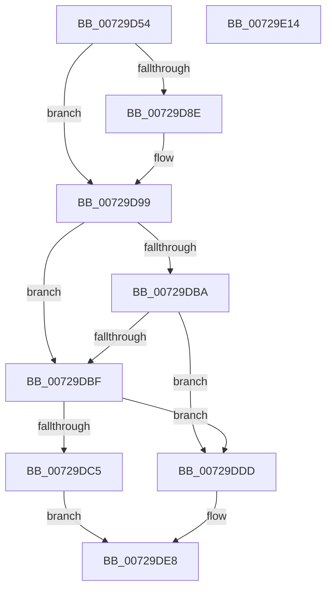

# PnpNotifyTargetDeviceChangeNotifyEntry

- RVA: `0x00729D54`–`0x00729E15` (길이 `193` bytes)
- VA: `0x0000000140729D54`
- 실행 섹션: `PAGE`
- PDB 이름 있음: `예`; PDB Function 태그: `아니요`
- unwind 정보 RVA: `0x0005E6B4`
- 디코드: `53`개 명령, `193/193` bytes 표시
- 미해석 바이트: `0` (있으면 어셈블리에 `.byte`로 보존)

> 이 문서는 커널 이미지의 기계어와 PDB 기호를 분석해 생성했습니다. 4번과 5번은 함수 원형과 자료형을 바이너리 사용 방식에서 추정한 C 해석이며 원본 소스 복구 결과는 아닙니다.

## 1. Dependencies

- 직접 호출 지점: **7**; 고유 호출 대상: **7**
- 직접 호출자로 확인된 함수: **1**
- RIP 상대 이미지 참조: **0**

### Outgoing calls
- `0x00729D7C` → [PsGetCurrentServerSilo](../../text/22/PsGetCurrentServerSilo_function_00225710.md) (function, `0x00225710`)
- `0x00729D84` → [PsGetServerSiloServiceSessionId](../../text/45/PsGetServerSiloServiceSessionId_function_0045ED00.md) (function, `0x0045ED00`)
- `0x00729D92` → [IopGetSessionIdFromPDO](../8F/IopGetSessionIdFromPDO_function_008FFDD8.md) (function, `0x008FFDD8`)
- `0x00729DB0` → [ExAcquireResourceExclusiveLite](../../text/21/ExAcquireResourceExclusiveLite_function_00214E20.md) (function, `0x00214E20`)
- `0x00729DD6` → [PnpNotifyDriverCallback](../95/PnpNotifyDriverCallback_function_00954AA0.md) (function, `0x00954AA0`)
- `0x00729DEF` → [ExReleaseResourceLite](../../text/25/ExReleaseResourceLite_function_0025FA10.md) (function, `0x0025FA10`)
- `0x00729DF4` → [KeLeaveCriticalRegion](../../text/25/KeLeaveCriticalRegion_function_0025D8B0.md) (function, `0x0025D8B0`)

### Direct callers
- [sub_00B264F4](../B2/Unknown_function_00B264F4.md) at `0x00B2653E`

### Static image references
- 디코드된 RIP-relative 메모리 참조가 없습니다.

## 2. Other-region calls and transfers

- 다른 실행 섹션으로 향하는 call: **5**
  - `0x00729D7C` → [PsGetCurrentServerSilo](../../text/22/PsGetCurrentServerSilo_function_00225710.md) (`PAGE` → `.text`)
  - `0x00729D84` → [PsGetServerSiloServiceSessionId](../../text/45/PsGetServerSiloServiceSessionId_function_0045ED00.md) (`PAGE` → `.text`)
  - `0x00729DB0` → [ExAcquireResourceExclusiveLite](../../text/21/ExAcquireResourceExclusiveLite_function_00214E20.md) (`PAGE` → `.text`)
  - `0x00729DEF` → [ExReleaseResourceLite](../../text/25/ExReleaseResourceLite_function_0025FA10.md) (`PAGE` → `.text`)
  - `0x00729DF4` → [KeLeaveCriticalRegion](../../text/25/KeLeaveCriticalRegion_function_0025D8B0.md) (`PAGE` → `.text`)
- 별도 외부 분기/꼬리 이동을 확인하지 못했습니다.

## 3. Assembly (complete function range)

```asm
00729D54  48 8B C4                        mov rax, rsp
00729D57  48 89 58 08                     mov qword ptr [rax + 8], rbx
00729D5B  48 89 68 10                     mov qword ptr [rax + 0x10], rbp
00729D5F  48 89 70 18                     mov qword ptr [rax + 0x18], rsi
00729D63  48 89 78 20                     mov qword ptr [rax + 0x20], rdi
00729D67  41 56                           push r14
00729D69  48 83 EC 20                     sub rsp, 0x20
00729D6D  49 8B F1                        mov rsi, r9
00729D70  4D 8B F0                        mov r14, r8
00729D73  48 8B EA                        mov rbp, rdx
00729D76  48 8B D9                        mov rbx, rcx
00729D79  83 CF FF                        or edi, 0xffffffff
00729D7C  E8 8F B9 AF FF                  call 0x140225710
00729D81  48 8B C8                        mov rcx, rax
00729D84  E8 77 4F D3 FF                  call 0x14045ed00
00729D89  39 43 14                        cmp dword ptr [rbx + 0x14], eax
00729D8C  74 0B                           je 0x140729d99
00729D8E  48 8B 4B 58                     mov rcx, qword ptr [rbx + 0x58]
00729D92  E8 41 60 1D 00                  call 0x1408ffdd8
00729D97  8B F8                           mov edi, eax
00729D99  65 48 8B 0C 25 88 01 00 00      mov rcx, qword ptr gs:[0x188]
00729DA2  B2 01                           mov dl, 1
00729DA4  66 FF 89 E4 01 00 00            dec word ptr [rcx + 0x1e4]
00729DAB  90                              nop
00729DAC  48 8B 4B 48                     mov rcx, qword ptr [rbx + 0x48]
00729DB0  E8 6B B0 AE FF                  call 0x140214e20
00729DB5  83 FF FF                        cmp edi, -1
00729DB8  74 05                           je 0x140729dbf
00729DBA  39 7B 14                        cmp dword ptr [rbx + 0x14], edi
00729DBD  75 1E                           jne 0x140729ddd
00729DBF  80 7B 3A 00                     cmp byte ptr [rbx + 0x3a], 0
00729DC3  75 18                           jne 0x140729ddd
00729DC5  48 8B 43 50                     mov rax, qword ptr [rbx + 0x50]
00729DC9  4C 8B C6                        mov r8, rsi
00729DCC  48 8B D5                        mov rdx, rbp
00729DCF  48 89 45 18                     mov qword ptr [rbp + 0x18], rax
00729DD3  48 8B CB                        mov rcx, rbx
00729DD6  E8 C5 AC 22 00                  call 0x140954aa0
00729DDB  EB 0B                           jmp 0x140729de8
00729DDD  C7 06 BB 00 00 C0               mov dword ptr [rsi], 0xc00000bb
00729DE3  B8 10 00 00 C0                  mov eax, 0xc0000010
00729DE8  41 89 06                        mov dword ptr [r14], eax
00729DEB  48 8B 4B 48                     mov rcx, qword ptr [rbx + 0x48]
00729DEF  E8 1C 5C B3 FF                  call 0x14025fa10
00729DF4  E8 B7 3A B3 FF                  call 0x14025d8b0
00729DF9  48 8B 5C 24 30                  mov rbx, qword ptr [rsp + 0x30]
00729DFE  48 8B 6C 24 38                  mov rbp, qword ptr [rsp + 0x38]
00729E03  48 8B 74 24 40                  mov rsi, qword ptr [rsp + 0x40]
00729E08  48 8B 7C 24 48                  mov rdi, qword ptr [rsp + 0x48]
00729E0D  48 83 C4 20                     add rsp, 0x20
00729E11  41 5E                           pop r14
00729E13  C3                              ret
00729E14  CC                              int3
```

## 4. C-style interpretation (structured pseudocode)

```c
__int64 __fastcall PnpNotifyTargetDeviceChangeNotifyEntry(__int64 a1, __int64 a2, __int64 a3, __int64 a4)
{
    __int64 result;
    __int64 v_rdi;
    __int64 v_rsp;
    unsigned __int64 v_stack_p10;
    unsigned __int64 v_stack_p18;
    unsigned __int64 v_stack_p20;
    unsigned __int64 v_stack_p8;

    *(unsigned __int64 *)(v_rsp + 8) = v_rbx;
    *(unsigned __int64 *)(v_rsp + 16) = v_rbp;
    *(unsigned __int64 *)(v_rsp + 24) = v_rsi;
    *(unsigned __int64 *)(v_rsp + 32) = v_rdi;
    v_rsp = (v_rsp) - (32);
    v_rdi = (unsigned int)((v_rdi) | (0xFFFFFFFFULL));
    result = PsGetCurrentServerSilo(a1, a2, a3, a4);
    result = PsGetServerSiloServiceSessionId(result, a2, a3, a4);
    if ((*(unsigned int *)(a1 + 20)) != ((unsigned int)(result))) {
        a1 = *(unsigned __int64 *)(a1 + 88);
        result = IopGetSessionIdFromPDO(a1, a2, a3, a4);
        v_rdi = (unsigned int)(result);
    }
    result = ExAcquireResourceExclusiveLite(*(unsigned __int64 *)(a1 + 72), 1, a3, a4);
    if (((unsigned int)(v_rdi)) == -1) goto loc_00729DBF;
    if ((*(unsigned int *)(a1 + 20)) != ((unsigned int)(v_rdi))) goto loc_00729DDD;
loc_00729DBF:
    if ((*(unsigned __int8 *)(a1 + 58)) != 0) goto loc_00729DDD;
    *(unsigned __int64 *)(a2 + 24) = *(unsigned __int64 *)(a1 + 80);
    result = PnpNotifyDriverCallback(a1, a2, a4, a4);
    goto loc_00729DE8;
loc_00729DDD:
    *(unsigned int *)(a4) = 0xC00000BBULL;
loc_00729DE8:
    *(unsigned int *)(a3) = (unsigned int)((unsigned int)(0xC0000010ULL));
    result = ExReleaseResourceLite(*(unsigned __int64 *)(a1 + 72), a2, a4, a4);
    result = KeLeaveCriticalRegion(*(unsigned __int64 *)(a1 + 72), a2, a4, a4);
    v_rsp = (v_rsp) + (32);
    return result;
}
```

## 5. (Beta) C Style

```c
int64_t PnpNotifyTargetDeviceChangeNotifyEntry(void *Arg1, void *Arg2, void *Arg3, void *Arg4)
{
    uint8_t *arg1 = (uint8_t *)Arg1;
    uint8_t *arg2 = (uint8_t *)Arg2;
    uint8_t *arg3 = (uint8_t *)Arg3;
    uint8_t *arg4 = (uint8_t *)Arg4;

    int64_t result;
    int64_t local_rdi;
    int64_t local_rsp;
    uint64_t v_stack_p10;
    uint64_t v_stack_p18;
    uint64_t v_stack_p20;
    uint64_t v_stack_p8;

    *(uint64_t *)(local_rsp + 0x8) = local_rbx;
    *(uint64_t *)(local_rsp + 0x10) = local_rbp;
    *(uint64_t *)(local_rsp + 0x18) = local_rsi;
    *(uint64_t *)(local_rsp + 0x20) = local_rdi;
    local_rsp = (local_rsp) - (32);
    local_rdi = (uint32_t)((local_rdi) | (0xFFFFFFFFULL));
    result = PsGetCurrentServerSilo(Arg1, Arg2, Arg3, Arg4);
    result = PsGetServerSiloServiceSessionId(result, Arg2, Arg3, Arg4);
    if ((*(uint32_t *)(arg1 + 0x14)) != ((uint32_t)(result))) {
        Arg1 = *(uint64_t *)(arg1 + 0x58);
        result = IopGetSessionIdFromPDO(Arg1, Arg2, Arg3, Arg4);
        local_rdi = (uint32_t)(result);
    }
    result = ExAcquireResourceExclusiveLite(*(uint64_t *)(arg1 + 0x48), 1, Arg3, Arg4);
    if (((uint32_t)(local_rdi)) == -1) goto loc_00729DBF;
    if ((*(uint32_t *)(arg1 + 0x14)) != ((uint32_t)(local_rdi))) goto loc_00729DDD;
loc_00729DBF:
    if ((*(uint8_t *)(arg1 + 0x3A)) != 0) goto loc_00729DDD;
    *(uint64_t *)(arg2 + 0x18) = *(uint64_t *)(arg1 + 0x50);
    result = PnpNotifyDriverCallback(Arg1, Arg2, Arg4, Arg4);
    goto loc_00729DE8;
loc_00729DDD:
    *(uint32_t *)(arg4) = 0xC00000BBULL;
loc_00729DE8:
    *(uint32_t *)(arg3) = (uint32_t)((uint32_t)(0xC0000010ULL));
    result = ExReleaseResourceLite(*(uint64_t *)(arg1 + 0x48), Arg2, Arg4, Arg4);
    result = KeLeaveCriticalRegion(*(uint64_t *)(arg1 + 0x48), Arg2, Arg4, Arg4);
    local_rsp = (local_rsp) + (32);
    return result;
}
```

### 관측된 메모리 오프셋

구조체 형식이 확인되지 않은 접근은 인자 기준의 오프셋으로만 기록했습니다.

| 기준 인자 | 오프셋 표현 | 폭 (bit) | 접근 |
|---|---:|---:|---|
| `Arg1` | `+ 0x14` | `32` | `R` |
| `Arg1` | `+ 0x3A` | `8` | `R` |
| `Arg1` | `+ 0x48` | `64` | `R` |
| `Arg1` | `+ 0x50` | `64` | `R` |
| `Arg1` | `+ 0x58` | `64` | `R` |
| `Arg2` | `+ 0x18` | `64` | `W` |
| `Arg3` | `+ 0x0` | `32` | `W` |
| `Arg4` | `+ 0x0` | `32` | `W` |

## 6. Execution-region graph

[열기: 2D/3D 그래프와 함수 탐색 컨트롤 패널](../../../control-panel.html?section=page&rva=0x00729D54&view=graph)

- 2D 그래프는 위에서 아래로 흐르고, 3D 그래프는 빈 공간을 드래그해 회전합니다. Shift+드래그는 이동, 휠은 확대·축소, 함수 노드 선택은 대상 보고서 이동입니다.

### Static fallback


