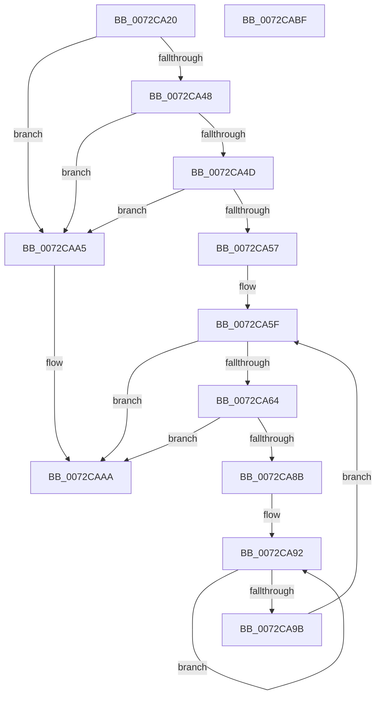

# PnpOpenFirstMatchingSubKey

- RVA: `0x0072CA20`–`0x0072CAC0` (길이 `160` bytes)
- VA: `0x000000014072CA20`
- 실행 섹션: `PAGE`
- PDB 이름 있음: `예`; PDB Function 태그: `아니요`
- unwind 정보 RVA: `0x00066400`
- 디코드: `48`개 명령, `160/160` bytes 표시
- 미해석 바이트: `0` (있으면 어셈블리에 `.byte`로 보존)

> 이 문서는 커널 이미지의 기계어와 PDB 기호를 분석해 생성했습니다. 4번과 5번은 함수 원형과 자료형을 바이너리 사용 방식에서 추정한 C 해석이며 원본 소스 복구 결과는 아닙니다.

## 1. Dependencies

- 직접 호출 지점: **2**; 고유 호출 대상: **2**
- 직접 호출자로 확인된 함수: **2**
- RIP 상대 이미지 참조: **0**

### Outgoing calls
- `0x0072CA6C` → [RtlInitUnicodeString](../../text/42/RtlInitUnicodeString_function_0042A780.md) (function, `0x0042A780`)
- `0x0072CA82` → [IopOpenRegistryKeyEx](../A5/IopOpenRegistryKeyEx_function_00A51B44.md) (function, `0x00A51B44`)

### Direct callers
- [PiDevCfgConfigureDeviceLocation](../AA/PiDevCfgConfigureDeviceLocation_function_00AA88C0.md) at `0x00AA89F0`
- [PiDevCfgConfigureDeviceLocation](../AA/PiDevCfgConfigureDeviceLocation_function_00AA88C0.md) at `0x00AA8ABA`
- [sub_00B38904](../B3/Unknown_function_00B38904.md) at `0x00B38AA9`

### Static image references
- 디코드된 RIP-relative 메모리 참조가 없습니다.

## 2. Other-region calls and transfers

- 다른 실행 섹션으로 향하는 call: **1**
  - `0x0072CA6C` → [RtlInitUnicodeString](../../text/42/RtlInitUnicodeString_function_0042A780.md) (`PAGE` → `.text`)
- 별도 외부 분기/꼬리 이동을 확인하지 못했습니다.

## 3. Assembly (complete function range)

```asm
0072CA20  48 8B C4                        mov rax, rsp
0072CA23  48 89 58 08                     mov qword ptr [rax + 8], rbx
0072CA27  48 89 68 10                     mov qword ptr [rax + 0x10], rbp
0072CA2B  48 89 70 18                     mov qword ptr [rax + 0x18], rsi
0072CA2F  57                              push rdi
0072CA30  48 83 EC 30                     sub rsp, 0x30
0072CA34  33 ED                           xor ebp, ebp
0072CA36  0F 57 C0                        xorps xmm0, xmm0
0072CA39  48 8B F2                        mov rsi, rdx
0072CA3C  48 8B D9                        mov rbx, rcx
0072CA3F  0F 11 40 E8                     movups xmmword ptr [rax - 0x18], xmm0
0072CA43  48 85 C9                        test rcx, rcx
0072CA46  74 5D                           je 0x14072caa5
0072CA48  48 85 D2                        test rdx, rdx
0072CA4B  74 58                           je 0x14072caa5
0072CA4D  48 8B 7C 24 60                  mov rdi, qword ptr [rsp + 0x60]
0072CA52  48 85 FF                        test rdi, rdi
0072CA55  74 4E                           je 0x14072caa5
0072CA57  48 89 2F                        mov qword ptr [rdi], rbp
0072CA5A  B8 34 00 00 C0                  mov eax, 0xc0000034
0072CA5F  66 39 2B                        cmp word ptr [rbx], bp
0072CA62  74 46                           je 0x14072caaa
0072CA64  48 8B D3                        mov rdx, rbx
0072CA67  48 8D 4C 24 20                  lea rcx, [rsp + 0x20]
0072CA6C  E8 0F DD CF FF                  call 0x14042a780
0072CA71  41 B9 19 00 02 00               mov r9d, 0x20019
0072CA77  4C 8D 44 24 20                  lea r8, [rsp + 0x20]
0072CA7C  48 8B D6                        mov rdx, rsi
0072CA7F  48 8B CF                        mov rcx, rdi
0072CA82  E8 BD 50 32 00                  call 0x140a51b44
0072CA87  85 C0                           test eax, eax
0072CA89  79 1F                           jns 0x14072caaa
0072CA8B  48 89 2F                        mov qword ptr [rdi], rbp
0072CA8E  48 83 C9 FF                     or rcx, 0xffffffffffffffff
0072CA92  48 FF C1                        inc rcx
0072CA95  66 39 2C 4B                     cmp word ptr [rbx + rcx*2], bp
0072CA99  75 F7                           jne 0x14072ca92
0072CA9B  48 8D 1C 4B                     lea rbx, [rbx + rcx*2]
0072CA9F  48 83 C3 02                     add rbx, 2
0072CAA3  EB BA                           jmp 0x14072ca5f
0072CAA5  B8 0D 00 00 C0                  mov eax, 0xc000000d
0072CAAA  48 8B 5C 24 40                  mov rbx, qword ptr [rsp + 0x40]
0072CAAF  48 8B 6C 24 48                  mov rbp, qword ptr [rsp + 0x48]
0072CAB4  48 8B 74 24 50                  mov rsi, qword ptr [rsp + 0x50]
0072CAB9  48 83 C4 30                     add rsp, 0x30
0072CABD  5F                              pop rdi
0072CABE  C3                              ret
0072CABF  CC                              int3
```

## 4. C-style interpretation (structured pseudocode)

```c
__int64 __fastcall PnpOpenFirstMatchingSubKey(__int64 a1, __int64 a2, __int64 a3, __int64 a4, __int64 a5)
{
    __int64 result;
    __int64 v_rbp;
    __int64 v_rbx;
    __int64 v_rsp;
    unsigned __int64 v_stack_m18;
    unsigned __int64 v_stack_p10;
    unsigned __int64 v_stack_p18;
    unsigned __int64 v_stack_p8;

    *(unsigned __int64 *)(v_rsp + 8) = v_rbx;
    *(unsigned __int64 *)(v_rsp + 16) = v_rbp;
    *(unsigned __int64 *)(v_rsp + 24) = v_rsi;
    v_rsp = (v_rsp) - (48);
    v_rbp = 0;
    *(unsigned __int64 *)(v_rsp - 24) = v_xmm0;
    if (a1 == 0) goto loc_0072CAA5;
    if (a2 == 0) goto loc_0072CAA5;
    if (a5 == 0) goto loc_0072CAA5;
    *(unsigned __int64 *)(a5) = 0;
loc_0072CA5F:
    if ((*(unsigned __int16 *)(a1)) == 0) goto loc_0072CAAA;
    result = RtlInitUnicodeString(v_stack_m18, a1, a3, a4);
    result = IopOpenRegistryKeyEx(a5, a2, v_stack_m18, (unsigned int)(0x20019ULL));
    if (!sign_flag) goto loc_0072CAAA;
    *(unsigned __int64 *)(a5) = 0;
    a1 = (a5) | (-1);
loc_0072CA92:
    a1 = (a1) + 1;
    if ((*(unsigned __int16 *)(a1 + a1 * 2)) != 0) goto loc_0072CA92;
    v_rbx = (a1 + a1 * 2) + (2);
    goto loc_0072CA5F;
loc_0072CAA5:
loc_0072CAAA:
    v_rsp = (v_rsp) + (48);
    return (unsigned int)(0xC000000DULL);
}
```

## 5. (Beta) C Style

```c
int64_t PnpOpenFirstMatchingSubKey(void *Arg1, int64_t Arg2, int64_t Arg3, int64_t Arg4, int64_t Arg5)
{
    uint8_t *arg1 = (uint8_t *)Arg1;

    int64_t result;
    int64_t local_rbp;
    int64_t local_rbx;
    int64_t local_rsp;
    uint64_t v_stack_m18;
    uint64_t v_stack_p10;
    uint64_t v_stack_p18;
    uint64_t v_stack_p8;

    *(uint64_t *)(local_rsp + 0x8) = local_rbx;
    *(uint64_t *)(local_rsp + 0x10) = local_rbp;
    *(uint64_t *)(local_rsp + 0x18) = local_rsi;
    local_rsp = (local_rsp) - (48);
    local_rbp = 0;
    *(uint64_t *)(local_rsp - 0x18) = v_xmm0;
    if (Arg1 == NULL) goto loc_0072CAA5;
    if (Arg2 == 0) goto loc_0072CAA5;
    if (Arg5 == 0) goto loc_0072CAA5;
    *(uint64_t *)(Arg5) = 0;
loc_0072CA5F:
    if ((*(uint16_t *)(arg1)) == 0) goto loc_0072CAAA;
    result = RtlInitUnicodeString(v_stack_m18, Arg1, Arg3, Arg4);
    result = IopOpenRegistryKeyEx(Arg5, Arg2, v_stack_m18, (uint32_t)(0x20019ULL));
    if (!sign_flag) goto loc_0072CAAA;
    *(uint64_t *)(Arg5) = 0;
    Arg1 = (Arg5) | (-1);
loc_0072CA92:
    Arg1 = (Arg1) + 1;
    if ((*(uint16_t *)(arg1 + arg1 * 2)) != 0) goto loc_0072CA92;
    local_rbx = (Arg1 + Arg1 * 2) + (2);
    goto loc_0072CA5F;
loc_0072CAA5:
loc_0072CAAA:
    local_rsp = (local_rsp) + (48);
    return (uint32_t)(0xC000000DULL);
}
```

### 관측된 메모리 오프셋

구조체 형식이 확인되지 않은 접근은 인자 기준의 오프셋으로만 기록했습니다.

| 기준 인자 | 오프셋 표현 | 폭 (bit) | 접근 |
|---|---:|---:|---|
| `Arg1` | `+ 0x0` | `16` | `R` |
| `Arg1` | `+ 0x0 + rcx*2` | `16` | `R` |
| `Arg1` | `+ 0x0 + rcx*2` | `64` | `R` |

## 6. Execution-region graph

[열기: 2D/3D 그래프와 함수 탐색 컨트롤 패널](../../../control-panel.html?section=page&rva=0x0072CA20&view=graph)

- 2D 그래프는 위에서 아래로 흐르고, 3D 그래프는 빈 공간을 드래그해 회전합니다. Shift+드래그는 이동, 휠은 확대·축소, 함수 노드 선택은 대상 보고서 이동입니다.

### Static fallback


