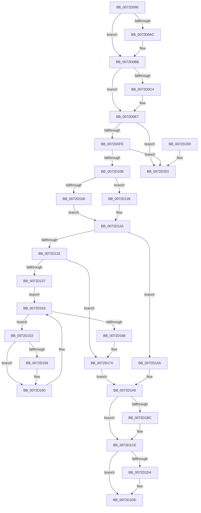

# PnpProcessCompletedEject

- RVA: `0x0072D090`–`0x0072D208` (길이 `376` bytes)
- VA: `0x000000014072D090`
- 실행 섹션: `PAGE`
- PDB 이름 있음: `예`; PDB Function 태그: `아니요`
- unwind 정보 RVA: `0x0006383C`
- 디코드: `98`개 명령, `376/376` bytes 표시
- 미해석 바이트: `0` (있으면 어셈블리에 `.byte`로 보존)

> 이 문서는 커널 이미지의 기계어와 PDB 기호를 분석해 생성했습니다. 4번과 5번은 함수 원형과 자료형을 바이너리 사용 방식에서 추정한 C 해석이며 원본 소스 복구 결과는 아닙니다.

## 1. Dependencies

- 직접 호출 지점: **15**; 고유 호출 대상: **14**
- 직접 호출자로 확인된 함수: **1**
- RIP 상대 이미지 참조: **2**

### Outgoing calls
- `0x0072D0B4` → [IopWarmEjectDevice](../74/IopWarmEjectDevice_function_007405EC.md) (function, `0x007405EC`)
- `0x0072D0D1` → [guard_dispatch_icall](../../text/6B/guard_dispatch_icall_function_006BAAD0.md) (function, `0x006BAAD0`)
- `0x0072D0E2` → [guard_dispatch_icall](../../text/6B/guard_dispatch_icall_function_006BAAD0.md) (function, `0x006BAAD0`)
- `0x0072D0EC` → [PpDevNodeLockTree](../A1/PpDevNodeLockTree_function_00A19310.md) (function, `0x00A19310`)
- `0x0072D13E` → [ExAcquireFastMutex](../../text/20/ExAcquireFastMutex_function_0020E5A0.md) (function, `0x0020E5A0`)
- `0x0072D16F` → [ExReleaseFastMutex](../../text/25/ExReleaseFastMutex_function_002519C0.md) (function, `0x002519C0`)
- `0x0072D182` → [PnpInvalidateRelationsInList](../A0/PnpInvalidateRelationsInList_function_00A05DF8.md) (function, `0x00A05DF8`)
- `0x0072D18D` → [PnpTrackQueryRemoveDevices](../AC/PnpTrackQueryRemoveDevices_function_00ACCF54.md) (function, `0x00ACCF54`)
- `0x0072D196` → [IopFreeRelationList](../A0/IopFreeRelationList_function_00A08310.md) (function, `0x00A08310`)
- `0x0072D1AE` → [PpDevNodeUnlockTree](../A2/PpDevNodeUnlockTree_function_00A21290.md) (function, `0x00A21290`)
- `0x0072D1BF` → [PnpDisableAndFreeEventWatchdog](../95/PnpDisableAndFreeEventWatchdog_function_00955ABC.md) (function, `0x00955ABC`)
- `0x0072D1C9` → [PnpCompleteDeviceEvent](../95/PnpCompleteDeviceEvent_function_00955548.md) (function, `0x00955548`)
- `0x0072D1D8` → [PnpSetDeviceRemovalSafe](../73/PnpSetDeviceRemovalSafe_function_00738184.md) (function, `0x00738184`)
- `0x0072D1E1` → [ObfDereferenceObject](../../text/2F/ObfDereferenceObject_function_002F9350.md) (function, `0x002F9350`)
- `0x0072D1EB` → [ExFreePoolWithTag](../../poolcode/B8/ExFreePoolWithTag_function_00B82870.md) (function, `0x00B82870`)

### Direct callers
- [sub_00B33FE8](../B3/Unknown_function_00B33FE8.md) at `0x00B34110`

### Static image references
- `0x0072D137` → RVA `0x00F8ACA0` (`.data`; read)
- `0x0072D143` → RVA `0x00F8ACE0` (`.data`; read)

## 2. Other-region calls and transfers

- 다른 실행 섹션으로 향하는 call: **6**
  - `0x0072D0D1` → [guard_dispatch_icall](../../text/6B/guard_dispatch_icall_function_006BAAD0.md) (`PAGE` → `.text`)
  - `0x0072D0E2` → [guard_dispatch_icall](../../text/6B/guard_dispatch_icall_function_006BAAD0.md) (`PAGE` → `.text`)
  - `0x0072D13E` → [ExAcquireFastMutex](../../text/20/ExAcquireFastMutex_function_0020E5A0.md) (`PAGE` → `.text`)
  - `0x0072D16F` → [ExReleaseFastMutex](../../text/25/ExReleaseFastMutex_function_002519C0.md) (`PAGE` → `.text`)
  - `0x0072D1E1` → [ObfDereferenceObject](../../text/2F/ObfDereferenceObject_function_002F9350.md) (`PAGE` → `.text`)
  - `0x0072D1EB` → [ExFreePoolWithTag](../../poolcode/B8/ExFreePoolWithTag_function_00B82870.md) (`PAGE` → `POOLCODE`)
- 별도 외부 분기/꼬리 이동을 확인하지 못했습니다.

## 3. Assembly (complete function range)

```asm
0072D090  48 89 5C 24 08                  mov qword ptr [rsp + 8], rbx
0072D095  48 89 74 24 10                  mov qword ptr [rsp + 0x10], rsi
0072D09A  57                              push rdi
0072D09B  48 83 EC 20                     sub rsp, 0x20
0072D09F  8B 51 5C                        mov edx, dword ptr [rcx + 0x5c]
0072D0A2  33 F6                           xor esi, esi
0072D0A4  48 8B D9                        mov rbx, rcx
0072D0A7  83 FA 01                        cmp edx, 1
0072D0AA  76 0F                           jbe 0x14072d0bb
0072D0AC  40 88 71 59                     mov byte ptr [rcx + 0x59], sil
0072D0B0  48 8B 49 38                     mov rcx, qword ptr [rcx + 0x38]
0072D0B4  E8 33 35 01 00                  call 0x1407405ec
0072D0B9  8B F0                           mov esi, eax
0072D0BB  48 8B 4B 60                     mov rcx, qword ptr [rbx + 0x60]
0072D0BF  48 85 C9                        test rcx, rcx
0072D0C2  74 23                           je 0x14072d0e7
0072D0C4  48 8B 41 20                     mov rax, qword ptr [rcx + 0x20]
0072D0C8  BA 01 00 00 00                  mov edx, 1
0072D0CD  48 8B 49 08                     mov rcx, qword ptr [rcx + 8]
0072D0D1  E8 FA D9 F8 FF                  call 0x1406baad0
0072D0D6  48 8B 4B 60                     mov rcx, qword ptr [rbx + 0x60]
0072D0DA  48 8B 41 18                     mov rax, qword ptr [rcx + 0x18]
0072D0DE  48 8B 49 08                     mov rcx, qword ptr [rcx + 8]
0072D0E2  E8 E9 D9 F8 FF                  call 0x1406baad0
0072D0E7  B9 01 00 00 00                  mov ecx, 1
0072D0EC  E8 1F C2 2E 00                  call 0x140a19310
0072D0F1  48 8B 0B                        mov rcx, qword ptr [rbx]
0072D0F4  48 39 59 08                     cmp qword ptr [rcx + 8], rbx
0072D0F8  0F 85 03 01 00 00               jne 0x14072d201
0072D0FE  48 8B 43 08                     mov rax, qword ptr [rbx + 8]
0072D102  48 39 18                        cmp qword ptr [rax], rbx
0072D105  0F 85 F6 00 00 00               jne 0x14072d201
0072D10B  48 89 08                        mov qword ptr [rax], rcx
0072D10E  48 89 41 08                     mov qword ptr [rcx + 8], rax
0072D112  48 8B 43 38                     mov rax, qword ptr [rbx + 0x38]
0072D116  48 85 C0                        test rax, rax
0072D119  74 0D                           je 0x14072d128
0072D11B  48 8B 80 38 01 00 00            mov rax, qword ptr [rax + 0x138]
0072D122  48 8B 78 28                     mov rdi, qword ptr [rax + 0x28]
0072D126  EB 02                           jmp 0x14072d12a
0072D128  33 FF                           xor edi, edi
0072D12A  48 83 7B 40 00                  cmp qword ptr [rbx + 0x40], 0
0072D12F  74 74                           je 0x14072d1a5
0072D131  80 7B 58 00                     cmp byte ptr [rbx + 0x58], 0
0072D135  74 3D                           je 0x14072d174
0072D137  48 8D 0D 62 DB 85 00            lea rcx, [rip + 0x85db62]
0072D13E  E8 5D 14 AE FF                  call 0x14020e5a0
0072D143  48 8B 05 96 DB 85 00            mov rax, qword ptr [rip + 0x85db96]
0072D14A  4C 8D 05 8F DB 85 00            lea r8, [rip + 0x85db8f]
0072D151  EB 10                           jmp 0x14072d163
0072D153  83 78 F8 01                     cmp dword ptr [rax - 8], 1
0072D157  74 07                           je 0x14072d160
0072D159  C7 40 F8 04 00 00 00            mov dword ptr [rax - 8], 4
0072D160  48 8B 00                        mov rax, qword ptr [rax]
0072D163  49 3B C0                        cmp rax, r8
0072D166  75 EB                           jne 0x14072d153
0072D168  48 8D 0D 31 DB 85 00            lea rcx, [rip + 0x85db31]
0072D16F  E8 4C 48 B2 FF                  call 0x1402519c0
0072D174  48 8B 4B 40                     mov rcx, qword ptr [rbx + 0x40]
0072D178  45 33 C0                        xor r8d, r8d
0072D17B  41 B1 01                        mov r9b, 1
0072D17E  41 8D 50 04                     lea edx, [r8 + 4]
0072D182  E8 71 8C 2D 00                  call 0x140a05df8
0072D187  48 8B 4B 40                     mov rcx, qword ptr [rbx + 0x40]
0072D18B  33 D2                           xor edx, edx
0072D18D  E8 C2 FD 39 00                  call 0x140accf54
0072D192  48 8B 4B 40                     mov rcx, qword ptr [rbx + 0x40]
0072D196  E8 75 B1 2D 00                  call 0x140a08310
0072D19B  48 83 A7 B8 02 00 00 00         and qword ptr [rdi + 0x2b8], 0
0072D1A3  EB 04                           jmp 0x14072d1a9
0072D1A5  C6 43 59 00                     mov byte ptr [rbx + 0x59], 0
0072D1A9  B9 01 00 00 00                  mov ecx, 1
0072D1AE  E8 DD 40 2F 00                  call 0x140a21290
0072D1B3  48 8B 7B 30                     mov rdi, qword ptr [rbx + 0x30]
0072D1B7  48 85 FF                        test rdi, rdi
0072D1BA  74 12                           je 0x14072d1ce
0072D1BC  48 8B CF                        mov rcx, rdi
0072D1BF  E8 F8 88 22 00                  call 0x140955abc
0072D1C4  8B D6                           mov edx, esi
0072D1C6  48 8B CF                        mov rcx, rdi
0072D1C9  E8 7A 83 22 00                  call 0x140955548
0072D1CE  80 7B 59 00                     cmp byte ptr [rbx + 0x59], 0
0072D1D2  74 09                           je 0x14072d1dd
0072D1D4  48 8B 4B 38                     mov rcx, qword ptr [rbx + 0x38]
0072D1D8  E8 A7 AF 00 00                  call 0x140738184
0072D1DD  48 8B 4B 38                     mov rcx, qword ptr [rbx + 0x38]
0072D1E1  E8 6A C1 BC FF                  call 0x1402f9350
0072D1E6  33 D2                           xor edx, edx
0072D1E8  48 8B CB                        mov rcx, rbx
0072D1EB  E8 80 56 45 00                  call 0x140b82870
0072D1F0  48 8B 5C 24 30                  mov rbx, qword ptr [rsp + 0x30]
0072D1F5  48 8B 74 24 38                  mov rsi, qword ptr [rsp + 0x38]
0072D1FA  48 83 C4 20                     add rsp, 0x20
0072D1FE  5F                              pop rdi
0072D1FF  C3                              ret
0072D200  CC                              int3
0072D201  B9 03 00 00 00                  mov ecx, 3
0072D206  CD 29                           int 0x29
```

## 4. C-style interpretation (structured pseudocode)

```c
__int64 __fastcall PnpProcessCompletedEject(__int64 a1)
{
    __int64 result;
    __int64 v_rdi;
    __int64 v_rsi;
    __int64 v_rsp;
    unsigned __int64 v_stack_p10;
    unsigned __int64 v_stack_p8;

    v_stack_p8 = v_rbx;
    v_stack_p10 = v_rsi;
    v_rsp = (v_rsp) - (32);
    v_rsi = 0;
    if (((unsigned int)((unsigned int)(*(unsigned int *)(a1 + 92)))) >= = 1) {
        *(unsigned __int8 *)(a1 + 89) = 0;
        a1 = *(unsigned __int64 *)(a1 + 56);
        result = IopWarmEjectDevice(a1, (unsigned int)(*(unsigned int *)(a1 + 92)), a3, a4);
        v_rsi = (unsigned int)(result);
    }
    if (*(unsigned __int64 *)(a1 + 96) != 0) {
        result = *(unsigned __int64 *)(*(unsigned __int64 *)(a1 + 96) + 32);
        a2 = 1;
        a1 = *(unsigned __int64 *)(*(unsigned __int64 *)(a1 + 96) + 8);
        result = guard_dispatch_icall(a1, a2, a3, a4);
        a1 = *(unsigned __int64 *)(a1 + 96);
        result = *(unsigned __int64 *)(a1 + 24);
        a1 = *(unsigned __int64 *)(a1 + 8);
        result = guard_dispatch_icall(a1, a2, a3, a4);
    }
    result = PpDevNodeLockTree(1, a2, a3, a4);
    if ((*(unsigned __int64 *)(*(unsigned __int64 *)(a1) + 8)) != a1) goto loc_0072D201;
    if ((*(unsigned __int64 *)(*(unsigned __int64 *)(a1 + 8))) != a1) goto loc_0072D201;
    *(unsigned __int64 *)(*(unsigned __int64 *)(a1 + 8)) = *(unsigned __int64 *)(a1);
    *(unsigned __int64 *)(*(unsigned __int64 *)(a1) + 8) = *(unsigned __int64 *)(a1 + 8);
    if (*(unsigned __int64 *)(a1 + 56) == 0) goto loc_0072D128;
    goto loc_0072D12A;
loc_0072D128:
    v_rdi = 0;
loc_0072D12A:
    if ((*(unsigned __int64 *)(a1 + 64)) == 0) goto loc_0072D1A5;
    if ((*(unsigned __int8 *)(a1 + 88)) == 0) goto loc_0072D174;
    result = ExAcquireFastMutex(v_rip + 8772450, a2, a3, a4);
    goto loc_0072D163;
loc_0072D153:
    if ((*(unsigned int *)(*(unsigned __int64 *)(v_rip + 8772502) - 8)) != 1) {
        *(unsigned int *)(*(unsigned __int64 *)(v_rip + 8772502) - 8) = 4;
    }
loc_0072D163:
    if ((*(unsigned __int64 *)(*(unsigned __int64 *)(v_rip + 8772502))) != (v_rip + 8772495)) goto loc_0072D153;
    result = ExReleaseFastMutex(v_rip + 8772401, a2, v_rip + 8772495, a4);
loc_0072D174:
    a3 = 0;
    result = PnpInvalidateRelationsInList(*(unsigned __int64 *)(a1 + 64), a3 + 4, a3, 1);
    a2 = 0;
    result = PnpTrackQueryRemoveDevices(*(unsigned __int64 *)(a1 + 64), a2, a3, 1);
    result = IopFreeRelationList(*(unsigned __int64 *)(a1 + 64), a2, a3, 1);
    goto loc_0072D1A9;
loc_0072D1A5:
    *(unsigned __int8 *)(a1 + 89) = 0;
loc_0072D1A9:
    result = PpDevNodeUnlockTree(1, a2, a3, 1);
    if (*(unsigned __int64 *)(a1 + 48) != 0) {
        a1 = *(unsigned __int64 *)(a1 + 48);
        result = PnpDisableAndFreeEventWatchdog(a1, a2, a3, 1);
        a2 = (unsigned int)(v_rsi);
        a1 = *(unsigned __int64 *)(a1 + 48);
        result = PnpCompleteDeviceEvent(a1, a2, a3, 1);
    }
    if ((*(unsigned __int8 *)(a1 + 89)) != 0) {
        a1 = *(unsigned __int64 *)(a1 + 56);
        result = PnpSetDeviceRemovalSafe(a1, a2, a3, 1);
    }
    result = ObfDereferenceObject(*(unsigned __int64 *)(a1 + 56), a2, a3, 1);
    a2 = 0;
    result = ExFreePoolWithTag(a1, a2, a3, 1);
    v_rsp = (v_rsp) + (32);
    return result;
loc_0072D201:
    return result;
}
```

## 5. (Beta) C Style

```c
int64_t PnpProcessCompletedEject(void *Arg1)
{
    uint8_t *arg1 = (uint8_t *)Arg1;

    int64_t result;
    int64_t local_rdi;
    int64_t local_rsi;
    int64_t local_rsp;
    uint64_t v_stack_p10;
    uint64_t v_stack_p8;

    v_stack_p8 = local_rbx;
    v_stack_p10 = local_rsi;
    local_rsp = (local_rsp) - (32);
    local_rsi = 0;
    if (((uint32_t)((uint32_t)(*(uint32_t *)(arg1 + 0x5C)))) >= = 1) {
        *(uint8_t *)(arg1 + 0x59) = 0;
        Arg1 = *(uint64_t *)(arg1 + 0x38);
        result = IopWarmEjectDevice(Arg1, (uint32_t)(*(uint32_t *)(arg1 + 0x5C)), a3, a4);
        local_rsi = (uint32_t)(result);
    }
    if (*(uint64_t *)(arg1 + 0x60) != 0) {
        result = *(uint64_t *)(*(uint64_t *)(arg1 + 0x60) + 0x20);
        a2 = 1;
        Arg1 = *(uint64_t *)(*(uint64_t *)(arg1 + 0x60) + 0x8);
        result = guard_dispatch_icall(Arg1, a2, a3, a4);
        Arg1 = *(uint64_t *)(arg1 + 0x60);
        result = *(uint64_t *)(arg1 + 0x18);
        Arg1 = *(uint64_t *)(arg1 + 0x8);
        result = guard_dispatch_icall(Arg1, a2, a3, a4);
    }
    result = PpDevNodeLockTree(1, a2, a3, a4);
    if ((*(uint64_t *)(*(uint64_t *)(arg1) + 0x8)) != Arg1) goto loc_0072D201;
    if ((*(uint64_t *)(*(uint64_t *)(arg1 + 0x8))) != Arg1) goto loc_0072D201;
    *(uint64_t *)(*(uint64_t *)(arg1 + 0x8)) = *(uint64_t *)(arg1);
    *(uint64_t *)(*(uint64_t *)(arg1) + 0x8) = *(uint64_t *)(arg1 + 0x8);
    if (*(uint64_t *)(arg1 + 0x38) == 0) goto loc_0072D128;
    goto loc_0072D12A;
loc_0072D128:
    local_rdi = 0;
loc_0072D12A:
    if ((*(uint64_t *)(arg1 + 0x40)) == 0) goto loc_0072D1A5;
    if ((*(uint8_t *)(arg1 + 0x58)) == 0) goto loc_0072D174;
    result = ExAcquireFastMutex(v_rip + 8772450, a2, a3, a4);
    goto loc_0072D163;
loc_0072D153:
    if ((*(uint32_t *)(*(uint64_t *)(v_rip + 0x85DB96) - 0x8)) != 1) {
        *(uint32_t *)(*(uint64_t *)(v_rip + 0x85DB96) - 0x8) = 4;
    }
loc_0072D163:
    if ((*(uint64_t *)(*(uint64_t *)(v_rip + 0x85DB96))) != (v_rip + 8772495)) goto loc_0072D153;
    result = ExReleaseFastMutex(v_rip + 8772401, a2, v_rip + 8772495, a4);
loc_0072D174:
    a3 = 0;
    result = PnpInvalidateRelationsInList(*(uint64_t *)(arg1 + 0x40), a3 + 4, a3, 1);
    a2 = 0;
    result = PnpTrackQueryRemoveDevices(*(uint64_t *)(arg1 + 0x40), a2, a3, 1);
    result = IopFreeRelationList(*(uint64_t *)(arg1 + 0x40), a2, a3, 1);
    goto loc_0072D1A9;
loc_0072D1A5:
    *(uint8_t *)(arg1 + 0x59) = 0;
loc_0072D1A9:
    result = PpDevNodeUnlockTree(1, a2, a3, 1);
    if (*(uint64_t *)(arg1 + 0x30) != 0) {
        Arg1 = *(uint64_t *)(arg1 + 0x30);
        result = PnpDisableAndFreeEventWatchdog(Arg1, a2, a3, 1);
        a2 = (uint32_t)(local_rsi);
        Arg1 = *(uint64_t *)(arg1 + 0x30);
        result = PnpCompleteDeviceEvent(Arg1, a2, a3, 1);
    }
    if ((*(uint8_t *)(arg1 + 0x59)) != 0) {
        Arg1 = *(uint64_t *)(arg1 + 0x38);
        result = PnpSetDeviceRemovalSafe(Arg1, a2, a3, 1);
    }
    result = ObfDereferenceObject(*(uint64_t *)(arg1 + 0x38), a2, a3, 1);
    a2 = 0;
    result = ExFreePoolWithTag(Arg1, a2, a3, 1);
    local_rsp = (local_rsp) + (32);
    return result;
loc_0072D201:
    return result;
}
```

### 관측된 메모리 오프셋

구조체 형식이 확인되지 않은 접근은 인자 기준의 오프셋으로만 기록했습니다.

| 기준 인자 | 오프셋 표현 | 폭 (bit) | 접근 |
|---|---:|---:|---|
| `Arg1` | `+ 0x0` | `64` | `R` |
| `Arg1` | `+ 0x8` | `64` | `R` |
| `Arg1` | `+ 0x30` | `64` | `R` |
| `Arg1` | `+ 0x38` | `64` | `R` |
| `Arg1` | `+ 0x40` | `64` | `R` |
| `Arg1` | `+ 0x58` | `8` | `R` |
| `Arg1` | `+ 0x59` | `8` | `R` |
| `Arg1` | `+ 0x59` | `8` | `W` |
| `Arg1` | `+ 0x5C` | `32` | `R` |
| `Arg1` | `+ 0x60` | `64` | `R` |

## 6. Execution-region graph

[열기: 2D/3D 그래프와 함수 탐색 컨트롤 패널](../../../control-panel.html?section=page&rva=0x0072D090&view=graph)

- 2D 그래프는 위에서 아래로 흐르고, 3D 그래프는 빈 공간을 드래그해 회전합니다. Shift+드래그는 이동, 휠은 확대·축소, 함수 노드 선택은 대상 보고서 이동입니다.

### Static fallback


