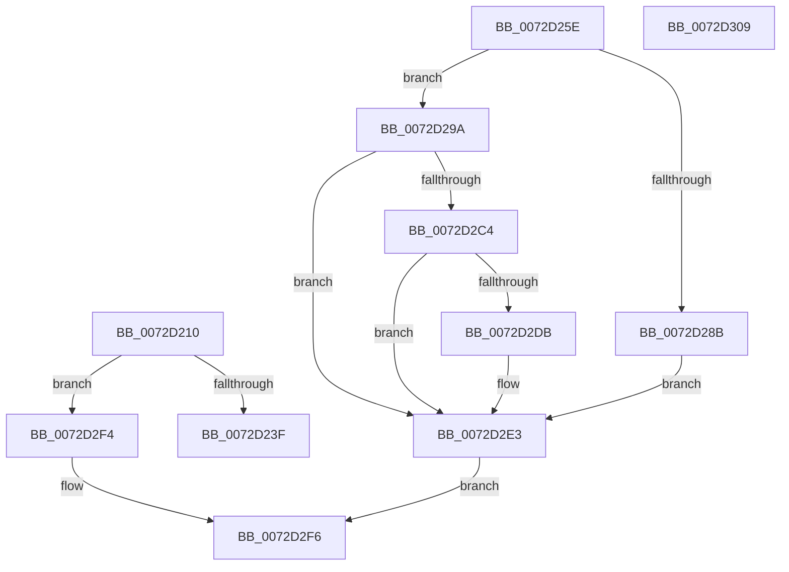

# PnpQueryRemoveLockedDeviceNode

- RVA: `0x0072D210`–`0x0072D32B` (길이 `283` bytes)
- VA: `0x000000014072D210`
- 실행 섹션: `PAGE`
- PDB 이름 있음: `예`; PDB Function 태그: `아니요`
- unwind 정보 RVA: `0x000C8780`
- 디코드: `88`개 명령, `283/283` bytes 표시
- 미해석 바이트: `2` (있으면 어셈블리에 `.byte`로 보존)

> 이 문서는 커널 이미지의 기계어와 PDB 기호를 분석해 생성했습니다. 4번과 5번은 함수 원형과 자료형을 바이너리 사용 방식에서 추정한 C 해석이며 원본 소스 복구 결과는 아닙니다.

## 1. Dependencies

- 직접 호출 지점: **7**; 고유 호출 대상: **7**
- 직접 호출자로 확인된 함수: **1**
- RIP 상대 이미지 참조: **1**

### Outgoing calls
- `0x0072D269` → [PipSetDevNodeUserFlags](../8F/PipSetDevNodeUserFlags_function_008FB8FC.md) (function, `0x008FB8FC`)
- `0x0072D280` → [PiIrpQueryRemoveDevice](../73/PiIrpQueryRemoveDevice_function_0073E088.md) (function, `0x0073E088`)
- `0x0072D293` → [PipSetDevNodeState](../../text/47/PipSetDevNodeState_function_00470708.md) (function, `0x00470708`)
- `0x0072D2A2` → [IopRemoveDevice](../8F/IopRemoveDevice_function_008FC7FC.md) (function, `0x008FC7FC`)
- `0x0072D2B5` → [RtlCopyUnicodeString](../../text/3F/RtlCopyUnicodeString_function_003FEF30.md) (function, `0x003FEF30`)
- `0x0072D2DE` → [RtlAppendUnicodeStringToString](../../text/40/RtlAppendUnicodeStringToString_function_0040FA50.md) (function, `0x0040FA50`)
- `0x0072D2EB` → [PipClearDevNodeUserFlags](../A2/PipClearDevNodeUserFlags_function_00A2ABC4.md) (function, `0x00A2ABC4`)

### Direct callers
- [PnpDeleteLockedDeviceNode](../A0/PnpDeleteLockedDeviceNode_function_00A09DC4.md) at `0x00A09E86`

### Static image references
- `0x0072D23F` → RVA `0x00000000` (`image boundary/outside`; read)

## 2. Other-region calls and transfers

- 다른 실행 섹션으로 향하는 call: **3**
  - `0x0072D293` → [PipSetDevNodeState](../../text/47/PipSetDevNodeState_function_00470708.md) (`PAGE` → `.text`)
  - `0x0072D2B5` → [RtlCopyUnicodeString](../../text/3F/RtlCopyUnicodeString_function_003FEF30.md) (`PAGE` → `.text`)
  - `0x0072D2DE` → [RtlAppendUnicodeStringToString](../../text/40/RtlAppendUnicodeStringToString_function_0040FA50.md) (`PAGE` → `.text`)
- 별도 외부 분기/꼬리 이동을 확인하지 못했습니다.

## 3. Assembly (complete function range)

```asm
0072D210  48 89 5C 24 10                  mov qword ptr [rsp + 0x10], rbx
0072D215  48 89 6C 24 18                  mov qword ptr [rsp + 0x18], rbp
0072D21A  56                              push rsi
0072D21B  57                              push rdi
0072D21C  41 56                           push r14
0072D21E  48 83 EC 20                     sub rsp, 0x20
0072D222  8B 81 2C 01 00 00               mov eax, dword ptr [rcx + 0x12c]
0072D228  49 8B F8                        mov rdi, r8
0072D22B  05 00 FD FF FF                  add eax, 0xfffffd00
0072D230  4C 8B F2                        mov r14, rdx
0072D233  48 8B D9                        mov rbx, rcx
0072D236  83 F8 16                        cmp eax, 0x16
0072D239  0F 87 B5 00 00 00               ja 0x14072d2f4
0072D23F  48 8D 0D BA 2D 8D FF            lea rcx, [rip - 0x72d246]
0072D246  48 98                           cdqe
0072D248  0F B6 84 01 14 D3 72 00         movzx eax, byte ptr [rcx + rax + 0x72d314]
0072D250  44 8B 8C 81 0C D3 72 00         mov r9d, dword ptr [rcx + rax*4 + 0x72d30c]
0072D258  4C 03 C9                        add r9, rcx
0072D25B  41 FF E1                        jmp r9
0072D25E  CC                              int3
0072D25F  CC                              int3
0072D260  CC                              int3
0072D261  BA 00 02 00 00                  mov edx, 0x200
0072D266  48 8B CB                        mov rcx, rbx
0072D269  E8 8E E6 1C 00                  call 0x1408fb8fc
0072D26E  48 8B 6B 20                     mov rbp, qword ptr [rbx + 0x20]
0072D272  48 8D 54 24 40                  lea rdx, [rsp + 0x40]
0072D277  48 83 64 24 40 00               and qword ptr [rsp + 0x40], 0
0072D27D  48 8B CD                        mov rcx, rbp
0072D280  E8 03 0E 01 00                  call 0x14073e088
0072D285  8B F0                           mov esi, eax
0072D287  85 C0                           test eax, eax
0072D289  78 0F                           js 0x14072d29a
0072D28B  BA 12 03 00 00                  mov edx, 0x312
0072D290  48 8B CB                        mov rcx, rbx
0072D293  E8 70 34 D4 FF                  call 0x140470708
0072D298  EB 49                           jmp 0x14072d2e3
0072D29A  BA 03 00 00 00                  mov edx, 3
0072D29F  48 8B CD                        mov rcx, rbp
0072D2A2  E8 55 F5 1C 00                  call 0x1408fc7fc
0072D2A7  48 8D 53 28                     lea rdx, [rbx + 0x28]
0072D2AB  41 C7 06 06 00 00 00            mov dword ptr [r14], 6
0072D2B2  48 8B CF                        mov rcx, rdi
0072D2B5  E8 76 1C CD FF                  call 0x1403fef30
0072D2BA  48 8B 54 24 40                  mov rdx, qword ptr [rsp + 0x40]
0072D2BF  48 85 D2                        test rdx, rdx
0072D2C2  74 1F                           je 0x14072d2e3
0072D2C4  0F B7 07                        movzx eax, word ptr [rdi]
0072D2C7  48 83 C2 38                     add rdx, 0x38
0072D2CB  0F B7 4F 02                     movzx ecx, word ptr [rdi + 2]
0072D2CF  2B C8                           sub ecx, eax
0072D2D1  0F B7 02                        movzx eax, word ptr [rdx]
0072D2D4  83 C0 04                        add eax, 4
0072D2D7  3B C8                           cmp ecx, eax
0072D2D9  7C 08                           jl 0x14072d2e3
0072D2DB  48 8B CF                        mov rcx, rdi
0072D2DE  E8 6D 27 CE FF                  call 0x14040fa50
0072D2E3  BA 00 02 00 00                  mov edx, 0x200
0072D2E8  48 8B CB                        mov rcx, rbx
0072D2EB  E8 D4 D8 2F 00                  call 0x140a2abc4
0072D2F0  8B C6                           mov eax, esi
0072D2F2  EB 02                           jmp 0x14072d2f6
0072D2F4  33 C0                           xor eax, eax
0072D2F6  48 8B 5C 24 48                  mov rbx, qword ptr [rsp + 0x48]
0072D2FB  48 8B 6C 24 50                  mov rbp, qword ptr [rsp + 0x50]
0072D300  48 83 C4 20                     add rsp, 0x20
0072D304  41 5E                           pop r14
0072D306  5F                              pop rdi
0072D307  5E                              pop rsi
0072D308  C3                              ret
0072D309  CC                              int3
0072D30A  66 90                           nop
0072D30C  F4                              hlt
0072D30D  D2 72 00                        sal byte ptr [rdx], cl
0072D310  61                              .byte 0x61
0072D311  D2 72 00                        sal byte ptr [rdx], cl
0072D314  00 00                           add byte ptr [rax], al
0072D316  00 00                           add byte ptr [rax], al
0072D318  00 01                           add byte ptr [rcx], al
0072D31A  01 00                           add dword ptr [rax], eax
0072D31C  01 01                           add dword ptr [rcx], eax
0072D31E  01 00                           add dword ptr [rax], eax
0072D320  00 00                           add byte ptr [rax], al
0072D322  00 00                           add byte ptr [rax], al
0072D324  00 00                           add byte ptr [rax], al
0072D326  00 00                           add byte ptr [rax], al
0072D328  00 00                           add byte ptr [rax], al
0072D32A  00                              .byte 0x00
```

## 4. C-style interpretation (structured pseudocode)

```c
__int64 __fastcall PnpQueryRemoveLockedDeviceNode(__int64 a1, __int64 a2, __int64 a3)
{
    __int64 result;
    __int64 v_rsp;
    unsigned __int64 v_stack_p10;
    unsigned __int64 v_stack_p18;
    unsigned __int64 v_stack_p8;

    v_stack_p10 = v_rbx;
    v_stack_p18 = v_rbp;
    v_rsp = (v_rsp) - (32);
    result = (unsigned int)(((unsigned int)(*(unsigned int *)(a1 + 300))) + (0xFFFFFD00ULL));
    if (((unsigned int)(result)) > 22) goto loc_0072D2F4;
    a4 = ((unsigned int)(*(unsigned int *)(v_rip - 7524934 + *(unsigned __int8 *)(v_rip - 7524934 + result * 1 + 7525140) * 4 + 7525132))) + (v_rip - 7524934);
loc_0072D2F4:
    result = 0;
loc_0072D2F6:
    v_rsp = (v_rsp) + (32);
    return result;
}
```

## 5. (Beta) C Style

```c
int64_t PnpQueryRemoveLockedDeviceNode(void *Arg1, int64_t Arg2, int64_t Arg3)
{
    uint8_t *arg1 = (uint8_t *)Arg1;

    int64_t result;
    int64_t local_rsp;
    uint64_t v_stack_p10;
    uint64_t v_stack_p18;
    uint64_t v_stack_p8;

    v_stack_p10 = local_rbx;
    v_stack_p18 = local_rbp;
    local_rsp = (local_rsp) - (32);
    result = (uint32_t)(((uint32_t)(*(uint32_t *)(arg1 + 0x12C))) + (0xFFFFFD00ULL));
    if (((uint32_t)(result)) > 22) goto loc_0072D2F4;
    a4 = ((uint32_t)(*(uint32_t *)(v_rip - 0x72D246 + *(uint8_t *)(v_rip - 0x72D246 + result * 1 + 0x72D314) * 4 + 0x72D30C))) + (v_rip - 7524934);
loc_0072D2F4:
    result = 0;
loc_0072D2F6:
    local_rsp = (local_rsp) + (32);
    return result;
}
```

### 관측된 메모리 오프셋

구조체 형식이 확인되지 않은 접근은 인자 기준의 오프셋으로만 기록했습니다.

| 기준 인자 | 오프셋 표현 | 폭 (bit) | 접근 |
|---|---:|---:|---|
| `Arg1` | `+ 0x12C` | `32` | `R` |

## 6. Execution-region graph

[열기: 2D/3D 그래프와 함수 탐색 컨트롤 패널](../../../control-panel.html?section=page&rva=0x0072D210&view=graph)

- 2D 그래프는 위에서 아래로 흐르고, 3D 그래프는 빈 공간을 드래그해 회전합니다. Shift+드래그는 이동, 휠은 확대·축소, 함수 노드 선택은 대상 보고서 이동입니다.

### Static fallback


