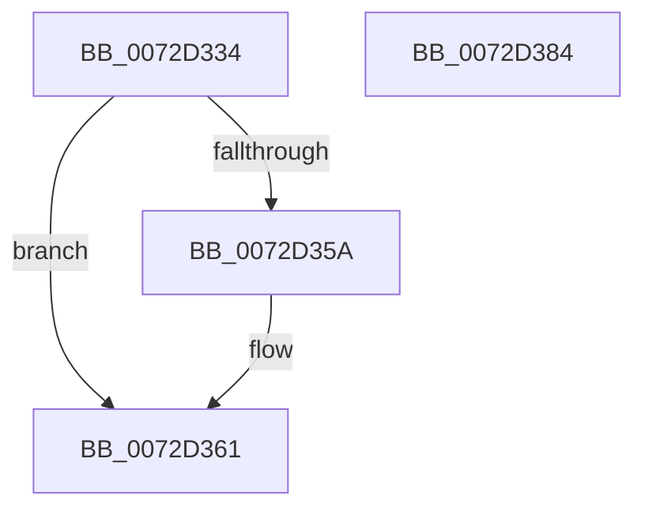

# PnpQueuePendingEject

- RVA: `0x0072D334`–`0x0072D385` (길이 `81` bytes)
- VA: `0x000000014072D334`
- 실행 섹션: `PAGE`
- PDB 이름 있음: `예`; PDB Function 태그: `아니요`
- unwind 정보 RVA: `0x0005CF00`
- 디코드: `22`개 명령, `81/81` bytes 표시
- 미해석 바이트: `0` (있으면 어셈블리에 `.byte`로 보존)

> 이 문서는 커널 이미지의 기계어와 PDB 기호를 분석해 생성했습니다. 4번과 5번은 함수 원형과 자료형을 바이너리 사용 방식에서 추정한 C 해석이며 원본 소스 복구 결과는 아닙니다.

## 1. Dependencies

- 직접 호출 지점: **2**; 고유 호출 대상: **2**
- 직접 호출자로 확인된 함수: **1**
- RIP 상대 이미지 참조: **3**

### Outgoing calls
- `0x0072D342` → [PpDevNodeLockTree](../A1/PpDevNodeLockTree_function_00A19310.md) (function, `0x00A19310`)
- `0x0072D377` → [PpDevNodeUnlockTree](../A2/PpDevNodeUnlockTree_function_00A21290.md) (function, `0x00A21290`)

### Direct callers
- [IopEjectDevice](../73/IopEjectDevice_function_0073DC84.md) at `0x0073DCCF`
- [IopEjectDevice](../73/IopEjectDevice_function_0073DC84.md) at `0x0073DD5E`
- [IopEjectDevice](../73/IopEjectDevice_function_0073DC84.md) at `0x0073DDEC`

### Static image references
- `0x0072D347` → RVA `0x00F8C458` (`.data`; read)
- `0x0072D34E` → RVA `0x00F8C450` (`.data`; read)
- `0x0072D370` → RVA `0x00F8C458` (`.data`; write)

## 2. Other-region calls and transfers

- 다른 실행 섹션으로 향하는 call: **0**
- 별도 외부 분기/꼬리 이동을 확인하지 못했습니다.

## 3. Assembly (complete function range)

```asm
0072D334  40 53                           push rbx
0072D336  48 83 EC 20                     sub rsp, 0x20
0072D33A  48 8B D9                        mov rbx, rcx
0072D33D  B9 01 00 00 00                  mov ecx, 1
0072D342  E8 C9 BF 2E 00                  call 0x140a19310
0072D347  48 8B 05 0A F1 85 00            mov rax, qword ptr [rip + 0x85f10a]
0072D34E  48 8D 0D FB F0 85 00            lea rcx, [rip + 0x85f0fb]
0072D355  48 39 08                        cmp qword ptr [rax], rcx
0072D358  74 07                           je 0x14072d361
0072D35A  B9 03 00 00 00                  mov ecx, 3
0072D35F  CD 29                           int 0x29
0072D361  48 89 0B                        mov qword ptr [rbx], rcx
0072D364  B9 01 00 00 00                  mov ecx, 1
0072D369  48 89 43 08                     mov qword ptr [rbx + 8], rax
0072D36D  48 89 18                        mov qword ptr [rax], rbx
0072D370  48 89 1D E1 F0 85 00            mov qword ptr [rip + 0x85f0e1], rbx
0072D377  E8 14 3F 2F 00                  call 0x140a21290
0072D37C  B0 01                           mov al, 1
0072D37E  48 83 C4 20                     add rsp, 0x20
0072D382  5B                              pop rbx
0072D383  C3                              ret
0072D384  CC                              int3
```

## 4. C-style interpretation (structured pseudocode)

```c
__int64 __fastcall PnpQueuePendingEject(__int64 a1)
{
    __int64 result;
    __int64 v_rsp;

    v_rsp = (v_rsp) - (32);
    result = PpDevNodeLockTree(1, a2, a3, a4);
    if ((*(unsigned __int64 *)(*(unsigned __int64 *)(v_rip + 8777994))) != (v_rip + 8777979)) {
        a1 = 3;
    }
    *(unsigned __int64 *)(a1) = a1;
    *(unsigned __int64 *)(a1 + 8) = *(unsigned __int64 *)(v_rip + 8777994);
    *(unsigned __int64 *)(*(unsigned __int64 *)(v_rip + 8777994)) = a1;
    *(unsigned __int64 *)(v_rip + 8777953) = a1;
    result = PpDevNodeUnlockTree(1, a2, a3, a4);
    v_rsp = (v_rsp) + (32);
    return 1;
}
```

## 5. (Beta) C Style

```c
int64_t PnpQueuePendingEject(void *Arg1)
{
    uint8_t *arg1 = (uint8_t *)Arg1;

    int64_t result;
    int64_t local_rsp;

    local_rsp = (local_rsp) - (32);
    result = PpDevNodeLockTree(1, a2, a3, a4);
    if ((*(uint64_t *)(*(uint64_t *)(v_rip + 0x85F10A))) != (v_rip + 8777979)) {
        Arg1 = 3;
    }
    *(void **)(arg1) = Arg1;
    *(uint64_t *)(arg1 + 0x8) = *(uint64_t *)(v_rip + 0x85F10A);
    *(void **)(*(uint64_t *)(v_rip + 0x85F10A)) = Arg1;
    *(void **)(v_rip + 0x85F0E1) = Arg1;
    result = PpDevNodeUnlockTree(1, a2, a3, a4);
    local_rsp = (local_rsp) + (32);
    return 1;
}
```

### 관측된 메모리 오프셋

구조체 형식이 확인되지 않은 접근은 인자 기준의 오프셋으로만 기록했습니다.

| 기준 인자 | 오프셋 표현 | 폭 (bit) | 접근 |
|---|---:|---:|---|
| `Arg1` | `+ 0x0` | `64` | `W` |
| `Arg1` | `+ 0x8` | `64` | `W` |

## 6. Execution-region graph

[열기: 2D/3D 그래프와 함수 탐색 컨트롤 패널](../../../control-panel.html?section=page&rva=0x0072D334&view=graph)

- 2D 그래프는 위에서 아래로 흐르고, 3D 그래프는 빈 공간을 드래그해 회전합니다. Shift+드래그는 이동, 휠은 확대·축소, 함수 노드 선택은 대상 보고서 이동입니다.

### Static fallback


