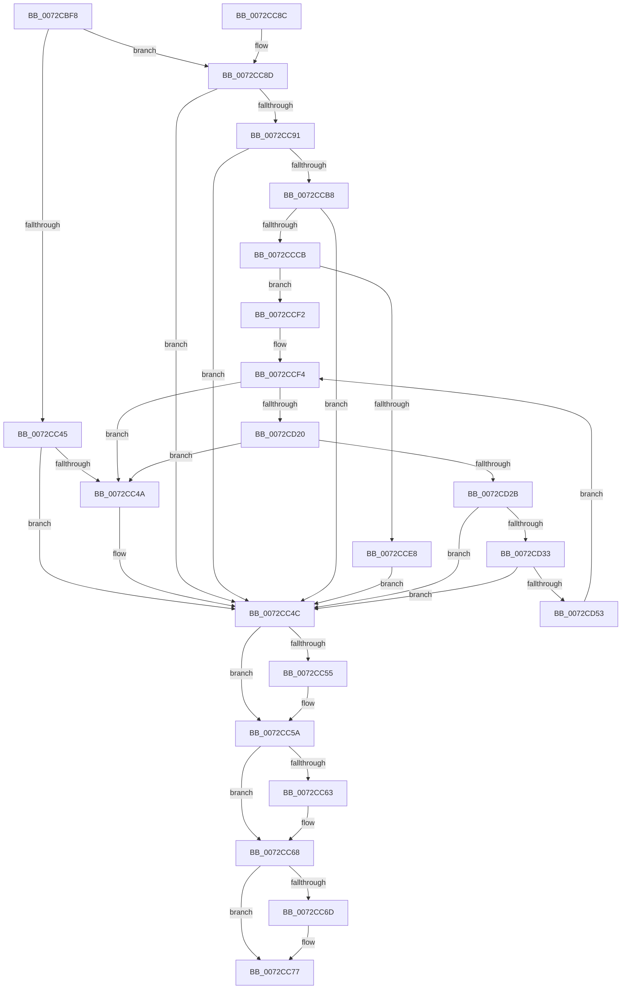

# PnpRegCopyKeySecurityTree

- RVA: `0x0072CBF8`–`0x0072CD57` (길이 `351` bytes)
- VA: `0x000000014072CBF8`
- 실행 섹션: `PAGE`
- PDB 이름 있음: `예`; PDB Function 태그: `아니요`
- unwind 정보 RVA: `0x000C8768`
- 디코드: `101`개 명령, `351/351` bytes 표시
- 미해석 바이트: `0` (있으면 어셈블리에 `.byte`로 보존)

> 이 문서는 커널 이미지의 기계어와 PDB 기호를 분석해 생성했습니다. 4번과 5번은 함수 원형과 자료형을 바이너리 사용 방식에서 추정한 C 해석이며 원본 소스 복구 결과는 아닙니다.

## 1. Dependencies

- 직접 호출 지점: **9**; 고유 호출 대상: **7**
- 직접 호출자로 확인된 함수: **2**
- RIP 상대 이미지 참조: **0**

### Outgoing calls
- `0x0072CC37` → [PnpCtxRegOpenKey](../8E/PnpCtxRegOpenKey_function_008EF7B8.md) (function, `0x008EF7B8`)
- `0x0072CC55` → [ZwClose](../../text/6A/ZwClose_function_006AD2B0.md) (function, `0x006AD2B0`)
- `0x0072CC63` → [ZwClose](../../text/6A/ZwClose_function_006AD2B0.md) (function, `0x006AD2B0`)
- `0x0072CC72` → [ExFreePoolWithTag](../../poolcode/B8/ExFreePoolWithTag_function_00B82870.md) (function, `0x00B82870`)
- `0x0072CCAD` → [PnpCtxRegOpenKey](../8E/PnpCtxRegOpenKey_function_008EF7B8.md) (function, `0x008EF7B8`)
- `0x0072CCC0` → [PnpRegCopyKeySecurity](PnpRegCopyKeySecurity_function_0072CAC8.md) (function, `0x0072CAC8`)
- `0x0072CCDB` → [ExAllocatePool2](../../poolcode/B8/ExAllocatePool2_function_00B820F0.md) (function, `0x00B820F0`)
- `0x0072CD0E` → [PnpCtxRegEnumKey](../99/PnpCtxRegEnumKey_function_009929C0.md) (function, `0x009929C0`)
- `0x0072CD44` → [PnpRegCopyKeySecurityTree](PnpRegCopyKeySecurityTree_function_0072CBF8.md) (function, `0x0072CBF8`)

### Direct callers
- [PnpRegCopyKeySecurityTree](PnpRegCopyKeySecurityTree_function_0072CBF8.md) at `0x0072CD44`
- [PipMigrateServiceCallback](../../init/C3/PipMigrateServiceCallback_function_00C31E60.md) at `0x00C31F38`

### Static image references
- 디코드된 RIP-relative 메모리 참조가 없습니다.

## 2. Other-region calls and transfers

- 다른 실행 섹션으로 향하는 call: **4**
  - `0x0072CC55` → [ZwClose](../../text/6A/ZwClose_function_006AD2B0.md) (`PAGE` → `.text`)
  - `0x0072CC63` → [ZwClose](../../text/6A/ZwClose_function_006AD2B0.md) (`PAGE` → `.text`)
  - `0x0072CC72` → [ExFreePoolWithTag](../../poolcode/B8/ExFreePoolWithTag_function_00B82870.md) (`PAGE` → `POOLCODE`)
  - `0x0072CCDB` → [ExAllocatePool2](../../poolcode/B8/ExAllocatePool2_function_00B820F0.md) (`PAGE` → `POOLCODE`)
- 별도 외부 분기/꼬리 이동을 확인하지 못했습니다.

## 3. Assembly (complete function range)

```asm
0072CBF8  4C 8B DC                        mov r11, rsp
0072CBFB  49 89 5B 08                     mov qword ptr [r11 + 8], rbx
0072CBFF  49 89 73 10                     mov qword ptr [r11 + 0x10], rsi
0072CC03  45 89 4B 20                     mov dword ptr [r11 + 0x20], r9d
0072CC07  55                              push rbp
0072CC08  57                              push rdi
0072CC09  41 56                           push r14
0072CC0B  48 8B EC                        mov rbp, rsp
0072CC0E  48 83 EC 40                     sub rsp, 0x40
0072CC12  48 8D 45 F0                     lea rax, [rbp - 0x10]
0072CC16  4C 8B F1                        mov r14, rcx
0072CC19  33 FF                           xor edi, edi
0072CC1B  49 89 43 D0                     mov qword ptr [r11 - 0x30], rax
0072CC1F  48 21 7D F8                     and qword ptr [rbp - 8], rdi
0072CC23  45 33 C9                        xor r9d, r9d
0072CC26  48 21 7D F0                     and qword ptr [rbp - 0x10], rdi
0072CC2A  33 C9                           xor ecx, ecx
0072CC2C  C7 44 24 20 1F 00 02 00         mov dword ptr [rsp + 0x20], 0x2001f
0072CC34  49 8B F0                        mov rsi, r8
0072CC37  E8 7C 2B 1C 00                  call 0x1408ef7b8
0072CC3C  8B D8                           mov ebx, eax
0072CC3E  3D 34 00 00 C0                  cmp eax, 0xc0000034
0072CC43  75 48                           jne 0x14072cc8d
0072CC45  48 85 F6                        test rsi, rsi
0072CC48  74 02                           je 0x14072cc4c
0072CC4A  33 DB                           xor ebx, ebx
0072CC4C  48 8B 4D F0                     mov rcx, qword ptr [rbp - 0x10]
0072CC50  48 85 C9                        test rcx, rcx
0072CC53  74 05                           je 0x14072cc5a
0072CC55  E8 56 06 F8 FF                  call 0x1406ad2b0
0072CC5A  48 8B 4D F8                     mov rcx, qword ptr [rbp - 8]
0072CC5E  48 85 C9                        test rcx, rcx
0072CC61  74 05                           je 0x14072cc68
0072CC63  E8 48 06 F8 FF                  call 0x1406ad2b0
0072CC68  48 85 FF                        test rdi, rdi
0072CC6B  74 0A                           je 0x14072cc77
0072CC6D  33 D2                           xor edx, edx
0072CC6F  48 8B CF                        mov rcx, rdi
0072CC72  E8 F9 5B 45 00                  call 0x140b82870
0072CC77  48 8B 74 24 68                  mov rsi, qword ptr [rsp + 0x68]
0072CC7C  8B C3                           mov eax, ebx
0072CC7E  48 8B 5C 24 60                  mov rbx, qword ptr [rsp + 0x60]
0072CC83  48 83 C4 40                     add rsp, 0x40
0072CC87  41 5E                           pop r14
0072CC89  5F                              pop rdi
0072CC8A  5D                              pop rbp
0072CC8B  C3                              ret
0072CC8C  CC                              int3
0072CC8D  85 C0                           test eax, eax
0072CC8F  78 BB                           js 0x14072cc4c
0072CC91  48 8D 45 F8                     lea rax, [rbp - 8]
0072CC95  45 33 C9                        xor r9d, r9d
0072CC98  48 89 44 24 28                  mov qword ptr [rsp + 0x28], rax
0072CC9D  4C 8B C6                        mov r8, rsi
0072CCA0  49 8B D6                        mov rdx, r14
0072CCA3  C7 44 24 20 1F 00 02 00         mov dword ptr [rsp + 0x20], 0x2001f
0072CCAB  33 C9                           xor ecx, ecx
0072CCAD  E8 06 2B 1C 00                  call 0x1408ef7b8
0072CCB2  8B D8                           mov ebx, eax
0072CCB4  85 C0                           test eax, eax
0072CCB6  78 94                           js 0x14072cc4c
0072CCB8  48 8B 55 F0                     mov rdx, qword ptr [rbp - 0x10]
0072CCBC  48 8B 4D F8                     mov rcx, qword ptr [rbp - 8]
0072CCC0  E8 03 FE FF FF                  call 0x14072cac8
0072CCC5  8B D8                           mov ebx, eax
0072CCC7  85 C0                           test eax, eax
0072CCC9  78 81                           js 0x14072cc4c
0072CCCB  BA 00 04 00 00                  mov edx, 0x400
0072CCD0  B9 00 01 00 00                  mov ecx, 0x100
0072CCD5  41 B8 50 70 73 75               mov r8d, 0x75737050
0072CCDB  E8 10 54 45 00                  call 0x140b820f0
0072CCE0  48 8B F8                        mov rdi, rax
0072CCE3  48 85 C0                        test rax, rax
0072CCE6  75 0A                           jne 0x14072ccf2
0072CCE8  BB 9A 00 00 C0                  mov ebx, 0xc000009a
0072CCED  E9 5A FF FF FF                  jmp 0x14072cc4c
0072CCF2  33 F6                           xor esi, esi
0072CCF4  48 8B 55 F0                     mov rdx, qword ptr [rbp - 0x10]
0072CCF8  48 8D 45 38                     lea rax, [rbp + 0x38]
0072CCFC  4C 8B CF                        mov r9, rdi
0072CCFF  48 89 44 24 20                  mov qword ptr [rsp + 0x20], rax
0072CD04  44 8B C6                        mov r8d, esi
0072CD07  C7 45 38 00 02 00 00            mov dword ptr [rbp + 0x38], 0x200
0072CD0E  E8 AD 5C 26 00                  call 0x1409929c0
0072CD13  8B D8                           mov ebx, eax
0072CD15  3D 1A 00 00 80                  cmp eax, 0x8000001a
0072CD1A  0F 84 2A FF FF FF               je 0x14072cc4a
0072CD20  3D 7C 01 00 C0                  cmp eax, 0xc000017c
0072CD25  0F 84 1F FF FF FF               je 0x14072cc4a
0072CD2B  85 C0                           test eax, eax
0072CD2D  0F 88 19 FF FF FF               js 0x14072cc4c
0072CD33  48 8B 55 F0                     mov rdx, qword ptr [rbp - 0x10]
0072CD37  41 B9 07 00 00 00               mov r9d, 7
0072CD3D  48 8B 4D F8                     mov rcx, qword ptr [rbp - 8]
0072CD41  4C 8B C7                        mov r8, rdi
0072CD44  E8 AF FE FF FF                  call 0x14072cbf8
0072CD49  8B D8                           mov ebx, eax
0072CD4B  85 C0                           test eax, eax
0072CD4D  0F 88 F9 FE FF FF               js 0x14072cc4c
0072CD53  FF C6                           inc esi
0072CD55  EB 9D                           jmp 0x14072ccf4
```

## 4. C-style interpretation (structured pseudocode)

```c
__int64 __fastcall PnpRegCopyKeySecurityTree(__int64 a1, int a2, __int64 a3, int a4)
{
    __int64 result;
    __int64 v_rbx;
    __int64 v_rdi;
    __int64 v_rsi;
    __int64 v_rsp;
    unsigned __int64 v_stack_m20;
    unsigned __int64 v_stack_m28;
    unsigned int v_stack_m38;
    unsigned __int64 v_stack_p10;
    unsigned int v_stack_p20;
    unsigned __int64 v_stack_p28;
    unsigned __int64 v_stack_p8;

    *(unsigned __int64 *)(v_rsp + 8) = v_rbx;
    *(unsigned __int64 *)(v_rsp + 16) = v_rsi;
    *(unsigned int *)(v_rsp + 32) = a4;
    v_rsp = (v_rsp) - (64);
    v_rdi = 0;
    *(unsigned __int64 *)(v_rsp - 48) = v_stack_m28;
    a4 = 0;
    a1 = 0;
    v_stack_m38 = 0x2001FULL;
    result = PnpCtxRegOpenKey(a1, a2, a3, a4);
    if (((unsigned int)(result)) != 0xC0000034ULL) goto loc_0072CC8D;
    v_rbx = (unsigned int)((unsigned int)(result));
    if (a3 != 0) {
        v_rbx = 0;
    }
    if (v_stack_m28 != 0) {
        result = ZwClose(v_stack_m28, a2, a3, a4);
    }
    if (v_stack_m20 != 0) {
        result = ZwClose(v_stack_m20, a2, a3, a4);
    }
    if (0 != 0) {
        a2 = 0;
        a1 = 0;
        result = ExFreePoolWithTag(a1, a2, a3, a4);
    }
    v_rsp = (v_rsp) + (64);
    return 0;
loc_0072CC8D:
    if (sign_flag) goto loc_0072CC4C;
    a4 = 0;
    v_stack_p28 = v_stack_m20;
    v_stack_p20 = 0x2001FULL;
    a1 = 0;
    result = PnpCtxRegOpenKey(a1, a1, v_stack_p10, a4);
    if (sign_flag) goto loc_0072CC4C;
    result = PnpRegCopyKeySecurity(v_stack_m20, v_stack_m28, v_stack_p10, a4);
    if (sign_flag) goto loc_0072CC4C;
    result = ExAllocatePool2(256, (unsigned int)(0x400ULL), (unsigned int)(0x75737050ULL), a4);
    if (result != 0) goto loc_0072CCF2;
    goto loc_0072CC4C;
loc_0072CCF2:
    v_rsi = 0;
loc_0072CCF4:
    v_stack_p20 = v_stack_p20;
    v_stack_p20 = 512;
    result = PnpCtxRegEnumKey(256, v_stack_m28, 0, result);
    if (((unsigned int)(result)) == 0x8000001AULL) goto loc_0072CC4A;
    if (((unsigned int)(result)) == 0xC000017CULL) goto loc_0072CC4A;
    if (sign_flag) goto loc_0072CC4C;
    result = PnpRegCopyKeySecurityTree(v_stack_m20, v_stack_m28, result, 7);
    if (sign_flag) goto loc_0072CC4C;
    v_rsi = (unsigned int)((v_rsi) + 1);
    goto loc_0072CCF4;
}
```

## 5. (Beta) C Style

```c
int64_t PnpRegCopyKeySecurityTree(int64_t Arg1, int32_t Arg2, int64_t Arg3, int32_t Arg4)
{
    int64_t result;
    int64_t local_rbx;
    int64_t local_rdi;
    int64_t local_rsi;
    int64_t local_rsp;
    uint64_t v_stack_m20;
    uint64_t v_stack_m28;
    uint32_t v_stack_m38;
    uint64_t v_stack_p10;
    uint32_t v_stack_p20;
    uint64_t v_stack_p28;
    uint64_t v_stack_p8;

    *(uint64_t *)(local_rsp + 0x8) = local_rbx;
    *(uint64_t *)(local_rsp + 0x10) = local_rsi;
    *(uint32_t *)(local_rsp + 0x20) = Arg4;
    local_rsp = (local_rsp) - (64);
    local_rdi = 0;
    *(uint64_t *)(local_rsp - 0x30) = v_stack_m28;
    Arg4 = 0;
    Arg1 = 0;
    v_stack_m38 = 0x2001FULL;
    result = PnpCtxRegOpenKey(Arg1, Arg2, Arg3, Arg4);
    if (((uint32_t)(result)) != 0xC0000034ULL) goto loc_0072CC8D;
    local_rbx = (uint32_t)((uint32_t)(result));
    if (Arg3 != 0) {
        local_rbx = 0;
    }
    if (v_stack_m28 != 0) {
        result = ZwClose(v_stack_m28, Arg2, Arg3, Arg4);
    }
    if (v_stack_m20 != 0) {
        result = ZwClose(v_stack_m20, Arg2, Arg3, Arg4);
    }
    if (0 != 0) {
        Arg2 = 0;
        Arg1 = 0;
        result = ExFreePoolWithTag(Arg1, Arg2, Arg3, Arg4);
    }
    local_rsp = (local_rsp) + (64);
    return 0;
loc_0072CC8D:
    if (sign_flag) goto loc_0072CC4C;
    Arg4 = 0;
    v_stack_p28 = v_stack_m20;
    v_stack_p20 = 0x2001FULL;
    Arg1 = 0;
    result = PnpCtxRegOpenKey(Arg1, Arg1, v_stack_p10, Arg4);
    if (sign_flag) goto loc_0072CC4C;
    result = PnpRegCopyKeySecurity(v_stack_m20, v_stack_m28, v_stack_p10, Arg4);
    if (sign_flag) goto loc_0072CC4C;
    result = ExAllocatePool2(256, (uint32_t)(0x400ULL), (uint32_t)(0x75737050ULL), Arg4);
    if (result != 0) goto loc_0072CCF2;
    goto loc_0072CC4C;
loc_0072CCF2:
    local_rsi = 0;
loc_0072CCF4:
    v_stack_p20 = v_stack_p20;
    v_stack_p20 = 512;
    result = PnpCtxRegEnumKey(256, v_stack_m28, 0, result);
    if (((uint32_t)(result)) == 0x8000001AULL) goto loc_0072CC4A;
    if (((uint32_t)(result)) == 0xC000017CULL) goto loc_0072CC4A;
    if (sign_flag) goto loc_0072CC4C;
    result = PnpRegCopyKeySecurityTree(v_stack_m20, v_stack_m28, result, 7);
    if (sign_flag) goto loc_0072CC4C;
    local_rsi = (uint32_t)((local_rsi) + 1);
    goto loc_0072CCF4;
}
```

## 6. Execution-region graph

[열기: 2D/3D 그래프와 함수 탐색 컨트롤 패널](../../../control-panel.html?section=page&rva=0x0072CBF8&view=graph)

- 2D 그래프는 위에서 아래로 흐르고, 3D 그래프는 빈 공간을 드래그해 회전합니다. Shift+드래그는 이동, 휠은 확대·축소, 함수 노드 선택은 대상 보고서 이동입니다.

### Static fallback


