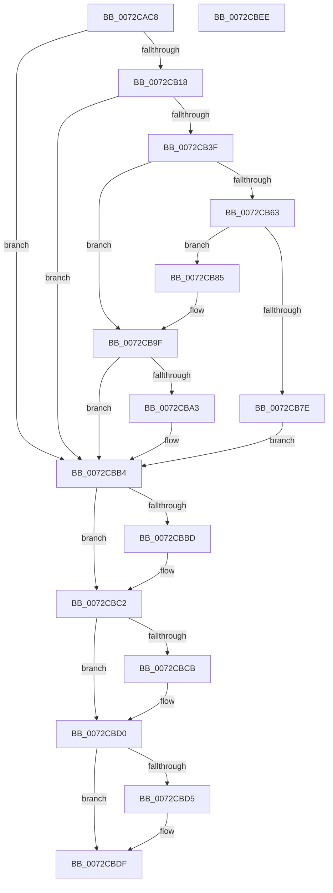

# PnpRegCopyKeySecurity

- RVA: `0x0072CAC8`–`0x0072CBEF` (길이 `295` bytes)
- VA: `0x000000014072CAC8`
- 실행 섹션: `PAGE`
- PDB 이름 있음: `예`; PDB Function 태그: `아니요`
- unwind 정보 RVA: `0x000C86D4`
- 디코드: `88`개 명령, `295/295` bytes 표시
- 미해석 바이트: `0` (있으면 어셈블리에 `.byte`로 보존)

> 이 문서는 커널 이미지의 기계어와 PDB 기호를 분석해 생성했습니다. 4번과 5번은 함수 원형과 자료형을 바이너리 사용 방식에서 추정한 C 해석이며 원본 소스 복구 결과는 아닙니다.

## 1. Dependencies

- 직접 호출 지점: **9**; 고유 호출 대상: **6**
- 직접 호출자로 확인된 함수: **1**
- RIP 상대 이미지 참조: **0**

### Outgoing calls
- `0x0072CB09` → [PnpCtxRegOpenKey](../8E/PnpCtxRegOpenKey_function_008EF7B8.md) (function, `0x008EF7B8`)
- `0x0072CB34` → [PnpCtxRegOpenKey](../8E/PnpCtxRegOpenKey_function_008EF7B8.md) (function, `0x008EF7B8`)
- `0x0072CB55` → [PnpCtxRegGetKeySecurity](../82/PnpCtxRegGetKeySecurity_function_0082924C.md) (function, `0x0082924C`)
- `0x0072CB71` → [ExAllocatePool2](../../poolcode/B8/ExAllocatePool2_function_00B820F0.md) (function, `0x00B820F0`)
- `0x0072CB98` → [PnpCtxRegGetKeySecurity](../82/PnpCtxRegGetKeySecurity_function_0082924C.md) (function, `0x0082924C`)
- `0x0072CBAD` → [PnpCtxRegSetKeySecurity](../82/PnpCtxRegSetKeySecurity_function_0082929C.md) (function, `0x0082929C`)
- `0x0072CBBD` → [ZwClose](../../text/6A/ZwClose_function_006AD2B0.md) (function, `0x006AD2B0`)
- `0x0072CBCB` → [ZwClose](../../text/6A/ZwClose_function_006AD2B0.md) (function, `0x006AD2B0`)
- `0x0072CBDA` → [ExFreePoolWithTag](../../poolcode/B8/ExFreePoolWithTag_function_00B82870.md) (function, `0x00B82870`)

### Direct callers
- [PnpRegCopyKeySecurityTree](PnpRegCopyKeySecurityTree_function_0072CBF8.md) at `0x0072CCC0`

### Static image references
- 디코드된 RIP-relative 메모리 참조가 없습니다.

## 2. Other-region calls and transfers

- 다른 실행 섹션으로 향하는 call: **4**
  - `0x0072CB71` → [ExAllocatePool2](../../poolcode/B8/ExAllocatePool2_function_00B820F0.md) (`PAGE` → `POOLCODE`)
  - `0x0072CBBD` → [ZwClose](../../text/6A/ZwClose_function_006AD2B0.md) (`PAGE` → `.text`)
  - `0x0072CBCB` → [ZwClose](../../text/6A/ZwClose_function_006AD2B0.md) (`PAGE` → `.text`)
  - `0x0072CBDA` → [ExFreePoolWithTag](../../poolcode/B8/ExFreePoolWithTag_function_00B82870.md) (`PAGE` → `POOLCODE`)
- 별도 외부 분기/꼬리 이동을 확인하지 못했습니다.

## 3. Assembly (complete function range)

```asm
0072CAC8  48 89 5C 24 08                  mov qword ptr [rsp + 8], rbx
0072CACD  44 89 44 24 18                  mov dword ptr [rsp + 0x18], r8d
0072CAD2  55                              push rbp
0072CAD3  56                              push rsi
0072CAD4  57                              push rdi
0072CAD5  48 8B EC                        mov rbp, rsp
0072CAD8  48 83 EC 40                     sub rsp, 0x40
0072CADC  83 65 30 00                     and dword ptr [rbp + 0x30], 0
0072CAE0  48 8D 45 38                     lea rax, [rbp + 0x38]
0072CAE4  48 8B F2                        mov rsi, rdx
0072CAE7  48 89 44 24 28                  mov qword ptr [rsp + 0x28], rax
0072CAEC  48 8B D1                        mov rdx, rcx
0072CAEF  C7 44 24 20 00 00 02 00         mov dword ptr [rsp + 0x20], 0x20000
0072CAF7  33 FF                           xor edi, edi
0072CAF9  33 C9                           xor ecx, ecx
0072CAFB  48 21 7D 38                     and qword ptr [rbp + 0x38], rdi
0072CAFF  45 33 C9                        xor r9d, r9d
0072CB02  48 21 7D F0                     and qword ptr [rbp - 0x10], rdi
0072CB06  45 33 C0                        xor r8d, r8d
0072CB09  E8 AA 2C 1C 00                  call 0x1408ef7b8
0072CB0E  8B D8                           mov ebx, eax
0072CB10  85 C0                           test eax, eax
0072CB12  0F 88 9C 00 00 00               js 0x14072cbb4
0072CB18  48 8D 45 F0                     lea rax, [rbp - 0x10]
0072CB1C  45 33 C9                        xor r9d, r9d
0072CB1F  48 89 44 24 28                  mov qword ptr [rsp + 0x28], rax
0072CB24  45 33 C0                        xor r8d, r8d
0072CB27  48 8B D6                        mov rdx, rsi
0072CB2A  C7 44 24 20 00 00 0C 00         mov dword ptr [rsp + 0x20], 0xc0000
0072CB32  33 C9                           xor ecx, ecx
0072CB34  E8 7F 2C 1C 00                  call 0x1408ef7b8
0072CB39  8B D8                           mov ebx, eax
0072CB3B  85 C0                           test eax, eax
0072CB3D  78 75                           js 0x14072cbb4
0072CB3F  48 8B 55 38                     mov rdx, qword ptr [rbp + 0x38]
0072CB43  48 8D 45 30                     lea rax, [rbp + 0x30]
0072CB47  8D 77 07                        lea esi, [rdi + 7]
0072CB4A  48 89 44 24 20                  mov qword ptr [rsp + 0x20], rax
0072CB4F  44 8B C6                        mov r8d, esi
0072CB52  45 33 C9                        xor r9d, r9d
0072CB55  E8 F2 C6 0F 00                  call 0x14082924c
0072CB5A  8B D8                           mov ebx, eax
0072CB5C  3D 23 00 00 C0                  cmp eax, 0xc0000023
0072CB61  75 3C                           jne 0x14072cb9f
0072CB63  8B 55 30                        mov edx, dword ptr [rbp + 0x30]
0072CB66  B9 00 01 00 00                  mov ecx, 0x100
0072CB6B  41 B8 50 70 73 75               mov r8d, 0x75737050
0072CB71  E8 7A 55 45 00                  call 0x140b820f0
0072CB76  48 8B F8                        mov rdi, rax
0072CB79  48 85 C0                        test rax, rax
0072CB7C  75 07                           jne 0x14072cb85
0072CB7E  BB 9A 00 00 C0                  mov ebx, 0xc000009a
0072CB83  EB 2F                           jmp 0x14072cbb4
0072CB85  48 8B 55 38                     mov rdx, qword ptr [rbp + 0x38]
0072CB89  48 8D 45 30                     lea rax, [rbp + 0x30]
0072CB8D  4C 8B CF                        mov r9, rdi
0072CB90  48 89 44 24 20                  mov qword ptr [rsp + 0x20], rax
0072CB95  44 8B C6                        mov r8d, esi
0072CB98  E8 AF C6 0F 00                  call 0x14082924c
0072CB9D  8B D8                           mov ebx, eax
0072CB9F  85 DB                           test ebx, ebx
0072CBA1  78 11                           js 0x14072cbb4
0072CBA3  48 8B 55 F0                     mov rdx, qword ptr [rbp - 0x10]
0072CBA7  4C 8B CF                        mov r9, rdi
0072CBAA  44 8B C6                        mov r8d, esi
0072CBAD  E8 EA C6 0F 00                  call 0x14082929c
0072CBB2  8B D8                           mov ebx, eax
0072CBB4  48 8B 4D 38                     mov rcx, qword ptr [rbp + 0x38]
0072CBB8  48 85 C9                        test rcx, rcx
0072CBBB  74 05                           je 0x14072cbc2
0072CBBD  E8 EE 06 F8 FF                  call 0x1406ad2b0
0072CBC2  48 8B 4D F0                     mov rcx, qword ptr [rbp - 0x10]
0072CBC6  48 85 C9                        test rcx, rcx
0072CBC9  74 05                           je 0x14072cbd0
0072CBCB  E8 E0 06 F8 FF                  call 0x1406ad2b0
0072CBD0  48 85 FF                        test rdi, rdi
0072CBD3  74 0A                           je 0x14072cbdf
0072CBD5  33 D2                           xor edx, edx
0072CBD7  48 8B CF                        mov rcx, rdi
0072CBDA  E8 91 5C 45 00                  call 0x140b82870
0072CBDF  8B C3                           mov eax, ebx
0072CBE1  48 8B 5C 24 60                  mov rbx, qword ptr [rsp + 0x60]
0072CBE6  48 83 C4 40                     add rsp, 0x40
0072CBEA  5F                              pop rdi
0072CBEB  5E                              pop rsi
0072CBEC  5D                              pop rbp
0072CBED  C3                              ret
0072CBEE  CC                              int3
```

## 4. C-style interpretation (structured pseudocode)

```c
__int64 __fastcall PnpRegCopyKeySecurity(__int64 a1, __int64 a2, int a3, int a4)
{
    __int64 result;
    __int64 v_rbx;
    __int64 v_rdi;
    __int64 v_rsp;
    unsigned __int64 v_stack_m28;
    unsigned __int64 v_stack_m30;
    unsigned int v_stack_m38;
    unsigned int v_stack_p18;
    unsigned __int64 v_stack_p20;
    unsigned __int64 v_stack_p8;

    v_stack_p8 = v_rbx;
    v_stack_p18 = a3;
    v_rsp = (v_rsp) - (64);
    v_stack_m30 = v_stack_p20;
    v_stack_m38 = 0x20000ULL;
    v_rdi = 0;
    a1 = 0;
    a4 = 0;
    a3 = 0;
    result = PnpCtxRegOpenKey(a1, a1, a3, a4);
    if (sign_flag) goto loc_0072CBB4;
    a4 = 0;
    v_stack_m30 = v_stack_m28;
    a3 = 0;
    v_stack_m38 = 0xC0000ULL;
    a1 = 0;
    result = PnpCtxRegOpenKey(a1, a2, a3, a4);
    if (sign_flag) goto loc_0072CBB4;
    v_stack_m38 = v_stack_p18;
    a4 = 0;
    result = PnpCtxRegGetKeySecurity(a1, v_stack_p20, (unsigned int)((unsigned int)(v_rdi + 7)), a4);
    if (((unsigned int)(result)) != 0xC0000023ULL) goto loc_0072CB9F;
    result = ExAllocatePool2(256, (unsigned int)(v_stack_p18), (unsigned int)(0x75737050ULL), a4);
    if (result != 0) goto loc_0072CB85;
    goto loc_0072CBB4;
loc_0072CB85:
    v_stack_m38 = v_stack_p18;
    result = PnpCtxRegGetKeySecurity(256, v_stack_p20, (unsigned int)((unsigned int)(v_rdi + 7)), result);
loc_0072CB9F:
    v_rbx = (unsigned int)((unsigned int)(result));
    if (!(sign_flag)) {
        a2 = v_stack_m28;
        a4 = result;
        a3 = (unsigned int)(v_rdi + 7);
        result = PnpCtxRegSetKeySecurity(256, a2, a3, a4);
        v_rbx = (unsigned int)(result);
    }
    if (v_stack_p20 != 0) {
        result = ZwClose(v_stack_p20, a2, a3, a4);
    }
    if (v_stack_m28 != 0) {
        result = ZwClose(v_stack_m28, a2, a3, a4);
    }
    if (result != 0) {
        a2 = 0;
        a1 = result;
        result = ExFreePoolWithTag(a1, a2, a3, a4);
    }
    v_rsp = (v_rsp) + (64);
    return (unsigned int)((unsigned int)(v_rbx));
}
```

## 5. (Beta) C Style

```c
int64_t PnpRegCopyKeySecurity(int64_t Arg1, int64_t Arg2, int32_t Arg3, int32_t Arg4)
{
    int64_t result;
    int64_t local_rbx;
    int64_t local_rdi;
    int64_t local_rsp;
    uint64_t v_stack_m28;
    uint64_t v_stack_m30;
    uint32_t v_stack_m38;
    uint32_t v_stack_p18;
    uint64_t v_stack_p20;
    uint64_t v_stack_p8;

    v_stack_p8 = local_rbx;
    v_stack_p18 = Arg3;
    local_rsp = (local_rsp) - (64);
    v_stack_m30 = v_stack_p20;
    v_stack_m38 = 0x20000ULL;
    local_rdi = 0;
    Arg1 = 0;
    Arg4 = 0;
    Arg3 = 0;
    result = PnpCtxRegOpenKey(Arg1, Arg1, Arg3, Arg4);
    if (sign_flag) goto loc_0072CBB4;
    Arg4 = 0;
    v_stack_m30 = v_stack_m28;
    Arg3 = 0;
    v_stack_m38 = 0xC0000ULL;
    Arg1 = 0;
    result = PnpCtxRegOpenKey(Arg1, Arg2, Arg3, Arg4);
    if (sign_flag) goto loc_0072CBB4;
    v_stack_m38 = v_stack_p18;
    Arg4 = 0;
    result = PnpCtxRegGetKeySecurity(Arg1, v_stack_p20, (uint32_t)((uint32_t)(local_rdi + 7)), Arg4);
    if (((uint32_t)(result)) != 0xC0000023ULL) goto loc_0072CB9F;
    result = ExAllocatePool2(256, (uint32_t)(v_stack_p18), (uint32_t)(0x75737050ULL), Arg4);
    if (result != 0) goto loc_0072CB85;
    goto loc_0072CBB4;
loc_0072CB85:
    v_stack_m38 = v_stack_p18;
    result = PnpCtxRegGetKeySecurity(256, v_stack_p20, (uint32_t)((uint32_t)(local_rdi + 7)), result);
loc_0072CB9F:
    local_rbx = (uint32_t)((uint32_t)(result));
    if (!(sign_flag)) {
        Arg2 = v_stack_m28;
        Arg4 = result;
        Arg3 = (uint32_t)(local_rdi + 7);
        result = PnpCtxRegSetKeySecurity(256, Arg2, Arg3, Arg4);
        local_rbx = (uint32_t)(result);
    }
    if (v_stack_p20 != 0) {
        result = ZwClose(v_stack_p20, Arg2, Arg3, Arg4);
    }
    if (v_stack_m28 != 0) {
        result = ZwClose(v_stack_m28, Arg2, Arg3, Arg4);
    }
    if (result != 0) {
        Arg2 = 0;
        Arg1 = result;
        result = ExFreePoolWithTag(Arg1, Arg2, Arg3, Arg4);
    }
    local_rsp = (local_rsp) + (64);
    return (uint32_t)((uint32_t)(local_rbx));
}
```

## 6. Execution-region graph

[열기: 2D/3D 그래프와 함수 탐색 컨트롤 패널](../../../control-panel.html?section=page&rva=0x0072CAC8&view=graph)

- 2D 그래프는 위에서 아래로 흐르고, 3D 그래프는 빈 공간을 드래그해 회전합니다. Shift+드래그는 이동, 휠은 확대·축소, 함수 노드 선택은 대상 보고서 이동입니다.

### Static fallback


