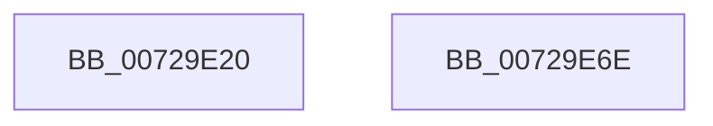

# PnpReportTargetDeviceChangeAsyncWorker

- RVA: `0x00729E20`–`0x00729E6F` (길이 `79` bytes)
- VA: `0x0000000140729E20`
- 실행 섹션: `PAGE`
- PDB 이름 있음: `예`; PDB Function 태그: `아니요`
- unwind 정보 RVA: `0x00064C80`
- 디코드: `22`개 명령, `79/79` bytes 표시
- 미해석 바이트: `0` (있으면 어셈블리에 `.byte`로 보존)

> 이 문서는 커널 이미지의 기계어와 PDB 기호를 분석해 생성했습니다. 4번과 5번은 함수 원형과 자료형을 바이너리 사용 방식에서 추정한 C 해석이며 원본 소스 복구 결과는 아닙니다.

## 1. Dependencies

- 직접 호출 지점: **3**; 고유 호출 대상: **3**
- 직접 호출자로 확인된 함수: **0**
- RIP 상대 이미지 참조: **0**

### Outgoing calls
- `0x00729E48` → [PnpSetCustomTargetEvent](../95/PnpSetCustomTargetEvent_function_009519E8.md) (function, `0x009519E8`)
- `0x00729E56` → [ObfDereferenceObjectWithTag](../../text/2F/ObfDereferenceObjectWithTag_function_002F78E0.md) (function, `0x002F78E0`)
- `0x00729E63` → [ExFreePoolWithTag](../../poolcode/B8/ExFreePoolWithTag_function_00B82870.md) (function, `0x00B82870`)

### Direct callers
- 이 함수 시작 RVA로 연결되는 직접 call은 확인되지 않았습니다. 간접 호출은 완전히 역산할 수 없습니다.

### Static image references
- 디코드된 RIP-relative 메모리 참조가 없습니다.

## 2. Other-region calls and transfers

- 다른 실행 섹션으로 향하는 call: **2**
  - `0x00729E56` → [ObfDereferenceObjectWithTag](../../text/2F/ObfDereferenceObjectWithTag_function_002F78E0.md) (`PAGE` → `.text`)
  - `0x00729E63` → [ExFreePoolWithTag](../../poolcode/B8/ExFreePoolWithTag_function_00B82870.md) (`PAGE` → `POOLCODE`)
- 별도 외부 분기/꼬리 이동을 확인하지 못했습니다.

## 3. Assembly (complete function range)

```asm
00729E20  40 53                           push rbx
00729E22  48 83 EC 30                     sub rsp, 0x30
00729E26  48 8B 41 38                     mov rax, qword ptr [rcx + 0x38]
00729E2A  48 8B D9                        mov rbx, rcx
00729E2D  4C 8B 49 28                     mov r9, qword ptr [rcx + 0x28]
00729E31  45 33 C0                        xor r8d, r8d
00729E34  48 89 44 24 28                  mov qword ptr [rsp + 0x28], rax
00729E39  33 D2                           xor edx, edx
00729E3B  48 8B 41 30                     mov rax, qword ptr [rcx + 0x30]
00729E3F  48 8B 49 20                     mov rcx, qword ptr [rcx + 0x20]
00729E43  48 89 44 24 20                  mov qword ptr [rsp + 0x20], rax
00729E48  E8 9B 7B 22 00                  call 0x1409519e8
00729E4D  48 8B 4B 20                     mov rcx, qword ptr [rbx + 0x20]
00729E51  BA 50 6E 70 4E                  mov edx, 0x4e706e50
00729E56  E8 85 DA BC FF                  call 0x1402f78e0
00729E5B  BA 50 6E 70 38                  mov edx, 0x38706e50
00729E60  48 8B CB                        mov rcx, rbx
00729E63  E8 08 8A 45 00                  call 0x140b82870
00729E68  48 83 C4 30                     add rsp, 0x30
00729E6C  5B                              pop rbx
00729E6D  C3                              ret
00729E6E  CC                              int3
```

## 4. C-style interpretation (structured pseudocode)

```c
__int64 __fastcall PnpReportTargetDeviceChangeAsyncWorker(__int64 a1, int a2, int a3)
{
    __int64 result;
    __int64 v_rsp;
    unsigned __int64 v_stack_m10;
    unsigned __int64 v_stack_m18;

    v_rsp = (v_rsp) - (48);
    a3 = 0;
    v_stack_m10 = *(unsigned __int64 *)(a1 + 56);
    a2 = 0;
    v_stack_m18 = *(unsigned __int64 *)(a1 + 48);
    result = PnpSetCustomTargetEvent(*(unsigned __int64 *)(a1 + 32), a2, a3, *(unsigned __int64 *)(a1 + 40));
    result = ObfDereferenceObjectWithTag(*(unsigned __int64 *)(a1 + 32), (unsigned int)(0x4E706E50ULL), a3, *(unsigned __int64 *)(a1 + 40));
    result = ExFreePoolWithTag(a1, (unsigned int)(0x38706E50ULL), a3, *(unsigned __int64 *)(a1 + 40));
    v_rsp = (v_rsp) + (48);
    return result;
}
```

## 5. (Beta) C Style

```c
int64_t PnpReportTargetDeviceChangeAsyncWorker(void *Arg1, int32_t Arg2, int32_t Arg3)
{
    uint8_t *arg1 = (uint8_t *)Arg1;

    int64_t result;
    int64_t local_rsp;
    uint64_t v_stack_m10;
    uint64_t v_stack_m18;

    local_rsp = (local_rsp) - (48);
    Arg3 = 0;
    v_stack_m10 = *(uint64_t *)(arg1 + 0x38);
    Arg2 = 0;
    v_stack_m18 = *(uint64_t *)(arg1 + 0x30);
    result = PnpSetCustomTargetEvent(*(uint64_t *)(arg1 + 0x20), Arg2, Arg3, *(uint64_t *)(arg1 + 0x28));
    result = ObfDereferenceObjectWithTag(*(uint64_t *)(arg1 + 0x20), (uint32_t)(0x4E706E50ULL), Arg3, *(uint64_t *)(arg1 + 0x28));
    result = ExFreePoolWithTag(Arg1, (uint32_t)(0x38706E50ULL), Arg3, *(uint64_t *)(arg1 + 0x28));
    local_rsp = (local_rsp) + (48);
    return result;
}
```

### 관측된 메모리 오프셋

구조체 형식이 확인되지 않은 접근은 인자 기준의 오프셋으로만 기록했습니다.

| 기준 인자 | 오프셋 표현 | 폭 (bit) | 접근 |
|---|---:|---:|---|
| `Arg1` | `+ 0x20` | `64` | `R` |
| `Arg1` | `+ 0x28` | `64` | `R` |
| `Arg1` | `+ 0x30` | `64` | `R` |
| `Arg1` | `+ 0x38` | `64` | `R` |

## 6. Execution-region graph

[열기: 2D/3D 그래프와 함수 탐색 컨트롤 패널](../../../control-panel.html?section=page&rva=0x00729E20&view=graph)

- 2D 그래프는 위에서 아래로 흐르고, 3D 그래프는 빈 공간을 드래그해 회전합니다. Shift+드래그는 이동, 휠은 확대·축소, 함수 노드 선택은 대상 보고서 이동입니다.

### Static fallback


