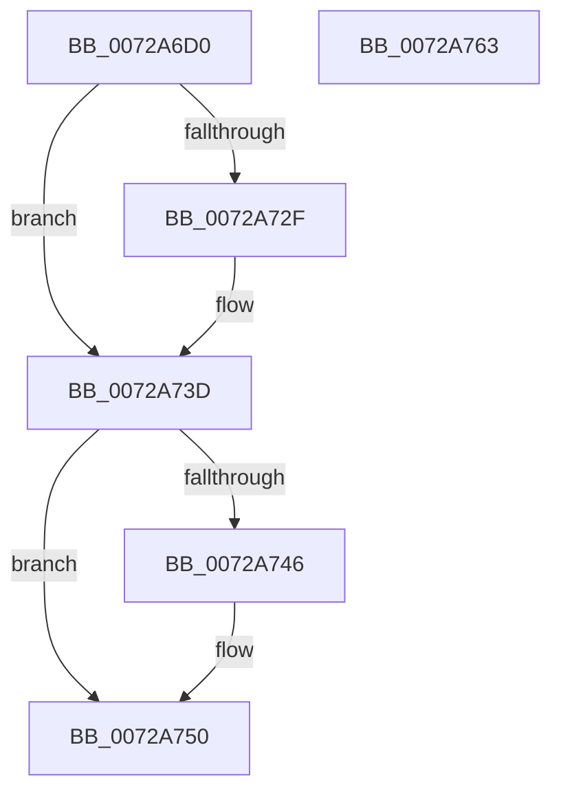

# PnpRequestDeviceEjectExWorker

- RVA: `0x0072A6D0`–`0x0072A764` (길이 `148` bytes)
- VA: `0x000000014072A6D0`
- 실행 섹션: `PAGE`
- PDB 이름 있음: `예`; PDB Function 태그: `아니요`
- unwind 정보 RVA: `0x000697A4`
- 디코드: `36`개 명령, `148/148` bytes 표시
- 미해석 바이트: `0` (있으면 어셈블리에 `.byte`로 보존)

> 이 문서는 커널 이미지의 기계어와 PDB 기호를 분석해 생성했습니다. 4번과 5번은 함수 원형과 자료형을 바이너리 사용 방식에서 추정한 C 해석이며 원본 소스 복구 결과는 아닙니다.

## 1. Dependencies

- 직접 호출 지점: **5**; 고유 호출 대상: **5**
- 직접 호출자로 확인된 함수: **0**
- RIP 상대 이미지 참조: **0**

### Outgoing calls
- `0x0072A6EA` → [RtlInitUnicodeString](../../text/42/RtlInitUnicodeString_function_0042A780.md) (function, `0x0042A780`)
- `0x0072A71F` → [PnpQueueQueryAndRemoveEvent](../94/PnpQueueQueryAndRemoveEvent_function_0094FD2C.md) (function, `0x0094FD2C`)
- `0x0072A738` → [guard_dispatch_icall](../../text/6B/guard_dispatch_icall_function_006BAAD0.md) (function, `0x006BAAD0`)
- `0x0072A74B` → [ObfDereferenceObjectWithTag](../../text/2F/ObfDereferenceObjectWithTag_function_002F78E0.md) (function, `0x002F78E0`)
- `0x0072A758` → [ExFreePoolWithTag](../../poolcode/B8/ExFreePoolWithTag_function_00B82870.md) (function, `0x00B82870`)

### Direct callers
- 이 함수 시작 RVA로 연결되는 직접 call은 확인되지 않았습니다. 간접 호출은 완전히 역산할 수 없습니다.

### Static image references
- 디코드된 RIP-relative 메모리 참조가 없습니다.

## 2. Other-region calls and transfers

- 다른 실행 섹션으로 향하는 call: **4**
  - `0x0072A6EA` → [RtlInitUnicodeString](../../text/42/RtlInitUnicodeString_function_0042A780.md) (`PAGE` → `.text`)
  - `0x0072A738` → [guard_dispatch_icall](../../text/6B/guard_dispatch_icall_function_006BAAD0.md) (`PAGE` → `.text`)
  - `0x0072A74B` → [ObfDereferenceObjectWithTag](../../text/2F/ObfDereferenceObjectWithTag_function_002F78E0.md) (`PAGE` → `.text`)
  - `0x0072A758` → [ExFreePoolWithTag](../../poolcode/B8/ExFreePoolWithTag_function_00B82870.md) (`PAGE` → `POOLCODE`)
- 별도 외부 분기/꼬리 이동을 확인하지 못했습니다.

## 3. Assembly (complete function range)

```asm
0072A6D0  40 53                           push rbx
0072A6D2  48 83 EC 40                     sub rsp, 0x40
0072A6D6  48 8B D9                        mov rbx, rcx
0072A6D9  48 8D 51 40                     lea rdx, [rcx + 0x40]
0072A6DD  0F 57 C0                        xorps xmm0, xmm0
0072A6E0  48 8D 4C 24 30                  lea rcx, [rsp + 0x30]
0072A6E5  0F 11 44 24 30                  movups xmmword ptr [rsp + 0x30], xmm0
0072A6EA  E8 91 00 D0 FF                  call 0x14042a780
0072A6EF  4C 8D 83 D4 01 00 00            lea r8, [rbx + 0x1d4]
0072A6F6  C7 44 24 28 01 00 00 00         mov dword ptr [rsp + 0x28], 1
0072A6FE  48 8D 93 D0 01 00 00            lea rdx, [rbx + 0x1d0]
0072A705  C7 44 24 50 00 04 00 00         mov dword ptr [rsp + 0x50], 0x400
0072A70D  4C 8D 4C 24 50                  lea r9, [rsp + 0x50]
0072A712  C7 44 24 20 08 00 00 00         mov dword ptr [rsp + 0x20], 8
0072A71A  48 8D 4C 24 30                  lea rcx, [rsp + 0x30]
0072A71F  E8 08 56 22 00                  call 0x14094fd2c
0072A724  4C 8B 03                        mov r8, qword ptr [rbx]
0072A727  89 43 18                        mov dword ptr [rbx + 0x18], eax
0072A72A  4D 85 C0                        test r8, r8
0072A72D  74 0E                           je 0x14072a73d
0072A72F  48 8B 53 08                     mov rdx, qword ptr [rbx + 8]
0072A733  8B C8                           mov ecx, eax
0072A735  49 8B C0                        mov rax, r8
0072A738  E8 93 03 F9 FF                  call 0x1406baad0
0072A73D  48 8B 4B 10                     mov rcx, qword ptr [rbx + 0x10]
0072A741  48 85 C9                        test rcx, rcx
0072A744  74 0A                           je 0x14072a750
0072A746  BA 50 6E 70 45                  mov edx, 0x45706e50
0072A74B  E8 90 D1 BC FF                  call 0x1402f78e0
0072A750  BA 50 6E 70 46                  mov edx, 0x46706e50
0072A755  48 8B CB                        mov rcx, rbx
0072A758  E8 13 81 45 00                  call 0x140b82870
0072A75D  48 83 C4 40                     add rsp, 0x40
0072A761  5B                              pop rbx
0072A762  C3                              ret
0072A763  CC                              int3
```

## 4. C-style interpretation (structured pseudocode)

```c
__int64 __fastcall PnpRequestDeviceEjectExWorker(__int64 a1)
{
    __int64 result;
    __int64 v_rsp;
    unsigned __int64 v_stack_m18;
    unsigned int v_stack_m20;
    unsigned int v_stack_m28;
    unsigned int v_stack_p8;

    v_rsp = (v_rsp) - (64);
    v_stack_m18 = v_xmm0;
    result = RtlInitUnicodeString(v_stack_m18, a1 + 64, a3, a4);
    v_stack_m20 = 1;
    v_stack_p8 = 0x400ULL;
    v_stack_m28 = 8;
    result = PnpQueueQueryAndRemoveEvent(v_stack_m18, a1 + 464, a1 + 468, v_stack_p8);
    *(unsigned int *)(a1 + 24) = (unsigned int)(result);
    if (*(unsigned __int64 *)(a1) != 0) {
        a2 = *(unsigned __int64 *)(a1 + 8);
        a1 = (unsigned int)(result);
        result = *(unsigned __int64 *)(a1);
        result = guard_dispatch_icall(a1, a2, *(unsigned __int64 *)(a1), v_stack_p8);
    }
    if (*(unsigned __int64 *)(a1 + 16) != 0) {
        a2 = 0x45706E50ULL;
        result = ObfDereferenceObjectWithTag(*(unsigned __int64 *)(a1 + 16), a2, *(unsigned __int64 *)(a1), v_stack_p8);
    }
    result = ExFreePoolWithTag(a1, (unsigned int)(0x46706E50ULL), *(unsigned __int64 *)(a1), v_stack_p8);
    v_rsp = (v_rsp) + (64);
    return result;
}
```

## 5. (Beta) C Style

```c
int64_t PnpRequestDeviceEjectExWorker(void *Arg1)
{
    uint8_t *arg1 = (uint8_t *)Arg1;

    int64_t result;
    int64_t local_rsp;
    uint64_t v_stack_m18;
    uint32_t v_stack_m20;
    uint32_t v_stack_m28;
    uint32_t v_stack_p8;

    local_rsp = (local_rsp) - (64);
    v_stack_m18 = v_xmm0;
    result = RtlInitUnicodeString(v_stack_m18, Arg1 + 64, a3, a4);
    v_stack_m20 = 1;
    v_stack_p8 = 0x400ULL;
    v_stack_m28 = 8;
    result = PnpQueueQueryAndRemoveEvent(v_stack_m18, Arg1 + 464, Arg1 + 468, v_stack_p8);
    *(uint32_t *)(arg1 + 0x18) = (uint32_t)(result);
    if (*(uint64_t *)(arg1) != 0) {
        a2 = *(uint64_t *)(arg1 + 0x8);
        Arg1 = (uint32_t)(result);
        result = *(uint64_t *)(arg1);
        result = guard_dispatch_icall(Arg1, a2, *(uint64_t *)(arg1), v_stack_p8);
    }
    if (*(uint64_t *)(arg1 + 0x10) != 0) {
        a2 = 0x45706E50ULL;
        result = ObfDereferenceObjectWithTag(*(uint64_t *)(arg1 + 0x10), a2, *(uint64_t *)(arg1), v_stack_p8);
    }
    result = ExFreePoolWithTag(Arg1, (uint32_t)(0x46706E50ULL), *(uint64_t *)(arg1), v_stack_p8);
    local_rsp = (local_rsp) + (64);
    return result;
}
```

### 관측된 메모리 오프셋

구조체 형식이 확인되지 않은 접근은 인자 기준의 오프셋으로만 기록했습니다.

| 기준 인자 | 오프셋 표현 | 폭 (bit) | 접근 |
|---|---:|---:|---|
| `Arg1` | `+ 0x0` | `64` | `R` |
| `Arg1` | `+ 0x8` | `64` | `R` |
| `Arg1` | `+ 0x10` | `64` | `R` |
| `Arg1` | `+ 0x18` | `32` | `W` |
| `Arg1` | `+ 0x40` | `64` | `R` |
| `Arg1` | `+ 0x1D0` | `64` | `R` |
| `Arg1` | `+ 0x1D4` | `64` | `R` |

## 6. Execution-region graph

[열기: 2D/3D 그래프와 함수 탐색 컨트롤 패널](../../../control-panel.html?section=page&rva=0x0072A6D0&view=graph)

- 2D 그래프는 위에서 아래로 흐르고, 3D 그래프는 빈 공간을 드래그해 회전합니다. Shift+드래그는 이동, 휠은 확대·축소, 함수 노드 선택은 대상 보고서 이동입니다.

### Static fallback


