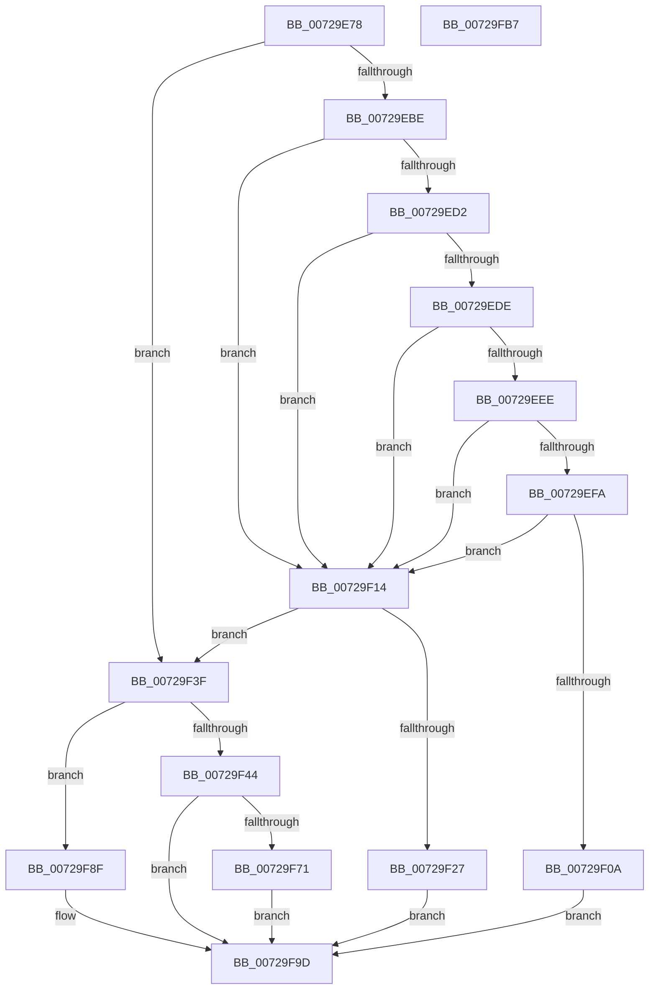

# PnpRequestHwProfileChangeNotification

- RVA: `0x00729E78`–`0x00729FB8` (길이 `320` bytes)
- VA: `0x0000000140729E78`
- 실행 섹션: `PAGE`
- PDB 이름 있음: `예`; PDB Function 태그: `아니요`
- unwind 정보 RVA: `0x000BDF80`
- 디코드: `93`개 명령, `320/320` bytes 표시
- 미해석 바이트: `0` (있으면 어셈블리에 `.byte`로 보존)

> 이 문서는 커널 이미지의 기계어와 PDB 기호를 분석해 생성했습니다. 4번과 5번은 함수 원형과 자료형을 바이너리 사용 방식에서 추정한 C 해석이며 원본 소스 복구 결과는 아닙니다.

## 1. Dependencies

- 직접 호출 지점: **9**; 고유 호출 대상: **5**
- 직접 호출자로 확인된 함수: **4**
- RIP 상대 이미지 참조: **3**

### Outgoing calls
- `0x00729EC8` → [RtlCompareMemory](../../text/6B/RtlCompareMemory_function_006BA670.md) (function, `0x006BA670`)
- `0x00729EE4` → [RtlCompareMemory](../../text/6B/RtlCompareMemory_function_006BA670.md) (function, `0x006BA670`)
- `0x00729F00` → [RtlCompareMemory](../../text/6B/RtlCompareMemory_function_006BA670.md) (function, `0x006BA670`)
- `0x00729F1D` → [RtlCompareMemory](../../text/6B/RtlCompareMemory_function_006BA670.md) (function, `0x006BA670`)
- `0x00729F38` → [PnpSetHwProfileChangeEvent](../73/PnpSetHwProfileChangeEvent_function_00738290.md) (function, `0x00738290`)
- `0x00729F4E` → [KeInitializeEvent](../../text/40/KeInitializeEvent_function_0040DD10.md) (function, `0x0040DD10`)
- `0x00729F68` → [PnpSetHwProfileChangeEvent](../73/PnpSetHwProfileChangeEvent_function_00738290.md) (function, `0x00738290`)
- `0x00729F84` → [KeWaitForSingleObject](../../text/20/KeWaitForSingleObject_function_0020E6B0.md) (function, `0x0020E6B0`)
- `0x00729F98` → [PnpNotifyHwProfileChange](PnpNotifyHwProfileChange_function_00729B04.md) (function, `0x00729B04`)

### Direct callers
- [PpProfileCancelHardwareProfileTransition](../73/PpProfileCancelHardwareProfileTransition_function_00737918.md) at `0x0073797A`
- [PpProfileCancelTransitioningDock](../73/PpProfileCancelTransitioningDock_function_007379A0.md) at `0x00737A08`
- [PpProfileCancelTransitioningDock](../73/PpProfileCancelTransitioningDock_function_007379A0.md) at `0x00737A25`
- [PpProfileCommitTransitioningDock](../73/PpProfileCommitTransitioningDock_function_00737A4C.md) at `0x00737B48`
- [PpProfileCommitTransitioningDock](../73/PpProfileCommitTransitioningDock_function_00737A4C.md) at `0x00737B6E`
- [PpProfileQueryHardwareProfileChange](../73/PpProfileQueryHardwareProfileChange_function_00737C5C.md) at `0x00737CE9`

### Static image references
- `0x00729E94` → RVA `0x00024028` (`.rdata`; read)
- `0x00729ED2` → RVA `0x000240B8` (`.rdata`; read)
- `0x00729EEE` → RVA `0x00024178` (`.rdata`; read)

## 2. Other-region calls and transfers

- 다른 실행 섹션으로 향하는 call: **6**
  - `0x00729EC8` → [RtlCompareMemory](../../text/6B/RtlCompareMemory_function_006BA670.md) (`PAGE` → `.text`)
  - `0x00729EE4` → [RtlCompareMemory](../../text/6B/RtlCompareMemory_function_006BA670.md) (`PAGE` → `.text`)
  - `0x00729F00` → [RtlCompareMemory](../../text/6B/RtlCompareMemory_function_006BA670.md) (`PAGE` → `.text`)
  - `0x00729F1D` → [RtlCompareMemory](../../text/6B/RtlCompareMemory_function_006BA670.md) (`PAGE` → `.text`)
  - `0x00729F4E` → [KeInitializeEvent](../../text/40/KeInitializeEvent_function_0040DD10.md) (`PAGE` → `.text`)
  - `0x00729F84` → [KeWaitForSingleObject](../../text/20/KeWaitForSingleObject_function_0020E6B0.md) (`PAGE` → `.text`)
- 별도 외부 분기/꼬리 이동을 확인하지 못했습니다.

## 3. Assembly (complete function range)

```asm
00729E78  48 8B C4                        mov rax, rsp
00729E7B  48 89 58 10                     mov qword ptr [rax + 0x10], rbx
00729E7F  48 89 68 18                     mov qword ptr [rax + 0x18], rbp
00729E83  48 89 70 20                     mov qword ptr [rax + 0x20], rsi
00729E87  57                              push rdi
00729E88  41 54                           push r12
00729E8A  41 56                           push r14
00729E8C  48 83 EC 50                     sub rsp, 0x50
00729E90  83 60 08 00                     and dword ptr [rax + 8], 0
00729E94  4C 8D 25 8D A1 8F FF            lea r12, [rip - 0x705e73]
00729E9B  33 C0                           xor eax, eax
00729E9D  0F 57 C0                        xorps xmm0, xmm0
00729EA0  48 89 44 24 40                  mov qword ptr [rsp + 0x40], rax
00729EA5  49 8B F9                        mov rdi, r9
00729EA8  49 8B F0                        mov rsi, r8
00729EAB  8B EA                           mov ebp, edx
00729EAD  48 8B D9                        mov rbx, rcx
00729EB0  0F 11 44 24 30                  movups xmmword ptr [rsp + 0x30], xmm0
00729EB5  49 3B CC                        cmp rcx, r12
00729EB8  0F 84 81 00 00 00               je 0x140729f3f
00729EBE  44 8D 70 10                     lea r14d, [rax + 0x10]
00729EC2  49 8B D4                        mov rdx, r12
00729EC5  45 8B C6                        mov r8d, r14d
00729EC8  E8 A3 07 F9 FF                  call 0x1406ba670
00729ECD  49 3B C6                        cmp rax, r14
00729ED0  74 42                           je 0x140729f14
00729ED2  48 8D 15 DF A1 8F FF            lea rdx, [rip - 0x705e21]
00729ED9  48 3B DA                        cmp rbx, rdx
00729EDC  74 36                           je 0x140729f14
00729EDE  45 8B C6                        mov r8d, r14d
00729EE1  48 8B CB                        mov rcx, rbx
00729EE4  E8 87 07 F9 FF                  call 0x1406ba670
00729EE9  49 3B C6                        cmp rax, r14
00729EEC  74 26                           je 0x140729f14
00729EEE  48 8D 15 83 A2 8F FF            lea rdx, [rip - 0x705d7d]
00729EF5  48 3B DA                        cmp rbx, rdx
00729EF8  74 1A                           je 0x140729f14
00729EFA  45 8B C6                        mov r8d, r14d
00729EFD  48 8B CB                        mov rcx, rbx
00729F00  E8 6B 07 F9 FF                  call 0x1406ba670
00729F05  49 3B C6                        cmp rax, r14
00729F08  74 0A                           je 0x140729f14
00729F0A  B8 10 00 00 C0                  mov eax, 0xc0000010
00729F0F  E9 89 00 00 00                  jmp 0x140729f9d
00729F14  4D 8B C6                        mov r8, r14
00729F17  49 8B D4                        mov rdx, r12
00729F1A  48 8B CB                        mov rcx, rbx
00729F1D  E8 4E 07 F9 FF                  call 0x1406ba670
00729F22  49 3B C6                        cmp rax, r14
00729F25  74 18                           je 0x140729f3f
00729F27  48 83 64 24 20 00               and qword ptr [rsp + 0x20], 0
00729F2D  45 33 C9                        xor r9d, r9d
00729F30  45 33 C0                        xor r8d, r8d
00729F33  33 D2                           xor edx, edx
00729F35  48 8B CB                        mov rcx, rbx
00729F38  E8 53 E3 00 00                  call 0x140738290
00729F3D  EB 5E                           jmp 0x140729f9d
00729F3F  83 FD 01                        cmp ebp, 1
00729F42  75 4B                           jne 0x140729f8f
00729F44  45 33 C0                        xor r8d, r8d
00729F47  48 8D 4C 24 30                  lea rcx, [rsp + 0x30]
00729F4C  33 D2                           xor edx, edx
00729F4E  E8 BD 3D CE FF                  call 0x14040dd10
00729F53  4C 8B CE                        mov r9, rsi
00729F56  48 89 7C 24 20                  mov qword ptr [rsp + 0x20], rdi
00729F5B  4C 8D 44 24 70                  lea r8, [rsp + 0x70]
00729F60  48 8B CB                        mov rcx, rbx
00729F63  48 8D 54 24 30                  lea rdx, [rsp + 0x30]
00729F68  E8 23 E3 00 00                  call 0x140738290
00729F6D  85 C0                           test eax, eax
00729F6F  78 2C                           js 0x140729f9d
00729F71  48 83 64 24 20 00               and qword ptr [rsp + 0x20], 0
00729F77  48 8D 4C 24 30                  lea rcx, [rsp + 0x30]
00729F7C  45 33 C9                        xor r9d, r9d
00729F7F  45 33 C0                        xor r8d, r8d
00729F82  33 D2                           xor edx, edx
00729F84  E8 27 47 AE FF                  call 0x14020e6b0
00729F89  8B 44 24 70                     mov eax, dword ptr [rsp + 0x70]
00729F8D  EB 0E                           jmp 0x140729f9d
00729F8F  4C 8B C7                        mov r8, rdi
00729F92  48 8B D6                        mov rdx, rsi
00729F95  48 8B CB                        mov rcx, rbx
00729F98  E8 67 FB FF FF                  call 0x140729b04
00729F9D  4C 8D 5C 24 50                  lea r11, [rsp + 0x50]
00729FA2  49 8B 5B 28                     mov rbx, qword ptr [r11 + 0x28]
00729FA6  49 8B 6B 30                     mov rbp, qword ptr [r11 + 0x30]
00729FAA  49 8B 73 38                     mov rsi, qword ptr [r11 + 0x38]
00729FAE  49 8B E3                        mov rsp, r11
00729FB1  41 5E                           pop r14
00729FB3  41 5C                           pop r12
00729FB5  5F                              pop rdi
00729FB6  C3                              ret
00729FB7  CC                              int3
```

## 4. C-style interpretation (structured pseudocode)

```c
__int64 __fastcall PnpRequestHwProfileChangeNotification(__int64 a1, int a2, __int64 a3, __int64 a4)
{
    __int64 result;
    __int64 v_rsp;
    unsigned __int64 v_stack_m18;
    unsigned __int64 v_stack_m28;
    unsigned __int64 v_stack_m38;
    unsigned __int64 v_stack_m48;
    unsigned __int64 v_stack_p8;

    *(unsigned __int64 *)(v_rsp + 16) = v_rbx;
    *(unsigned __int64 *)(v_rsp + 24) = v_rbp;
    *(unsigned __int64 *)(v_rsp + 32) = v_rsi;
    v_rsp = (v_rsp) - (80);
    result = 0;
    v_stack_m28 = 0;
    v_stack_m38 = v_xmm0;
    if (a1 == (v_rip - 7364211)) goto loc_00729F3F;
    result = RtlCompareMemory(a1, v_rip - 7364211, (unsigned int)((unsigned int)(result + 16)), a4);
    if (result == (result + 16)) goto loc_00729F14;
    if (a1 == (v_rip - 7364129)) goto loc_00729F14;
    result = RtlCompareMemory(a1, v_rip - 7364129, (unsigned int)((unsigned int)(result + 16)), a4);
    if (result == (result + 16)) goto loc_00729F14;
    if (a1 == (v_rip - 7363965)) goto loc_00729F14;
    result = RtlCompareMemory(a1, v_rip - 7363965, (unsigned int)((unsigned int)(result + 16)), a4);
    if (result == (result + 16)) goto loc_00729F14;
    goto loc_00729F9D;
loc_00729F14:
    result = RtlCompareMemory(a1, v_rip - 7364211, result + 16, a4);
    if (result == (result + 16)) goto loc_00729F3F;
    a4 = 0;
    a3 = 0;
    a2 = 0;
    result = PnpSetHwProfileChangeEvent(a1, a2, a3, a4);
    goto loc_00729F9D;
loc_00729F3F:
    if (((unsigned int)((unsigned int)(a2))) != 1) goto loc_00729F8F;
    a3 = 0;
    a2 = 0;
    result = KeInitializeEvent(v_stack_m38, a2, a3, a4);
    v_stack_m48 = 0;
    result = PnpSetHwProfileChangeEvent(a1, v_stack_m38, v_stack_p8, 0);
    if (sign_flag) goto loc_00729F9D;
    a4 = 0;
    a3 = 0;
    a2 = 0;
    result = KeWaitForSingleObject(v_stack_m38, a2, a3, a4);
    goto loc_00729F9D;
loc_00729F8F:
    result = PnpNotifyHwProfileChange(a1, 0, 0, a4);
loc_00729F9D:
    return result;
}
```

## 5. (Beta) C Style

```c
int64_t PnpRequestHwProfileChangeNotification(int64_t Arg1, int32_t Arg2, int64_t Arg3, int64_t Arg4)
{
    int64_t result;
    int64_t local_rsp;
    uint64_t v_stack_m18;
    uint64_t v_stack_m28;
    uint64_t v_stack_m38;
    uint64_t v_stack_m48;
    uint64_t v_stack_p8;

    *(uint64_t *)(local_rsp + 0x10) = local_rbx;
    *(uint64_t *)(local_rsp + 0x18) = local_rbp;
    *(uint64_t *)(local_rsp + 0x20) = local_rsi;
    local_rsp = (local_rsp) - (80);
    result = 0;
    v_stack_m28 = 0;
    v_stack_m38 = v_xmm0;
    if (Arg1 == (v_rip - 7364211)) goto loc_00729F3F;
    result = RtlCompareMemory(Arg1, v_rip - 7364211, (uint32_t)((uint32_t)(result + 16)), Arg4);
    if (result == (result + 16)) goto loc_00729F14;
    if (Arg1 == (v_rip - 7364129)) goto loc_00729F14;
    result = RtlCompareMemory(Arg1, v_rip - 7364129, (uint32_t)((uint32_t)(result + 16)), Arg4);
    if (result == (result + 16)) goto loc_00729F14;
    if (Arg1 == (v_rip - 7363965)) goto loc_00729F14;
    result = RtlCompareMemory(Arg1, v_rip - 7363965, (uint32_t)((uint32_t)(result + 16)), Arg4);
    if (result == (result + 16)) goto loc_00729F14;
    goto loc_00729F9D;
loc_00729F14:
    result = RtlCompareMemory(Arg1, v_rip - 7364211, result + 16, Arg4);
    if (result == (result + 16)) goto loc_00729F3F;
    Arg4 = 0;
    Arg3 = 0;
    Arg2 = 0;
    result = PnpSetHwProfileChangeEvent(Arg1, Arg2, Arg3, Arg4);
    goto loc_00729F9D;
loc_00729F3F:
    if (((uint32_t)((uint32_t)(Arg2))) != 1) goto loc_00729F8F;
    Arg3 = 0;
    Arg2 = 0;
    result = KeInitializeEvent(v_stack_m38, Arg2, Arg3, Arg4);
    v_stack_m48 = 0;
    result = PnpSetHwProfileChangeEvent(Arg1, v_stack_m38, v_stack_p8, 0);
    if (sign_flag) goto loc_00729F9D;
    Arg4 = 0;
    Arg3 = 0;
    Arg2 = 0;
    result = KeWaitForSingleObject(v_stack_m38, Arg2, Arg3, Arg4);
    goto loc_00729F9D;
loc_00729F8F:
    result = PnpNotifyHwProfileChange(Arg1, 0, 0, Arg4);
loc_00729F9D:
    return result;
}
```

## 6. Execution-region graph

[열기: 2D/3D 그래프와 함수 탐색 컨트롤 패널](../../../control-panel.html?section=page&rva=0x00729E78&view=graph)

- 2D 그래프는 위에서 아래로 흐르고, 3D 그래프는 빈 공간을 드래그해 회전합니다. Shift+드래그는 이동, 휠은 확대·축소, 함수 노드 선택은 대상 보고서 이동입니다.

### Static fallback


