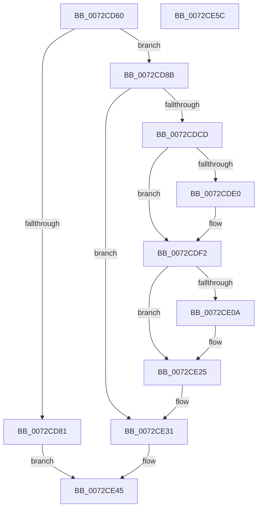

# PnpRestartDeviceNode

- RVA: `0x0072CD60`–`0x0072CE5D` (길이 `253` bytes)
- VA: `0x000000014072CD60`
- 실행 섹션: `PAGE`
- PDB 이름 있음: `예`; PDB Function 태그: `아니요`
- unwind 정보 RVA: `0x0005CAAC`
- 디코드: `61`개 명령, `253/253` bytes 표시
- 미해석 바이트: `0` (있으면 어셈블리에 `.byte`로 보존)

> 이 문서는 커널 이미지의 기계어와 PDB 기호를 분석해 생성했습니다. 4번과 5번은 함수 원형과 자료형을 바이너리 사용 방식에서 추정한 C 해석이며 원본 소스 복구 결과는 아닙니다.

## 1. Dependencies

- 직접 호출 지점: **11**; 고유 호출 대상: **8**
- 직접 호출자로 확인된 함수: **6**
- RIP 상대 이미지 참조: **1**

### Outgoing calls
- `0x0072CD72` → [PpDevNodeLockTree](../A1/PpDevNodeLockTree_function_00A19310.md) (function, `0x00A19310`)
- `0x0072CD93` → [PipClearDevNodeUserFlags](../A2/PipClearDevNodeUserFlags_function_00A2ABC4.md) (function, `0x00A2ABC4`)
- `0x0072CDA0` → [PipClearDevNodeFlags](../8F/PipClearDevNodeFlags_function_008F9F54.md) (function, `0x008F9F54`)
- `0x0072CDD5` → [PipClearDevNodeFlags](../8F/PipClearDevNodeFlags_function_008F9F54.md) (function, `0x008F9F54`)
- `0x0072CDE6` → [ExFreePoolWithTag](../../poolcode/B8/ExFreePoolWithTag_function_00B82870.md) (function, `0x00B82870`)
- `0x0072CDF9` → [ExAcquireFastMutex](../../text/20/ExAcquireFastMutex_function_0020E5A0.md) (function, `0x0020E5A0`)
- `0x0072CE0C` → [ExFreePoolWithTag](../../poolcode/B8/ExFreePoolWithTag_function_00B82870.md) (function, `0x00B82870`)
- `0x0072CE20` → [PipClearDevNodeFlags](../8F/PipClearDevNodeFlags_function_008F9F54.md) (function, `0x008F9F54`)
- `0x0072CE2C` → [ExReleaseFastMutex](../../text/25/ExReleaseFastMutex_function_002519C0.md) (function, `0x002519C0`)
- `0x0072CE40` → [PipSetDevNodeState](../../text/47/PipSetDevNodeState_function_00470708.md) (function, `0x00470708`)
- `0x0072CE4A` → [PpDevNodeUnlockTree](../A2/PpDevNodeUnlockTree_function_00A21290.md) (function, `0x00A21290`)

### Direct callers
- [PiProfileUpdateDeviceTreeCallback](../73/PiProfileUpdateDeviceTreeCallback_function_00737630.md) at `0x007376B3`
- [PiProcessQueryRemoveNoFdo](../74/PiProcessQueryRemoveNoFdo_function_007442B4.md) at `0x0074432A`
- [PiProcessClearDeviceProblem](../A2/PiProcessClearDeviceProblem_function_00A271CC.md) at `0x00A272B6`
- [PiRestartRemovalRelations](../AB/PiRestartRemovalRelations_function_00AB06B8.md) at `0x00AB0778`
- [PiRestartDevice](../AC/PiRestartDevice_function_00ACFA1C.md) at `0x00ACFA92`
- [sub_00B33FE8](../B3/Unknown_function_00B33FE8.md) at `0x00B342C1`

### Static image references
- `0x0072CDF2` → RVA `0x00F8C3E0` (`.data`; read)

## 2. Other-region calls and transfers

- 다른 실행 섹션으로 향하는 call: **5**
  - `0x0072CDE6` → [ExFreePoolWithTag](../../poolcode/B8/ExFreePoolWithTag_function_00B82870.md) (`PAGE` → `POOLCODE`)
  - `0x0072CDF9` → [ExAcquireFastMutex](../../text/20/ExAcquireFastMutex_function_0020E5A0.md) (`PAGE` → `.text`)
  - `0x0072CE0C` → [ExFreePoolWithTag](../../poolcode/B8/ExFreePoolWithTag_function_00B82870.md) (`PAGE` → `POOLCODE`)
  - `0x0072CE2C` → [ExReleaseFastMutex](../../text/25/ExReleaseFastMutex_function_002519C0.md) (`PAGE` → `.text`)
  - `0x0072CE40` → [PipSetDevNodeState](../../text/47/PipSetDevNodeState_function_00470708.md) (`PAGE` → `.text`)
- 별도 외부 분기/꼬리 이동을 확인하지 못했습니다.

## 3. Assembly (complete function range)

```asm
0072CD60  48 89 5C 24 08                  mov qword ptr [rsp + 8], rbx
0072CD65  57                              push rdi
0072CD66  48 83 EC 20                     sub rsp, 0x20
0072CD6A  48 8B D9                        mov rbx, rcx
0072CD6D  B9 04 00 00 00                  mov ecx, 4
0072CD72  E8 99 C5 2E 00                  call 0x140a19310
0072CD77  8B 83 8C 01 00 00               mov eax, dword ptr [rbx + 0x18c]
0072CD7D  A8 10                           test al, 0x10
0072CD7F  75 0A                           jne 0x14072cd8b
0072CD81  BF 01 00 00 C0                  mov edi, 0xc0000001
0072CD86  E9 BA 00 00 00                  jmp 0x14072ce45
0072CD8B  BA 05 00 00 00                  mov edx, 5
0072CD90  48 8B CB                        mov rcx, rbx
0072CD93  E8 2C DE 2F 00                  call 0x140a2abc4
0072CD98  BA 00 80 10 00                  mov edx, 0x108000
0072CD9D  48 8B CB                        mov rcx, rbx
0072CDA0  E8 AF D1 1C 00                  call 0x1408f9f54
0072CDA5  81 A3 C0 02 00 00 03 3C FE FF   and dword ptr [rbx + 0x2c0], 0xfffe3c03
0072CDAF  33 FF                           xor edi, edi
0072CDB1  8B 83 2C 01 00 00               mov eax, dword ptr [rbx + 0x12c]
0072CDB7  89 BB 28 01 00 00               mov dword ptr [rbx + 0x128], edi
0072CDBD  2D 01 03 00 00                  sub eax, 0x301
0072CDC2  89 7B 78                        mov dword ptr [rbx + 0x78], edi
0072CDC5  89 7B 7C                        mov dword ptr [rbx + 0x7c], edi
0072CDC8  83 F8 01                        cmp eax, 1
0072CDCB  76 64                           jbe 0x14072ce31
0072CDCD  BA 00 0D 20 7C                  mov edx, 0x7c200d00
0072CDD2  48 8B CB                        mov rcx, rbx
0072CDD5  E8 7A D1 1C 00                  call 0x1408f9f54
0072CDDA  66 39 7B 38                     cmp word ptr [rbx + 0x38], di
0072CDDE  74 12                           je 0x14072cdf2
0072CDE0  48 8B 4B 40                     mov rcx, qword ptr [rbx + 0x40]
0072CDE4  33 D2                           xor edx, edx
0072CDE6  E8 85 5A 45 00                  call 0x140b82870
0072CDEB  89 7B 38                        mov dword ptr [rbx + 0x38], edi
0072CDEE  48 89 7B 40                     mov qword ptr [rbx + 0x40], rdi
0072CDF2  48 8D 0D E7 F5 85 00            lea rcx, [rip + 0x85f5e7]
0072CDF9  E8 A2 17 AE FF                  call 0x14020e5a0
0072CDFE  48 8B 8B B8 01 00 00            mov rcx, qword ptr [rbx + 0x1b8]
0072CE05  48 85 C9                        test rcx, rcx
0072CE08  74 1B                           je 0x14072ce25
0072CE0A  33 D2                           xor edx, edx
0072CE0C  E8 5F 5A 45 00                  call 0x140b82870
0072CE11  BA 00 02 00 00                  mov edx, 0x200
0072CE16  48 89 BB B8 01 00 00            mov qword ptr [rbx + 0x1b8], rdi
0072CE1D  48 8B CB                        mov rcx, rbx
0072CE20  E8 2F D1 1C 00                  call 0x1408f9f54
0072CE25  48 8D 0D B4 F5 85 00            lea rcx, [rip + 0x85f5b4]
0072CE2C  E8 8F 4B B2 FF                  call 0x1402519c0
0072CE31  83 8B 94 02 00 00 FF            or dword ptr [rbx + 0x294], 0xffffffff
0072CE38  BA 01 03 00 00                  mov edx, 0x301
0072CE3D  48 8B CB                        mov rcx, rbx
0072CE40  E8 C3 38 D4 FF                  call 0x140470708
0072CE45  B9 04 00 00 00                  mov ecx, 4
0072CE4A  E8 41 44 2F 00                  call 0x140a21290
0072CE4F  48 8B 5C 24 30                  mov rbx, qword ptr [rsp + 0x30]
0072CE54  8B C7                           mov eax, edi
0072CE56  48 83 C4 20                     add rsp, 0x20
0072CE5A  5F                              pop rdi
0072CE5B  C3                              ret
0072CE5C  CC                              int3
```

## 4. C-style interpretation (structured pseudocode)

```c
__int64 __fastcall PnpRestartDeviceNode(__int64 a1)
{
    __int64 result;
    __int64 v_rdi;
    __int64 v_rsp;
    unsigned __int64 v_stack_p8;

    v_stack_p8 = v_rbx;
    v_rsp = (v_rsp) - (32);
    result = PpDevNodeLockTree(4, a2, a3, a4);
    if ((((unsigned __int8)((unsigned int)(*(unsigned int *)(a1 + 396)))) & (16)) != 0) goto loc_0072CD8B;
    goto loc_0072CE45;
loc_0072CD8B:
    result = PipClearDevNodeUserFlags(a1, 5, a3, a4);
    result = PipClearDevNodeFlags(a1, (unsigned int)(0x108000ULL), a3, a4);
    v_rdi = 0;
    *(unsigned int *)(a1 + 296) = 0;
    result = (unsigned int)(((unsigned int)(*(unsigned int *)(a1 + 300))) - (769));
    *(unsigned int *)(a1 + 120) = 0;
    *(unsigned int *)(a1 + 124) = 0;
    if (((unsigned int)(result)) <= 1) goto loc_0072CE31;
    result = PipClearDevNodeFlags(a1, (unsigned int)(0x7C200D00ULL), a3, a4);
    if ((*(unsigned __int16 *)(a1 + 56)) != 0) {
        a1 = *(unsigned __int64 *)(a1 + 64);
        a2 = 0;
        result = ExFreePoolWithTag(a1, a2, a3, a4);
        *(unsigned int *)(a1 + 56) = 0;
        *(unsigned __int64 *)(a1 + 64) = 0;
    }
    result = ExAcquireFastMutex(v_rip + 8779239, a2, a3, a4);
    if (*(unsigned __int64 *)(a1 + 440) != 0) {
        a2 = 0;
        result = ExFreePoolWithTag(*(unsigned __int64 *)(a1 + 440), a2, a3, a4);
        a2 = 512;
        *(unsigned __int64 *)(a1 + 440) = 0;
        a1 = a1;
        result = PipClearDevNodeFlags(a1, a2, a3, a4);
    }
    result = ExReleaseFastMutex(v_rip + 8779188, a2, a3, a4);
loc_0072CE31:
    result = PipSetDevNodeState(a1, 769, a3, a4);
loc_0072CE45:
    result = PpDevNodeUnlockTree(4, 769, a3, a4);
    v_rsp = (v_rsp) + (32);
    return 0;
}
```

## 5. (Beta) C Style

```c
int64_t PnpRestartDeviceNode(void *Arg1)
{
    uint8_t *arg1 = (uint8_t *)Arg1;

    int64_t result;
    int64_t local_rdi;
    int64_t local_rsp;
    uint64_t v_stack_p8;

    v_stack_p8 = local_rbx;
    local_rsp = (local_rsp) - (32);
    result = PpDevNodeLockTree(4, a2, a3, a4);
    if ((((uint8_t)((uint32_t)(*(uint32_t *)(arg1 + 0x18C)))) & (16)) != 0) goto loc_0072CD8B;
    goto loc_0072CE45;
loc_0072CD8B:
    result = PipClearDevNodeUserFlags(Arg1, 5, a3, a4);
    result = PipClearDevNodeFlags(Arg1, (uint32_t)(0x108000ULL), a3, a4);
    local_rdi = 0;
    *(uint32_t *)(arg1 + 0x128) = 0;
    result = (uint32_t)(((uint32_t)(*(uint32_t *)(arg1 + 0x12C))) - (769));
    *(uint32_t *)(arg1 + 0x78) = 0;
    *(uint32_t *)(arg1 + 0x7C) = 0;
    if (((uint32_t)(result)) <= 1) goto loc_0072CE31;
    result = PipClearDevNodeFlags(Arg1, (uint32_t)(0x7C200D00ULL), a3, a4);
    if ((*(uint16_t *)(arg1 + 0x38)) != 0) {
        Arg1 = *(uint64_t *)(arg1 + 0x40);
        a2 = 0;
        result = ExFreePoolWithTag(Arg1, a2, a3, a4);
        *(uint32_t *)(arg1 + 0x38) = 0;
        *(uint64_t *)(arg1 + 0x40) = 0;
    }
    result = ExAcquireFastMutex(v_rip + 8779239, a2, a3, a4);
    if (*(uint64_t *)(arg1 + 0x1B8) != 0) {
        a2 = 0;
        result = ExFreePoolWithTag(*(uint64_t *)(arg1 + 0x1B8), a2, a3, a4);
        a2 = 512;
        *(uint64_t *)(arg1 + 0x1B8) = 0;
        Arg1 = Arg1;
        result = PipClearDevNodeFlags(Arg1, a2, a3, a4);
    }
    result = ExReleaseFastMutex(v_rip + 8779188, a2, a3, a4);
loc_0072CE31:
    result = PipSetDevNodeState(Arg1, 769, a3, a4);
loc_0072CE45:
    result = PpDevNodeUnlockTree(4, 769, a3, a4);
    local_rsp = (local_rsp) + (32);
    return 0;
}
```

### 관측된 메모리 오프셋

구조체 형식이 확인되지 않은 접근은 인자 기준의 오프셋으로만 기록했습니다.

| 기준 인자 | 오프셋 표현 | 폭 (bit) | 접근 |
|---|---:|---:|---|
| `Arg1` | `+ 0x38` | `16` | `R` |
| `Arg1` | `+ 0x38` | `32` | `W` |
| `Arg1` | `+ 0x40` | `64` | `R` |
| `Arg1` | `+ 0x40` | `64` | `W` |
| `Arg1` | `+ 0x78` | `32` | `W` |
| `Arg1` | `+ 0x7C` | `32` | `W` |
| `Arg1` | `+ 0x128` | `32` | `W` |
| `Arg1` | `+ 0x12C` | `32` | `R` |
| `Arg1` | `+ 0x18C` | `32` | `R` |
| `Arg1` | `+ 0x1B8` | `64` | `R` |
| `Arg1` | `+ 0x1B8` | `64` | `W` |
| `Arg1` | `+ 0x294` | `32` | `R/W` |
| `Arg1` | `+ 0x2C0` | `32` | `R/W` |

## 6. Execution-region graph

[열기: 2D/3D 그래프와 함수 탐색 컨트롤 패널](../../../control-panel.html?section=page&rva=0x0072CD60&view=graph)

- 2D 그래프는 위에서 아래로 흐르고, 3D 그래프는 빈 공간을 드래그해 회전합니다. Shift+드래그는 이동, 휠은 확대·축소, 함수 노드 선택은 대상 보고서 이동입니다.

### Static fallback


