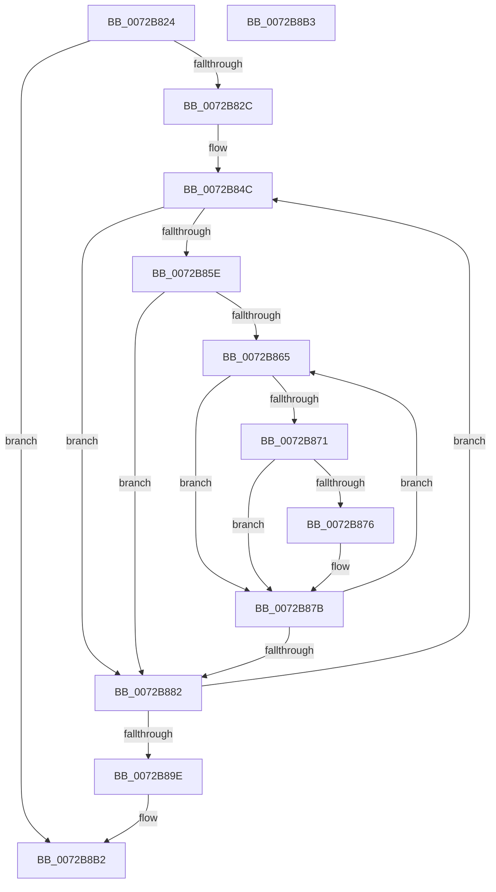

# PnpSelectFirstConfiguration

- RVA: `0x0072B824`–`0x0072B8B4` (길이 `144` bytes)
- VA: `0x000000014072B824`
- 실행 섹션: `PAGE`
- PDB 이름 있음: `예`; PDB Function 태그: `아니요`
- unwind 정보 RVA: `0x000C8588`
- 디코드: `44`개 명령, `144/144` bytes 표시
- 미해석 바이트: `0` (있으면 어셈블리에 `.byte`로 보존)

> 이 문서는 커널 이미지의 기계어와 PDB 기호를 분석해 생성했습니다. 4번과 5번은 함수 원형과 자료형을 바이너리 사용 방식에서 추정한 C 해석이며 원본 소스 복구 결과는 아닙니다.

## 1. Dependencies

- 직접 호출 지점: **1**; 고유 호출 대상: **1**
- 직접 호출자로 확인된 함수: **1**
- RIP 상대 이미지 참조: **0**

### Outgoing calls
- `0x0072B88F` → [IopAddRemoveReqDescs](../AB/IopAddRemoveReqDescs_function_00AB3FD0.md) (function, `0x00AB3FD0`)

### Direct callers
- [PnpFindBestConfigurationWorker](PnpFindBestConfigurationWorker_function_0072B688.md) at `0x0072B6C3`

### Static image references
- 디코드된 RIP-relative 메모리 참조가 없습니다.

## 2. Other-region calls and transfers

- 다른 실행 섹션으로 향하는 call: **0**
- 별도 외부 분기/꼬리 이동을 확인하지 못했습니다.

## 3. Assembly (complete function range)

```asm
0072B824  85 D2                           test edx, edx
0072B826  0F 84 86 00 00 00               je 0x14072b8b2
0072B82C  48 89 5C 24 08                  mov qword ptr [rsp + 8], rbx
0072B831  48 89 6C 24 10                  mov qword ptr [rsp + 0x10], rbp
0072B836  48 89 74 24 18                  mov qword ptr [rsp + 0x18], rsi
0072B83B  57                              push rdi
0072B83C  48 83 EC 20                     sub rsp, 0x20
0072B840  41 8B F1                        mov esi, r9d
0072B843  8B FA                           mov edi, edx
0072B845  49 8B E8                        mov rbp, r8
0072B848  48 8D 59 20                     lea rbx, [rcx + 0x20]
0072B84C  48 8B 03                        mov rax, qword ptr [rbx]
0072B84F  48 8D 48 28                     lea rcx, [rax + 0x28]
0072B853  48 89 48 10                     mov qword ptr [rax + 0x10], rcx
0072B857  48 8B 11                        mov rdx, qword ptr [rcx]
0072B85A  85 F6                           test esi, esi
0072B85C  74 24                           je 0x14072b882
0072B85E  33 C9                           xor ecx, ecx
0072B860  39 4A 14                        cmp dword ptr [rdx + 0x14], ecx
0072B863  76 1D                           jbe 0x14072b882
0072B865  4C 8B 44 CA 18                  mov r8, qword ptr [rdx + rcx*8 + 0x18]
0072B86A  41 80 78 08 00                  cmp byte ptr [r8 + 8], 0
0072B86F  74 0A                           je 0x14072b87b
0072B871  83 3A 01                        cmp dword ptr [rdx], 1
0072B874  75 05                           jne 0x14072b87b
0072B876  41 83 48 54 01                  or dword ptr [r8 + 0x54], 1
0072B87B  FF C1                           inc ecx
0072B87D  3B 4A 14                        cmp ecx, dword ptr [rdx + 0x14]
0072B880  72 E3                           jb 0x14072b865
0072B882  48 8D 4A 18                     lea rcx, [rdx + 0x18]
0072B886  41 B1 01                        mov r9b, 1
0072B889  8B 52 14                        mov edx, dword ptr [rdx + 0x14]
0072B88C  4C 8B C5                        mov r8, rbp
0072B88F  E8 3C 87 38 00                  call 0x140ab3fd0
0072B894  48 83 C3 40                     add rbx, 0x40
0072B898  48 83 EF 01                     sub rdi, 1
0072B89C  75 AE                           jne 0x14072b84c
0072B89E  48 8B 5C 24 30                  mov rbx, qword ptr [rsp + 0x30]
0072B8A3  48 8B 6C 24 38                  mov rbp, qword ptr [rsp + 0x38]
0072B8A8  48 8B 74 24 40                  mov rsi, qword ptr [rsp + 0x40]
0072B8AD  48 83 C4 20                     add rsp, 0x20
0072B8B1  5F                              pop rdi
0072B8B2  C3                              ret
0072B8B3  CC                              int3
```

## 4. C-style interpretation (structured pseudocode)

```c
__int64 __fastcall PnpSelectFirstConfiguration(__int64 a1, int a2, __int64 a3, int a4)
{
    __int64 result;
    __int64 v_rbx;
    __int64 v_rdi;
    __int64 v_rsp;
    unsigned __int64 v_stack_p10;
    unsigned __int64 v_stack_p18;
    unsigned __int64 v_stack_p8;

    if (a2 == 0) goto loc_0072B8B2;
    v_stack_p8 = v_rbx;
    v_stack_p10 = v_rbp;
    v_stack_p18 = v_rsi;
    v_rsp = (v_rsp) - (32);
loc_0072B84C:
    *(unsigned __int64 *)(*(unsigned __int64 *)(a1 + 32) + 16) = *(unsigned __int64 *)(a1 + 32) + 40;
    if ((unsigned int)((unsigned int)(a4)) == 0) goto loc_0072B882;
    a1 = 0;
    if ((*(unsigned int *)(*(unsigned __int64 *)(*(unsigned __int64 *)(a1 + 32) + 40) + 20)) <= 0) goto loc_0072B882;
loc_0072B865:
    if ((*(unsigned __int8 *)(*(unsigned __int64 *)(*(unsigned __int64 *)(*(unsigned __int64 *)(a1 + 32) + 40) + a1 * 8 + 24) + 8)) == 0) goto loc_0072B87B;
    if ((*(unsigned int *)(*(unsigned __int64 *)(*(unsigned __int64 *)(a1 + 32) + 40))) == 1) {
    }
    a1 = (unsigned int)((a1) + 1);
    if (((unsigned int)(a1)) < (*(unsigned int *)(*(unsigned __int64 *)(*(unsigned __int64 *)(a1 + 32) + 40) + 20))) goto loc_0072B865;
loc_0072B882:
    result = IopAddRemoveReqDescs(*(unsigned __int64 *)(*(unsigned __int64 *)(a1 + 32) + 40) + 24, (unsigned int)(*(unsigned int *)(*(unsigned __int64 *)(*(unsigned __int64 *)(a1 + 32) + 40) + 20)), a3, 1);
    v_rbx = (a1 + 32) + (64);
    v_rdi = ((unsigned int)(a2)) - (1);
    if (condition_is_not_equal) goto loc_0072B84C;
    v_rsp = (v_rsp) + (32);
loc_0072B8B2:
    return result;
}
```

## 5. (Beta) C Style

```c
int64_t PnpSelectFirstConfiguration(void *Arg1, int32_t Arg2, int64_t Arg3, int32_t Arg4)
{
    uint8_t *arg1 = (uint8_t *)Arg1;

    int64_t result;
    int64_t local_rbx;
    int64_t local_rdi;
    int64_t local_rsp;
    uint64_t v_stack_p10;
    uint64_t v_stack_p18;
    uint64_t v_stack_p8;

    if (Arg2 == 0) goto loc_0072B8B2;
    v_stack_p8 = local_rbx;
    v_stack_p10 = local_rbp;
    v_stack_p18 = local_rsi;
    local_rsp = (local_rsp) - (32);
loc_0072B84C:
    *(uint64_t *)(*(uint64_t *)(arg1 + 0x20) + 0x10) = *(uint64_t *)(arg1 + 0x20) + 40;
    if ((uint32_t)((uint32_t)(Arg4)) == 0) goto loc_0072B882;
    Arg1 = 0;
    if ((*(uint32_t *)(*(uint64_t *)(*(uint64_t *)(arg1 + 0x20) + 0x28) + 0x14)) <= 0) goto loc_0072B882;
loc_0072B865:
    if ((*(uint8_t *)(*(uint64_t *)(*(uint64_t *)(*(uint64_t *)(arg1 + 0x20) + 0x28) + arg1 * 8 + 0x18) + 0x8)) == 0) goto loc_0072B87B;
    if ((*(uint32_t *)(*(uint64_t *)(*(uint64_t *)(arg1 + 0x20) + 0x28))) == 1) {
    }
    Arg1 = (uint32_t)((Arg1) + 1);
    if (((uint32_t)(Arg1)) < (*(uint32_t *)(*(uint64_t *)(*(uint64_t *)(arg1 + 0x20) + 0x28) + 0x14))) goto loc_0072B865;
loc_0072B882:
    result = IopAddRemoveReqDescs(*(uint64_t *)(*(uint64_t *)(arg1 + 0x20) + 0x28) + 24, (uint32_t)(*(uint32_t *)(*(uint64_t *)(*(uint64_t *)(arg1 + 0x20) + 0x28) + 0x14)), Arg3, 1);
    local_rbx = (Arg1 + 32) + (64);
    local_rdi = ((uint32_t)(Arg2)) - (1);
    if (condition_is_not_equal) goto loc_0072B84C;
    local_rsp = (local_rsp) + (32);
loc_0072B8B2:
    return result;
}
```

### 관측된 메모리 오프셋

구조체 형식이 확인되지 않은 접근은 인자 기준의 오프셋으로만 기록했습니다.

| 기준 인자 | 오프셋 표현 | 폭 (bit) | 접근 |
|---|---:|---:|---|
| `Arg1` | `+ 0x0` | `64` | `R` |
| `Arg1` | `+ 0x20` | `64` | `R` |

## 6. Execution-region graph

[열기: 2D/3D 그래프와 함수 탐색 컨트롤 패널](../../../control-panel.html?section=page&rva=0x0072B824&view=graph)

- 2D 그래프는 위에서 아래로 흐르고, 3D 그래프는 빈 공간을 드래그해 회전합니다. Shift+드래그는 이동, 휠은 확대·축소, 함수 노드 선택은 대상 보고서 이동입니다.

### Static fallback


