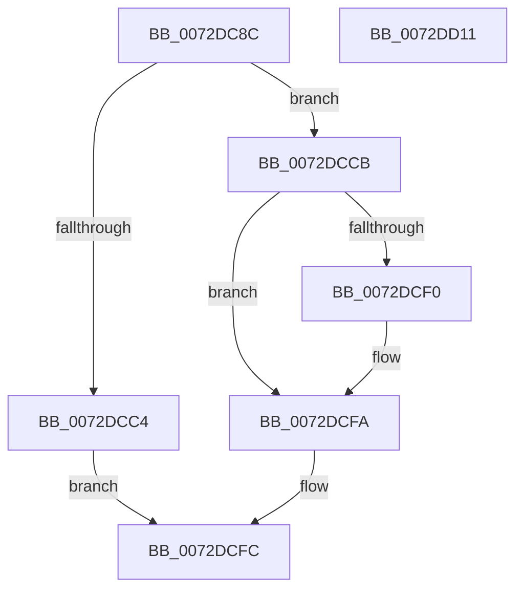

# PnpSetInterruptInformation

- RVA: `0x0072DC8C`–`0x0072DD12` (길이 `134` bytes)
- VA: `0x000000014072DC8C`
- 실행 섹션: `PAGE`
- PDB 이름 있음: `예`; PDB Function 태그: `아니요`
- unwind 정보 RVA: `0x0005C954`
- 디코드: `37`개 명령, `134/134` bytes 표시
- 미해석 바이트: `0` (있으면 어셈블리에 `.byte`로 보존)

> 이 문서는 커널 이미지의 기계어와 PDB 기호를 분석해 생성했습니다. 4번과 5번은 함수 원형과 자료형을 바이너리 사용 방식에서 추정한 C 해석이며 원본 소스 복구 결과는 아닙니다.

## 1. Dependencies

- 직접 호출 지점: **3**; 고유 호출 대상: **3**
- 직접 호출자로 확인된 함수: **1**
- RIP 상대 이미지 참조: **0**

### Outgoing calls
- `0x0072DCB7` → [ExAllocatePool2](../../poolcode/B8/ExAllocatePool2_function_00B820F0.md) (function, `0x00B820F0`)
- `0x0072DCD7` → [memcpy](../../text/6C/memcpy_function_006C6840.md) (function, `0x006C6840`)
- `0x0072DCF5` → [ExFreePoolWithTag](../../poolcode/B8/ExFreePoolWithTag_function_00B82870.md) (function, `0x00B82870`)

### Direct callers
- [PnpSetDevicePropertyData](../8F/PnpSetDevicePropertyData_function_008F6114.md) at `0x008F6250`

### Static image references
- 디코드된 RIP-relative 메모리 참조가 없습니다.

## 2. Other-region calls and transfers

- 다른 실행 섹션으로 향하는 call: **3**
  - `0x0072DCB7` → [ExAllocatePool2](../../poolcode/B8/ExAllocatePool2_function_00B820F0.md) (`PAGE` → `POOLCODE`)
  - `0x0072DCD7` → [memcpy](../../text/6C/memcpy_function_006C6840.md) (`PAGE` → `.text`)
  - `0x0072DCF5` → [ExFreePoolWithTag](../../poolcode/B8/ExFreePoolWithTag_function_00B82870.md) (`PAGE` → `POOLCODE`)
- 별도 외부 분기/꼬리 이동을 확인하지 못했습니다.

## 3. Assembly (complete function range)

```asm
0072DC8C  48 89 5C 24 08                  mov qword ptr [rsp + 8], rbx
0072DC91  48 89 6C 24 10                  mov qword ptr [rsp + 0x10], rbp
0072DC96  48 89 74 24 18                  mov qword ptr [rsp + 0x18], rsi
0072DC9B  57                              push rdi
0072DC9C  48 83 EC 20                     sub rsp, 0x20
0072DCA0  41 8B F8                        mov edi, r8d
0072DCA3  48 8B F2                        mov rsi, rdx
0072DCA6  48 8B E9                        mov rbp, rcx
0072DCA9  41 B8 50 6E 70 47               mov r8d, 0x47706e50
0072DCAF  B9 00 01 00 00                  mov ecx, 0x100
0072DCB4  8D 57 04                        lea edx, [rdi + 4]
0072DCB7  E8 34 44 45 00                  call 0x140b820f0
0072DCBC  48 8B D8                        mov rbx, rax
0072DCBF  48 85 C0                        test rax, rax
0072DCC2  75 07                           jne 0x14072dccb
0072DCC4  B8 9A 00 00 C0                  mov eax, 0xc000009a
0072DCC9  EB 31                           jmp 0x14072dcfc
0072DCCB  4C 8B C7                        mov r8, rdi
0072DCCE  89 38                           mov dword ptr [rax], edi
0072DCD0  48 8D 48 04                     lea rcx, [rax + 4]
0072DCD4  48 8B D6                        mov rdx, rsi
0072DCD7  E8 64 8B F9 FF                  call 0x1406c6840
0072DCDC  48 8B 85 38 01 00 00            mov rax, qword ptr [rbp + 0x138]
0072DCE3  48 8B 48 58                     mov rcx, qword ptr [rax + 0x58]
0072DCE7  48 89 58 58                     mov qword ptr [rax + 0x58], rbx
0072DCEB  48 85 C9                        test rcx, rcx
0072DCEE  74 0A                           je 0x14072dcfa
0072DCF0  BA 50 6E 70 47                  mov edx, 0x47706e50
0072DCF5  E8 76 4B 45 00                  call 0x140b82870
0072DCFA  33 C0                           xor eax, eax
0072DCFC  48 8B 5C 24 30                  mov rbx, qword ptr [rsp + 0x30]
0072DD01  48 8B 6C 24 38                  mov rbp, qword ptr [rsp + 0x38]
0072DD06  48 8B 74 24 40                  mov rsi, qword ptr [rsp + 0x40]
0072DD0B  48 83 C4 20                     add rsp, 0x20
0072DD0F  5F                              pop rdi
0072DD10  C3                              ret
0072DD11  CC                              int3
```

## 4. C-style interpretation (structured pseudocode)

```c
__int64 __fastcall PnpSetInterruptInformation(__int64 a1, __int64 a2, int a3)
{
    __int64 result;
    __int64 v_rsp;
    unsigned __int64 v_stack_p10;
    unsigned __int64 v_stack_p18;
    unsigned __int64 v_stack_p8;

    v_stack_p8 = v_rbx;
    v_stack_p10 = v_rbp;
    v_stack_p18 = v_rsi;
    v_rsp = (v_rsp) - (32);
    result = ExAllocatePool2(256, (unsigned int)(a3) + 4, (unsigned int)(0x47706E50ULL), a4);
    if (result != 0) goto loc_0072DCCB;
    goto loc_0072DCFC;
loc_0072DCCB:
    *(unsigned int *)((unsigned int)(0xC000009AULL)) = (unsigned int)((unsigned int)(a3));
    result = memcpy((unsigned int)(0xC000009AULL) + 4, a2, (unsigned int)(a3), a4);
    *(unsigned __int64 *)(*(unsigned __int64 *)(a1 + 312) + 88) = result;
    result = *(unsigned __int64 *)(a1 + 312);
    if (*(unsigned __int64 *)(*(unsigned __int64 *)(a1 + 312) + 88) != 0) {
        a2 = 0x47706E50ULL;
        result = ExFreePoolWithTag(*(unsigned __int64 *)(*(unsigned __int64 *)(a1 + 312) + 88), a2, (unsigned int)(a3), a4);
    }
    result = 0;
loc_0072DCFC:
    v_rsp = (v_rsp) + (32);
    return result;
}
```

## 5. (Beta) C Style

```c
int64_t PnpSetInterruptInformation(void *Arg1, int64_t Arg2, void *Arg3)
{
    uint8_t *arg1 = (uint8_t *)Arg1;
    uint8_t *arg3 = (uint8_t *)Arg3;

    int64_t result;
    int64_t local_rsp;
    uint64_t v_stack_p10;
    uint64_t v_stack_p18;
    uint64_t v_stack_p8;

    v_stack_p8 = local_rbx;
    v_stack_p10 = local_rbp;
    v_stack_p18 = local_rsi;
    local_rsp = (local_rsp) - (32);
    result = ExAllocatePool2(256, (uint32_t)(Arg3) + 4, (uint32_t)(0x47706E50ULL), a4);
    if (result != 0) goto loc_0072DCCB;
    goto loc_0072DCFC;
loc_0072DCCB:
    *(uint32_t *)((uint32_t)(0xC000009AULL)) = (uint32_t)((uint32_t)(Arg3));
    result = memcpy((uint32_t)(0xC000009AULL) + 4, Arg2, (uint32_t)(Arg3), a4);
    *(uint64_t *)(*(uint64_t *)(arg1 + 0x138) + 0x58) = result;
    result = *(uint64_t *)(arg1 + 0x138);
    if (*(uint64_t *)(*(uint64_t *)(arg1 + 0x138) + 0x58) != 0) {
        Arg2 = 0x47706E50ULL;
        result = ExFreePoolWithTag(*(uint64_t *)(*(uint64_t *)(arg1 + 0x138) + 0x58), Arg2, (uint32_t)(Arg3), a4);
    }
    result = 0;
loc_0072DCFC:
    local_rsp = (local_rsp) + (32);
    return result;
}
```

### 관측된 메모리 오프셋

구조체 형식이 확인되지 않은 접근은 인자 기준의 오프셋으로만 기록했습니다.

| 기준 인자 | 오프셋 표현 | 폭 (bit) | 접근 |
|---|---:|---:|---|
| `Arg1` | `+ 0x138` | `64` | `R` |
| `Arg3` | `+ 0x4` | `32` | `R` |

## 6. Execution-region graph

[열기: 2D/3D 그래프와 함수 탐색 컨트롤 패널](../../../control-panel.html?section=page&rva=0x0072DC8C&view=graph)

- 2D 그래프는 위에서 아래로 흐르고, 3D 그래프는 빈 공간을 드래그해 회전합니다. Shift+드래그는 이동, 휠은 확대·축소, 함수 노드 선택은 대상 보고서 이동입니다.

### Static fallback


