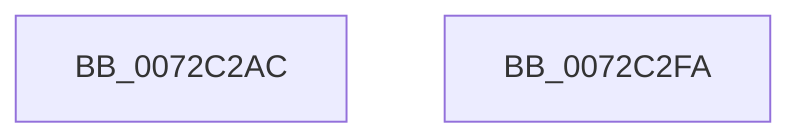

# PnpSetRegistryDword

- RVA: `0x0072C2AC`–`0x0072C2FB` (길이 `79` bytes)
- VA: `0x000000014072C2AC`
- 실행 섹션: `PAGE`
- PDB 이름 있음: `예`; PDB Function 태그: `아니요`
- unwind 정보 RVA: `0x00071A74`
- 디코드: `20`개 명령, `79/79` bytes 표시
- 미해석 바이트: `0` (있으면 어셈블리에 `.byte`로 보존)

> 이 문서는 커널 이미지의 기계어와 PDB 기호를 분석해 생성했습니다. 4번과 5번은 함수 원형과 자료형을 바이너리 사용 방식에서 추정한 C 해석이며 원본 소스 복구 결과는 아닙니다.

## 1. Dependencies

- 직접 호출 지점: **2**; 고유 호출 대상: **2**
- 직접 호출자로 확인된 함수: **1**
- RIP 상대 이미지 참조: **0**

### Outgoing calls
- `0x0072C2CA` → [RtlInitUnicodeString](../../text/42/RtlInitUnicodeString_function_0042A780.md) (function, `0x0042A780`)
- `0x0072C2EF` → [ZwSetValueKey](../../text/6A/ZwSetValueKey_function_006ADCD0.md) (function, `0x006ADCD0`)

### Direct callers
- [IoReportDetectedDevice](IoReportDetectedDevice_function_00725CD0.md) at `0x0072638A`
- [IoReportDetectedDevice](IoReportDetectedDevice_function_00725CD0.md) at `0x00726623`

### Static image references
- 디코드된 RIP-relative 메모리 참조가 없습니다.

## 2. Other-region calls and transfers

- 다른 실행 섹션으로 향하는 call: **2**
  - `0x0072C2CA` → [RtlInitUnicodeString](../../text/42/RtlInitUnicodeString_function_0042A780.md) (`PAGE` → `.text`)
  - `0x0072C2EF` → [ZwSetValueKey](../../text/6A/ZwSetValueKey_function_006ADCD0.md) (`PAGE` → `.text`)
- 별도 외부 분기/꼬리 이동을 확인하지 못했습니다.

## 3. Assembly (complete function range)

```asm
0072C2AC  40 53                           push rbx
0072C2AE  48 83 EC 50                     sub rsp, 0x50
0072C2B2  48 8B D9                        mov rbx, rcx
0072C2B5  C7 44 24 30 01 00 00 00         mov dword ptr [rsp + 0x30], 1
0072C2BD  0F 57 C0                        xorps xmm0, xmm0
0072C2C0  48 8D 4C 24 38                  lea rcx, [rsp + 0x38]
0072C2C5  0F 11 44 24 38                  movups xmmword ptr [rsp + 0x38], xmm0
0072C2CA  E8 B1 E4 CF FF                  call 0x14042a780
0072C2CF  41 B9 04 00 00 00               mov r9d, 4
0072C2D5  48 8D 44 24 30                  lea rax, [rsp + 0x30]
0072C2DA  44 89 4C 24 28                  mov dword ptr [rsp + 0x28], r9d
0072C2DF  48 8D 54 24 38                  lea rdx, [rsp + 0x38]
0072C2E4  45 33 C0                        xor r8d, r8d
0072C2E7  48 89 44 24 20                  mov qword ptr [rsp + 0x20], rax
0072C2EC  48 8B CB                        mov rcx, rbx
0072C2EF  E8 DC 19 F8 FF                  call 0x1406adcd0
0072C2F4  48 83 C4 50                     add rsp, 0x50
0072C2F8  5B                              pop rbx
0072C2F9  C3                              ret
0072C2FA  CC                              int3
```

## 4. C-style interpretation (structured pseudocode)

```c
__int64 __fastcall PnpSetRegistryDword(__int64 a1, __int64 a2, int a3)
{
    __int64 result;
    __int64 v_rsp;
    unsigned __int64 v_stack_m20;
    unsigned int v_stack_m28;
    unsigned int v_stack_m30;
    unsigned __int64 v_stack_m38;

    v_rsp = (v_rsp) - (80);
    v_stack_m28 = 1;
    v_stack_m20 = v_xmm0;
    result = RtlInitUnicodeString(v_stack_m20, a2, a3, a4);
    v_stack_m30 = 4;
    a3 = 0;
    v_stack_m38 = v_stack_m28;
    result = ZwSetValueKey(a1, v_stack_m20, a3, 4);
    v_rsp = (v_rsp) + (80);
    return result;
}
```

## 5. (Beta) C Style

```c
int64_t PnpSetRegistryDword(int64_t Arg1, int64_t Arg2, int32_t Arg3)
{
    int64_t result;
    int64_t local_rsp;
    uint64_t v_stack_m20;
    uint32_t v_stack_m28;
    uint32_t v_stack_m30;
    uint64_t v_stack_m38;

    local_rsp = (local_rsp) - (80);
    v_stack_m28 = 1;
    v_stack_m20 = v_xmm0;
    result = RtlInitUnicodeString(v_stack_m20, Arg2, Arg3, a4);
    v_stack_m30 = 4;
    Arg3 = 0;
    v_stack_m38 = v_stack_m28;
    result = ZwSetValueKey(Arg1, v_stack_m20, Arg3, 4);
    local_rsp = (local_rsp) + (80);
    return result;
}
```

## 6. Execution-region graph

[열기: 2D/3D 그래프와 함수 탐색 컨트롤 패널](../../../control-panel.html?section=page&rva=0x0072C2AC&view=graph)

- 2D 그래프는 위에서 아래로 흐르고, 3D 그래프는 빈 공간을 드래그해 회전합니다. Shift+드래그는 이동, 휠은 확대·축소, 함수 노드 선택은 대상 보고서 이동입니다.

### Static fallback


