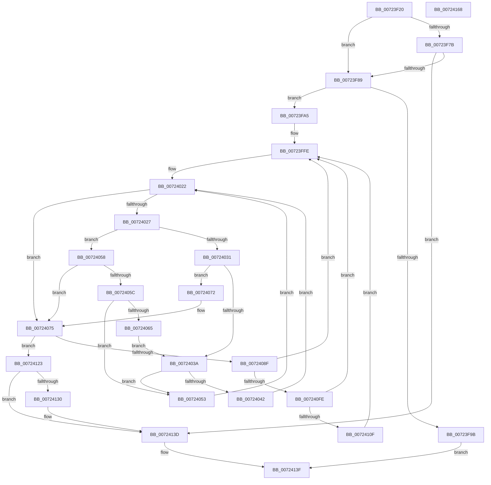

# PnpShutdownDevices

- RVA: `0x00723F20`–`0x00724169` (길이 `585` bytes)
- VA: `0x0000000140723F20`
- 실행 섹션: `PAGE`
- PDB 이름 있음: `예`; PDB Function 태그: `아니요`
- unwind 정보 RVA: `0x000C8160`
- 디코드: `144`개 명령, `585/585` bytes 표시
- 미해석 바이트: `0` (있으면 어셈블리에 `.byte`로 보존)

> 이 문서는 커널 이미지의 기계어와 PDB 기호를 분석해 생성했습니다. 4번과 5번은 함수 원형과 자료형을 바이너리 사용 방식에서 추정한 C 해석이며 원본 소스 복구 결과는 아닙니다.

## 1. Dependencies

- 직접 호출 지점: **15**; 고유 호출 대상: **11**
- 직접 호출자로 확인된 함수: **1**
- RIP 상대 이미지 참조: **8**

### Outgoing calls
- `0x00723F6A` → [KeSetEvent](../../text/33/KeSetEvent_function_0033F310.md) (function, `0x0033F310`)
- `0x00723F8E` → [PnpCreateDeviceEventEntry](../95/PnpCreateDeviceEventEntry_function_00951B48.md) (function, `0x00951B48`)
- `0x00723FB9` → [KeWaitForSingleObject](../../text/20/KeWaitForSingleObject_function_0020E6B0.md) (function, `0x0020E6B0`)
- `0x00723FD2` → [KeWaitForSingleObject](../../text/20/KeWaitForSingleObject_function_0020E6B0.md) (function, `0x0020E6B0`)
- `0x00723FF5` → [PipSetDevNodeUserFlags](../8F/PipSetDevNodeUserFlags_function_008FB8FC.md) (function, `0x008FB8FC`)
- `0x00724019` → [ExAcquireResourceSharedLite](../../text/21/ExAcquireResourceSharedLite_function_00211BC0.md) (function, `0x00211BC0`)
- `0x0072404C` → [PipSetDevNodeUserFlags](../8F/PipSetDevNodeUserFlags_function_008FB8FC.md) (function, `0x008FB8FC`)
- `0x0072406B` → [PipSetDevNodeUserFlags](../8F/PipSetDevNodeUserFlags_function_008FB8FC.md) (function, `0x008FB8FC`)
- `0x0072407C` → [ExReleaseResourceLite](../../text/25/ExReleaseResourceLite_function_0025FA10.md) (function, `0x0025FA10`)
- `0x00724081` → [KeLeaveCriticalRegion](../../text/25/KeLeaveCriticalRegion_function_0025D8B0.md) (function, `0x0025D8B0`)
- `0x007240DA` → [PnpInitializeTargetDeviceRemoveEvent](../94/PnpInitializeTargetDeviceRemoveEvent_function_0094FBC8.md) (function, `0x0094FBC8`)
- `0x007240E9` → [PnpProcessQueryRemoveAndEject](../A0/PnpProcessQueryRemoveAndEject_function_00A05170.md) (function, `0x00A05170`)
- `0x00724119` → [ExFreePoolWithTag](../../poolcode/B8/ExFreePoolWithTag_function_00B82870.md) (function, `0x00B82870`)
- `0x00724138` → [ExFreePoolWithTag](../../poolcode/B8/ExFreePoolWithTag_function_00B82870.md) (function, `0x00B82870`)
- `0x00724146` → [_security_check_cookie](../../text/6A/_security_check_cookie_function_006AC640.md) (function, `0x006AC640`)

### Direct callers
- [IoShutdownSystem](../../pagelk/B6/IoShutdownSystem_function_00B63B8C.md) at `0x00B63C1F`

### Static image references
- `0x00723F3F` → RVA `0x00E0A740` (`.data`; read)
- `0x00723F50` → RVA `0x00F8C5E0` (`.data`; read)
- `0x00723F6F` → RVA `0x00F8CFD8` (`.data`; read)
- `0x00723F7B` → RVA `0x00F0C8B0` (`.data`; read)
- `0x00723FB0` → RVA `0x00F8AC80` (`.data`; read)
- `0x00723FC9` → RVA `0x00F8AD60` (`.data`; read)
- `0x00723FD7` → RVA `0x00F8C438` (`.data`; read)
- `0x00724007` → RVA `0x00F8C600` (`.data`; read)

## 2. Other-region calls and transfers

- 다른 실행 섹션으로 향하는 call: **9**
  - `0x00723F6A` → [KeSetEvent](../../text/33/KeSetEvent_function_0033F310.md) (`PAGE` → `.text`)
  - `0x00723FB9` → [KeWaitForSingleObject](../../text/20/KeWaitForSingleObject_function_0020E6B0.md) (`PAGE` → `.text`)
  - `0x00723FD2` → [KeWaitForSingleObject](../../text/20/KeWaitForSingleObject_function_0020E6B0.md) (`PAGE` → `.text`)
  - `0x00724019` → [ExAcquireResourceSharedLite](../../text/21/ExAcquireResourceSharedLite_function_00211BC0.md) (`PAGE` → `.text`)
  - `0x0072407C` → [ExReleaseResourceLite](../../text/25/ExReleaseResourceLite_function_0025FA10.md) (`PAGE` → `.text`)
  - `0x00724081` → [KeLeaveCriticalRegion](../../text/25/KeLeaveCriticalRegion_function_0025D8B0.md) (`PAGE` → `.text`)
  - `0x00724119` → [ExFreePoolWithTag](../../poolcode/B8/ExFreePoolWithTag_function_00B82870.md) (`PAGE` → `POOLCODE`)
  - `0x00724138` → [ExFreePoolWithTag](../../poolcode/B8/ExFreePoolWithTag_function_00B82870.md) (`PAGE` → `POOLCODE`)
  - `0x00724146` → [_security_check_cookie](../../text/6A/_security_check_cookie_function_006AC640.md) (`PAGE` → `.text`)
- 별도 외부 분기/꼬리 이동을 확인하지 못했습니다.

## 3. Assembly (complete function range)

```asm
00723F20  48 8B C4                        mov rax, rsp
00723F23  48 89 58 08                     mov qword ptr [rax + 8], rbx
00723F27  48 89 70 10                     mov qword ptr [rax + 0x10], rsi
00723F2B  48 89 78 18                     mov qword ptr [rax + 0x18], rdi
00723F2F  55                              push rbp
00723F30  41 54                           push r12
00723F32  41 56                           push r14
00723F34  48 8D 68 A8                     lea rbp, [rax - 0x58]
00723F38  48 81 EC 40 01 00 00            sub rsp, 0x140
00723F3F  48 8B 05 FA 67 6E 00            mov rax, qword ptr [rip + 0x6e67fa]
00723F46  48 33 C4                        xor rax, rsp
00723F49  48 89 45 30                     mov qword ptr [rbp + 0x30], rax
00723F4D  45 33 F6                        xor r14d, r14d
00723F50  48 8D 0D 89 86 86 00            lea rcx, [rip + 0x868689]
00723F57  45 33 C0                        xor r8d, r8d
00723F5A  4C 89 74 24 70                  mov qword ptr [rsp + 0x70], r14
00723F5F  33 D2                           xor edx, edx
00723F61  44 89 75 84                     mov dword ptr [rbp - 0x7c], r14d
00723F65  44 89 74 24 78                  mov dword ptr [rsp + 0x78], r14d
00723F6A  E8 A1 B3 C1 FF                  call 0x14033f310
00723F6F  44 38 35 62 90 86 00            cmp byte ptr [rip + 0x869062], r14b
00723F76  41 8B F6                        mov esi, r14d
00723F79  75 0E                           jne 0x140723f89
00723F7B  8B 05 2F 89 7E 00               mov eax, dword ptr [rip + 0x7e892f]
00723F81  A8 20                           test al, 0x20
00723F83  0F 84 B4 01 00 00               je 0x14072413d
00723F89  B9 91 01 00 00                  mov ecx, 0x191
00723F8E  E8 B5 DB 22 00                  call 0x140951b48
00723F93  48 8B F8                        mov rdi, rax
00723F96  48 85 C0                        test rax, rax
00723F99  75 0A                           jne 0x140723fa5
00723F9B  B8 9A 00 00 C0                  mov eax, 0xc000009a
00723FA0  E9 9A 01 00 00                  jmp 0x14072413f
00723FA5  45 33 C9                        xor r9d, r9d
00723FA8  4C 89 74 24 20                  mov qword ptr [rsp + 0x20], r14
00723FAD  45 33 C0                        xor r8d, r8d
00723FB0  48 8D 0D C9 6C 86 00            lea rcx, [rip + 0x866cc9]
00723FB7  33 D2                           xor edx, edx
00723FB9  E8 F2 A6 AE FF                  call 0x14020e6b0
00723FBE  45 33 C9                        xor r9d, r9d
00723FC1  4C 89 74 24 20                  mov qword ptr [rsp + 0x20], r14
00723FC6  45 33 C0                        xor r8d, r8d
00723FC9  48 8D 0D 90 6D 86 00            lea rcx, [rip + 0x866d90]
00723FD0  33 D2                           xor edx, edx
00723FD2  E8 D9 A6 AE FF                  call 0x14020e6b0
00723FD7  48 8B 1D 5A 84 86 00            mov rbx, qword ptr [rip + 0x86845a]
00723FDE  48 8D 45 90                     lea rax, [rbp - 0x70]
00723FE2  48 8B CB                        mov rcx, rbx
00723FE5  48 89 45 88                     mov qword ptr [rbp - 0x78], rax
00723FE9  BA 10 00 00 00                  mov edx, 0x10
00723FEE  C7 45 80 00 00 A0 00            mov dword ptr [rbp - 0x80], 0xa00000
00723FF5  E8 02 79 1D 00                  call 0x1408fb8fc
00723FFA  41 83 CC FF                     or r12d, 0xffffffff
00723FFE  65 48 8B 04 25 88 01 00 00      mov rax, qword ptr gs:[0x188]
00724007  48 8D 0D F2 85 86 00            lea rcx, [rip + 0x8685f2]
0072400E  B2 01                           mov dl, 1
00724010  66 44 01 A0 E4 01 00 00         add word ptr [rax + 0x1e4], r12w
00724018  90                              nop
00724019  E8 A2 DB AE FF                  call 0x140211bc0
0072401E  48 8B 5B 08                     mov rbx, qword ptr [rbx + 8]
00724022  48 85 DB                        test rbx, rbx
00724025  74 4E                           je 0x140724075
00724027  8B 83 90 01 00 00               mov eax, dword ptr [rbx + 0x190]
0072402D  A8 20                           test al, 0x20
0072402F  74 27                           je 0x140724058
00724031  48 3B 1D 00 84 86 00            cmp rbx, qword ptr [rip + 0x868400]
00724038  74 38                           je 0x140724072
0072403A  48 8B 03                        mov rax, qword ptr [rbx]
0072403D  48 85 C0                        test rax, rax
00724040  75 11                           jne 0x140724053
00724042  48 8B 5B 10                     mov rbx, qword ptr [rbx + 0x10]
00724046  8D 50 20                        lea edx, [rax + 0x20]
00724049  48 8B CB                        mov rcx, rbx
0072404C  E8 AB 78 1D 00                  call 0x1408fb8fc
00724051  EB CF                           jmp 0x140724022
00724053  48 8B D8                        mov rbx, rax
00724056  EB CA                           jmp 0x140724022
00724058  A8 10                           test al, 0x10
0072405A  74 19                           je 0x140724075
0072405C  48 8B 43 08                     mov rax, qword ptr [rbx + 8]
00724060  48 85 C0                        test rax, rax
00724063  75 EE                           jne 0x140724053
00724065  8D 50 20                        lea edx, [rax + 0x20]
00724068  48 8B CB                        mov rcx, rbx
0072406B  E8 8C 78 1D 00                  call 0x1408fb8fc
00724070  EB C8                           jmp 0x14072403a
00724072  49 8B DE                        mov rbx, r14
00724075  48 8D 0D 84 85 86 00            lea rcx, [rip + 0x868584]
0072407C  E8 8F B9 B3 FF                  call 0x14025fa10
00724081  E8 2A 98 B3 FF                  call 0x14025d8b0
00724086  48 85 DB                        test rbx, rbx
00724089  0F 84 94 00 00 00               je 0x140724123
0072408F  4C 8B 43 20                     mov r8, qword ptr [rbx + 0x20]
00724093  48 8D 45 80                     lea rax, [rbp - 0x80]
00724097  48 89 44 24 60                  mov qword ptr [rsp + 0x60], rax
0072409C  45 33 C9                        xor r9d, r9d
0072409F  48 8D 44 24 78                  lea rax, [rsp + 0x78]
007240A4  BA 91 01 00 00                  mov edx, 0x191
007240A9  48 89 44 24 58                  mov qword ptr [rsp + 0x58], rax
007240AE  48 8B CF                        mov rcx, rdi
007240B1  4C 89 74 24 50                  mov qword ptr [rsp + 0x50], r14
007240B6  4C 89 74 24 48                  mov qword ptr [rsp + 0x48], r14
007240BB  44 89 74 24 40                  mov dword ptr [rsp + 0x40], r14d
007240C0  C7 44 24 38 2E 00 00 00         mov dword ptr [rsp + 0x38], 0x2e
007240C8  44 89 74 24 30                  mov dword ptr [rsp + 0x30], r14d
007240CD  44 89 74 24 28                  mov dword ptr [rsp + 0x28], r14d
007240D2  C7 44 24 20 01 00 00 00         mov dword ptr [rsp + 0x20], 1
007240DA  E8 E9 BA 22 00                  call 0x14094fbc8
007240DF  48 8D 4C 24 70                  lea rcx, [rsp + 0x70]
007240E4  48 89 7C 24 70                  mov qword ptr [rsp + 0x70], rdi
007240E9  E8 82 10 2E 00                  call 0x140a05170
007240EE  48 8B 54 24 70                  mov rdx, qword ptr [rsp + 0x70]
007240F3  8B F0                           mov esi, eax
007240F5  48 3B D7                        cmp rdx, rdi
007240F8  0F 84 00 FF FF FF               je 0x140723ffe
007240FE  41 8B CC                        mov ecx, r12d
00724101  F0 0F C1 4A 40                  lock xadd dword ptr [rdx + 0x40], ecx
00724106  41 03 CC                        add ecx, r12d
00724109  0F 85 EF FE FF FF               jne 0x140723ffe
0072410F  48 8B 4C 24 70                  mov rcx, qword ptr [rsp + 0x70]
00724114  BA 50 6E 70 4B                  mov edx, 0x4b706e50
00724119  E8 52 E7 45 00                  call 0x140b82870
0072411E  E9 DB FE FF FF                  jmp 0x140723ffe
00724123  41 8B C4                        mov eax, r12d
00724126  F0 0F C1 47 40                  lock xadd dword ptr [rdi + 0x40], eax
0072412B  41 03 C4                        add eax, r12d
0072412E  75 0D                           jne 0x14072413d
00724130  BA 50 6E 70 4B                  mov edx, 0x4b706e50
00724135  48 8B CF                        mov rcx, rdi
00724138  E8 33 E7 45 00                  call 0x140b82870
0072413D  8B C6                           mov eax, esi
0072413F  48 8B 4D 30                     mov rcx, qword ptr [rbp + 0x30]
00724143  48 33 CC                        xor rcx, rsp
00724146  E8 F5 84 F8 FF                  call 0x1406ac640
0072414B  4C 8D 9C 24 40 01 00 00         lea r11, [rsp + 0x140]
00724153  49 8B 5B 20                     mov rbx, qword ptr [r11 + 0x20]
00724157  49 8B 73 28                     mov rsi, qword ptr [r11 + 0x28]
0072415B  49 8B 7B 30                     mov rdi, qword ptr [r11 + 0x30]
0072415F  49 8B E3                        mov rsp, r11
00724162  41 5E                           pop r14
00724164  41 5C                           pop r12
00724166  5D                              pop rbp
00724167  C3                              ret
00724168  CC                              int3
```

## 4. C-style interpretation (structured pseudocode)

```c
__int64 __fastcall PnpShutdownDevices(__int64 a1, int a2, int a3, int a4)
{
    __int64 result;
    __int64 v_r12;
    __int64 v_r14;
    __int64 v_rsp;
    unsigned __int64 v_stack_m100;
    unsigned __int64 v_stack_m108;
    unsigned __int64 v_stack_m110;
    unsigned int v_stack_m118;
    unsigned int v_stack_m120;
    unsigned int v_stack_m128;
    unsigned int v_stack_m130;
    unsigned __int64 v_stack_m138;
    unsigned __int64 v_stack_m18;
    unsigned int v_stack_mE0;
    unsigned __int64 v_stack_mE8;
    unsigned __int64 v_stack_mF8;

    *(unsigned __int64 *)(v_rsp + 8) = v_rbx;
    *(unsigned __int64 *)(v_rsp + 16) = v_rsi;
    *(unsigned __int64 *)(v_rsp + 24) = v_rdi;
    v_rsp = (v_rsp) - (320);
    result = (*(unsigned __int64 *)(v_rip + 7235578)) ^ (v_rsp);
    *(unsigned __int64 *)(v_rsp - 88 + 48) = result;
    v_r14 = 0;
    a3 = 0;
    v_stack_mE8 = 0;
    a2 = 0;
    *(unsigned int *)(v_rsp - 88 - 124) = 0;
    v_stack_mE0 = 0;
    result = KeSetEvent(v_rip + 8816265, a2, a3, a4);
    if ((*(unsigned __int8 *)(v_rip + 8818786)) != 0) goto loc_00723F89;
    if ((((unsigned __int8)((unsigned int)(*(unsigned int *)(v_rip + 8292655)))) & (32)) == 0) goto loc_0072413D;
loc_00723F89:
    result = PnpCreateDeviceEventEntry(401, a2, a3, a4);
    if (result != 0) goto loc_00723FA5;
    goto loc_0072413F;
loc_00723FA5:
    a4 = 0;
    v_stack_m138 = 0;
    a3 = 0;
    a2 = 0;
    result = KeWaitForSingleObject(v_rip + 8809673, a2, a3, a4);
    a4 = 0;
    v_stack_m138 = 0;
    a3 = 0;
    a2 = 0;
    result = KeWaitForSingleObject(v_rip + 8809872, a2, a3, a4);
    *(unsigned __int64 *)(v_rsp - 88 - 120) = v_rsp - 88 - 112;
    *(unsigned int *)(v_rsp - 88 - 128) = 0xA00000ULL;
    result = PipSetDevNodeUserFlags(*(unsigned __int64 *)(v_rip + 8815706), 16, a3, a4);
    v_r12 = (unsigned int)((v_r12) | (0xFFFFFFFFULL));
loc_00723FFE:
    result = ExAcquireResourceSharedLite(v_rip + 8816114, 1, a3, a4);
loc_00724022:
    if (*(unsigned __int64 *)(*(unsigned __int64 *)(v_rip + 8815706) + 8) == 0) goto loc_00724075;
    if ((((unsigned __int8)((unsigned int)(*(unsigned int *)(*(unsigned __int64 *)(*(unsigned __int64 *)(v_rip + 8815706) + 8) + 400)))) & (32)) == 0) goto loc_00724058;
    if ((*(unsigned __int64 *)(*(unsigned __int64 *)(v_rip + 8815706) + 8)) == (*(unsigned __int64 *)(v_rip + 8815616))) goto loc_00724072;
loc_0072403A:
    if (*(unsigned __int64 *)(*(unsigned __int64 *)(*(unsigned __int64 *)(v_rip + 8815706) + 8)) != 0) goto loc_00724053;
    result = PipSetDevNodeUserFlags(*(unsigned __int64 *)(*(unsigned __int64 *)(*(unsigned __int64 *)(v_rip + 8815706) + 8) + 16), *(unsigned __int64 *)(*(unsigned __int64 *)(*(unsigned __int64 *)(v_rip + 8815706) + 8)) + 32, a3, a4);
    goto loc_00724022;
loc_00724053:
    goto loc_00724022;
loc_00724058:
    if ((((unsigned __int8)(result)) & (16)) == 0) goto loc_00724075;
    if (*(unsigned __int64 *)(result + 8) != 0) goto loc_00724053;
    result = PipSetDevNodeUserFlags(result, *(unsigned __int64 *)(result + 8) + 32, a3, a4);
    goto loc_0072403A;
loc_00724072:
loc_00724075:
    result = ExReleaseResourceLite(v_rip + 8816004, *(unsigned __int64 *)(result + 8) + 32, a3, a4);
    result = KeLeaveCriticalRegion(v_rip + 8816004, *(unsigned __int64 *)(result + 8) + 32, a3, a4);
    if (0 == 0) goto loc_00724123;
    v_stack_mF8 = v_rsp - 88 - 128;
    a4 = 0;
    v_stack_m100 = v_stack_mE0;
    v_stack_m108 = 0;
    v_stack_m110 = 0;
    v_stack_m118 = 0;
    v_stack_m120 = 46;
    v_stack_m128 = 0;
    v_stack_m130 = 0;
    v_stack_m138 = 1;
    result = PnpInitializeTargetDeviceRemoveEvent(result, 401, *(unsigned __int64 *)(0 + 32), a4);
    v_stack_mE8 = result;
    result = PnpProcessQueryRemoveAndEject(v_stack_mE8, 401, *(unsigned __int64 *)(0 + 32), a4);
    if (v_stack_mE8 == result) goto loc_00723FFE;
    a1 = (unsigned int)(((unsigned int)((unsigned int)(v_r12))) + ((unsigned int)(v_r12)));
    if (condition_is_not_equal) goto loc_00723FFE;
    result = ExFreePoolWithTag(v_stack_mE8, (unsigned int)(0x4B706E50ULL), *(unsigned __int64 *)(0 + 32), a4);
    goto loc_00723FFE;
loc_00724123:
    result = (unsigned int)(((unsigned int)((unsigned int)(v_r12))) + ((unsigned int)(v_r12)));
    if (!(condition_is_not_equal)) {
        a2 = 0x4B706E50ULL;
        a1 = result;
        result = ExFreePoolWithTag(a1, a2, *(unsigned __int64 *)(0 + 32), a4);
    }
loc_0072413F:
    a1 = (*(unsigned __int64 *)(v_rsp - 88 + 48)) ^ (v_rsp);
    result = _security_check_cookie(a1, a2, *(unsigned __int64 *)(0 + 32), a4);
    return result;
}
```

## 5. (Beta) C Style

```c
int64_t PnpShutdownDevices(int64_t Arg1, int32_t Arg2, int32_t Arg3, int32_t Arg4)
{
    int64_t result;
    int64_t local_r12;
    int64_t local_r14;
    int64_t local_rsp;
    uint64_t v_stack_m100;
    uint64_t v_stack_m108;
    uint64_t v_stack_m110;
    uint32_t v_stack_m118;
    uint32_t v_stack_m120;
    uint32_t v_stack_m128;
    uint32_t v_stack_m130;
    uint64_t v_stack_m138;
    uint64_t v_stack_m18;
    uint32_t v_stack_mE0;
    uint64_t v_stack_mE8;
    uint64_t v_stack_mF8;

    *(uint64_t *)(local_rsp + 0x8) = local_rbx;
    *(uint64_t *)(local_rsp + 0x10) = local_rsi;
    *(uint64_t *)(local_rsp + 0x18) = local_rdi;
    local_rsp = (local_rsp) - (320);
    result = (*(uint64_t *)(v_rip + 0x6E67FA)) ^ (local_rsp);
    *(uint64_t *)(local_rsp - 0x58 + 0x30) = result;
    local_r14 = 0;
    Arg3 = 0;
    v_stack_mE8 = 0;
    Arg2 = 0;
    *(uint32_t *)(local_rsp - 0x58 - 0x7C) = 0;
    v_stack_mE0 = 0;
    result = KeSetEvent(v_rip + 8816265, Arg2, Arg3, Arg4);
    if ((*(uint8_t *)(v_rip + 0x869062)) != 0) goto loc_00723F89;
    if ((((uint8_t)((uint32_t)(*(uint32_t *)(v_rip + 0x7E892F)))) & (32)) == 0) goto loc_0072413D;
loc_00723F89:
    result = PnpCreateDeviceEventEntry(401, Arg2, Arg3, Arg4);
    if (result != 0) goto loc_00723FA5;
    goto loc_0072413F;
loc_00723FA5:
    Arg4 = 0;
    v_stack_m138 = 0;
    Arg3 = 0;
    Arg2 = 0;
    result = KeWaitForSingleObject(v_rip + 8809673, Arg2, Arg3, Arg4);
    Arg4 = 0;
    v_stack_m138 = 0;
    Arg3 = 0;
    Arg2 = 0;
    result = KeWaitForSingleObject(v_rip + 8809872, Arg2, Arg3, Arg4);
    *(uint64_t *)(local_rsp - 0x58 - 0x78) = local_rsp - 88 - 112;
    *(uint32_t *)(local_rsp - 0x58 - 0x80) = 0xA00000ULL;
    result = PipSetDevNodeUserFlags(*(uint64_t *)(v_rip + 0x86845A), 16, Arg3, Arg4);
    local_r12 = (uint32_t)((local_r12) | (0xFFFFFFFFULL));
loc_00723FFE:
    result = ExAcquireResourceSharedLite(v_rip + 8816114, 1, Arg3, Arg4);
loc_00724022:
    if (*(uint64_t *)(*(uint64_t *)(v_rip + 0x86845A) + 0x8) == 0) goto loc_00724075;
    if ((((uint8_t)((uint32_t)(*(uint32_t *)(*(uint64_t *)(*(uint64_t *)(v_rip + 0x86845A) + 0x8) + 0x190)))) & (32)) == 0) goto loc_00724058;
    if ((*(uint64_t *)(*(uint64_t *)(v_rip + 0x86845A) + 0x8)) == (*(uint64_t *)(v_rip + 0x868400))) goto loc_00724072;
loc_0072403A:
    if (*(uint64_t *)(*(uint64_t *)(*(uint64_t *)(v_rip + 0x86845A) + 0x8)) != 0) goto loc_00724053;
    result = PipSetDevNodeUserFlags(*(uint64_t *)(*(uint64_t *)(*(uint64_t *)(v_rip + 0x86845A) + 0x8) + 0x10), *(uint64_t *)(*(uint64_t *)(*(uint64_t *)(v_rip + 0x86845A) + 0x8)) + 32, Arg3, Arg4);
    goto loc_00724022;
loc_00724053:
    goto loc_00724022;
loc_00724058:
    if ((((uint8_t)(result)) & (16)) == 0) goto loc_00724075;
    if (*(uint64_t *)(result + 0x8) != 0) goto loc_00724053;
    result = PipSetDevNodeUserFlags(result, *(uint64_t *)(result + 0x8) + 32, Arg3, Arg4);
    goto loc_0072403A;
loc_00724072:
loc_00724075:
    result = ExReleaseResourceLite(v_rip + 8816004, *(uint64_t *)(result + 0x8) + 32, Arg3, Arg4);
    result = KeLeaveCriticalRegion(v_rip + 8816004, *(uint64_t *)(result + 0x8) + 32, Arg3, Arg4);
    if (0 == 0) goto loc_00724123;
    v_stack_mF8 = local_rsp - 88 - 128;
    Arg4 = 0;
    v_stack_m100 = v_stack_mE0;
    v_stack_m108 = 0;
    v_stack_m110 = 0;
    v_stack_m118 = 0;
    v_stack_m120 = 46;
    v_stack_m128 = 0;
    v_stack_m130 = 0;
    v_stack_m138 = 1;
    result = PnpInitializeTargetDeviceRemoveEvent(result, 401, *(uint64_t *)(0 + 0x20), Arg4);
    v_stack_mE8 = result;
    result = PnpProcessQueryRemoveAndEject(v_stack_mE8, 401, *(uint64_t *)(0 + 0x20), Arg4);
    if (v_stack_mE8 == result) goto loc_00723FFE;
    Arg1 = (uint32_t)(((uint32_t)((uint32_t)(local_r12))) + ((uint32_t)(local_r12)));
    if (condition_is_not_equal) goto loc_00723FFE;
    result = ExFreePoolWithTag(v_stack_mE8, (uint32_t)(0x4B706E50ULL), *(uint64_t *)(0 + 0x20), Arg4);
    goto loc_00723FFE;
loc_00724123:
    result = (uint32_t)(((uint32_t)((uint32_t)(local_r12))) + ((uint32_t)(local_r12)));
    if (!(condition_is_not_equal)) {
        Arg2 = 0x4B706E50ULL;
        Arg1 = result;
        result = ExFreePoolWithTag(Arg1, Arg2, *(uint64_t *)(0 + 0x20), Arg4);
    }
loc_0072413F:
    Arg1 = (*(uint64_t *)(local_rsp - 0x58 + 0x30)) ^ (local_rsp);
    result = _security_check_cookie(Arg1, Arg2, *(uint64_t *)(0 + 0x20), Arg4);
    return result;
}
```

## 6. Execution-region graph

[열기: 2D/3D 그래프와 함수 탐색 컨트롤 패널](../../../control-panel.html?section=page&rva=0x00723F20&view=graph)

- 2D 그래프는 위에서 아래로 흐르고, 3D 그래프는 빈 공간을 드래그해 회전합니다. Shift+드래그는 이동, 휠은 확대·축소, 함수 노드 선택은 대상 보고서 이동입니다.

### Static fallback


