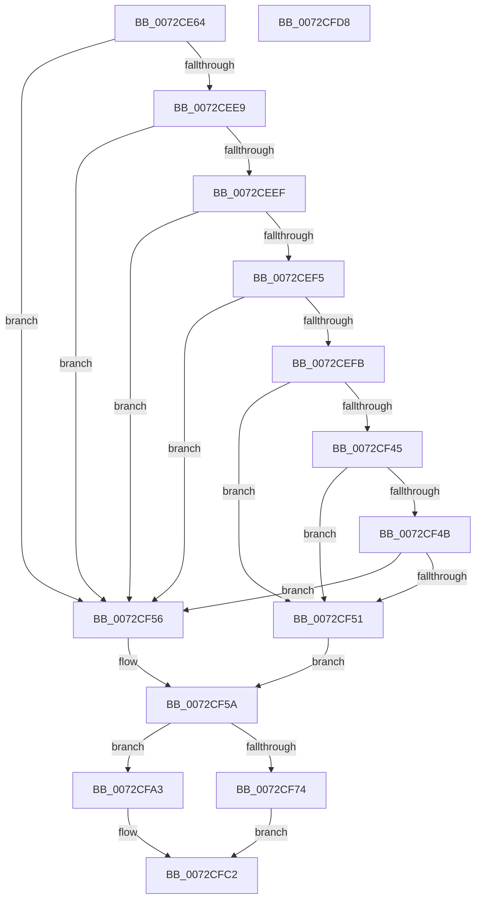

# PnpUpdateRebootRequiredReason

- RVA: `0x0072CE64`–`0x0072CFD9` (길이 `373` bytes)
- VA: `0x000000014072CE64`
- 실행 섹션: `PAGE`
- PDB 이름 있음: `예`; PDB Function 태그: `아니요`
- unwind 정보 RVA: `0x000C86F8`
- 디코드: `102`개 명령, `373/373` bytes 표시
- 미해석 바이트: `0` (있으면 어셈블리에 `.byte`로 보존)

> 이 문서는 커널 이미지의 기계어와 PDB 기호를 분석해 생성했습니다. 4번과 5번은 함수 원형과 자료형을 바이너리 사용 방식에서 추정한 C 해석이며 원본 소스 복구 결과는 아닙니다.

## 1. Dependencies

- 직접 호출 지점: **4**; 고유 호출 대상: **2**
- 직접 호출자로 확인된 함수: **4**
- RIP 상대 이미지 참조: **3**

### Outgoing calls
- `0x0072CED9` → [PnpGetObjectProperty](../8E/PnpGetObjectProperty_function_008E2180.md) (function, `0x008E2180`)
- `0x0072CF3C` → [PnpGetObjectProperty](../8E/PnpGetObjectProperty_function_008E2180.md) (function, `0x008E2180`)
- `0x0072CF9A` → [PnpSetObjectProperty](../8F/PnpSetObjectProperty_function_008F66E8.md) (function, `0x008F66E8`)
- `0x0072CFBD` → [PnpSetObjectProperty](../8F/PnpSetObjectProperty_function_008F66E8.md) (function, `0x008F66E8`)

### Direct callers
- [PnpReallocateResources](../73/PnpReallocateResources_function_0073E924.md) at `0x0073EA7F`
- [PipProcessRestartPhase2](../74/PipProcessRestartPhase2_function_007408B8.md) at `0x0074091C`
- [sub_00B26024](../B2/Unknown_function_00B26024.md) at `0x00B2603E`
- [sub_00B29934](../B2/Unknown_function_00B29934.md) at `0x00B29B3F`

### Static image references
- `0x0072CEAA` → RVA `0x00E66398` (`.data`; read)
- `0x0072CEC6` → RVA `0x00014308` (`.rdata`; read)
- `0x0072CEDE` → RVA `0x00012F10` (`.rdata`; read)

## 2. Other-region calls and transfers

- 다른 실행 섹션으로 향하는 call: **0**
- 별도 외부 분기/꼬리 이동을 확인하지 못했습니다.

## 3. Assembly (complete function range)

```asm
0072CE64  4C 8B DC                        mov r11, rsp
0072CE67  49 89 5B 08                     mov qword ptr [r11 + 8], rbx
0072CE6B  45 88 4B 20                     mov byte ptr [r11 + 0x20], r9b
0072CE6F  49 89 53 10                     mov qword ptr [r11 + 0x10], rdx
0072CE73  55                              push rbp
0072CE74  56                              push rsi
0072CE75  57                              push rdi
0072CE76  41 54                           push r12
0072CE78  41 56                           push r14
0072CE7A  48 8B EC                        mov rbp, rsp
0072CE7D  48 83 EC 70                     sub rsp, 0x70
0072CE81  33 DB                           xor ebx, ebx
0072CE83  48 8D 45 40                     lea rax, [rbp + 0x40]
0072CE87  89 5C 24 50                     mov dword ptr [rsp + 0x50], ebx
0072CE8B  49 8B F0                        mov rsi, r8
0072CE8E  49 89 43 B0                     mov qword ptr [r11 - 0x50], rax
0072CE92  48 8B F9                        mov rdi, rcx
0072CE95  48 8D 45 48                     lea rax, [rbp + 0x48]
0072CE99  88 5D 48                        mov byte ptr [rbp + 0x48], bl
0072CE9C  44 8D 73 01                     lea r14d, [rbx + 1]
0072CEA0  89 5D 40                        mov dword ptr [rbp + 0x40], ebx
0072CEA3  45 89 73 A8                     mov dword ptr [r11 - 0x58], r14d
0072CEA7  48 8B D1                        mov rdx, rcx
0072CEAA  48 8B 0D E7 94 73 00            mov rcx, qword ptr [rip + 0x7394e7]
0072CEB1  45 33 C9                        xor r9d, r9d
0072CEB4  49 89 43 A0                     mov qword ptr [r11 - 0x60], rax
0072CEB8  45 8B C6                        mov r8d, r14d
0072CEBB  48 8D 45 38                     lea rax, [rbp + 0x38]
0072CEBF  89 5D 38                        mov dword ptr [rbp + 0x38], ebx
0072CEC2  49 89 43 98                     mov qword ptr [r11 - 0x68], rax
0072CEC6  48 8D 05 3B 74 8E FF            lea rax, [rip - 0x718bc5]
0072CECD  49 89 43 90                     mov qword ptr [r11 - 0x70], rax
0072CED1  49 89 5B 88                     mov qword ptr [r11 - 0x78], rbx
0072CED5  48 89 5D F0                     mov qword ptr [rbp - 0x10], rbx
0072CED9  E8 A2 52 1B 00                  call 0x1408e2180
0072CEDE  4C 8D 25 2B 60 8E FF            lea r12, [rip - 0x719fd5]
0072CEE5  85 C0                           test eax, eax
0072CEE7  78 6D                           js 0x14072cf56
0072CEE9  83 7D 38 11                     cmp dword ptr [rbp + 0x38], 0x11
0072CEED  75 67                           jne 0x14072cf56
0072CEEF  44 39 75 40                     cmp dword ptr [rbp + 0x40], r14d
0072CEF3  75 61                           jne 0x14072cf56
0072CEF5  80 7D 48 FF                     cmp byte ptr [rbp + 0x48], 0xff
0072CEF9  75 5B                           jne 0x14072cf56
0072CEFB  48 8B 0D 96 94 73 00            mov rcx, qword ptr [rip + 0x739496]
0072CF02  48 8D 45 40                     lea rax, [rbp + 0x40]
0072CF06  89 5C 24 50                     mov dword ptr [rsp + 0x50], ebx
0072CF0A  45 33 C9                        xor r9d, r9d
0072CF0D  48 89 44 24 48                  mov qword ptr [rsp + 0x48], rax
0072CF12  45 8B C6                        mov r8d, r14d
0072CF15  C7 44 24 40 08 00 00 00         mov dword ptr [rsp + 0x40], 8
0072CF1D  48 8D 45 F0                     lea rax, [rbp - 0x10]
0072CF21  48 89 44 24 38                  mov qword ptr [rsp + 0x38], rax
0072CF26  48 8B D7                        mov rdx, rdi
0072CF29  48 8D 45 38                     lea rax, [rbp + 0x38]
0072CF2D  48 89 44 24 30                  mov qword ptr [rsp + 0x30], rax
0072CF32  4C 89 64 24 28                  mov qword ptr [rsp + 0x28], r12
0072CF37  48 89 5C 24 20                  mov qword ptr [rsp + 0x20], rbx
0072CF3C  E8 3F 52 1B 00                  call 0x1408e2180
0072CF41  85 C0                           test eax, eax
0072CF43  78 0C                           js 0x14072cf51
0072CF45  83 7D 38 09                     cmp dword ptr [rbp + 0x38], 9
0072CF49  75 06                           jne 0x14072cf51
0072CF4B  83 7D 40 08                     cmp dword ptr [rbp + 0x40], 8
0072CF4F  74 05                           je 0x14072cf56
0072CF51  48 8B C3                        mov rax, rbx
0072CF54  EB 04                           jmp 0x14072cf5a
0072CF56  48 8B 45 F0                     mov rax, qword ptr [rbp - 0x10]
0072CF5A  48 8B 0D 37 94 73 00            mov rcx, qword ptr [rip + 0x739437]
0072CF61  48 0B C6                        or rax, rsi
0072CF64  48 89 45 F0                     mov qword ptr [rbp - 0x10], rax
0072CF68  45 8B C6                        mov r8d, r14d
0072CF6B  89 5C 24 48                     mov dword ptr [rsp + 0x48], ebx
0072CF6F  48 8B D7                        mov rdx, rdi
0072CF72  74 2F                           je 0x14072cfa3
0072CF74  C7 44 24 40 08 00 00 00         mov dword ptr [rsp + 0x40], 8
0072CF7C  48 8D 45 F0                     lea rax, [rbp - 0x10]
0072CF80  48 89 44 24 38                  mov qword ptr [rsp + 0x38], rax
0072CF85  45 33 C9                        xor r9d, r9d
0072CF88  C7 44 24 30 09 00 00 00         mov dword ptr [rsp + 0x30], 9
0072CF90  4C 89 64 24 28                  mov qword ptr [rsp + 0x28], r12
0072CF95  48 89 5C 24 20                  mov qword ptr [rsp + 0x20], rbx
0072CF9A  E8 49 97 1C 00                  call 0x1408f66e8
0072CF9F  8B D8                           mov ebx, eax
0072CFA1  EB 1F                           jmp 0x14072cfc2
0072CFA3  89 5C 24 40                     mov dword ptr [rsp + 0x40], ebx
0072CFA7  45 33 C9                        xor r9d, r9d
0072CFAA  48 89 5C 24 38                  mov qword ptr [rsp + 0x38], rbx
0072CFAF  89 5C 24 30                     mov dword ptr [rsp + 0x30], ebx
0072CFB3  4C 89 64 24 28                  mov qword ptr [rsp + 0x28], r12
0072CFB8  48 89 5C 24 20                  mov qword ptr [rsp + 0x20], rbx
0072CFBD  E8 26 97 1C 00                  call 0x1408f66e8
0072CFC2  8B C3                           mov eax, ebx
0072CFC4  48 8B 9C 24 A0 00 00 00         mov rbx, qword ptr [rsp + 0xa0]
0072CFCC  48 83 C4 70                     add rsp, 0x70
0072CFD0  41 5E                           pop r14
0072CFD2  41 5C                           pop r12
0072CFD4  5F                              pop rdi
0072CFD5  5E                              pop rsi
0072CFD6  5D                              pop rbp
0072CFD7  C3                              ret
0072CFD8  CC                              int3
```

## 4. C-style interpretation (structured pseudocode)

```c
__int64 __fastcall PnpUpdateRebootRequiredReason(__int64 a1, __int64 a2, __int64 a3, int a4)
{
    __int64 result;
    __int64 v_rbx;
    __int64 v_rsp;
    unsigned __int64 v_stack_m38;
    unsigned int v_stack_m48;
    unsigned __int64 v_stack_m50;
    unsigned int v_stack_m58;
    unsigned __int64 v_stack_m60;
    unsigned __int64 v_stack_m68;
    unsigned __int64 v_stack_m70;
    unsigned __int64 v_stack_m78;
    unsigned __int64 v_stack_p10;
    unsigned __int64 v_stack_p18;
    unsigned __int64 v_stack_p20;
    unsigned __int64 v_stack_p8;

    *(unsigned __int64 *)(v_rsp + 8) = v_rbx;
    *(unsigned __int8 *)(v_rsp + 32) = (unsigned __int8)(a4);
    *(unsigned __int64 *)(v_rsp + 16) = a2;
    v_rsp = (v_rsp) - (112);
    v_rbx = 0;
    v_stack_m48 = 0;
    *(unsigned __int64 *)(v_rsp - 80) = v_stack_p18;
    v_stack_p20 = 0;
    v_stack_p18 = 0;
    *(unsigned int *)(v_rsp - 88) = (unsigned int)(v_rbx + 1);
    a4 = 0;
    *(unsigned __int64 *)(v_rsp - 96) = v_stack_p20;
    v_stack_p10 = 0;
    *(unsigned __int64 *)(v_rsp - 104) = v_stack_p10;
    *(unsigned __int64 *)(v_rsp - 112) = v_rip - 7441349;
    *(unsigned __int64 *)(v_rsp - 120) = 0;
    v_stack_m38 = 0;
    result = PnpGetObjectProperty(*(unsigned __int64 *)(v_rip + 7574759), a1, (unsigned int)((unsigned int)(v_rbx + 1)), a4);
    if (sign_flag) goto loc_0072CF56;
    if (v_stack_p10 != 17) goto loc_0072CF56;
    if (v_stack_p18 != ((unsigned int)(v_rbx + 1))) goto loc_0072CF56;
    if (v_stack_p20 != 255) goto loc_0072CF56;
    v_stack_m48 = 0;
    a4 = 0;
    v_stack_m50 = v_stack_p18;
    v_stack_m58 = 8;
    v_stack_m60 = v_stack_m38;
    v_stack_m68 = v_stack_p10;
    v_stack_m70 = v_rip - 7446485;
    v_stack_m78 = 0;
    result = PnpGetObjectProperty(*(unsigned __int64 *)(v_rip + 7574678), a1, (unsigned int)((unsigned int)(v_rbx + 1)), a4);
    if (sign_flag) goto loc_0072CF51;
    if (v_stack_p10 != 9) goto loc_0072CF51;
    if (v_stack_p18 == 8) goto loc_0072CF56;
loc_0072CF51:
    goto loc_0072CF5A;
loc_0072CF56:
loc_0072CF5A:
    result = (v_stack_m38) | (a3);
    v_stack_m38 = result;
    v_stack_m50 = 0;
    if (condition_is_equal) goto loc_0072CFA3;
    v_stack_m58 = 8;
    v_stack_m60 = v_stack_m38;
    a4 = 0;
    v_stack_m68 = 9;
    v_stack_m70 = v_rip - 7446485;
    v_stack_m78 = 0;
    result = PnpSetObjectProperty(*(unsigned __int64 *)(v_rip + 7574583), a1, (unsigned int)((unsigned int)(v_rbx + 1)), a4);
    goto loc_0072CFC2;
loc_0072CFA3:
    v_stack_m58 = (unsigned int)((unsigned int)((unsigned int)(result)));
    a4 = 0;
    v_stack_m60 = (unsigned int)((unsigned int)(result));
    v_stack_m68 = (unsigned int)((unsigned int)((unsigned int)(result)));
    v_stack_m70 = v_rip - 7446485;
    v_stack_m78 = (unsigned int)((unsigned int)(result));
    result = PnpSetObjectProperty(*(unsigned __int64 *)(v_rip + 7574583), a1, (unsigned int)((unsigned int)(v_rbx + 1)), a4);
loc_0072CFC2:
    v_rsp = (v_rsp) + (112);
    return (unsigned int)((unsigned int)((unsigned int)((unsigned int)(result))));
}
```

## 5. (Beta) C Style

```c
int64_t PnpUpdateRebootRequiredReason(int64_t Arg1, int64_t Arg2, int64_t Arg3, int32_t Arg4)
{
    int64_t result;
    int64_t local_rbx;
    int64_t local_rsp;
    uint64_t v_stack_m38;
    uint32_t v_stack_m48;
    uint64_t v_stack_m50;
    uint32_t v_stack_m58;
    uint64_t v_stack_m60;
    uint64_t v_stack_m68;
    uint64_t v_stack_m70;
    uint64_t v_stack_m78;
    uint64_t v_stack_p10;
    uint64_t v_stack_p18;
    uint64_t v_stack_p20;
    uint64_t v_stack_p8;

    *(uint64_t *)(local_rsp + 0x8) = local_rbx;
    *(uint8_t *)(local_rsp + 0x20) = (uint8_t)(Arg4);
    *(uint64_t *)(local_rsp + 0x10) = Arg2;
    local_rsp = (local_rsp) - (112);
    local_rbx = 0;
    v_stack_m48 = 0;
    *(uint64_t *)(local_rsp - 0x50) = v_stack_p18;
    v_stack_p20 = 0;
    v_stack_p18 = 0;
    *(uint32_t *)(local_rsp - 0x58) = (uint32_t)(local_rbx + 1);
    Arg4 = 0;
    *(uint64_t *)(local_rsp - 0x60) = v_stack_p20;
    v_stack_p10 = 0;
    *(uint64_t *)(local_rsp - 0x68) = v_stack_p10;
    *(uint64_t *)(local_rsp - 0x70) = v_rip - 7441349;
    *(uint64_t *)(local_rsp - 0x78) = 0;
    v_stack_m38 = 0;
    result = PnpGetObjectProperty(*(uint64_t *)(v_rip + 0x7394E7), Arg1, (uint32_t)((uint32_t)(local_rbx + 1)), Arg4);
    if (sign_flag) goto loc_0072CF56;
    if (v_stack_p10 != 17) goto loc_0072CF56;
    if (v_stack_p18 != ((uint32_t)(local_rbx + 1))) goto loc_0072CF56;
    if (v_stack_p20 != 255) goto loc_0072CF56;
    v_stack_m48 = 0;
    Arg4 = 0;
    v_stack_m50 = v_stack_p18;
    v_stack_m58 = 8;
    v_stack_m60 = v_stack_m38;
    v_stack_m68 = v_stack_p10;
    v_stack_m70 = v_rip - 7446485;
    v_stack_m78 = 0;
    result = PnpGetObjectProperty(*(uint64_t *)(v_rip + 0x739496), Arg1, (uint32_t)((uint32_t)(local_rbx + 1)), Arg4);
    if (sign_flag) goto loc_0072CF51;
    if (v_stack_p10 != 9) goto loc_0072CF51;
    if (v_stack_p18 == 8) goto loc_0072CF56;
loc_0072CF51:
    goto loc_0072CF5A;
loc_0072CF56:
loc_0072CF5A:
    result = (v_stack_m38) | (Arg3);
    v_stack_m38 = result;
    v_stack_m50 = 0;
    if (condition_is_equal) goto loc_0072CFA3;
    v_stack_m58 = 8;
    v_stack_m60 = v_stack_m38;
    Arg4 = 0;
    v_stack_m68 = 9;
    v_stack_m70 = v_rip - 7446485;
    v_stack_m78 = 0;
    result = PnpSetObjectProperty(*(uint64_t *)(v_rip + 0x739437), Arg1, (uint32_t)((uint32_t)(local_rbx + 1)), Arg4);
    goto loc_0072CFC2;
loc_0072CFA3:
    v_stack_m58 = (uint32_t)((uint32_t)((uint32_t)(result)));
    Arg4 = 0;
    v_stack_m60 = (uint32_t)((uint32_t)(result));
    v_stack_m68 = (uint32_t)((uint32_t)((uint32_t)(result)));
    v_stack_m70 = v_rip - 7446485;
    v_stack_m78 = (uint32_t)((uint32_t)(result));
    result = PnpSetObjectProperty(*(uint64_t *)(v_rip + 0x739437), Arg1, (uint32_t)((uint32_t)(local_rbx + 1)), Arg4);
loc_0072CFC2:
    local_rsp = (local_rsp) + (112);
    return (uint32_t)((uint32_t)((uint32_t)((uint32_t)(result))));
}
```

## 6. Execution-region graph

[열기: 2D/3D 그래프와 함수 탐색 컨트롤 패널](../../../control-panel.html?section=page&rva=0x0072CE64&view=graph)

- 2D 그래프는 위에서 아래로 흐르고, 3D 그래프는 빈 공간을 드래그해 회전합니다. Shift+드래그는 이동, 휠은 확대·축소, 함수 노드 선택은 대상 보고서 이동입니다.

### Static fallback


