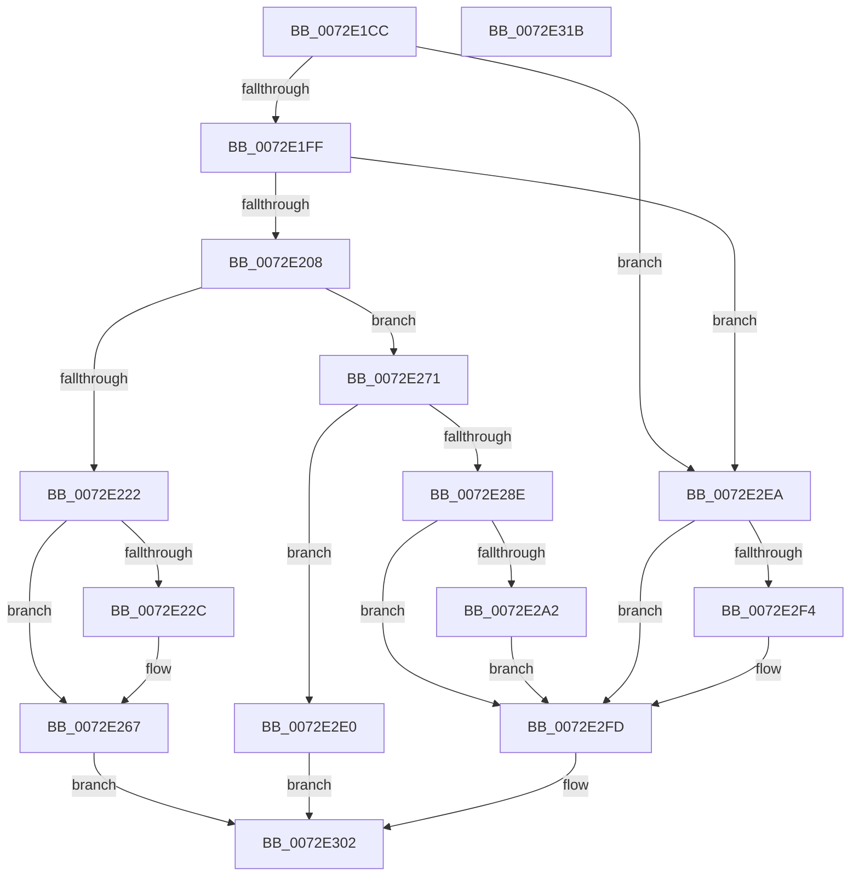

# PpBootDDBHelper

- RVA: `0x0072E1CC`–`0x0072E31C` (길이 `336` bytes)
- VA: `0x000000014072E1CC`
- 실행 섹션: `PAGE`
- PDB 이름 있음: `예`; PDB Function 태그: `아니요`
- unwind 정보 RVA: `0x00093E28`
- 디코드: `90`개 명령, `336/336` bytes 표시
- 미해석 바이트: `0` (있으면 어셈블리에 `.byte`로 보존)

> 이 문서는 커널 이미지의 기계어와 PDB 기호를 분석해 생성했습니다. 4번과 5번은 함수 원형과 자료형을 바이너리 사용 방식에서 추정한 C 해석이며 원본 소스 복구 결과는 아닙니다.

## 1. Dependencies

- 직접 호출 지점: **8**; 고유 호출 대상: **6**
- 직접 호출자로 확인된 함수: **1**
- RIP 상대 이미지 참조: **4**

### Outgoing calls
- `0x0072E215` → [ExAllocatePool2](../../poolcode/B8/ExAllocatePool2_function_00B820F0.md) (function, `0x00B820F0`)
- `0x0072E249` → [RtlInitUnicodeString](../../text/42/RtlInitUnicodeString_function_0042A780.md) (function, `0x0042A780`)
- `0x0072E262` → [PnpLogEvent](PnpLogEvent_function_0072C8FC.md) (function, `0x0072C8FC`)
- `0x0072E27A` → [memcpy](../../text/6C/memcpy_function_006C6840.md) (function, `0x006C6840`)
- `0x0072E284` → [SdbInitDatabaseInMemory](../95/SdbInitDatabaseInMemory_function_0095BC5C.md) (function, `0x0095BC5C`)
- `0x0072E293` → [ExFreePoolWithTag](../../poolcode/B8/ExFreePoolWithTag_function_00B82870.md) (function, `0x00B82870`)
- `0x0072E2BF` → [RtlInitUnicodeString](../../text/42/RtlInitUnicodeString_function_0042A780.md) (function, `0x0042A780`)
- `0x0072E2D9` → [PnpLogEvent](PnpLogEvent_function_0072C8FC.md) (function, `0x0072C8FC`)

### Direct callers
- [PpInitializeBootDDB](../../init/C3/PpInitializeBootDDB_function_00C34018.md) at `0x00C340EB`
- [PpInitializeBootDDB](../../init/C3/PpInitializeBootDDB_function_00C34018.md) at `0x00C34115`

### Static image references
- `0x0072E222` → RVA `0x00FD9A8C` (`PAGEDATA`; read)
- `0x0072E22F` → RVA `0x00AFE0D0` (` ?? ::NNGAKEGL::`string'`; read)
- `0x0072E239` → RVA `0x00FD9A8C` (`PAGEDATA`; write)
- `0x0072E2A5` → RVA `0x00AFE0F0` (` ?? ::NNGAKEGL::`string'`; read)

## 2. Other-region calls and transfers

- 다른 실행 섹션으로 향하는 call: **5**
  - `0x0072E215` → [ExAllocatePool2](../../poolcode/B8/ExAllocatePool2_function_00B820F0.md) (`PAGE` → `POOLCODE`)
  - `0x0072E249` → [RtlInitUnicodeString](../../text/42/RtlInitUnicodeString_function_0042A780.md) (`PAGE` → `.text`)
  - `0x0072E27A` → [memcpy](../../text/6C/memcpy_function_006C6840.md) (`PAGE` → `.text`)
  - `0x0072E293` → [ExFreePoolWithTag](../../poolcode/B8/ExFreePoolWithTag_function_00B82870.md) (`PAGE` → `POOLCODE`)
  - `0x0072E2BF` → [RtlInitUnicodeString](../../text/42/RtlInitUnicodeString_function_0042A780.md) (`PAGE` → `.text`)
- 별도 외부 분기/꼬리 이동을 확인하지 못했습니다.

## 3. Assembly (complete function range)

```asm
0072E1CC  48 89 5C 24 08                  mov qword ptr [rsp + 8], rbx
0072E1D1  48 89 6C 24 10                  mov qword ptr [rsp + 0x10], rbp
0072E1D6  48 89 74 24 18                  mov qword ptr [rsp + 0x18], rsi
0072E1DB  57                              push rdi
0072E1DC  41 56                           push r14
0072E1DE  41 57                           push r15
0072E1E0  48 83 EC 40                     sub rsp, 0x40
0072E1E4  49 83 20 00                     and qword ptr [r8], 0
0072E1E8  49 8B F1                        mov rsi, r9
0072E1EB  49 83 21 00                     and qword ptr [r9], 0
0072E1EF  4D 8B F0                        mov r14, r8
0072E1F2  8B FA                           mov edi, edx
0072E1F4  48 8B E9                        mov rbp, rcx
0072E1F7  85 D2                           test edx, edx
0072E1F9  0F 84 EB 00 00 00               je 0x14072e2ea
0072E1FF  48 85 C9                        test rcx, rcx
0072E202  0F 84 E2 00 00 00               je 0x14072e2ea
0072E208  41 B8 50 70 20 20               mov r8d, 0x20207050
0072E20E  8B D7                           mov edx, edi
0072E210  B9 00 01 00 00                  mov ecx, 0x100
0072E215  E8 D6 3E 45 00                  call 0x140b820f0
0072E21A  48 8B D8                        mov rbx, rax
0072E21D  48 85 C0                        test rax, rax
0072E220  75 4F                           jne 0x14072e271
0072E222  8B 05 64 B8 8A 00               mov eax, dword ptr [rip + 0x8ab864]
0072E228  A8 02                           test al, 2
0072E22A  75 3B                           jne 0x14072e267
0072E22C  83 C8 02                        or eax, 2
0072E22F  48 8D 15 9A FE 3C 00            lea rdx, [rip + 0x3cfe9a]
0072E236  0F 57 C0                        xorps xmm0, xmm0
0072E239  89 05 4D B8 8A 00               mov dword ptr [rip + 0x8ab84d], eax
0072E23F  48 8D 4C 24 30                  lea rcx, [rsp + 0x30]
0072E244  0F 11 44 24 30                  movups xmmword ptr [rsp + 0x30], xmm0
0072E249  E8 32 C5 CF FF                  call 0x14042a780
0072E24E  21 5C 24 20                     and dword ptr [rsp + 0x20], ebx
0072E252  48 8D 4C 24 30                  lea rcx, [rsp + 0x30]
0072E257  45 33 C9                        xor r9d, r9d
0072E25A  33 D2                           xor edx, edx
0072E25C  41 B8 6D 03 00 C0               mov r8d, 0xc000036d
0072E262  E8 95 E6 FF FF                  call 0x14072c8fc
0072E267  B8 9A 00 00 C0                  mov eax, 0xc000009a
0072E26C  E9 91 00 00 00                  jmp 0x14072e302
0072E271  4C 8B C7                        mov r8, rdi
0072E274  48 8B D5                        mov rdx, rbp
0072E277  48 8B CB                        mov rcx, rbx
0072E27A  E8 C1 85 F9 FF                  call 0x1406c6840
0072E27F  8B D7                           mov edx, edi
0072E281  48 8B CB                        mov rcx, rbx
0072E284  E8 D3 D9 22 00                  call 0x14095bc5c
0072E289  48 85 C0                        test rax, rax
0072E28C  75 52                           jne 0x14072e2e0
0072E28E  33 D2                           xor edx, edx
0072E290  48 8B CB                        mov rcx, rbx
0072E293  E8 D8 45 45 00                  call 0x140b82870
0072E298  8B 05 EE B7 8A 00               mov eax, dword ptr [rip + 0x8ab7ee]
0072E29E  A8 04                           test al, 4
0072E2A0  75 5B                           jne 0x14072e2fd
0072E2A2  83 C8 04                        or eax, 4
0072E2A5  48 8D 15 44 FE 3C 00            lea rdx, [rip + 0x3cfe44]
0072E2AC  0F 57 C0                        xorps xmm0, xmm0
0072E2AF  89 05 D7 B7 8A 00               mov dword ptr [rip + 0x8ab7d7], eax
0072E2B5  48 8D 4C 24 30                  lea rcx, [rsp + 0x30]
0072E2BA  0F 11 44 24 30                  movups xmmword ptr [rsp + 0x30], xmm0
0072E2BF  E8 BC C4 CF FF                  call 0x14042a780
0072E2C4  83 64 24 20 00                  and dword ptr [rsp + 0x20], 0
0072E2C9  48 8D 4C 24 30                  lea rcx, [rsp + 0x30]
0072E2CE  45 33 C9                        xor r9d, r9d
0072E2D1  33 D2                           xor edx, edx
0072E2D3  41 B8 6D 03 00 C0               mov r8d, 0xc000036d
0072E2D9  E8 1E E6 FF FF                  call 0x14072c8fc
0072E2DE  EB 1D                           jmp 0x14072e2fd
0072E2E0  49 89 1E                        mov qword ptr [r14], rbx
0072E2E3  48 89 06                        mov qword ptr [rsi], rax
0072E2E6  33 C0                           xor eax, eax
0072E2E8  EB 18                           jmp 0x14072e302
0072E2EA  8B 05 9C B7 8A 00               mov eax, dword ptr [rip + 0x8ab79c]
0072E2F0  A8 01                           test al, 1
0072E2F2  75 09                           jne 0x14072e2fd
0072E2F4  83 C8 01                        or eax, 1
0072E2F7  89 05 8F B7 8A 00               mov dword ptr [rip + 0x8ab78f], eax
0072E2FD  B8 01 00 00 C0                  mov eax, 0xc0000001
0072E302  48 8B 5C 24 60                  mov rbx, qword ptr [rsp + 0x60]
0072E307  48 8B 6C 24 68                  mov rbp, qword ptr [rsp + 0x68]
0072E30C  48 8B 74 24 70                  mov rsi, qword ptr [rsp + 0x70]
0072E311  48 83 C4 40                     add rsp, 0x40
0072E315  41 5F                           pop r15
0072E317  41 5E                           pop r14
0072E319  5F                              pop rdi
0072E31A  C3                              ret
0072E31B  CC                              int3
```

## 4. C-style interpretation (structured pseudocode)

```c
__int64 __fastcall PpBootDDBHelper(__int64 a1, int a2, __int64 a3, __int64 a4)
{
    __int64 result;
    __int64 v_rsp;
    unsigned __int64 v_stack_m28;
    unsigned int v_stack_m38;
    unsigned __int64 v_stack_p10;
    unsigned __int64 v_stack_p18;
    unsigned __int64 v_stack_p8;

    v_stack_p8 = v_rbx;
    v_stack_p10 = v_rbp;
    v_stack_p18 = v_rsi;
    v_rsp = (v_rsp) - (64);
    if (a2 == 0) goto loc_0072E2EA;
    if (a1 == 0) goto loc_0072E2EA;
    result = ExAllocatePool2(256, (unsigned int)((unsigned int)((unsigned int)(a2))), (unsigned int)(0x20207050ULL), a4);
    if (result != 0) goto loc_0072E271;
    result = (unsigned int)(*(unsigned int *)(v_rip + 9091172));
    if ((((unsigned __int8)((unsigned int)(*(unsigned int *)(v_rip + 9091172)))) & (2)) == 0) {
        result = (unsigned int)(((unsigned int)(*(unsigned int *)(v_rip + 9091172))) | (2));
        a2 = v_rip + 3997338;
        *(unsigned int *)(v_rip + 9091149) = (unsigned int)(result);
        a1 = v_stack_m28;
        v_stack_m28 = v_xmm0;
        result = RtlInitUnicodeString(a1, a2, (unsigned int)(0x20207050ULL), a4);
        a1 = v_stack_m28;
        a4 = 0;
        a2 = 0;
        a3 = 0xC000036DULL;
        result = PnpLogEvent(a1, a2, a3, a4);
    }
    goto loc_0072E302;
loc_0072E271:
    result = memcpy(result, a1, (unsigned int)(a2), a4);
    result = SdbInitDatabaseInMemory(result, (unsigned int)((unsigned int)((unsigned int)(a2))), (unsigned int)(a2), a4);
    if (result != 0) goto loc_0072E2E0;
    a2 = 0;
    result = ExFreePoolWithTag(result, a2, (unsigned int)(a2), a4);
    if ((((unsigned __int8)((unsigned int)(*(unsigned int *)(v_rip + 9091054)))) & (4)) != 0) goto loc_0072E2FD;
    result = (unsigned int)(((unsigned int)(*(unsigned int *)(v_rip + 9091054))) | (4));
    *(unsigned int *)(v_rip + 9091031) = (unsigned int)(result);
    v_stack_m28 = v_xmm0;
    result = RtlInitUnicodeString(v_stack_m28, v_rip + 3997252, (unsigned int)(a2), a4);
    a4 = 0;
    a2 = 0;
    result = PnpLogEvent(v_stack_m28, a2, (unsigned int)(0xC000036DULL), a4);
    goto loc_0072E2FD;
loc_0072E2E0:
    *(unsigned __int64 *)(a3) = result;
    *(unsigned __int64 *)(a4) = result;
    result = 0;
    goto loc_0072E302;
loc_0072E2EA:
    result = (unsigned int)(*(unsigned int *)(v_rip + 9090972));
    if ((((unsigned __int8)((unsigned int)(*(unsigned int *)(v_rip + 9090972)))) & (1)) == 0) {
        result = (unsigned int)(((unsigned int)(*(unsigned int *)(v_rip + 9090972))) | (1));
        *(unsigned int *)(v_rip + 9090959) = (unsigned int)(result);
    }
loc_0072E302:
    v_rsp = (v_rsp) + (64);
    return (unsigned int)(0xC0000001ULL);
}
```

## 5. (Beta) C Style

```c
int64_t PpBootDDBHelper(int64_t Arg1, int32_t Arg2, void *Arg3, void *Arg4)
{
    uint8_t *arg3 = (uint8_t *)Arg3;
    uint8_t *arg4 = (uint8_t *)Arg4;

    int64_t result;
    int64_t local_rsp;
    uint64_t v_stack_m28;
    uint32_t v_stack_m38;
    uint64_t v_stack_p10;
    uint64_t v_stack_p18;
    uint64_t v_stack_p8;

    v_stack_p8 = local_rbx;
    v_stack_p10 = local_rbp;
    v_stack_p18 = local_rsi;
    local_rsp = (local_rsp) - (64);
    if (Arg2 == 0) goto loc_0072E2EA;
    if (Arg1 == 0) goto loc_0072E2EA;
    result = ExAllocatePool2(256, (uint32_t)((uint32_t)((uint32_t)(Arg2))), (uint32_t)(0x20207050ULL), Arg4);
    if (result != 0) goto loc_0072E271;
    result = (uint32_t)(*(uint32_t *)(v_rip + 0x8AB864));
    if ((((uint8_t)((uint32_t)(*(uint32_t *)(v_rip + 0x8AB864)))) & (2)) == 0) {
        result = (uint32_t)(((uint32_t)(*(uint32_t *)(v_rip + 0x8AB864))) | (2));
        Arg2 = v_rip + 3997338;
        *(uint32_t *)(v_rip + 0x8AB84D) = (uint32_t)(result);
        Arg1 = v_stack_m28;
        v_stack_m28 = v_xmm0;
        result = RtlInitUnicodeString(Arg1, Arg2, (uint32_t)(0x20207050ULL), Arg4);
        Arg1 = v_stack_m28;
        Arg4 = 0;
        Arg2 = 0;
        Arg3 = 0xC000036DULL;
        result = PnpLogEvent(Arg1, Arg2, Arg3, Arg4);
    }
    goto loc_0072E302;
loc_0072E271:
    result = memcpy(result, Arg1, (uint32_t)(Arg2), Arg4);
    result = SdbInitDatabaseInMemory(result, (uint32_t)((uint32_t)((uint32_t)(Arg2))), (uint32_t)(Arg2), Arg4);
    if (result != 0) goto loc_0072E2E0;
    Arg2 = 0;
    result = ExFreePoolWithTag(result, Arg2, (uint32_t)(Arg2), Arg4);
    if ((((uint8_t)((uint32_t)(*(uint32_t *)(v_rip + 0x8AB7EE)))) & (4)) != 0) goto loc_0072E2FD;
    result = (uint32_t)(((uint32_t)(*(uint32_t *)(v_rip + 0x8AB7EE))) | (4));
    *(uint32_t *)(v_rip + 0x8AB7D7) = (uint32_t)(result);
    v_stack_m28 = v_xmm0;
    result = RtlInitUnicodeString(v_stack_m28, v_rip + 3997252, (uint32_t)(Arg2), Arg4);
    Arg4 = 0;
    Arg2 = 0;
    result = PnpLogEvent(v_stack_m28, Arg2, (uint32_t)(0xC000036DULL), Arg4);
    goto loc_0072E2FD;
loc_0072E2E0:
    *(uint64_t *)(arg3) = result;
    *(uint64_t *)(arg4) = result;
    result = 0;
    goto loc_0072E302;
loc_0072E2EA:
    result = (uint32_t)(*(uint32_t *)(v_rip + 0x8AB79C));
    if ((((uint8_t)((uint32_t)(*(uint32_t *)(v_rip + 0x8AB79C)))) & (1)) == 0) {
        result = (uint32_t)(((uint32_t)(*(uint32_t *)(v_rip + 0x8AB79C))) | (1));
        *(uint32_t *)(v_rip + 0x8AB78F) = (uint32_t)(result);
    }
loc_0072E302:
    local_rsp = (local_rsp) + (64);
    return (uint32_t)(0xC0000001ULL);
}
```

### 관측된 메모리 오프셋

구조체 형식이 확인되지 않은 접근은 인자 기준의 오프셋으로만 기록했습니다.

| 기준 인자 | 오프셋 표현 | 폭 (bit) | 접근 |
|---|---:|---:|---|
| `Arg3` | `+ 0x0` | `64` | `R/W` |
| `Arg3` | `+ 0x0` | `64` | `W` |
| `Arg4` | `+ 0x0` | `64` | `R/W` |
| `Arg4` | `+ 0x0` | `64` | `W` |

## 6. Execution-region graph

[열기: 2D/3D 그래프와 함수 탐색 컨트롤 패널](../../../control-panel.html?section=page&rva=0x0072E1CC&view=graph)

- 2D 그래프는 위에서 아래로 흐르고, 3D 그래프는 빈 공간을 드래그해 회전합니다. Shift+드래그는 이동, 휠은 확대·축소, 함수 노드 선택은 대상 보고서 이동입니다.

### Static fallback


