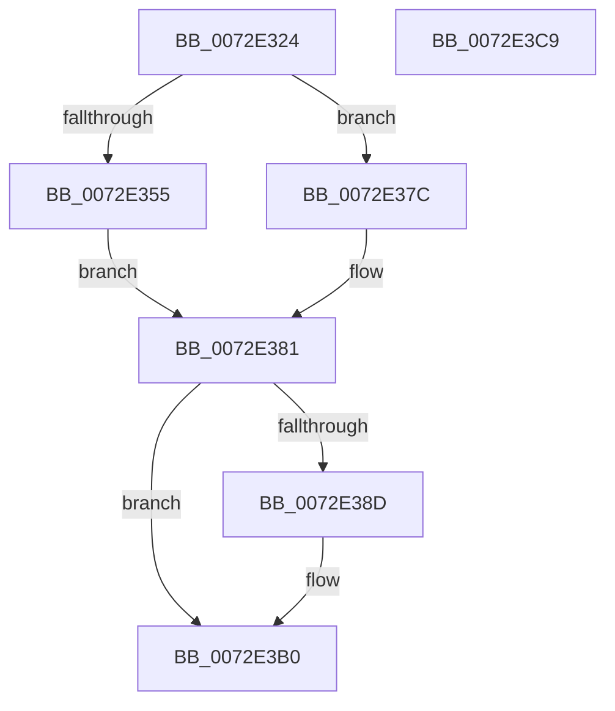

# PpReleaseBootDDB

- RVA: `0x0072E324`–`0x0072E3CA` (길이 `166` bytes)
- VA: `0x000000014072E324`
- 실행 섹션: `PAGE`
- PDB 이름 있음: `예`; PDB Function 태그: `아니요`
- unwind 정보 RVA: `0x0005CF00`
- 디코드: `37`개 명령, `166/166` bytes 표시
- 미해석 바이트: `0` (있으면 어셈블리에 `.byte`로 보존)

> 이 문서는 커널 이미지의 기계어와 PDB 기호를 분석해 생성했습니다. 4번과 5번은 함수 원형과 자료형을 바이너리 사용 방식에서 추정한 C 해석이며 원본 소스 복구 결과는 아닙니다.

## 1. Dependencies

- 직접 호출 지점: **7**; 고유 호출 대상: **5**
- 직접 호출자로 확인된 함수: **1**
- RIP 상대 이미지 참조: **9**

### Outgoing calls
- `0x0072E344` → [ExAcquireResourceExclusiveLite](../../text/21/ExAcquireResourceExclusiveLite_function_00214E20.md) (function, `0x00214E20`)
- `0x0072E355` → [SdbReleaseDatabase](../95/SdbReleaseDatabase_function_0095B57C.md) (function, `0x0095B57C`)
- `0x0072E36B` → [ExFreePoolWithTag](../../poolcode/B8/ExFreePoolWithTag_function_00B82870.md) (function, `0x00B82870`)
- `0x0072E38D` → [SdbReleaseDatabase](../95/SdbReleaseDatabase_function_0095B57C.md) (function, `0x0095B57C`)
- `0x0072E3A3` → [ExFreePoolWithTag](../../poolcode/B8/ExFreePoolWithTag_function_00B82870.md) (function, `0x00B82870`)
- `0x0072E3B7` → [ExReleaseResourceLite](../../text/25/ExReleaseResourceLite_function_0025FA10.md) (function, `0x0025FA10`)
- `0x0072E3BC` → [KeLeaveCriticalRegion](../../text/25/KeLeaveCriticalRegion_function_0025D8B0.md) (function, `0x0025D8B0`)

### Direct callers
- [PnpCompleteSystemStartProcess](../../text/5A/PnpCompleteSystemStartProcess_function_005A6F2C.md) at `0x005A6F87`

### Static image references
- `0x0072E333` → RVA `0x00F8C280` (`.data`; read)
- `0x0072E349` → RVA `0x00FD9BF8` (`PAGEDATA`; read)
- `0x0072E35A` → RVA `0x00FD9EB8` (`PAGEDATA`; read)
- `0x0072E363` → RVA `0x00FD9BF8` (`PAGEDATA`; read/write)
- `0x0072E370` → RVA `0x00FD9EB8` (`PAGEDATA`; read/write)
- `0x0072E381` → RVA `0x00FD9D10` (`PAGEDATA`; read)
- `0x0072E392` → RVA `0x00FD9EB0` (`PAGEDATA`; read)
- `0x0072E39B` → RVA `0x00FD9D10` (`PAGEDATA`; read/write)
- `0x0072E3A8` → RVA `0x00FD9EB0` (`PAGEDATA`; read/write)

## 2. Other-region calls and transfers

- 다른 실행 섹션으로 향하는 call: **5**
  - `0x0072E344` → [ExAcquireResourceExclusiveLite](../../text/21/ExAcquireResourceExclusiveLite_function_00214E20.md) (`PAGE` → `.text`)
  - `0x0072E36B` → [ExFreePoolWithTag](../../poolcode/B8/ExFreePoolWithTag_function_00B82870.md) (`PAGE` → `POOLCODE`)
  - `0x0072E3A3` → [ExFreePoolWithTag](../../poolcode/B8/ExFreePoolWithTag_function_00B82870.md) (`PAGE` → `POOLCODE`)
  - `0x0072E3B7` → [ExReleaseResourceLite](../../text/25/ExReleaseResourceLite_function_0025FA10.md) (`PAGE` → `.text`)
  - `0x0072E3BC` → [KeLeaveCriticalRegion](../../text/25/KeLeaveCriticalRegion_function_0025D8B0.md) (`PAGE` → `.text`)
- 별도 외부 분기/꼬리 이동을 확인하지 못했습니다.

## 3. Assembly (complete function range)

```asm
0072E324  40 53                           push rbx
0072E326  48 83 EC 20                     sub rsp, 0x20
0072E32A  65 48 8B 04 25 88 01 00 00      mov rax, qword ptr gs:[0x188]
0072E333  48 8D 0D 46 DF 85 00            lea rcx, [rip + 0x85df46]
0072E33A  B2 01                           mov dl, 1
0072E33C  66 FF 88 E4 01 00 00            dec word ptr [rax + 0x1e4]
0072E343  90                              nop
0072E344  E8 D7 6A AE FF                  call 0x140214e20
0072E349  48 8B 0D A8 B8 8A 00            mov rcx, qword ptr [rip + 0x8ab8a8]
0072E350  48 85 C9                        test rcx, rcx
0072E353  74 27                           je 0x14072e37c
0072E355  E8 22 D2 22 00                  call 0x14095b57c
0072E35A  48 8B 0D 57 BB 8A 00            mov rcx, qword ptr [rip + 0x8abb57]
0072E361  33 D2                           xor edx, edx
0072E363  48 83 25 8D B8 8A 00 00         and qword ptr [rip + 0x8ab88d], 0
0072E36B  E8 00 45 45 00                  call 0x140b82870
0072E370  48 83 25 40 BB 8A 00 00         and qword ptr [rip + 0x8abb40], 0
0072E378  33 DB                           xor ebx, ebx
0072E37A  EB 05                           jmp 0x14072e381
0072E37C  BB 01 00 00 C0                  mov ebx, 0xc0000001
0072E381  48 8B 0D 88 B9 8A 00            mov rcx, qword ptr [rip + 0x8ab988]
0072E388  48 85 C9                        test rcx, rcx
0072E38B  74 23                           je 0x14072e3b0
0072E38D  E8 EA D1 22 00                  call 0x14095b57c
0072E392  48 8B 0D 17 BB 8A 00            mov rcx, qword ptr [rip + 0x8abb17]
0072E399  33 D2                           xor edx, edx
0072E39B  48 83 25 6D B9 8A 00 00         and qword ptr [rip + 0x8ab96d], 0
0072E3A3  E8 C8 44 45 00                  call 0x140b82870
0072E3A8  48 83 25 00 BB 8A 00 00         and qword ptr [rip + 0x8abb00], 0
0072E3B0  48 8D 0D C9 DE 85 00            lea rcx, [rip + 0x85dec9]
0072E3B7  E8 54 16 B3 FF                  call 0x14025fa10
0072E3BC  E8 EF F4 B2 FF                  call 0x14025d8b0
0072E3C1  8B C3                           mov eax, ebx
0072E3C3  48 83 C4 20                     add rsp, 0x20
0072E3C7  5B                              pop rbx
0072E3C8  C3                              ret
0072E3C9  CC                              int3
```

## 4. C-style interpretation (structured pseudocode)

```c
__int64 __fastcall PpReleaseBootDDB(void)
{
    __int64 result;
    __int64 v_rbx;
    __int64 v_rsp;

    v_rsp = (v_rsp) - (32);
    result = ExAcquireResourceExclusiveLite(v_rip + 8773446, 1, a3, a4);
    if (*(unsigned __int64 *)(v_rip + 9091240) == 0) goto loc_0072E37C;
    result = SdbReleaseDatabase(*(unsigned __int64 *)(v_rip + 9091240), 1, a3, a4);
    a2 = 0;
    result = ExFreePoolWithTag(*(unsigned __int64 *)(v_rip + 9091927), a2, a3, a4);
    v_rbx = 0;
    goto loc_0072E381;
loc_0072E37C:
loc_0072E381:
    if (*(unsigned __int64 *)(v_rip + 9091464) != 0) {
        result = SdbReleaseDatabase(*(unsigned __int64 *)(v_rip + 9091464), a2, a3, a4);
        a1 = *(unsigned __int64 *)(v_rip + 9091863);
        a2 = 0;
        result = ExFreePoolWithTag(a1, a2, a3, a4);
    }
    result = ExReleaseResourceLite(v_rip + 8773321, a2, a3, a4);
    result = KeLeaveCriticalRegion(v_rip + 8773321, a2, a3, a4);
    v_rsp = (v_rsp) + (32);
    return (unsigned int)((unsigned int)((unsigned int)(0xC0000001ULL)));
}
```

## 5. (Beta) C Style

```c
void PpReleaseBootDDB(void)
{
    int64_t result;
    int64_t local_rbx;
    int64_t local_rsp;

    local_rsp = (local_rsp) - (32);
    result = ExAcquireResourceExclusiveLite(v_rip + 8773446, 1, a3, a4);
    if (*(uint64_t *)(v_rip + 0x8AB8A8) == 0) goto loc_0072E37C;
    result = SdbReleaseDatabase(*(uint64_t *)(v_rip + 0x8AB8A8), 1, a3, a4);
    a2 = 0;
    result = ExFreePoolWithTag(*(uint64_t *)(v_rip + 0x8ABB57), a2, a3, a4);
    local_rbx = 0;
    goto loc_0072E381;
loc_0072E37C:
loc_0072E381:
    if (*(uint64_t *)(v_rip + 0x8AB988) != 0) {
        result = SdbReleaseDatabase(*(uint64_t *)(v_rip + 0x8AB988), a2, a3, a4);
        a1 = *(uint64_t *)(v_rip + 0x8ABB17);
        a2 = 0;
        result = ExFreePoolWithTag(a1, a2, a3, a4);
    }
    result = ExReleaseResourceLite(v_rip + 8773321, a2, a3, a4);
    result = KeLeaveCriticalRegion(v_rip + 8773321, a2, a3, a4);
    local_rsp = (local_rsp) + (32);
    return (uint32_t)((uint32_t)((uint32_t)(0xC0000001ULL)));
}
```

## 6. Execution-region graph

[열기: 2D/3D 그래프와 함수 탐색 컨트롤 패널](../../../control-panel.html?section=page&rva=0x0072E324&view=graph)

- 2D 그래프는 위에서 아래로 흐르고, 3D 그래프는 빈 공간을 드래그해 회전합니다. Shift+드래그는 이동, 휠은 확대·축소, 함수 노드 선택은 대상 보고서 이동입니다.

### Static fallback


