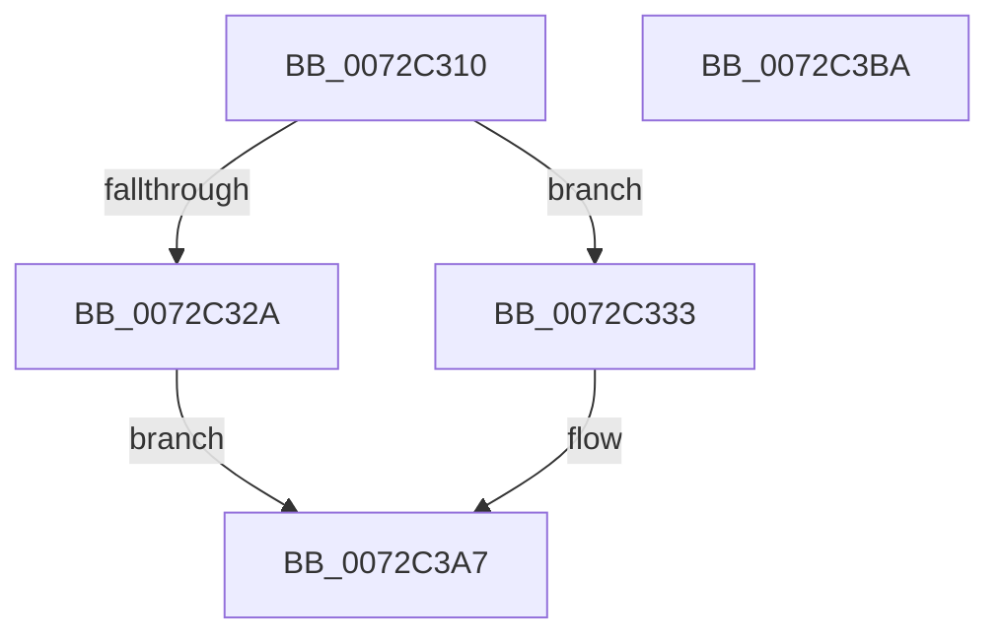

# PpSystemHiveLimitCallback

- RVA: `0x0072C310`–`0x0072C3BB` (길이 `171` bytes)
- VA: `0x000000014072C310`
- 실행 섹션: `PAGE`
- PDB 이름 있음: `예`; PDB Function 태그: `아니요`
- unwind 정보 RVA: `0x0005F638`
- 디코드: `38`개 명령, `171/171` bytes 표시
- 미해석 바이트: `0` (있으면 어셈블리에 `.byte`로 보존)

> 이 문서는 커널 이미지의 기계어와 PDB 기호를 분석해 생성했습니다. 4번과 5번은 함수 원형과 자료형을 바이너리 사용 방식에서 추정한 C 해석이며 원본 소스 복구 결과는 아닙니다.

## 1. Dependencies

- 직접 호출 지점: **5**; 고유 호출 대상: **5**
- 직접 호출자로 확인된 함수: **0**
- RIP 상대 이미지 참조: **4**

### Outgoing calls
- `0x0072C358` → [PpDevNodeLockTree](../A1/PpDevNodeLockTree_function_00A19310.md) (function, `0x00A19310`)
- `0x0072C36C` → [PipForDeviceNodeSubtree](../A5/PipForDeviceNodeSubtree_function_00A51920.md) (function, `0x00A51920`)
- `0x0072C376` → [PpDevNodeUnlockTree](../A2/PpDevNodeUnlockTree_function_00A21290.md) (function, `0x00A21290`)
- `0x0072C3A2` → [PnpRequestDeviceAction](../../text/47/PnpRequestDeviceAction_function_00477FF8.md) (function, `0x00477FF8`)
- `0x0072C3AF` → [_security_check_cookie](../../text/6A/_security_check_cookie_function_006AC640.md) (function, `0x006AC640`)

### Direct callers
- 이 함수 시작 RVA로 연결되는 직접 call은 확인되지 않았습니다. 간접 호출은 완전히 역산할 수 없습니다.

### Static image references
- `0x0072C316` → RVA `0x00E0A740` (`.data`; read)
- `0x0072C32A` → RVA `0x00E662F0` (`.data`; write)
- `0x0072C333` → RVA `0x00F8C438` (`.data`; read)
- `0x0072C365` → RVA `0x00A68BE0` (`PiResetProblemDevicesWorker`; read)

## 2. Other-region calls and transfers

- 다른 실행 섹션으로 향하는 call: **2**
  - `0x0072C3A2` → [PnpRequestDeviceAction](../../text/47/PnpRequestDeviceAction_function_00477FF8.md) (`PAGE` → `.text`)
  - `0x0072C3AF` → [_security_check_cookie](../../text/6A/_security_check_cookie_function_006AC640.md) (`PAGE` → `.text`)
- 별도 외부 분기/꼬리 이동을 확인하지 못했습니다.

## 3. Assembly (complete function range)

```asm
0072C310  40 53                           push rbx
0072C312  48 83 EC 60                     sub rsp, 0x60
0072C316  48 8B 05 23 E4 6D 00            mov rax, qword ptr [rip + 0x6de423]
0072C31D  48 33 C4                        xor rax, rsp
0072C320  48 89 44 24 50                  mov qword ptr [rsp + 0x50], rax
0072C325  3B 51 04                        cmp edx, dword ptr [rcx + 4]
0072C328  72 09                           jb 0x14072c333
0072C32A  C6 05 BF 9F 73 00 01            mov byte ptr [rip + 0x739fbf], 1
0072C331  EB 74                           jmp 0x14072c3a7
0072C333  48 8B 1D FE 00 86 00            mov rbx, qword ptr [rip + 0x8600fe]
0072C33A  B9 01 00 00 00                  mov ecx, 1
0072C33F  83 64 24 44 00                  and dword ptr [rsp + 0x44], 0
0072C344  83 64 24 48 00                  and dword ptr [rsp + 0x48], 0
0072C349  C6 05 A0 9F 73 00 00            mov byte ptr [rip + 0x739fa0], 0
0072C350  C7 44 24 40 31 00 00 00         mov dword ptr [rsp + 0x40], 0x31
0072C358  E8 B3 CF 2E 00                  call 0x140a19310
0072C35D  4C 8D 44 24 40                  lea r8, [rsp + 0x40]
0072C362  48 8B CB                        mov rcx, rbx
0072C365  48 8D 15 74 C8 33 00            lea rdx, [rip + 0x33c874]
0072C36C  E8 AF 55 32 00                  call 0x140a51920
0072C371  B9 01 00 00 00                  mov ecx, 1
0072C376  E8 15 4F 2F 00                  call 0x140a21290
0072C37B  48 83 64 24 30 00               and qword ptr [rsp + 0x30], 0
0072C381  45 33 C9                        xor r9d, r9d
0072C384  48 8B 0D AD 00 86 00            mov rcx, qword ptr [rip + 0x8600ad]
0072C38B  45 33 C0                        xor r8d, r8d
0072C38E  48 83 64 24 28 00               and qword ptr [rsp + 0x28], 0
0072C394  48 83 64 24 20 00               and qword ptr [rsp + 0x20], 0
0072C39A  41 8D 51 0E                     lea edx, [r9 + 0xe]
0072C39E  48 8B 49 20                     mov rcx, qword ptr [rcx + 0x20]
0072C3A2  E8 51 BC D4 FF                  call 0x140477ff8
0072C3A7  48 8B 4C 24 50                  mov rcx, qword ptr [rsp + 0x50]
0072C3AC  48 33 CC                        xor rcx, rsp
0072C3AF  E8 8C 02 F8 FF                  call 0x1406ac640
0072C3B4  48 83 C4 60                     add rsp, 0x60
0072C3B8  5B                              pop rbx
0072C3B9  C3                              ret
0072C3BA  CC                              int3
```

## 4. C-style interpretation (structured pseudocode)

```c
__int64 __fastcall PpSystemHiveLimitCallback(__int64 a1, int a2, __int64 a3, int a4)
{
    __int64 result;
    __int64 v_rsp;
    unsigned __int64 v_stack_m18;
    unsigned int v_stack_m20;
    unsigned int v_stack_m24;
    unsigned int v_stack_m28;
    unsigned __int64 v_stack_m38;
    unsigned __int64 v_stack_m40;
    unsigned __int64 v_stack_m48;

    v_rsp = (v_rsp) - (96);
    result = (*(unsigned __int64 *)(v_rip + 7201827)) ^ (v_rsp);
    v_stack_m18 = result;
    if (a2 < (*(unsigned int *)(a1 + 4))) goto loc_0072C333;
    *(unsigned __int8 *)(v_rip + 7577535) = 1;
    goto loc_0072C3A7;
loc_0072C333:
    *(unsigned __int8 *)(v_rip + 7577504) = 0;
    v_stack_m28 = 49;
    result = PpDevNodeLockTree(1, a2, a3, a4);
    result = PipForDeviceNodeSubtree(*(unsigned __int64 *)(v_rip + 8782078), v_rip + 3393652, v_stack_m28, a4);
    result = PpDevNodeUnlockTree(1, v_rip + 3393652, v_stack_m28, a4);
    a4 = 0;
    a3 = 0;
    result = PnpRequestDeviceAction(*(unsigned __int64 *)(*(unsigned __int64 *)(v_rip + 8781997) + 32), a4 + 14, a3, a4);
loc_0072C3A7:
    a1 = (v_stack_m18) ^ (v_rsp);
    result = _security_check_cookie(a1, a4 + 14, a3, a4);
    v_rsp = (v_rsp) + (96);
    return result;
}
```

## 5. (Beta) C Style

```c
int64_t PpSystemHiveLimitCallback(void *Arg1, int32_t Arg2, int64_t Arg3, int32_t Arg4)
{
    uint8_t *arg1 = (uint8_t *)Arg1;

    int64_t result;
    int64_t local_rsp;
    uint64_t v_stack_m18;
    uint32_t v_stack_m20;
    uint32_t v_stack_m24;
    uint32_t v_stack_m28;
    uint64_t v_stack_m38;
    uint64_t v_stack_m40;
    uint64_t v_stack_m48;

    local_rsp = (local_rsp) - (96);
    result = (*(uint64_t *)(v_rip + 0x6DE423)) ^ (local_rsp);
    v_stack_m18 = result;
    if (Arg2 < (*(uint32_t *)(arg1 + 0x4))) goto loc_0072C333;
    *(uint8_t *)(v_rip + 0x739FBF) = 1;
    goto loc_0072C3A7;
loc_0072C333:
    *(uint8_t *)(v_rip + 0x739FA0) = 0;
    v_stack_m28 = 49;
    result = PpDevNodeLockTree(1, Arg2, Arg3, Arg4);
    result = PipForDeviceNodeSubtree(*(uint64_t *)(v_rip + 0x8600FE), v_rip + 3393652, v_stack_m28, Arg4);
    result = PpDevNodeUnlockTree(1, v_rip + 3393652, v_stack_m28, Arg4);
    Arg4 = 0;
    Arg3 = 0;
    result = PnpRequestDeviceAction(*(uint64_t *)(*(uint64_t *)(v_rip + 0x8600AD) + 0x20), Arg4 + 14, Arg3, Arg4);
loc_0072C3A7:
    Arg1 = (v_stack_m18) ^ (local_rsp);
    result = _security_check_cookie(Arg1, Arg4 + 14, Arg3, Arg4);
    local_rsp = (local_rsp) + (96);
    return result;
}
```

### 관측된 메모리 오프셋

구조체 형식이 확인되지 않은 접근은 인자 기준의 오프셋으로만 기록했습니다.

| 기준 인자 | 오프셋 표현 | 폭 (bit) | 접근 |
|---|---:|---:|---|
| `Arg1` | `+ 0x4` | `32` | `R` |

## 6. Execution-region graph

[열기: 2D/3D 그래프와 함수 탐색 컨트롤 패널](../../../control-panel.html?section=page&rva=0x0072C310&view=graph)

- 2D 그래프는 위에서 아래로 흐르고, 3D 그래프는 빈 공간을 드래그해 회전합니다. Shift+드래그는 이동, 휠은 확대·축소, 함수 노드 선택은 대상 보고서 이동입니다.

### Static fallback


