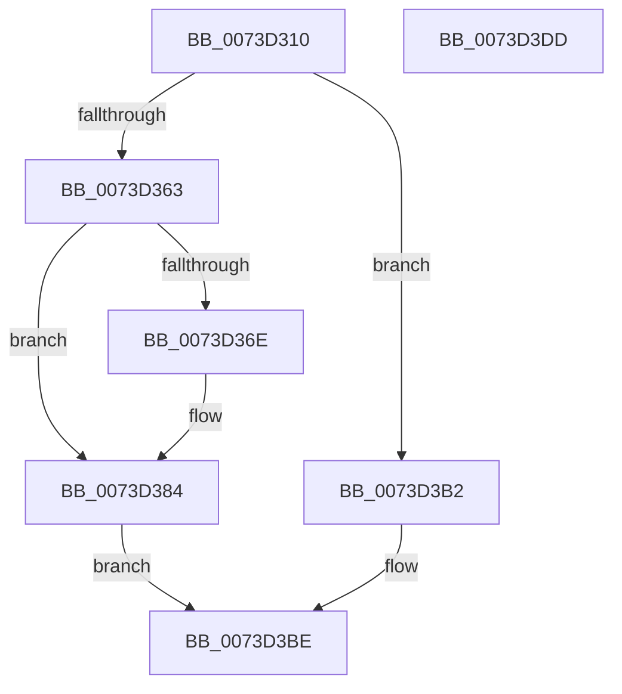

# IopAppendLegacyVeto

- RVA: `0x0073D310`–`0x0073D3DE` (길이 `206` bytes)
- VA: `0x000000014073D310`
- 실행 섹션: `PAGE`
- PDB 이름 있음: `예`; PDB Function 태그: `아니요`
- unwind 정보 RVA: `0x0005FEF8`
- 디코드: `60`개 명령, `206/206` bytes 표시
- 미해석 바이트: `0` (있으면 어셈블리에 `.byte`로 보존)

> 이 문서는 커널 이미지의 기계어와 PDB 기호를 분석해 생성했습니다. 4번과 5번은 함수 원형과 자료형을 바이너리 사용 방식에서 추정한 C 해석이며 원본 소스 복구 결과는 아닙니다.

## 1. Dependencies

- 직접 호출 지점: **4**; 고유 호출 대상: **3**
- 직접 호출자로 확인된 함수: **4**
- RIP 상대 이미지 참조: **0**

### Outgoing calls
- `0x0073D353` → [ExAllocatePool2](../../poolcode/B8/ExAllocatePool2_function_00B820F0.md) (function, `0x00B820F0`)
- `0x0073D375` → [memcpy](../../text/6C/memcpy_function_006C6840.md) (function, `0x006C6840`)
- `0x0073D37F` → [ExFreePoolWithTag](../../poolcode/B8/ExFreePoolWithTag_function_00B82870.md) (function, `0x00B82870`)
- `0x0073D396` → [memcpy](../../text/6C/memcpy_function_006C6840.md) (function, `0x006C6840`)

### Direct callers
- [IoGetLegacyVetoList](../91/IoGetLegacyVetoList_function_00911300.md) at `0x0091140A`
- [PopFilterCapabilities](../91/PopFilterCapabilities_function_0091141C.md) at `0x009116CA`
- [IopGetLegacyVetoListDrivers](../91/IopGetLegacyVetoListDrivers_function_00911814.md) at `0x00911A9C`
- [IopGetLegacyVetoListDeviceNode](../91/IopGetLegacyVetoListDeviceNode_function_00911ABC.md) at `0x00911B1A`

### Static image references
- 디코드된 RIP-relative 메모리 참조가 없습니다.

## 2. Other-region calls and transfers

- 다른 실행 섹션으로 향하는 call: **4**
  - `0x0073D353` → [ExAllocatePool2](../../poolcode/B8/ExAllocatePool2_function_00B820F0.md) (`PAGE` → `POOLCODE`)
  - `0x0073D375` → [memcpy](../../text/6C/memcpy_function_006C6840.md) (`PAGE` → `.text`)
  - `0x0073D37F` → [ExFreePoolWithTag](../../poolcode/B8/ExFreePoolWithTag_function_00B82870.md) (`PAGE` → `POOLCODE`)
  - `0x0073D396` → [memcpy](../../text/6C/memcpy_function_006C6840.md) (`PAGE` → `.text`)
- 별도 외부 분기/꼬리 이동을 확인하지 못했습니다.

## 3. Assembly (complete function range)

```asm
0073D310  48 8B C4                        mov rax, rsp
0073D313  48 89 58 08                     mov qword ptr [rax + 8], rbx
0073D317  48 89 68 10                     mov qword ptr [rax + 0x10], rbp
0073D31B  48 89 70 18                     mov qword ptr [rax + 0x18], rsi
0073D31F  48 89 78 20                     mov qword ptr [rax + 0x20], rdi
0073D323  41 54                           push r12
0073D325  41 56                           push r14
0073D327  41 57                           push r15
0073D329  48 83 EC 20                     sub rsp, 0x20
0073D32D  44 0F B7 02                     movzx r8d, word ptr [rdx]
0073D331  4C 8B F2                        mov r14, rdx
0073D334  44 8B 79 08                     mov r15d, dword ptr [rcx + 8]
0073D338  41 83 C0 02                     add r8d, 2
0073D33C  45 03 F8                        add r15d, r8d
0073D33F  48 8B D9                        mov rbx, rcx
0073D342  41 8B D7                        mov edx, r15d
0073D345  41 B8 50 70 69 6F               mov r8d, 0x6f697050
0073D34B  B9 40 00 00 00                  mov ecx, 0x40
0073D350  41 8B EF                        mov ebp, r15d
0073D353  E8 98 4D 44 00                  call 0x140b820f0
0073D358  45 33 E4                        xor r12d, r12d
0073D35B  48 8B F8                        mov rdi, rax
0073D35E  48 85 C0                        test rax, rax
0073D361  74 4F                           je 0x14073d3b2
0073D363  48 8B 33                        mov rsi, qword ptr [rbx]
0073D366  48 8B 16                        mov rdx, qword ptr [rsi]
0073D369  48 85 D2                        test rdx, rdx
0073D36C  74 16                           je 0x14073d384
0073D36E  44 8B 43 08                     mov r8d, dword ptr [rbx + 8]
0073D372  48 8B C8                        mov rcx, rax
0073D375  E8 C6 94 F8 FF                  call 0x1406c6840
0073D37A  48 8B 0E                        mov rcx, qword ptr [rsi]
0073D37D  33 D2                           xor edx, edx
0073D37F  E8 EC 54 44 00                  call 0x140b82870
0073D384  8B 43 08                        mov eax, dword ptr [rbx + 8]
0073D387  45 0F B7 06                     movzx r8d, word ptr [r14]
0073D38B  49 8B 56 08                     mov rdx, qword ptr [r14 + 8]
0073D38F  48 D1 E8                        shr rax, 1
0073D392  48 8D 0C 47                     lea rcx, [rdi + rax*2]
0073D396  E8 A5 94 F8 FF                  call 0x1406c6840
0073D39B  48 8B 03                        mov rax, qword ptr [rbx]
0073D39E  48 D1 ED                        shr rbp, 1
0073D3A1  44 89 7B 08                     mov dword ptr [rbx + 8], r15d
0073D3A5  66 44 89 64 6F FE               mov word ptr [rdi + rbp*2 - 2], r12w
0073D3AB  48 89 38                        mov qword ptr [rax], rdi
0073D3AE  B0 01                           mov al, 1
0073D3B0  EB 0C                           jmp 0x14073d3be
0073D3B2  48 8B 43 18                     mov rax, qword ptr [rbx + 0x18]
0073D3B6  C7 00 9A 00 00 C0               mov dword ptr [rax], 0xc000009a
0073D3BC  32 C0                           xor al, al
0073D3BE  48 8B 5C 24 40                  mov rbx, qword ptr [rsp + 0x40]
0073D3C3  48 8B 6C 24 48                  mov rbp, qword ptr [rsp + 0x48]
0073D3C8  48 8B 74 24 50                  mov rsi, qword ptr [rsp + 0x50]
0073D3CD  48 8B 7C 24 58                  mov rdi, qword ptr [rsp + 0x58]
0073D3D2  48 83 C4 20                     add rsp, 0x20
0073D3D6  41 5F                           pop r15
0073D3D8  41 5E                           pop r14
0073D3DA  41 5C                           pop r12
0073D3DC  C3                              ret
0073D3DD  CC                              int3
```

## 4. C-style interpretation (structured pseudocode)

```c
__int64 __fastcall IopAppendLegacyVeto(__int64 a1, __int64 a2)
{
    __int64 result;
    __int64 v_r12;
    __int64 v_r15;
    __int64 v_rbp;
    __int64 v_rsp;
    unsigned __int64 v_stack_p10;
    unsigned __int64 v_stack_p18;
    unsigned __int64 v_stack_p20;
    unsigned __int64 v_stack_p8;

    *(unsigned __int64 *)(v_rsp + 8) = v_rbx;
    *(unsigned __int64 *)(v_rsp + 16) = v_rbp;
    *(unsigned __int64 *)(v_rsp + 24) = v_rsi;
    *(unsigned __int64 *)(v_rsp + 32) = v_rdi;
    v_rsp = (v_rsp) - (32);
    a3 = (unsigned int)((*(unsigned __int16 *)(a2)) + (2));
    v_r15 = (unsigned int)(((unsigned int)(*(unsigned int *)(a1 + 8))) + ((unsigned int)(a3)));
    result = ExAllocatePool2(64, (unsigned int)((unsigned int)(v_r15)), (unsigned int)(0x6F697050ULL), a4);
    v_r12 = 0;
    if (result == 0) goto loc_0073D3B2;
    if (*(unsigned __int64 *)(*(unsigned __int64 *)(a1)) != 0) {
        a3 = *(unsigned int *)(a1 + 8);
        a1 = result;
        result = memcpy(a1, *(unsigned __int64 *)(*(unsigned __int64 *)(a1)), a3, a4);
        a1 = *(unsigned __int64 *)(*(unsigned __int64 *)(a1));
        a2 = 0;
        result = ExFreePoolWithTag(a1, a2, a3, a4);
    }
    result = ((unsigned int)(*(unsigned int *)(a1 + 8))) >> (1);
    result = memcpy(result + result * 2, *(unsigned __int64 *)(a2 + 8), *(unsigned __int16 *)(a2), a4);
    v_rbp = ((unsigned int)((unsigned int)(v_r15))) >> (1);
    *(unsigned int *)(a1 + 8) = (unsigned int)(v_r15);
    *(unsigned __int16 *)(result + v_rbp * 2 - 2) = 0;
    *(unsigned __int64 *)(*(unsigned __int64 *)(a1)) = result;
    goto loc_0073D3BE;
loc_0073D3B2:
    *(unsigned int *)(*(unsigned __int64 *)(a1 + 24)) = 0xC000009AULL;
    result = 0;
loc_0073D3BE:
    v_rsp = (v_rsp) + (32);
    return result;
}
```

## 5. (Beta) C Style

```c
int64_t IopAppendLegacyVeto(void *Arg1, void *Arg2)
{
    uint8_t *arg1 = (uint8_t *)Arg1;
    uint8_t *arg2 = (uint8_t *)Arg2;

    int64_t result;
    int64_t local_r12;
    int64_t local_r15;
    int64_t local_rbp;
    int64_t local_rsp;
    uint64_t v_stack_p10;
    uint64_t v_stack_p18;
    uint64_t v_stack_p20;
    uint64_t v_stack_p8;

    *(uint64_t *)(local_rsp + 0x8) = local_rbx;
    *(uint64_t *)(local_rsp + 0x10) = local_rbp;
    *(uint64_t *)(local_rsp + 0x18) = local_rsi;
    *(uint64_t *)(local_rsp + 0x20) = local_rdi;
    local_rsp = (local_rsp) - (32);
    a3 = (uint32_t)((*(uint16_t *)(arg2)) + (2));
    local_r15 = (uint32_t)(((uint32_t)(*(uint32_t *)(arg1 + 0x8))) + ((uint32_t)(a3)));
    result = ExAllocatePool2(64, (uint32_t)((uint32_t)(local_r15)), (uint32_t)(0x6F697050ULL), a4);
    local_r12 = 0;
    if (result == 0) goto loc_0073D3B2;
    if (*(uint64_t *)(*(uint64_t *)(arg1)) != 0) {
        a3 = *(uint32_t *)(arg1 + 0x8);
        Arg1 = result;
        result = memcpy(Arg1, *(uint64_t *)(*(uint64_t *)(arg1)), a3, a4);
        Arg1 = *(uint64_t *)(*(uint64_t *)(arg1));
        Arg2 = 0;
        result = ExFreePoolWithTag(Arg1, Arg2, a3, a4);
    }
    result = ((uint32_t)(*(uint32_t *)(arg1 + 0x8))) >> (1);
    result = memcpy(result + result * 2, *(uint64_t *)(arg2 + 0x8), *(uint16_t *)(arg2), a4);
    local_rbp = ((uint32_t)((uint32_t)(local_r15))) >> (1);
    *(uint32_t *)(arg1 + 0x8) = (uint32_t)(local_r15);
    *(uint16_t *)(result + local_rbp * 2 - 0x2) = 0;
    *(uint64_t *)(*(uint64_t *)(arg1)) = result;
    goto loc_0073D3BE;
loc_0073D3B2:
    *(uint32_t *)(*(uint64_t *)(arg1 + 0x18)) = 0xC000009AULL;
    result = 0;
loc_0073D3BE:
    local_rsp = (local_rsp) + (32);
    return result;
}
```

### 관측된 메모리 오프셋

구조체 형식이 확인되지 않은 접근은 인자 기준의 오프셋으로만 기록했습니다.

| 기준 인자 | 오프셋 표현 | 폭 (bit) | 접근 |
|---|---:|---:|---|
| `Arg1` | `+ 0x0` | `64` | `R` |
| `Arg1` | `+ 0x8` | `32` | `R` |
| `Arg1` | `+ 0x8` | `32` | `W` |
| `Arg1` | `+ 0x18` | `64` | `R` |
| `Arg2` | `+ 0x0` | `16` | `R` |
| `Arg2` | `+ 0x8` | `64` | `R` |

## 6. Execution-region graph

[열기: 2D/3D 그래프와 함수 탐색 컨트롤 패널](../../../control-panel.html?section=page&rva=0x0073D310&view=graph)

- 2D 그래프는 위에서 아래로 흐르고, 3D 그래프는 빈 공간을 드래그해 회전합니다. Shift+드래그는 이동, 휠은 확대·축소, 함수 노드 선택은 대상 보고서 이동입니다.

### Static fallback


