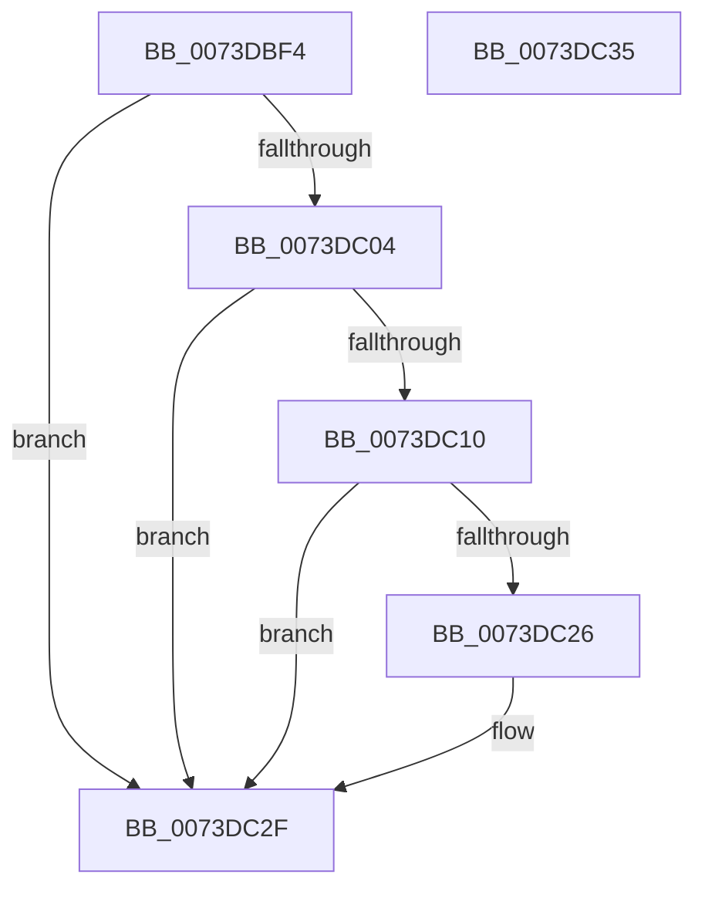

# IopCancelPendingEject

- RVA: `0x0073DBF4`–`0x0073DC36` (길이 `66` bytes)
- VA: `0x000000014073DBF4`
- 실행 섹션: `PAGE`
- PDB 이름 있음: `예`; PDB Function 태그: `아니요`
- unwind 정보 RVA: `0x0005CF00`
- 디코드: `21`개 명령, `66/66` bytes 표시
- 미해석 바이트: `0` (있으면 어셈블리에 `.byte`로 보존)

> 이 문서는 커널 이미지의 기계어와 PDB 기호를 분석해 생성했습니다. 4번과 5번은 함수 원형과 자료형을 바이너리 사용 방식에서 추정한 C 해석이며 원본 소스 복구 결과는 아닙니다.

## 1. Dependencies

- 직접 호출 지점: **2**; 고유 호출 대상: **2**
- 직접 호출자로 확인된 함수: **1**
- RIP 상대 이미지 참조: **0**

### Outgoing calls
- `0x0073DC14` → [IoCancelIrp](../../text/27/IoCancelIrp_function_002720E0.md) (function, `0x002720E0`)
- `0x0073DC2A` → [IoFreeIrp](../../text/24/IoFreeIrp_function_0024DF70.md) (function, `0x0024DF70`)

### Direct callers
- [sub_00B336B0](../B3/Unknown_function_00B336B0.md) at `0x00B339A1`

### Static image references
- 디코드된 RIP-relative 메모리 참조가 없습니다.

## 2. Other-region calls and transfers

- 다른 실행 섹션으로 향하는 call: **2**
  - `0x0073DC14` → [IoCancelIrp](../../text/27/IoCancelIrp_function_002720E0.md) (`PAGE` → `.text`)
  - `0x0073DC2A` → [IoFreeIrp](../../text/24/IoFreeIrp_function_0024DF70.md) (`PAGE` → `.text`)
- 별도 외부 분기/꼬리 이동을 확인하지 못했습니다.

## 3. Assembly (complete function range)

```asm
0073DBF4  40 53                           push rbx
0073DBF6  48 83 EC 20                     sub rsp, 0x20
0073DBFA  48 83 79 48 00                  cmp qword ptr [rcx + 0x48], 0
0073DBFF  48 8B D9                        mov rbx, rcx
0073DC02  74 2B                           je 0x14073dc2f
0073DC04  B8 01 00 00 00                  mov eax, 1
0073DC09  87 41 50                        xchg dword ptr [rcx + 0x50], eax
0073DC0C  85 C0                           test eax, eax
0073DC0E  75 1F                           jne 0x14073dc2f
0073DC10  48 8B 49 48                     mov rcx, qword ptr [rcx + 0x48]
0073DC14  E8 C7 44 B3 FF                  call 0x1402720e0
0073DC19  B8 02 00 00 00                  mov eax, 2
0073DC1E  87 43 50                        xchg dword ptr [rbx + 0x50], eax
0073DC21  83 F8 03                        cmp eax, 3
0073DC24  75 09                           jne 0x14073dc2f
0073DC26  48 8B 4B 48                     mov rcx, qword ptr [rbx + 0x48]
0073DC2A  E8 41 03 B1 FF                  call 0x14024df70
0073DC2F  48 83 C4 20                     add rsp, 0x20
0073DC33  5B                              pop rbx
0073DC34  C3                              ret
0073DC35  CC                              int3
```

## 4. C-style interpretation (structured pseudocode)

```c
__int64 __fastcall IopCancelPendingEject(__int64 a1)
{
    __int64 result;
    __int64 v_rsp;

    v_rsp = (v_rsp) - (32);
    if ((*(unsigned __int64 *)(a1 + 72)) == 0) goto loc_0073DC2F;
    if (1 != 0) goto loc_0073DC2F;
    result = IoCancelIrp(*(unsigned __int64 *)(a1 + 72), a2, a3, a4);
    result = 2;
    if (2 == 3) {
        a1 = *(unsigned __int64 *)(a1 + 72);
        result = IoFreeIrp(a1, a2, a3, a4);
    }
    v_rsp = (v_rsp) + (32);
    return result;
}
```

## 5. (Beta) C Style

```c
int64_t IopCancelPendingEject(void *Arg1)
{
    uint8_t *arg1 = (uint8_t *)Arg1;

    int64_t result;
    int64_t local_rsp;

    local_rsp = (local_rsp) - (32);
    if ((*(uint64_t *)(arg1 + 0x48)) == 0) goto loc_0073DC2F;
    if (1 != 0) goto loc_0073DC2F;
    result = IoCancelIrp(*(uint64_t *)(arg1 + 0x48), a2, a3, a4);
    result = 2;
    if (2 == 3) {
        Arg1 = *(uint64_t *)(arg1 + 0x48);
        result = IoFreeIrp(Arg1, a2, a3, a4);
    }
    local_rsp = (local_rsp) + (32);
    return result;
}
```

### 관측된 메모리 오프셋

구조체 형식이 확인되지 않은 접근은 인자 기준의 오프셋으로만 기록했습니다.

| 기준 인자 | 오프셋 표현 | 폭 (bit) | 접근 |
|---|---:|---:|---|
| `Arg1` | `+ 0x48` | `64` | `R` |
| `Arg1` | `+ 0x50` | `32` | `R/W` |

## 6. Execution-region graph

[열기: 2D/3D 그래프와 함수 탐색 컨트롤 패널](../../../control-panel.html?section=page&rva=0x0073DBF4&view=graph)

- 2D 그래프는 위에서 아래로 흐르고, 3D 그래프는 빈 공간을 드래그해 회전합니다. Shift+드래그는 이동, 휠은 확대·축소, 함수 노드 선택은 대상 보고서 이동입니다.

### Static fallback


