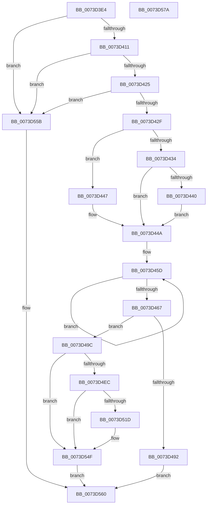

# IopCreateLegacyDeviceIds

- RVA: `0x0073D3E4`–`0x0073D57B` (길이 `407` bytes)
- VA: `0x000000014073D3E4`
- 실행 섹션: `PAGE`
- PDB 이름 있음: `예`; PDB Function 태그: `아니요`
- unwind 정보 RVA: `0x000C90AC`
- 디코드: `106`개 명령, `407/407` bytes 표시
- 미해석 바이트: `0` (있으면 어셈블리에 `.byte`로 보존)

> 이 문서는 커널 이미지의 기계어와 PDB 기호를 분석해 생성했습니다. 4번과 5번은 함수 원형과 자료형을 바이너리 사용 방식에서 추정한 C 해석이며 원본 소스 복구 결과는 아닙니다.

## 1. Dependencies

- 직접 호출 지점: **5**; 고유 호출 대상: **5**
- 직접 호출자로 확인된 함수: **1**
- RIP 상대 이미지 참조: **5**

### Outgoing calls
- `0x0073D485` → [ExAllocatePool2](../../poolcode/B8/ExAllocatePool2_function_00B820F0.md) (function, `0x00B820F0`)
- `0x0073D4E1` → [RtlStringCchPrintfExW](../../text/42/RtlStringCchPrintfExW_function_0042B390.md) (function, `0x0042B390`)
- `0x0073D512` → [RtlStringCchPrintfW](../../text/48/RtlStringCchPrintfW_function_00482D5C.md) (function, `0x00482D5C`)
- `0x0073D548` → [CmSetDeviceRegProp](../8F/CmSetDeviceRegProp_function_008FD68C.md) (function, `0x008FD68C`)
- `0x0073D554` → [ExFreePoolWithTag](../../poolcode/B8/ExFreePoolWithTag_function_00B82870.md) (function, `0x00B82870`)

### Direct callers
- [IoReportDetectedDevice](../72/IoReportDetectedDevice_function_00725CD0.md) at `0x0072641F`

### Static image references
- `0x0073D44D` → RVA `0x0000A0A8` (`.rdata`; read)
- `0x0073D4AE` → RVA `0x00B00040` (` ?? ::NNGAKEGL::`string'`; read)
- `0x0073D4C2` → RVA `0x00B00060` (` ?? ::NNGAKEGL::`string'`; read)
- `0x0073D4F4` → RVA `0x00AFFFE0` (` ?? ::NNGAKEGL::`string'`; read)
- `0x0073D527` → RVA `0x00E66398` (`.data`; read)

## 2. Other-region calls and transfers

- 다른 실행 섹션으로 향하는 call: **4**
  - `0x0073D485` → [ExAllocatePool2](../../poolcode/B8/ExAllocatePool2_function_00B820F0.md) (`PAGE` → `POOLCODE`)
  - `0x0073D4E1` → [RtlStringCchPrintfExW](../../text/42/RtlStringCchPrintfExW_function_0042B390.md) (`PAGE` → `.text`)
  - `0x0073D512` → [RtlStringCchPrintfW](../../text/48/RtlStringCchPrintfW_function_00482D5C.md) (`PAGE` → `.text`)
  - `0x0073D554` → [ExFreePoolWithTag](../../poolcode/B8/ExFreePoolWithTag_function_00B82870.md) (`PAGE` → `POOLCODE`)
- 별도 외부 분기/꼬리 이동을 확인하지 못했습니다.

## 3. Assembly (complete function range)

```asm
0073D3E4  48 8B C4                        mov rax, rsp
0073D3E7  48 89 58 10                     mov qword ptr [rax + 0x10], rbx
0073D3EB  55                              push rbp
0073D3EC  56                              push rsi
0073D3ED  57                              push rdi
0073D3EE  41 54                           push r12
0073D3F0  41 55                           push r13
0073D3F2  41 56                           push r14
0073D3F4  41 57                           push r15
0073D3F6  48 83 EC 50                     sub rsp, 0x50
0073D3FA  45 33 E4                        xor r12d, r12d
0073D3FD  48 8B EA                        mov rbp, rdx
0073D400  4C 89 60 08                     mov qword ptr [rax + 8], r12
0073D404  4C 89 60 20                     mov qword ptr [rax + 0x20], r12
0073D408  48 85 C9                        test rcx, rcx
0073D40B  0F 84 4A 01 00 00               je 0x14073d55b
0073D411  48 8B 81 38 01 00 00            mov rax, qword ptr [rcx + 0x138]
0073D418  48 8B 70 28                     mov rsi, qword ptr [rax + 0x28]
0073D41C  48 85 F6                        test rsi, rsi
0073D41F  0F 84 36 01 00 00               je 0x14073d55b
0073D425  4C 39 66 30                     cmp qword ptr [rsi + 0x30], r12
0073D429  0F 84 2C 01 00 00               je 0x14073d55b
0073D42F  4D 85 C0                        test r8, r8
0073D432  74 13                           je 0x14073d447
0073D434  41 8B 48 04                     mov ecx, dword ptr [r8 + 4]
0073D438  8D 41 01                        lea eax, [rcx + 1]
0073D43B  83 F8 13                        cmp eax, 0x13
0073D43E  76 0A                           jbe 0x14073d44a
0073D440  41 8D 4C 24 12                  lea ecx, [r12 + 0x12]
0073D445  EB 03                           jmp 0x14073d44a
0073D447  41 8B CC                        mov ecx, r12d
0073D44A  4C 63 F9                        movsxd r15, ecx
0073D44D  4C 8D 2D 54 CC 8C FF            lea r13, [rip - 0x7333ac]
0073D454  48 83 C9 FF                     or rcx, 0xffffffffffffffff
0073D458  4B 8B 44 FD 00                  mov rax, qword ptr [r13 + r15*8]
0073D45D  48 FF C1                        inc rcx
0073D460  66 44 39 24 48                  cmp word ptr [rax + rcx*2], r12w
0073D465  75 F6                           jne 0x14073d45d
0073D467  0F B7 02                        movzx eax, word ptr [rdx]
0073D46A  41 B8 50 70 69 6F               mov r8d, 0x6f697050
0073D470  03 C8                           add ecx, eax
0073D472  44 8D 34 4D 2A 00 00 00         lea r14d, [rcx*2 + 0x2a]
0073D47A  B9 00 01 00 00                  mov ecx, 0x100
0073D47F  41 8B D6                        mov edx, r14d
0073D482  41 8B DE                        mov ebx, r14d
0073D485  E8 66 4C 44 00                  call 0x140b820f0
0073D48A  48 8B F8                        mov rdi, rax
0073D48D  48 85 C0                        test rax, rax
0073D490  75 0A                           jne 0x14073d49c
0073D492  BB 9A 00 00 C0                  mov ebx, 0xc000009a
0073D497  E9 C4 00 00 00                  jmp 0x14073d560
0073D49C  4B 8B 44 FD 00                  mov rax, qword ptr [r13 + r15*8]
0073D4A1  4C 8D 8C 24 A8 00 00 00         lea r9, [rsp + 0xa8]
0073D4A9  48 89 6C 24 40                  mov qword ptr [rsp + 0x40], rbp
0073D4AE  4C 8D 3D 8B 2B 3C 00            lea r15, [rip + 0x3c2b8b]
0073D4B5  48 89 44 24 38                  mov qword ptr [rsp + 0x38], rax
0073D4BA  4C 8D 84 24 90 00 00 00         lea r8, [rsp + 0x90]
0073D4C2  48 8D 05 97 2B 3C 00            lea rax, [rip + 0x3c2b97]
0073D4C9  4C 89 7C 24 30                  mov qword ptr [rsp + 0x30], r15
0073D4CE  48 89 44 24 28                  mov qword ptr [rsp + 0x28], rax
0073D4D3  48 8B CF                        mov rcx, rdi
0073D4D6  48 D1 EB                        shr rbx, 1
0073D4D9  48 8B D3                        mov rdx, rbx
0073D4DC  4C 89 64 24 20                  mov qword ptr [rsp + 0x20], r12
0073D4E1  E8 AA DE CE FF                  call 0x14042b390
0073D4E6  8B D8                           mov ebx, eax
0073D4E8  85 C0                           test eax, eax
0073D4EA  78 63                           js 0x14073d54f
0073D4EC  48 8B 8C 24 90 00 00 00         mov rcx, qword ptr [rsp + 0x90]
0073D4F4  4C 8D 05 E5 2A 3C 00            lea r8, [rip + 0x3c2ae5]
0073D4FB  48 8B 94 24 A8 00 00 00         mov rdx, qword ptr [rsp + 0xa8]
0073D503  48 83 C1 02                     add rcx, 2
0073D507  48 FF CA                        dec rdx
0073D50A  48 89 6C 24 20                  mov qword ptr [rsp + 0x20], rbp
0073D50F  4D 8B CF                        mov r9, r15
0073D512  E8 45 58 D4 FF                  call 0x140482d5c
0073D517  8B D8                           mov ebx, eax
0073D519  85 C0                           test eax, eax
0073D51B  78 32                           js 0x14073d54f
0073D51D  48 8B 56 30                     mov rdx, qword ptr [rsi + 0x30]
0073D521  41 B9 03 00 00 00               mov r9d, 3
0073D527  48 8B 0D 6A 8E 72 00            mov rcx, qword ptr [rip + 0x728e6a]
0073D52E  45 33 C0                        xor r8d, r8d
0073D531  44 89 64 24 38                  mov dword ptr [rsp + 0x38], r12d
0073D536  44 89 74 24 30                  mov dword ptr [rsp + 0x30], r14d
0073D53B  48 89 7C 24 28                  mov qword ptr [rsp + 0x28], rdi
0073D540  C7 44 24 20 07 00 00 00         mov dword ptr [rsp + 0x20], 7
0073D548  E8 3F 01 1C 00                  call 0x1408fd68c
0073D54D  8B D8                           mov ebx, eax
0073D54F  33 D2                           xor edx, edx
0073D551  48 8B CF                        mov rcx, rdi
0073D554  E8 17 53 44 00                  call 0x140b82870
0073D559  EB 05                           jmp 0x14073d560
0073D55B  BB 0D 00 00 C0                  mov ebx, 0xc000000d
0073D560  8B C3                           mov eax, ebx
0073D562  48 8B 9C 24 98 00 00 00         mov rbx, qword ptr [rsp + 0x98]
0073D56A  48 83 C4 50                     add rsp, 0x50
0073D56E  41 5F                           pop r15
0073D570  41 5E                           pop r14
0073D572  41 5D                           pop r13
0073D574  41 5C                           pop r12
0073D576  5F                              pop rdi
0073D577  5E                              pop rsi
0073D578  5D                              pop rbp
0073D579  C3                              ret
0073D57A  CC                              int3
```

## 4. C-style interpretation (structured pseudocode)

```c
__int64 __fastcall IopCreateLegacyDeviceIds(__int64 a1, __int64 a2, __int64 a3)
{
    __int64 result;
    __int64 v_r12;
    __int64 v_rbx;
    __int64 v_rsp;
    unsigned __int64 v_stack_m48;
    unsigned __int64 v_stack_m50;
    unsigned __int64 v_stack_m58;
    unsigned __int64 v_stack_m60;
    unsigned __int64 v_stack_m68;
    unsigned __int64 v_stack_p10;
    unsigned __int64 v_stack_p20;
    unsigned __int64 v_stack_p8;

    *(unsigned __int64 *)(v_rsp + 16) = v_rbx;
    v_rsp = (v_rsp) - (80);
    v_r12 = 0;
    *(unsigned __int64 *)(v_rsp + 8) = 0;
    *(unsigned __int64 *)(v_rsp + 32) = 0;
    if (a1 == 0) goto loc_0073D55B;
    if (*(unsigned __int64 *)(*(unsigned __int64 *)(a1 + 312) + 40) == 0) goto loc_0073D55B;
    if ((*(unsigned __int64 *)(*(unsigned __int64 *)(*(unsigned __int64 *)(a1 + 312) + 40) + 48)) == 0) goto loc_0073D55B;
    if (a3 == 0) goto loc_0073D447;
    if (((unsigned int)((unsigned int)(*(unsigned int *)(a3 + 4)) + 1)) <= 19) goto loc_0073D44A;
    goto loc_0073D44A;
loc_0073D447:
loc_0073D44A:
    a1 = (0) | (-1);
loc_0073D45D:
    a1 = (a1) + 1;
    if ((*(unsigned __int16 *)(*(unsigned __int64 *)(v_rip - 7549868 + (int)(0) * 8) + a1 * 2)) != 0) goto loc_0073D45D;
    a1 = (unsigned int)((a1) + ((unsigned int)(*(unsigned __int16 *)(a2))));
    result = ExAllocatePool2(256, (unsigned int)((unsigned int)(a1 * 2 + 42)), (unsigned int)(0x6F697050ULL), a4);
    if (result != 0) goto loc_0073D49C;
    goto loc_0073D560;
loc_0073D49C:
    v_stack_m48 = a2;
    v_stack_m50 = *(unsigned __int64 *)(v_rip - 7549868 + (int)(0) * 8);
    v_stack_m58 = v_rip + 3943307;
    v_stack_m60 = v_rip + 3943319;
    v_rbx = ((unsigned int)(0xC000009AULL)) >> (1);
    v_stack_m68 = 0;
    result = RtlStringCchPrintfExW(result, v_rbx, v_stack_p8, v_stack_p20);
    if (sign_flag) goto loc_0073D54F;
    a1 = (v_stack_p8) + (2);
    a2 = (v_stack_p20) - 1;
    v_stack_m68 = a2;
    result = RtlStringCchPrintfW(a1, a2, v_rip + 3943141, v_rip + 3943307);
    v_rbx = (unsigned int)((unsigned int)(result));
    if (!(sign_flag)) {
        a2 = *(unsigned __int64 *)(*(unsigned __int64 *)(*(unsigned __int64 *)(a1 + 312) + 40) + 48);
        a4 = 3;
        a1 = *(unsigned __int64 *)(v_rip + 7507562);
        a3 = 0;
        v_stack_m50 = 0;
        v_stack_m58 = (unsigned int)(a1 * 2 + 42);
        v_stack_m60 = result;
        v_stack_m68 = 7;
        result = CmSetDeviceRegProp(a1, a2, a3, a4);
        v_rbx = (unsigned int)(result);
    }
    a2 = 0;
    result = ExFreePoolWithTag(result, a2, a3, a4);
    goto loc_0073D560;
loc_0073D55B:
loc_0073D560:
    v_rsp = (v_rsp) + (80);
    return (unsigned int)((unsigned int)((unsigned int)(0xC000000DULL)));
}
```

## 5. (Beta) C Style

```c
int64_t IopCreateLegacyDeviceIds(int64_t Arg1, void *Arg2, int64_t Arg3)
{
    uint8_t *arg2 = (uint8_t *)Arg2;

    int64_t result;
    int64_t local_r12;
    int64_t local_rbx;
    int64_t local_rsp;
    uint64_t v_stack_m48;
    uint64_t v_stack_m50;
    uint64_t v_stack_m58;
    uint64_t v_stack_m60;
    uint64_t v_stack_m68;
    uint64_t v_stack_p10;
    uint64_t v_stack_p20;
    uint64_t v_stack_p8;

    *(uint64_t *)(local_rsp + 0x10) = local_rbx;
    local_rsp = (local_rsp) - (80);
    local_r12 = 0;
    *(uint64_t *)(local_rsp + 0x8) = 0;
    *(uint64_t *)(local_rsp + 0x20) = 0;
    if (Arg1 == 0) goto loc_0073D55B;
    if (*(uint64_t *)(*(uint64_t *)(Arg1 + 0x138) + 0x28) == 0) goto loc_0073D55B;
    if ((*(uint64_t *)(*(uint64_t *)(*(uint64_t *)(Arg1 + 0x138) + 0x28) + 0x30)) == 0) goto loc_0073D55B;
    if (Arg3 == 0) goto loc_0073D447;
    if (((uint32_t)((uint32_t)(*(uint32_t *)(Arg3 + 0x4)) + 1)) <= 19) goto loc_0073D44A;
    goto loc_0073D44A;
loc_0073D447:
loc_0073D44A:
    Arg1 = (0) | (-1);
loc_0073D45D:
    Arg1 = (Arg1) + 1;
    if ((*(uint16_t *)(*(uint64_t *)(v_rip - 0x7333AC + (int32_t)(0) * 8) + Arg1 * 2)) != 0) goto loc_0073D45D;
    Arg1 = (uint32_t)((Arg1) + ((uint32_t)(*(uint16_t *)(arg2))));
    result = ExAllocatePool2(256, (uint32_t)((uint32_t)(Arg1 * 2 + 42)), (uint32_t)(0x6F697050ULL), a4);
    if (result != 0) goto loc_0073D49C;
    goto loc_0073D560;
loc_0073D49C:
    v_stack_m48 = Arg2;
    v_stack_m50 = *(uint64_t *)(v_rip - 0x7333AC + (int32_t)(0) * 8);
    v_stack_m58 = v_rip + 3943307;
    v_stack_m60 = v_rip + 3943319;
    local_rbx = ((uint32_t)(0xC000009AULL)) >> (1);
    v_stack_m68 = 0;
    result = RtlStringCchPrintfExW(result, local_rbx, v_stack_p8, v_stack_p20);
    if (sign_flag) goto loc_0073D54F;
    Arg1 = (v_stack_p8) + (2);
    Arg2 = (v_stack_p20) - 1;
    v_stack_m68 = Arg2;
    result = RtlStringCchPrintfW(Arg1, Arg2, v_rip + 3943141, v_rip + 3943307);
    local_rbx = (uint32_t)((uint32_t)(result));
    if (!(sign_flag)) {
        Arg2 = *(uint64_t *)(*(uint64_t *)(*(uint64_t *)(Arg1 + 0x138) + 0x28) + 0x30);
        a4 = 3;
        Arg1 = *(uint64_t *)(v_rip + 0x728E6A);
        Arg3 = 0;
        v_stack_m50 = 0;
        v_stack_m58 = (uint32_t)(Arg1 * 2 + 42);
        v_stack_m60 = result;
        v_stack_m68 = 7;
        result = CmSetDeviceRegProp(Arg1, Arg2, Arg3, a4);
        local_rbx = (uint32_t)(result);
    }
    Arg2 = 0;
    result = ExFreePoolWithTag(result, Arg2, Arg3, a4);
    goto loc_0073D560;
loc_0073D55B:
loc_0073D560:
    local_rsp = (local_rsp) + (80);
    return (uint32_t)((uint32_t)((uint32_t)(0xC000000DULL)));
}
```

### 관측된 메모리 오프셋

구조체 형식이 확인되지 않은 접근은 인자 기준의 오프셋으로만 기록했습니다.

| 기준 인자 | 오프셋 표현 | 폭 (bit) | 접근 |
|---|---:|---:|---|
| `Arg2` | `+ 0x0` | `16` | `R` |

## 6. Execution-region graph

[열기: 2D/3D 그래프와 함수 탐색 컨트롤 패널](../../../control-panel.html?section=page&rva=0x0073D3E4&view=graph)

- 2D 그래프는 위에서 아래로 흐르고, 3D 그래프는 빈 공간을 드래그해 회전합니다. Shift+드래그는 이동, 휠은 확대·축소, 함수 노드 선택은 대상 보고서 이동입니다.

### Static fallback


