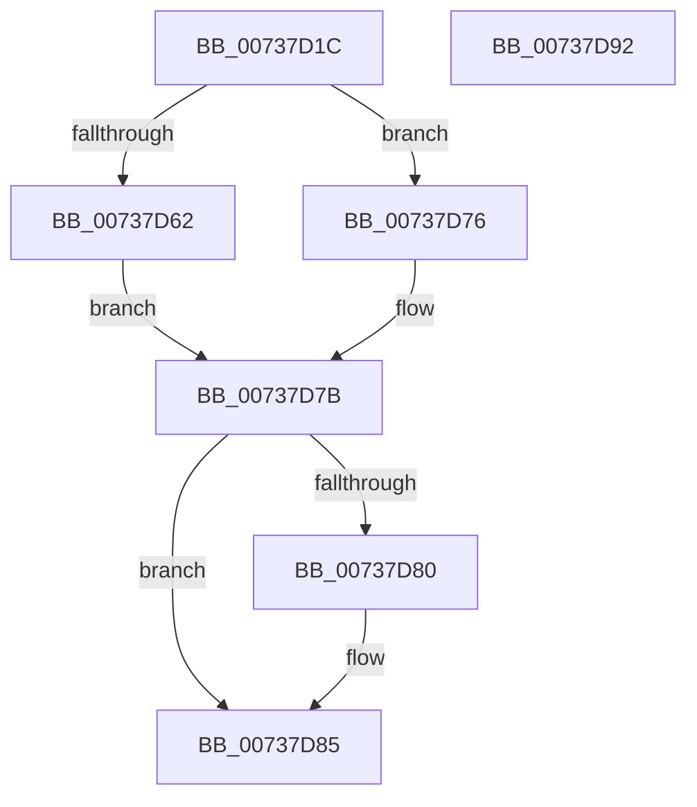

# IopCreateRootEnumeratedDeviceObject

- RVA: `0x00737D1C`–`0x00737D93` (길이 `119` bytes)
- VA: `0x0000000140737D1C`
- 실행 섹션: `PAGE`
- PDB 이름 있음: `예`; PDB Function 태그: `아니요`
- unwind 정보 RVA: `0x000718C0`
- 디코드: `35`개 명령, `119/119` bytes 표시
- 미해석 바이트: `0` (있으면 어셈블리에 `.byte`로 보존)

> 이 문서는 커널 이미지의 기계어와 PDB 기호를 분석해 생성했습니다. 4번과 5번은 함수 원형과 자료형을 바이너리 사용 방식에서 추정한 C 해석이며 원본 소스 복구 결과는 아닙니다.

## 1. Dependencies

- 직접 호출 지점: **2**; 고유 호출 대상: **2**
- 직접 호출자로 확인된 함수: **4**
- RIP 상대 이미지 참조: **1**

### Outgoing calls
- `0x00737D57` → [IoCreateDevice](../9A/IoCreateDevice_function_009A4B00.md) (function, `0x009A4B00`)
- `0x00737D80` → [IoDeleteDevice](../../text/26/IoDeleteDevice_function_0026FE90.md) (function, `0x0026FE90`)

### Direct callers
- [IoReportDetectedDevice](../72/IoReportDetectedDevice_function_00725CD0.md) at `0x00726104`
- [PiInitializeDevice](PiInitializeDevice_function_0073EC5C.md) at `0x0073EE69`
- [IopFindLegacyDeviceNode](../AC/IopFindLegacyDeviceNode_function_00AC7338.md) at `0x00AC7438`
- [sub_00B420B0](../B4/Unknown_function_00B420B0.md) at `0x00B4210C`

### Static image references
- `0x00737D42` → RVA `0x00F8C440` (`.data`; read)

## 2. Other-region calls and transfers

- 다른 실행 섹션으로 향하는 call: **1**
  - `0x00737D80` → [IoDeleteDevice](../../text/26/IoDeleteDevice_function_0026FE90.md) (`PAGE` → `.text`)
- 별도 외부 분기/꼬리 이동을 확인하지 못했습니다.

## 3. Assembly (complete function range)

```asm
00737D1C  4C 8B DC                        mov r11, rsp
00737D1F  49 89 5B 08                     mov qword ptr [r11 + 8], rbx
00737D23  57                              push rdi
00737D24  48 83 EC 40                     sub rsp, 0x40
00737D28  49 83 63 10 00                  and qword ptr [r11 + 0x10], 0
00737D2D  49 8D 43 10                     lea rax, [r11 + 0x10]
00737D31  49 89 43 E8                     mov qword ptr [r11 - 0x18], rax
00737D35  BA 04 00 00 00                  mov edx, 4
00737D3A  48 8B F9                        mov rdi, rcx
00737D3D  C6 44 24 28 00                  mov byte ptr [rsp + 0x28], 0
00737D42  48 8B 0D F7 46 85 00            mov rcx, qword ptr [rip + 0x8546f7]
00737D49  44 8B CA                        mov r9d, edx
00737D4C  45 33 C0                        xor r8d, r8d
00737D4F  C7 44 24 20 80 00 00 00         mov dword ptr [rsp + 0x20], 0x80
00737D57  E8 A4 CD 26 00                  call 0x1409a4b00
00737D5C  8B D8                           mov ebx, eax
00737D5E  85 C0                           test eax, eax
00737D60  78 14                           js 0x140737d76
00737D62  48 8B 54 24 58                  mov rdx, qword ptr [rsp + 0x58]
00737D67  33 C0                           xor eax, eax
00737D69  48 89 17                        mov qword ptr [rdi], rdx
00737D6C  48 8B 4A 40                     mov rcx, qword ptr [rdx + 0x40]
00737D70  89 01                           mov dword ptr [rcx], eax
00737D72  33 C9                           xor ecx, ecx
00737D74  EB 05                           jmp 0x140737d7b
00737D76  48 8B 4C 24 58                  mov rcx, qword ptr [rsp + 0x58]
00737D7B  48 85 C9                        test rcx, rcx
00737D7E  74 05                           je 0x140737d85
00737D80  E8 0B 81 B3 FF                  call 0x14026fe90
00737D85  8B C3                           mov eax, ebx
00737D87  48 8B 5C 24 50                  mov rbx, qword ptr [rsp + 0x50]
00737D8C  48 83 C4 40                     add rsp, 0x40
00737D90  5F                              pop rdi
00737D91  C3                              ret
00737D92  CC                              int3
```

## 4. C-style interpretation (structured pseudocode)

```c
__int64 __fastcall IopCreateRootEnumeratedDeviceObject(__int64 a1, __int64 a2, int a3)
{
    __int64 result;
    __int64 v_rsp;
    unsigned __int8 v_stack_m20;
    unsigned int v_stack_m28;
    unsigned __int64 v_stack_p10;
    unsigned __int64 v_stack_p8;

    *(unsigned __int64 *)(v_rsp + 8) = v_rbx;
    v_rsp = (v_rsp) - (64);
    *(unsigned __int64 *)(v_rsp - 24) = v_rsp + 16;
    v_stack_m20 = 0;
    a3 = 0;
    v_stack_m28 = 128;
    result = IoCreateDevice(*(unsigned __int64 *)(v_rip + 8734455), 4, a3, 4);
    if (sign_flag) goto loc_00737D76;
    result = 0;
    *(unsigned __int64 *)(a1) = v_stack_p10;
    *(unsigned int *)(*(unsigned __int64 *)(v_stack_p10 + 64)) = 0;
    a1 = 0;
    goto loc_00737D7B;
loc_00737D76:
loc_00737D7B:
    if (v_stack_p10 != 0) {
        result = IoDeleteDevice(v_stack_p10, v_stack_p10, a3, 4);
    }
    v_rsp = (v_rsp) + (64);
    return (unsigned int)((unsigned int)((unsigned int)((unsigned int)(result))));
}
```

## 5. (Beta) C Style

```c
int64_t IopCreateRootEnumeratedDeviceObject(void *Arg1, int64_t Arg2, int32_t Arg3)
{
    uint8_t *arg1 = (uint8_t *)Arg1;

    int64_t result;
    int64_t local_rsp;
    uint8_t v_stack_m20;
    uint32_t v_stack_m28;
    uint64_t v_stack_p10;
    uint64_t v_stack_p8;

    *(uint64_t *)(local_rsp + 0x8) = local_rbx;
    local_rsp = (local_rsp) - (64);
    *(uint64_t *)(local_rsp - 0x18) = local_rsp + 16;
    v_stack_m20 = 0;
    Arg3 = 0;
    v_stack_m28 = 128;
    result = IoCreateDevice(*(uint64_t *)(v_rip + 0x8546F7), 4, Arg3, 4);
    if (sign_flag) goto loc_00737D76;
    result = 0;
    *(uint64_t *)(arg1) = v_stack_p10;
    *(uint32_t *)(*(uint64_t *)(v_stack_p10 + 0x40)) = 0;
    Arg1 = 0;
    goto loc_00737D7B;
loc_00737D76:
loc_00737D7B:
    if (v_stack_p10 != 0) {
        result = IoDeleteDevice(v_stack_p10, v_stack_p10, Arg3, 4);
    }
    local_rsp = (local_rsp) + (64);
    return (uint32_t)((uint32_t)((uint32_t)((uint32_t)(result))));
}
```

### 관측된 메모리 오프셋

구조체 형식이 확인되지 않은 접근은 인자 기준의 오프셋으로만 기록했습니다.

| 기준 인자 | 오프셋 표현 | 폭 (bit) | 접근 |
|---|---:|---:|---|
| `Arg1` | `+ 0x0` | `64` | `W` |

## 6. Execution-region graph

[열기: 2D/3D 그래프와 함수 탐색 컨트롤 패널](../../../control-panel.html?section=page&rva=0x00737D1C&view=graph)

- 2D 그래프는 위에서 아래로 흐르고, 3D 그래프는 빈 공간을 드래그해 회전합니다. Shift+드래그는 이동, 휠은 확대·축소, 함수 노드 선택은 대상 보고서 이동입니다.

### Static fallback


