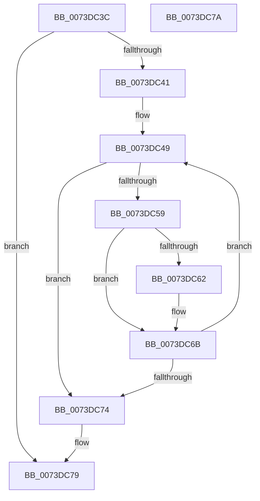

# IopDecDisableableDepends

- RVA: `0x0073DC3C`–`0x0073DC7B` (길이 `63` bytes)
- VA: `0x000000014073DC3C`
- 실행 섹션: `PAGE`
- PDB 이름 있음: `예`; PDB Function 태그: `아니요`
- unwind 정보 RVA: `0x000805BC`
- 디코드: `21`개 명령, `63/63` bytes 표시
- 미해석 바이트: `0` (있으면 어셈블리에 `.byte`로 보존)

> 이 문서는 커널 이미지의 기계어와 PDB 기호를 분석해 생성했습니다. 4번과 5번은 함수 원형과 자료형을 바이너리 사용 방식에서 추정한 C 해석이며 원본 소스 복구 결과는 아닙니다.

## 1. Dependencies

- 직접 호출 지점: **1**; 고유 호출 대상: **1**
- 직접 호출자로 확인된 함수: **2**
- RIP 상대 이미지 참조: **0**

### Outgoing calls
- `0x0073DC66` → [PnpRaiseNtPlugPlayDevicePropertyChangeEvent](../8F/PnpRaiseNtPlugPlayDevicePropertyChangeEvent_function_008F7D80.md) (function, `0x008F7D80`)

### Direct callers
- [PiProcessQueryDeviceState](../8F/PiProcessQueryDeviceState_function_008FA0F8.md) at `0x008FA2D7`
- [IopRemoveDevice](../8F/IopRemoveDevice_function_008FC7FC.md) at `0x008FCA21`

### Static image references
- 디코드된 RIP-relative 메모리 참조가 없습니다.

## 2. Other-region calls and transfers

- 다른 실행 섹션으로 향하는 call: **0**
- 별도 외부 분기/꼬리 이동을 확인하지 못했습니다.

## 3. Assembly (complete function range)

```asm
0073DC3C  48 85 C9                        test rcx, rcx
0073DC3F  74 38                           je 0x14073dc79
0073DC41  53                              push rbx
0073DC42  48 83 EC 20                     sub rsp, 0x20
0073DC46  48 8B D9                        mov rbx, rcx
0073DC49  83 C8 FF                        or eax, 0xffffffff
0073DC4C  F0 0F C1 83 58 02 00 00         lock xadd dword ptr [rbx + 0x258], eax
0073DC54  83 F8 01                        cmp eax, 1
0073DC57  75 1B                           jne 0x14073dc74
0073DC59  48 8B 53 30                     mov rdx, qword ptr [rbx + 0x30]
0073DC5D  48 85 D2                        test rdx, rdx
0073DC60  74 09                           je 0x14073dc6b
0073DC62  44 8D 40 0A                     lea r8d, [rax + 0xa]
0073DC66  E8 15 A1 1B 00                  call 0x1408f7d80
0073DC6B  48 8B 5B 10                     mov rbx, qword ptr [rbx + 0x10]
0073DC6F  48 85 DB                        test rbx, rbx
0073DC72  75 D5                           jne 0x14073dc49
0073DC74  48 83 C4 20                     add rsp, 0x20
0073DC78  5B                              pop rbx
0073DC79  C3                              ret
0073DC7A  CC                              int3
```

## 4. C-style interpretation (structured pseudocode)

```c
__int64 __fastcall IopDecDisableableDepends(__int64 a1)
{
    __int64 result;
    __int64 v_rsp;

    if (a1 == 0) goto loc_0073DC79;
    v_rsp = (v_rsp) - (32);
loc_0073DC49:
    result = (unsigned int)((result) | (0xFFFFFFFFULL));
    if (((unsigned int)(result)) != 1) goto loc_0073DC74;
    if (*(unsigned __int64 *)(a1 + 48) != 0) {
        a3 = result + 10;
        result = PnpRaiseNtPlugPlayDevicePropertyChangeEvent(a1, *(unsigned __int64 *)(a1 + 48), a3, a4);
    }
    if (*(unsigned __int64 *)(a1 + 16) != 0) goto loc_0073DC49;
loc_0073DC74:
    v_rsp = (v_rsp) + (32);
loc_0073DC79:
    return result;
}
```

## 5. (Beta) C Style

```c
int64_t IopDecDisableableDepends(int64_t Arg1)
{
    int64_t result;
    int64_t local_rsp;

    if (Arg1 == 0) goto loc_0073DC79;
    local_rsp = (local_rsp) - (32);
loc_0073DC49:
    result = (uint32_t)((result) | (0xFFFFFFFFULL));
    if (((uint32_t)(result)) != 1) goto loc_0073DC74;
    if (*(uint64_t *)(Arg1 + 0x30) != 0) {
        a3 = result + 10;
        result = PnpRaiseNtPlugPlayDevicePropertyChangeEvent(Arg1, *(uint64_t *)(Arg1 + 0x30), a3, a4);
    }
    if (*(uint64_t *)(Arg1 + 0x10) != 0) goto loc_0073DC49;
loc_0073DC74:
    local_rsp = (local_rsp) + (32);
loc_0073DC79:
    return result;
}
```

## 6. Execution-region graph

[열기: 2D/3D 그래프와 함수 탐색 컨트롤 패널](../../../control-panel.html?section=page&rva=0x0073DC3C&view=graph)

- 2D 그래프는 위에서 아래로 흐르고, 3D 그래프는 빈 공간을 드래그해 회전합니다. Shift+드래그는 이동, 휠은 확대·축소, 함수 노드 선택은 대상 보고서 이동입니다.

### Static fallback


