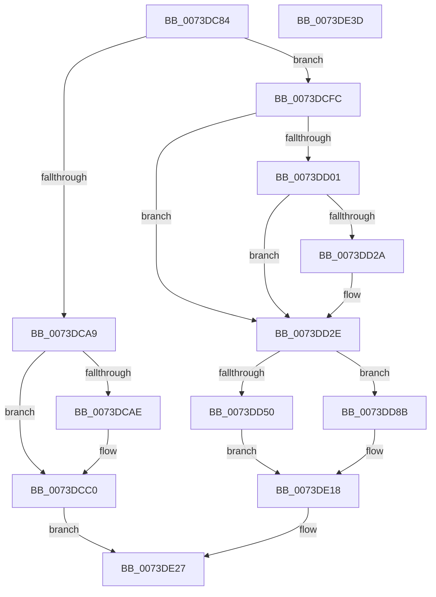

# IopEjectDevice

- RVA: `0x0073DC84`–`0x0073DE3E` (길이 `442` bytes)
- VA: `0x000000014073DC84`
- 실행 섹션: `PAGE`
- PDB 이름 있음: `예`; PDB Function 태그: `아니요`
- unwind 정보 RVA: `0x000C90FC`
- 디코드: `108`개 명령, `442/442` bytes 표시
- 미해석 바이트: `0` (있으면 어셈블리에 `.byte`로 보존)

> 이 문서는 커널 이미지의 기계어와 PDB 기호를 분석해 생성했습니다. 4번과 5번은 함수 원형과 자료형을 바이너리 사용 방식에서 추정한 C 해석이며 원본 소스 복구 결과는 아닙니다.

## 1. Dependencies

- 직접 호출 지점: **14**; 고유 호출 대상: **9**
- 직접 호출자로 확인된 함수: **1**
- RIP 상대 이미지 참조: **2**

### Outgoing calls
- `0x0073DCBB` → [guard_dispatch_icall](../../text/6B/guard_dispatch_icall_function_006BAAD0.md) (function, `0x006BAAD0`)
- `0x0073DCCF` → [PnpQueuePendingEject](../72/PnpQueuePendingEject_function_0072D334.md) (function, `0x0072D334`)
- `0x0073DCF0` → [ExQueueWorkItem](../../text/2F/ExQueueWorkItem_function_002F9520.md) (function, `0x002F9520`)
- `0x0073DD0E` → [guard_dispatch_icall](../../text/6B/guard_dispatch_icall_function_006BAAD0.md) (function, `0x006BAAD0`)
- `0x0073DD1F` → [guard_dispatch_icall](../../text/6B/guard_dispatch_icall_function_006BAAD0.md) (function, `0x006BAAD0`)
- `0x0073DD36` → [IoGetAttachedDeviceReferenceWithTag](../../text/27/IoGetAttachedDeviceReferenceWithTag_function_00273B84.md) (function, `0x00273B84`)
- `0x0073DD43` → [IoAllocateIrp](../../text/20/IoAllocateIrp_function_002065D0.md) (function, `0x002065D0`)
- `0x0073DD5E` → [PnpQueuePendingEject](../72/PnpQueuePendingEject_function_0072D334.md) (function, `0x0072D334`)
- `0x0073DD7C` → [ExQueueWorkItem](../../text/2F/ExQueueWorkItem_function_002F9520.md) (function, `0x002F9520`)
- `0x0073DD93` → [IovUtilWatermarkIrp](../../text/48/IovUtilWatermarkIrp_function_0048E1A4.md) (function, `0x0048E1A4`)
- `0x0073DDB9` → [memset](../../text/6C/memset_function_006C6C40.md) (function, `0x006C6C40`)
- `0x0073DDEC` → [PnpQueuePendingEject](../72/PnpQueuePendingEject_function_0072D334.md) (function, `0x0072D334`)
- `0x0073DE11` → [IofCallDriver](../../text/29/IofCallDriver_function_0029B4B0.md) (function, `0x0029B4B0`)
- `0x0073DE20` → [ObfDereferenceObjectWithTag](../../text/2F/ObfDereferenceObjectWithTag_function_002F78E0.md) (function, `0x002F78E0`)

### Direct callers
- [sub_00B33FE8](../B3/Unknown_function_00B33FE8.md) at `0x00B34444`

### Static image references
- `0x0073DCE1` → RVA `0x0072D090` (`PnpProcessCompletedEject`; read)
- `0x0073DDF8` → RVA `0x005AA4E0` (`IopDeviceEjectComplete`; read)

## 2. Other-region calls and transfers

- 다른 실행 섹션으로 향하는 call: **11**
  - `0x0073DCBB` → [guard_dispatch_icall](../../text/6B/guard_dispatch_icall_function_006BAAD0.md) (`PAGE` → `.text`)
  - `0x0073DCF0` → [ExQueueWorkItem](../../text/2F/ExQueueWorkItem_function_002F9520.md) (`PAGE` → `.text`)
  - `0x0073DD0E` → [guard_dispatch_icall](../../text/6B/guard_dispatch_icall_function_006BAAD0.md) (`PAGE` → `.text`)
  - `0x0073DD1F` → [guard_dispatch_icall](../../text/6B/guard_dispatch_icall_function_006BAAD0.md) (`PAGE` → `.text`)
  - `0x0073DD36` → [IoGetAttachedDeviceReferenceWithTag](../../text/27/IoGetAttachedDeviceReferenceWithTag_function_00273B84.md) (`PAGE` → `.text`)
  - `0x0073DD43` → [IoAllocateIrp](../../text/20/IoAllocateIrp_function_002065D0.md) (`PAGE` → `.text`)
  - `0x0073DD7C` → [ExQueueWorkItem](../../text/2F/ExQueueWorkItem_function_002F9520.md) (`PAGE` → `.text`)
  - `0x0073DD93` → [IovUtilWatermarkIrp](../../text/48/IovUtilWatermarkIrp_function_0048E1A4.md) (`PAGE` → `.text`)
  - `0x0073DDB9` → [memset](../../text/6C/memset_function_006C6C40.md) (`PAGE` → `.text`)
  - `0x0073DE11` → [IofCallDriver](../../text/29/IofCallDriver_function_0029B4B0.md) (`PAGE` → `.text`)
  - `0x0073DE20` → [ObfDereferenceObjectWithTag](../../text/2F/ObfDereferenceObjectWithTag_function_002F78E0.md) (`PAGE` → `.text`)
- 별도 외부 분기/꼬리 이동을 확인하지 못했습니다.

## 3. Assembly (complete function range)

```asm
0073DC84  48 89 5C 24 08                  mov qword ptr [rsp + 8], rbx
0073DC89  48 89 6C 24 10                  mov qword ptr [rsp + 0x10], rbp
0073DC8E  48 89 7C 24 18                  mov qword ptr [rsp + 0x18], rdi
0073DC93  41 56                           push r14
0073DC95  48 83 EC 20                     sub rsp, 0x20
0073DC99  83 7A 5C 01                     cmp dword ptr [rdx + 0x5c], 1
0073DC9D  48 8B D9                        mov rbx, rcx
0073DCA0  48 8B 4A 60                     mov rcx, qword ptr [rdx + 0x60]
0073DCA4  48 8B FA                        mov rdi, rdx
0073DCA7  74 53                           je 0x14073dcfc
0073DCA9  48 85 C9                        test rcx, rcx
0073DCAC  74 12                           je 0x14073dcc0
0073DCAE  48 8B 41 20                     mov rax, qword ptr [rcx + 0x20]
0073DCB2  BA 04 00 00 00                  mov edx, 4
0073DCB7  48 8B 49 08                     mov rcx, qword ptr [rcx + 8]
0073DCBB  E8 10 CE F7 FF                  call 0x1406baad0
0073DCC0  48 83 67 48 00                  and qword ptr [rdi + 0x48], 0
0073DCC5  48 8B CF                        mov rcx, rdi
0073DCC8  48 89 7F 08                     mov qword ptr [rdi + 8], rdi
0073DCCC  48 89 3F                        mov qword ptr [rdi], rdi
0073DCCF  E8 60 F6 FE FF                  call 0x14072d334
0073DCD4  48 8D 4F 10                     lea rcx, [rdi + 0x10]
0073DCD8  BA 01 00 00 00                  mov edx, 1
0073DCDD  48 83 21 00                     and qword ptr [rcx], 0
0073DCE1  48 8D 05 A8 F3 FE FF            lea rax, [rip - 0x10c58]
0073DCE8  48 89 41 10                     mov qword ptr [rcx + 0x10], rax
0073DCEC  48 89 79 18                     mov qword ptr [rcx + 0x18], rdi
0073DCF0  E8 2B B8 BB FF                  call 0x1402f9520
0073DCF5  33 C0                           xor eax, eax
0073DCF7  E9 2B 01 00 00                  jmp 0x14073de27
0073DCFC  48 85 C9                        test rcx, rcx
0073DCFF  74 2D                           je 0x14073dd2e
0073DD01  48 8B 41 20                     mov rax, qword ptr [rcx + 0x20]
0073DD05  BA 03 00 00 00                  mov edx, 3
0073DD0A  48 8B 49 08                     mov rcx, qword ptr [rcx + 8]
0073DD0E  E8 BD CD F7 FF                  call 0x1406baad0
0073DD13  48 8B 4F 60                     mov rcx, qword ptr [rdi + 0x60]
0073DD17  48 8B 41 28                     mov rax, qword ptr [rcx + 0x28]
0073DD1B  48 8B 49 08                     mov rcx, qword ptr [rcx + 8]
0073DD1F  E8 AC CD F7 FF                  call 0x1406baad0
0073DD24  80 7F 59 00                     cmp byte ptr [rdi + 0x59], 0
0073DD28  74 04                           je 0x14073dd2e
0073DD2A  C6 47 59 00                     mov byte ptr [rdi + 0x59], 0
0073DD2E  BA 50 6E 70 69                  mov edx, 0x69706e50
0073DD33  48 8B CB                        mov rcx, rbx
0073DD36  E8 49 5E B3 FF                  call 0x140273b84
0073DD3B  33 D2                           xor edx, edx
0073DD3D  4C 8B F0                        mov r14, rax
0073DD40  8A 48 4C                        mov cl, byte ptr [rax + 0x4c]
0073DD43  E8 88 88 AC FF                  call 0x1402065d0
0073DD48  48 8B E8                        mov rbp, rax
0073DD4B  48 85 C0                        test rax, rax
0073DD4E  75 3B                           jne 0x14073dd8b
0073DD50  48 21 47 48                     and qword ptr [rdi + 0x48], rax
0073DD54  48 8B CF                        mov rcx, rdi
0073DD57  48 89 7F 08                     mov qword ptr [rdi + 8], rdi
0073DD5B  48 89 3F                        mov qword ptr [rdi], rdi
0073DD5E  E8 D1 F5 FE FF                  call 0x14072d334
0073DD63  48 8D 4F 10                     lea rcx, [rdi + 0x10]
0073DD67  48 21 29                        and qword ptr [rcx], rbp
0073DD6A  48 8D 05 1F F3 FE FF            lea rax, [rip - 0x10ce1]
0073DD71  8D 55 01                        lea edx, [rbp + 1]
0073DD74  48 89 41 10                     mov qword ptr [rcx + 0x10], rax
0073DD78  48 89 79 18                     mov qword ptr [rcx + 0x18], rdi
0073DD7C  E8 9F B7 BB FF                  call 0x1402f9520
0073DD81  BB 9A 00 00 C0                  mov ebx, 0xc000009a
0073DD86  E9 8D 00 00 00                  jmp 0x14073de18
0073DD8B  BA 01 00 00 00                  mov edx, 1
0073DD90  48 8B CD                        mov rcx, rbp
0073DD93  E8 0C 04 D5 FF                  call 0x14048e1a4
0073DD98  48 8B 9D B8 00 00 00            mov rbx, qword ptr [rbp + 0xb8]
0073DD9F  41 B8 48 00 00 00               mov r8d, 0x48
0073DDA5  48 83 65 38 00                  and qword ptr [rbp + 0x38], 0
0073DDAA  49 2B D8                        sub rbx, r8
0073DDAD  48 8B CB                        mov rcx, rbx
0073DDB0  C7 45 30 BB 00 00 C0            mov dword ptr [rbp + 0x30], 0xc00000bb
0073DDB7  33 D2                           xor edx, edx
0073DDB9  E8 82 8E F8 FF                  call 0x1406c6c40
0073DDBE  66 C7 03 1B 11                  mov word ptr [rbx], 0x111b
0073DDC3  48 8B CF                        mov rcx, rdi
0073DDC6  65 48 8B 04 25 88 01 00 00      mov rax, qword ptr gs:[0x188]
0073DDCF  48 83 65 48 00                  and qword ptr [rbp + 0x48], 0
0073DDD4  48 83 65 50 00                  and qword ptr [rbp + 0x50], 0
0073DDD9  48 89 85 98 00 00 00            mov qword ptr [rbp + 0x98], rax
0073DDE0  C6 45 40 00                     mov byte ptr [rbp + 0x40], 0
0073DDE4  83 67 50 00                     and dword ptr [rdi + 0x50], 0
0073DDE8  48 89 6F 48                     mov qword ptr [rdi + 0x48], rbp
0073DDEC  E8 43 F5 FE FF                  call 0x14072d334
0073DDF1  48 8B 85 B8 00 00 00            mov rax, qword ptr [rbp + 0xb8]
0073DDF8  48 8D 0D E1 C6 E6 FF            lea rcx, [rip - 0x19391f]
0073DDFF  48 8B D5                        mov rdx, rbp
0073DE02  48 89 48 F0                     mov qword ptr [rax - 0x10], rcx
0073DE06  49 8B CE                        mov rcx, r14
0073DE09  48 89 78 F8                     mov qword ptr [rax - 8], rdi
0073DE0D  C6 40 BB E0                     mov byte ptr [rax - 0x45], 0xe0
0073DE11  E8 9A D6 B5 FF                  call 0x14029b4b0
0073DE16  8B D8                           mov ebx, eax
0073DE18  BA 50 6E 70 69                  mov edx, 0x69706e50
0073DE1D  49 8B CE                        mov rcx, r14
0073DE20  E8 BB 9A BB FF                  call 0x1402f78e0
0073DE25  8B C3                           mov eax, ebx
0073DE27  48 8B 5C 24 30                  mov rbx, qword ptr [rsp + 0x30]
0073DE2C  48 8B 6C 24 38                  mov rbp, qword ptr [rsp + 0x38]
0073DE31  48 8B 7C 24 40                  mov rdi, qword ptr [rsp + 0x40]
0073DE36  48 83 C4 20                     add rsp, 0x20
0073DE3A  41 5E                           pop r14
0073DE3C  C3                              ret
0073DE3D  CC                              int3
```

## 4. C-style interpretation (structured pseudocode)

```c
__int64 __fastcall IopEjectDevice(__int64 a1, __int64 a2)
{
    __int64 result;
    __int64 v_rbx;
    __int64 v_rsp;
    unsigned __int64 v_stack_p10;
    unsigned __int64 v_stack_p18;
    unsigned __int64 v_stack_p8;

    v_stack_p8 = v_rbx;
    v_stack_p10 = v_rbp;
    v_stack_p18 = v_rdi;
    v_rsp = (v_rsp) - (32);
    if ((*(unsigned int *)(a2 + 92)) == 1) goto loc_0073DCFC;
    if (*(unsigned __int64 *)(a2 + 96) != 0) {
        result = *(unsigned __int64 *)(*(unsigned __int64 *)(a2 + 96) + 32);
        a2 = 4;
        a1 = *(unsigned __int64 *)(*(unsigned __int64 *)(a2 + 96) + 8);
        result = guard_dispatch_icall(a1, a2, a3, a4);
    }
    *(unsigned __int64 *)(a2 + 8) = a2;
    *(unsigned __int64 *)(a2) = a2;
    result = PnpQueuePendingEject(a2, a2, a3, a4);
    *(unsigned __int64 *)(a2 + 16 + 16) = v_rip - 68696;
    *(unsigned __int64 *)(a2 + 16 + 24) = a2;
    result = ExQueueWorkItem(a2 + 16, 1, a3, a4);
    result = 0;
    goto loc_0073DE27;
loc_0073DCFC:
    if (a2 + 16 == 0) goto loc_0073DD2E;
    result = guard_dispatch_icall(*(unsigned __int64 *)(a2 + 16 + 8), 3, a3, a4);
    result = guard_dispatch_icall(*(unsigned __int64 *)(*(unsigned __int64 *)(a2 + 96) + 8), 3, a3, a4);
    if ((*(unsigned __int8 *)(a2 + 89)) != 0) {
        *(unsigned __int8 *)(a2 + 89) = 0;
    }
    result = IoGetAttachedDeviceReferenceWithTag(a1, (unsigned int)(0x69706E50ULL), a3, a4);
    a2 = 0;
    result = IoAllocateIrp(*(unsigned __int8 *)(result + 76), a2, a3, a4);
    if (result != 0) goto loc_0073DD8B;
    *(unsigned __int64 *)(a2 + 8) = 0;
    *(unsigned __int64 *)(a2) = 0;
    result = PnpQueuePendingEject(0, a2, a3, a4);
    *(unsigned __int64 *)(a2 + 16 + 16) = v_rip - 68833;
    *(unsigned __int64 *)(a2 + 16 + 24) = 0;
    result = ExQueueWorkItem(a2 + 16, result + 1, a3, a4);
    goto loc_0073DE18;
loc_0073DD8B:
    result = IovUtilWatermarkIrp(result, 1, a3, a4);
    v_rbx = (*(unsigned __int64 *)(result + 184)) - (72);
    *(unsigned int *)(result + 48) = 0xC00000BBULL;
    a2 = 0;
    result = memset(v_rbx, a2, 72, a4);
    *(unsigned __int16 *)(v_rbx) = 0x111BULL;
    *(unsigned __int64 *)(result + 152) = *(unsigned __int64 *)(gs_base + (0 + 392));
    *(unsigned __int8 *)(result + 64) = 0;
    *(unsigned __int64 *)(a2 + 72) = result;
    result = PnpQueuePendingEject(0, a2, 72, a4);
    *(unsigned __int64 *)(*(unsigned __int64 *)(result + 184) - 16) = v_rip - 1653023;
    *(unsigned __int64 *)(*(unsigned __int64 *)(result + 184) - 8) = 0;
    *(unsigned __int8 *)(*(unsigned __int64 *)(result + 184) - 69) = 224;
    result = IofCallDriver(result, result, 72, a4);
loc_0073DE18:
    result = ObfDereferenceObjectWithTag(result, (unsigned int)(0x69706E50ULL), 72, a4);
loc_0073DE27:
    v_rsp = (v_rsp) + (32);
    return (unsigned int)((unsigned int)((unsigned int)((unsigned int)(result))));
}
```

## 5. (Beta) C Style

```c
int64_t IopEjectDevice(int64_t Arg1, void *Arg2)
{
    uint8_t *arg2 = (uint8_t *)Arg2;

    int64_t result;
    int64_t local_rbx;
    int64_t local_rsp;
    uint64_t v_stack_p10;
    uint64_t v_stack_p18;
    uint64_t v_stack_p8;

    v_stack_p8 = local_rbx;
    v_stack_p10 = local_rbp;
    v_stack_p18 = local_rdi;
    local_rsp = (local_rsp) - (32);
    if ((*(uint32_t *)(arg2 + 0x5C)) == 1) goto loc_0073DCFC;
    if (*(uint64_t *)(arg2 + 0x60) != 0) {
        result = *(uint64_t *)(*(uint64_t *)(arg2 + 0x60) + 0x20);
        Arg2 = 4;
        Arg1 = *(uint64_t *)(*(uint64_t *)(arg2 + 0x60) + 0x8);
        result = guard_dispatch_icall(Arg1, Arg2, a3, a4);
    }
    *(void **)(arg2 + 0x8) = Arg2;
    *(void **)(arg2) = Arg2;
    result = PnpQueuePendingEject(Arg2, Arg2, a3, a4);
    *(uint64_t *)(arg2 + 0x10 + 0x10) = v_rip - 68696;
    *(void **)(arg2 + 0x10 + 0x18) = Arg2;
    result = ExQueueWorkItem(Arg2 + 16, 1, a3, a4);
    result = 0;
    goto loc_0073DE27;
loc_0073DCFC:
    if (Arg2 + 16 == 0) goto loc_0073DD2E;
    result = guard_dispatch_icall(*(uint64_t *)(arg2 + 0x10 + 0x8), 3, a3, a4);
    result = guard_dispatch_icall(*(uint64_t *)(*(uint64_t *)(arg2 + 0x60) + 0x8), 3, a3, a4);
    if ((*(uint8_t *)(arg2 + 0x59)) != 0) {
        *(uint8_t *)(arg2 + 0x59) = 0;
    }
    result = IoGetAttachedDeviceReferenceWithTag(Arg1, (uint32_t)(0x69706E50ULL), a3, a4);
    Arg2 = 0;
    result = IoAllocateIrp(*(uint8_t *)(result + 0x4C), Arg2, a3, a4);
    if (result != 0) goto loc_0073DD8B;
    *(uint64_t *)(arg2 + 0x8) = 0;
    *(uint64_t *)(arg2) = 0;
    result = PnpQueuePendingEject(0, Arg2, a3, a4);
    *(uint64_t *)(arg2 + 0x10 + 0x10) = v_rip - 68833;
    *(uint64_t *)(arg2 + 0x10 + 0x18) = 0;
    result = ExQueueWorkItem(Arg2 + 16, result + 1, a3, a4);
    goto loc_0073DE18;
loc_0073DD8B:
    result = IovUtilWatermarkIrp(result, 1, a3, a4);
    local_rbx = (*(uint64_t *)(result + 0xB8)) - (72);
    *(uint32_t *)(result + 0x30) = 0xC00000BBULL;
    Arg2 = 0;
    result = memset(local_rbx, Arg2, 72, a4);
    *(uint16_t *)(local_rbx) = 0x111BULL;
    *(uint64_t *)(result + 0x98) = *(uint64_t *)(gs_base + (0 + 0x188));
    *(uint8_t *)(result + 0x40) = 0;
    *(uint64_t *)(arg2 + 0x48) = result;
    result = PnpQueuePendingEject(0, Arg2, 72, a4);
    *(uint64_t *)(*(uint64_t *)(result + 0xB8) - 0x10) = v_rip - 1653023;
    *(uint64_t *)(*(uint64_t *)(result + 0xB8) - 0x8) = 0;
    *(uint8_t *)(*(uint64_t *)(result + 0xB8) - 0x45) = 224;
    result = IofCallDriver(result, result, 72, a4);
loc_0073DE18:
    result = ObfDereferenceObjectWithTag(result, (uint32_t)(0x69706E50ULL), 72, a4);
loc_0073DE27:
    local_rsp = (local_rsp) + (32);
    return (uint32_t)((uint32_t)((uint32_t)((uint32_t)(result))));
}
```

### 관측된 메모리 오프셋

구조체 형식이 확인되지 않은 접근은 인자 기준의 오프셋으로만 기록했습니다.

| 기준 인자 | 오프셋 표현 | 폭 (bit) | 접근 |
|---|---:|---:|---|
| `Arg2` | `+ 0x0` | `64` | `R/W` |
| `Arg2` | `+ 0x0` | `64` | `W` |
| `Arg2` | `+ 0x8` | `64` | `W` |
| `Arg2` | `+ 0x10` | `64` | `R` |
| `Arg2` | `+ 0x10` | `64` | `W` |
| `Arg2` | `+ 0x18` | `64` | `W` |
| `Arg2` | `+ 0x48` | `64` | `R/W` |
| `Arg2` | `+ 0x48` | `64` | `W` |
| `Arg2` | `+ 0x50` | `32` | `R/W` |
| `Arg2` | `+ 0x59` | `8` | `R` |
| `Arg2` | `+ 0x59` | `8` | `W` |
| `Arg2` | `+ 0x5C` | `32` | `R` |
| `Arg2` | `+ 0x60` | `64` | `R` |

## 6. Execution-region graph

[열기: 2D/3D 그래프와 함수 탐색 컨트롤 패널](../../../control-panel.html?section=page&rva=0x0073DC84&view=graph)

- 2D 그래프는 위에서 아래로 흐르고, 3D 그래프는 빈 공간을 드래그해 회전합니다. Shift+드래그는 이동, 휠은 확대·축소, 함수 노드 선택은 대상 보고서 이동입니다.

### Static fallback


